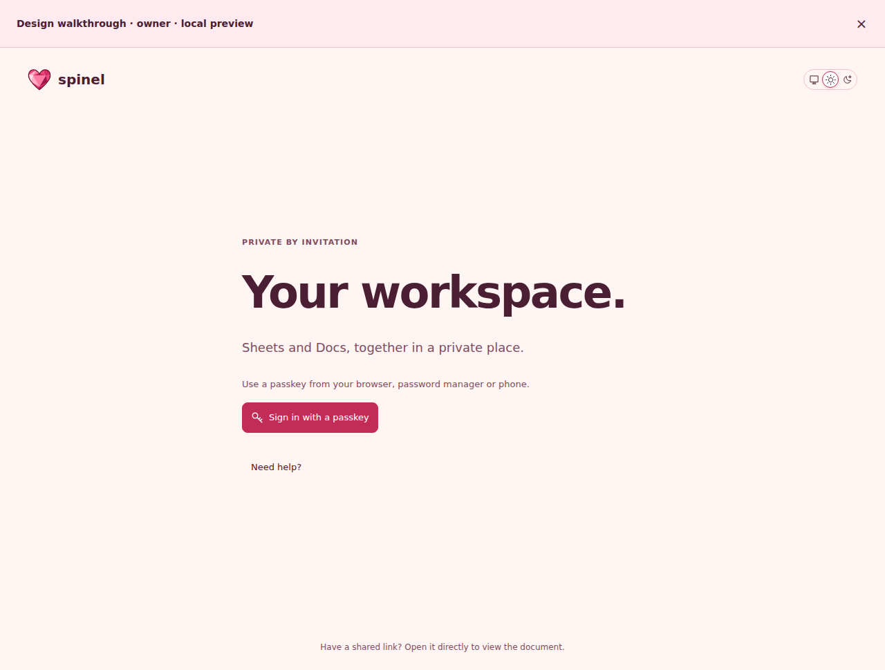
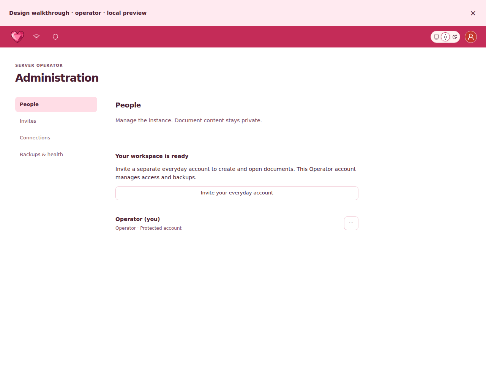
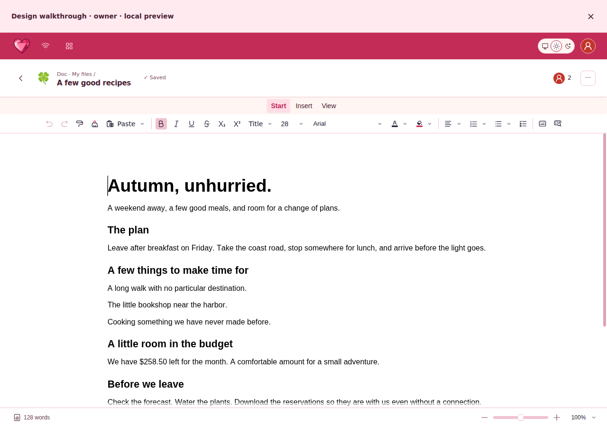
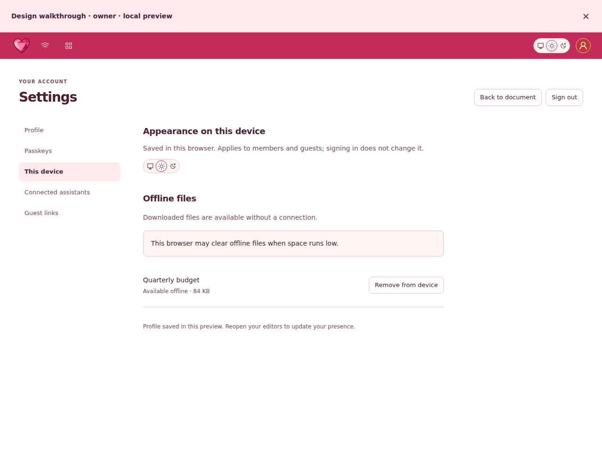

# SPN-047 visual review

Start with the [connected walkthrough guide](../walkthrough.md). These are rendered Storybook proposals awaiting owner approval in [PR #125](https://github.com/mxbaylee/spinel/pull/125), not production screens or approved regression baselines.

Proposal captures: commit `dc9170fa68243fa10ad34d700e0e8f9cf4471c40`, [Storybook CI run 39567403971](https://github.com/mxbaylee/spinel/actions/runs/39567403971). Workflow conclusion at packaging: **success**. PNGs were rendered; their existence does not establish that every journey assertion or CI gate passed.

The gallery preserves unchanged PNGs from CI. Entry and settings/admin pages come from the connected walkthrough where available; other captures show composed screen specimens. Connected Sheet/Doc walkthroughs use actual open-source Univer, including toolbar, editing and selection. Structural Space/history specimens remain schematic; local fixtures do not persist documents. Native Doc on a phone currently needs horizontal panning or zoom, unlike the reflowed schematic page. Preview-event controls belong to the review harness, not the proposed product.

Before images retain their original workflow and commit in [capture-sources.json](capture-sources.json). Some show actual production Playwright routes; others show existing Storybook components, as labeled below. They are older than this proposal. Fixture content differs, so compare hierarchy and usability rather than document text. Planned features and the homepage have no production baseline.

## Start here

- **Homepage:** [Light](homepage-light.png) · [Dark](homepage-dark.png) · [Phone](homepage-phone.png)
- **Sign in:** [Light](sign-in-light.png) · [Dark](sign-in-dark.png) · [Phone](sign-in-phone.png)
- **Operator setup:** [Light](setup-light.png) · [Dark](setup-dark.png) · [Phone](setup-phone.png)
- **Operator help:** [Light](operator-help-light.png) · [Dark](operator-help-dark.png) · [Phone](operator-help-phone.png)
- **Administration:** [Light](admin-light.png) · [Dark](admin-dark.png) · [Phone](admin-phone.png)
- **Settings:** [Light](profile-light.png) · [Dark](profile-dark.png) · [Phone](profile-phone.png)
- **Files:** [Light](dashboard-light.png) · [Dark](dashboard-dark.png) · [Phone](dashboard-phone.png)
- **Doc · native Univer:** [Light](doc-light.png) · [Dark](doc-dark.png) · [Phone](doc-phone.png)
- **Sheet · native Univer:** [Light](sheet-light.png) · [Dark](sheet-dark.png) · [Phone](sheet-phone.png)
- **Guest Doc · native Univer:** [Light](guest-viewer-light.png) · [Dark](guest-viewer-dark.png) · [Phone](guest-viewer-phone.png)
- **Guest Sheet · schematic:** [Light](guest-sheet-light.png) · [Dark](guest-sheet-dark.png) · [Phone](guest-sheet-phone.png)

## Four views from the proposal

Homepage — proposed arrival before sign-in:

Administration — reached after completing Operator setup in the connected journey:

Doc — opened from the Owner’s file list:

Settings — reached from the document, with appearance scoped to this browser:

## Connected journey checkpoints

These PNGs were captured after following product controls through the walkthrough. They are distinct from isolated screen specimens; the same source commit and workflow apply. Each checkpoint below has desktop and phone evidence.

- **Owner opens a Doc:** [Desktop](journey-owner-doc-1280.png) · [Phone](journey-owner-doc-390.png)
- **Settings reached from the document:** [Desktop](journey-device-settings-1280.png) · [Phone](journey-device-settings-390.png)
- **Failed save and leaving the document:** [Desktop](journey-save-failed-1280.png) · [Phone](journey-save-failed-390.png)
- **Operator completes setup:** [Desktop](journey-operator-first-run-1280.png) · [Phone](journey-operator-first-run-390.png)
- **Operator prepares an invitation:** [Desktop](journey-operator-invite-form-1280.png) · [Phone](journey-operator-invite-form-390.png)
- **Open guest document loses connection:** [Desktop](journey-guest-disconnected-1280.png) · [Phone](journey-guest-disconnected-390.png)
- **Guest link is turned off:** [Desktop](journey-guest-revoked-1280.png) · [Phone](journey-guest-revoked-390.png)

## More screens and states

- **Themed loading silhouettes:** [Light](loading-themes-light.png) · [Dark](loading-themes-dark.png) · [Phone](loading-themes-phone.png)
- **Consistent file-loading state:** [Light](loading-files-light.png) · [Dark](loading-files-dark.png) · [Phone](loading-files-phone.png)
- **Protected remaining passkey:** [Light](operator-protected-key-light.png) · [Dark](operator-protected-key-dark.png) · [Phone](operator-protected-key-phone.png)
- **Expanded icon picker with reachable actions:** [Light](icon-picker-expanded-light.png) · [Dark](icon-picker-expanded-dark.png) · [Phone](icon-picker-expanded-phone.png)
- **Folder restore preserves deletion boundaries:** [Light](folder-recovery-light.png) · [Dark](folder-recovery-dark.png) · [Phone](folder-recovery-phone.png)
- **Doc reopened from My files:** [Light](doc-reopen-light.png) · [Dark](doc-reopen-dark.png) · [Phone](doc-reopen-phone.png)
- **Named versions:** [Light](version-names-light.png) · [Dark](version-names-dark.png) · [Phone](version-names-phone.png)
- **Rename an older checkpoint:** [Light](version-rename-light.png) · [Dark](version-rename-dark.png) · [Phone](version-rename-phone.png)
- **Retained version-name draft after failure:** [Light](version-retry-light.png) · [Dark](version-retry-dark.png) · [Phone](version-retry-phone.png)
- **Direct access and guest link controls:** [Light](sharing-access-light.png) · [Dark](sharing-access-dark.png) · [Phone](sharing-access-phone.png)
- **People in the document:** [Light](presence-people-light.png) · [Dark](presence-people-dark.png) · [Phone](presence-people-phone.png)
- **Formula source and worksheet selection:** [Light](formula-authoring-light.png) · [Dark](formula-authoring-dark.png) · [Phone](formula-authoring-phone.png)
- **Failed disconnection preserves access:** [Light](connection-recovery-light.png) · [Dark](connection-recovery-dark.png) · [Phone](connection-recovery-phone.png)
- **Trash restore recovery:** [Light](file-recovery-light.png) · [Dark](file-recovery-dark.png) · [Phone](file-recovery-phone.png)
- **Retained file-name draft:** [Light](file-rename-failed-light.png) · [Dark](file-rename-failed-dark.png) · [Phone](file-rename-failed-phone.png)
- **Personal tag editing:** [Light](personal-tags-light.png) · [Dark](personal-tags-dark.png) · [Phone](personal-tags-phone.png)
- **Operator passkey-removal consequences:** [Light](passkey-removal-light.png) · [Dark](passkey-removal-dark.png) · [Phone](passkey-removal-phone.png)
- **Native Doc with review banner dismissed:** [Light](doc-full-editor-light.png) · [Dark](doc-full-editor-dark.png) · [Phone](doc-full-editor-phone.png)
- **Native Sheet with review banner dismissed:** [Light](sheet-full-editor-light.png) · [Dark](sheet-full-editor-dark.png) · [Phone](sheet-full-editor-phone.png)
- **Eight-level Space navigation:** [Light](space-deep-tree-light.png) · [Dark](space-deep-tree-dark.png) · [Phone](space-deep-tree-phone.png)
- **Native Sheet formula bar:** [Light](native-sheet-dark-formula-light.png) · [Dark](native-sheet-dark-formula-dark.png) · [Phone](native-sheet-dark-formula-phone.png)
- **Token creation:** [Light](token-create-light.png) · [Dark](token-create-dark.png) · [Phone](token-create-phone.png)
- **Import validation:** [Light](import-review-light.png) · [Dark](import-review-dark.png) · [Phone](import-review-phone.png)
- **Profile save recovery:** [Light](profile-save-error-light.png) · [Dark](profile-save-error-dark.png) · [Phone](profile-save-error-phone.png)
- **Backup failure:** [Light](backup-failed-light.png) · [Dark](backup-failed-dark.png) · [Phone](backup-failed-phone.png)
- **Connection consent error:** [Light](consent-error-light.png) · [Dark](consent-error-dark.png) · [Phone](consent-error-phone.png)
- **Named permanent deletion:** [Light](delete-confirmation-light.png) · [Dark](delete-confirmation-dark.png) · [Phone](delete-confirmation-phone.png)
- **Empty Trash:** [Light](empty-trash-light.png) · [Dark](empty-trash-dark.png) · [Phone](empty-trash-phone.png)
- **Unconfirmed offline changes:** [Light](offline-save-failed-light.png) · [Dark](offline-save-failed-dark.png) · [Phone](offline-save-failed-phone.png)
- **History calendar:** [Light](history-calendar-light.png) · [Dark](history-calendar-dark.png) · [Phone](history-calendar-phone.png)
- **Sharing:** [Light](sharing-light.png) · [Dark](sharing-dark.png) · [Phone](sharing-phone.png)
- **Profile icon picker:** [Light](profile-icon-picker-light.png) · [Dark](profile-icon-picker-dark.png) · [Phone](profile-icon-picker-phone.png)
- **Profile color picker:** [Light](profile-color-picker-light.png) · [Dark](profile-color-picker-dark.png) · [Phone](profile-color-picker-phone.png)
- **Connected applications:** [Light](connections-light.png) · [Dark](connections-dark.png) · [Phone](connections-phone.png)
- **Connection consent:** [Light](consent-light.png) · [Dark](consent-dark.png) · [Phone](consent-phone.png)
- **Operator invitations:** [Light](admin-invites-light.png) · [Dark](admin-invites-dark.png) · [Phone](admin-invites-phone.png)
- **Operator health:** [Light](admin-health-warning-light.png) · [Dark](admin-health-warning-dark.png) · [Phone](admin-health-warning-phone.png)
- **Version history · schematic preview:** [Light](history-light.png) · [Dark](history-dark.png) · [Phone](history-phone.png)
- **Doc Formula · structural composition:** [Light](formula-in-context-light.png) · [Dark](formula-in-context-dark.png) · [Phone](formula-in-context-phone.png)
- **Invitation:** [Light](invite-light.png) · [Dark](invite-dark.png) · [Phone](invite-phone.png)
- **Account recovery:** [Light](recovery-light.png) · [Dark](recovery-dark.png) · [Phone](recovery-phone.png)
- **Guest editor · schematic:** [Light](guest-editor-light.png) · [Dark](guest-editor-dark.png) · [Phone](guest-editor-phone.png)
- **Revoked guest link:** [Light](revoked-link-light.png) · [Dark](revoked-link-dark.png) · [Phone](revoked-link-phone.png)
- **Collapsed file navigation:** [Light](dashboard-collapsed-light.png) · [Dark](dashboard-collapsed-dark.png) · [Phone](dashboard-collapsed-phone.png)
- **Grid view:** [Light](dashboard-grid-light.png) · [Dark](dashboard-grid-dark.png) · [Phone](dashboard-grid-phone.png)
- **New file menu:** [Light](dashboard-new-menu-light.png) · [Dark](dashboard-new-menu-dark.png) · [Phone](dashboard-new-menu-phone.png)
- **Grid with collapsed navigation:** [Light](dashboard-grid-collapsed-light.png) · [Dark](dashboard-grid-collapsed-dark.png) · [Phone](dashboard-grid-collapsed-phone.png)
- **Planned Space:** [Light](planned-space-light.png) · [Dark](planned-space-dark.png) · [Phone](planned-space-phone.png)
- **Planned guest Space:** [Light](planned-space-guest-light.png) · [Dark](planned-space-guest-dark.png) · [Phone](planned-space-guest-phone.png)
- **Planned delegated roles:** [Light](planned-file-admin-light.png) · [Dark](planned-file-admin-dark.png) · [Phone](planned-file-admin-phone.png)
- **Shared Base UI controls:** [Light](controls-light.png) · [Dark](controls-dark.png) · [Phone](controls-phone.png)
- **Unavailable setup link:** [Light](invalid-setup-light.png) · [Dark](invalid-setup-dark.png) · [Phone](invalid-setup-phone.png)

## Before / proposed comparisons

- **Files** — Existing Storybook component baseline: [Light](before-dashboard-light.png) · [Dark](before-dashboard-dark.png) · [Phone](before-dashboard-phone.png). Proposed: [Light](dashboard-light.png) · [Dark](dashboard-dark.png) · [Phone](dashboard-phone.png).
- **Guest Sheet · schematic** — Production route baseline: [Light](before-guest-sheet-light.png) · [Dark](before-guest-sheet-dark.png) · [Phone](before-guest-sheet-phone.png). Proposed: [Light](guest-sheet-light.png) · [Dark](guest-sheet-dark.png) · [Phone](guest-sheet-phone.png).
- **Doc · native Univer** — Production route baseline: [Light](before-doc-light.png) · [Dark](before-doc-dark.png) · [Phone](before-doc-phone.png). Proposed: [Light](doc-light.png) · [Dark](doc-dark.png) · [Phone](doc-phone.png).
- **Sheet · native Univer** — Production route baseline: [Light](before-sheet-light.png) · [Dark](before-sheet-dark.png) · [Phone](before-sheet-phone.png). Proposed: [Light](sheet-light.png) · [Dark](sheet-dark.png) · [Phone](sheet-phone.png).
- **Sharing** — Existing Storybook component baseline: [Light](before-sharing-light.png) · [Dark](before-sharing-dark.png) · [Phone](before-sharing-phone.png). Proposed: [Light](sharing-light.png) · [Dark](sharing-dark.png) · [Phone](sharing-phone.png).
- **Settings** — Production route baseline: [Light](before-profile-light.png) · [Dark](before-profile-dark.png) · [Phone](before-profile-phone.png). Proposed: [Light](profile-light.png) · [Dark](profile-dark.png) · [Phone](profile-phone.png).
- **Profile icon picker** — Existing Storybook component baseline: [Light](before-profile-icon-picker-light.png) · [Dark](before-profile-icon-picker-dark.png) · [Phone](before-profile-icon-picker-phone.png). Proposed: [Light](profile-icon-picker-light.png) · [Dark](profile-icon-picker-dark.png) · [Phone](profile-icon-picker-phone.png).
- **Profile color picker** — Existing Storybook component baseline: [Light](before-profile-color-picker-light.png) · [Dark](before-profile-color-picker-dark.png) · [Phone](before-profile-color-picker-phone.png). Proposed: [Light](profile-color-picker-light.png) · [Dark](profile-color-picker-dark.png) · [Phone](profile-color-picker-phone.png).
- **Connected applications** — Production route baseline: [Light](before-connections-light.png) · [Dark](before-connections-dark.png) · [Phone](before-connections-phone.png). Proposed: [Light](connections-light.png) · [Dark](connections-dark.png) · [Phone](connections-phone.png).
- **Connection consent** — Production route baseline: [Light](before-consent-light.png) · [Dark](before-consent-dark.png) · [Phone](before-consent-phone.png). Proposed: [Light](consent-light.png) · [Dark](consent-dark.png) · [Phone](consent-phone.png).
- **Administration** — Existing Storybook component baseline: [Light](before-admin-light.png) · [Dark](before-admin-dark.png) · [Phone](before-admin-phone.png). Proposed: [Light](admin-light.png) · [Dark](admin-dark.png) · [Phone](admin-phone.png).
- **Operator invitations** — Existing Storybook component baseline: [Light](before-admin-invites-light.png) · [Dark](before-admin-invites-dark.png) · [Phone](before-admin-invites-phone.png). Proposed: [Light](admin-invites-light.png) · [Dark](admin-invites-dark.png) · [Phone](admin-invites-phone.png).
- **Operator health** — Existing Storybook component baseline: [Light](before-admin-health-warning-light.png) · [Dark](before-admin-health-warning-dark.png) · [Phone](before-admin-health-warning-phone.png). Proposed: [Light](admin-health-warning-light.png) · [Dark](admin-health-warning-dark.png) · [Phone](admin-health-warning-phone.png).
- **Version history · schematic preview** — Existing Storybook component baseline: [Light](before-history-light.png) · [Dark](before-history-dark.png) · [Phone](before-history-phone.png). Proposed: [Light](history-light.png) · [Dark](history-dark.png) · [Phone](history-phone.png).
- **Doc Formula · structural composition** — Production route baseline: [Light](before-formula-in-context-light.png) · [Dark](before-formula-in-context-dark.png) · [Phone](before-formula-in-context-phone.png). Proposed: [Light](formula-in-context-light.png) · [Dark](formula-in-context-dark.png) · [Phone](formula-in-context-phone.png).
- **Sign in** — Production route baseline: [Light](before-sign-in-light.png) · [Dark](before-sign-in-dark.png) · [Phone](before-sign-in-phone.png). Proposed: [Light](sign-in-light.png) · [Dark](sign-in-dark.png) · [Phone](sign-in-phone.png).
- **Operator setup** — Production route baseline: [Light](before-setup-light.png) · [Dark](before-setup-dark.png) · [Phone](before-setup-phone.png). Proposed: [Light](setup-light.png) · [Dark](setup-dark.png) · [Phone](setup-phone.png).
- **Invitation** — Production route baseline: [Light](before-invite-light.png) · [Dark](before-invite-dark.png) · [Phone](before-invite-phone.png). Proposed: [Light](invite-light.png) · [Dark](invite-dark.png) · [Phone](invite-phone.png).
- **Account recovery** — Production route baseline: [Light](before-recovery-light.png) · [Dark](before-recovery-dark.png) · [Phone](before-recovery-phone.png). Proposed: [Light](recovery-light.png) · [Dark](recovery-dark.png) · [Phone](recovery-phone.png).
- **Guest Doc · native Univer** — Production route baseline: [Light](before-guest-viewer-light.png) · [Dark](before-guest-viewer-dark.png) · [Phone](before-guest-viewer-phone.png). Proposed: [Light](guest-viewer-light.png) · [Dark](guest-viewer-dark.png) · [Phone](guest-viewer-phone.png).
- **Guest editor · schematic** — Production route baseline: [Light](before-guest-editor-light.png) · [Dark](before-guest-editor-dark.png) · [Phone](before-guest-editor-phone.png). Proposed: [Light](guest-editor-light.png) · [Dark](guest-editor-dark.png) · [Phone](guest-editor-phone.png).
- **Revoked guest link** — Production route baseline: [Light](before-revoked-link-light.png) · [Dark](before-revoked-link-dark.png) · [Phone](before-revoked-link-phone.png). Proposed: [Light](revoked-link-light.png) · [Dark](revoked-link-dark.png) · [Phone](revoked-link-phone.png).

The full **design-review** artifact includes dark phone/tablet variants, additional states, accessibility snapshots and the generated HTML index. The **storybook-review** artifact contains the built interactive Storybook. Use the workflow links and provenance rather than assuming a previously packaged artifact is current.
