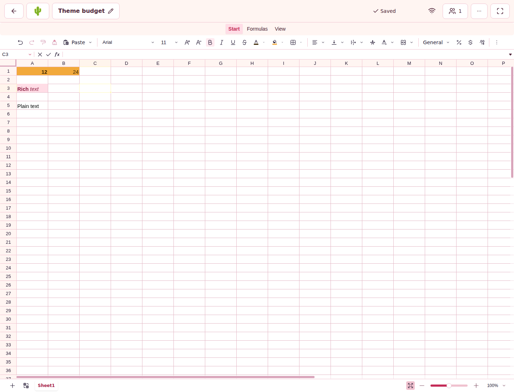
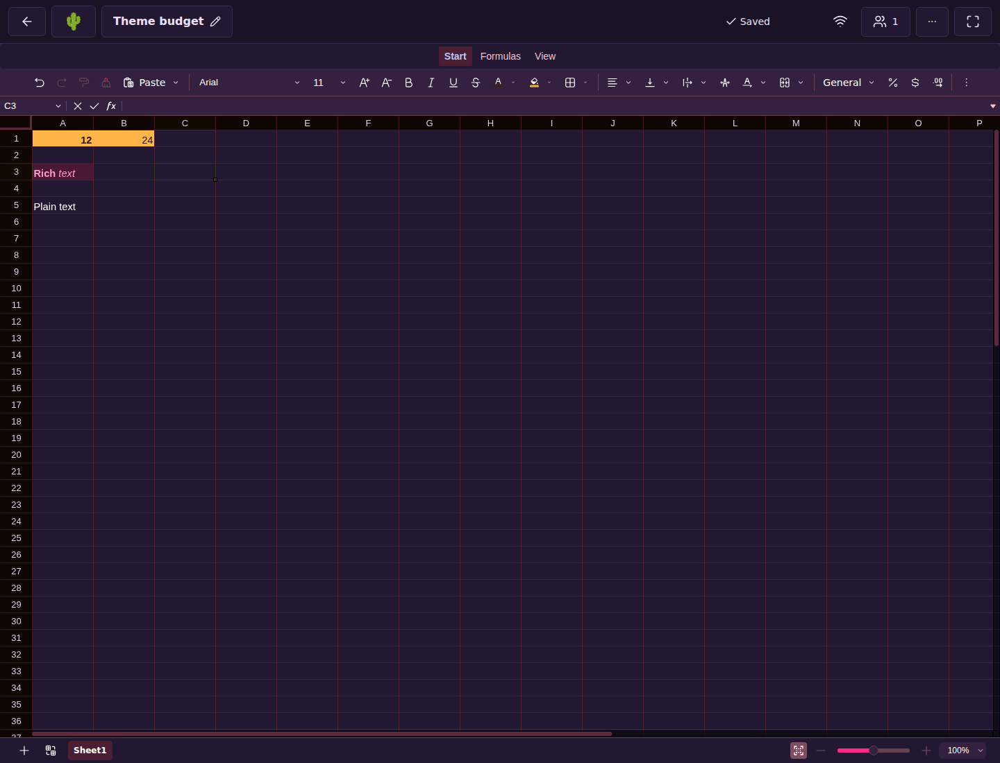
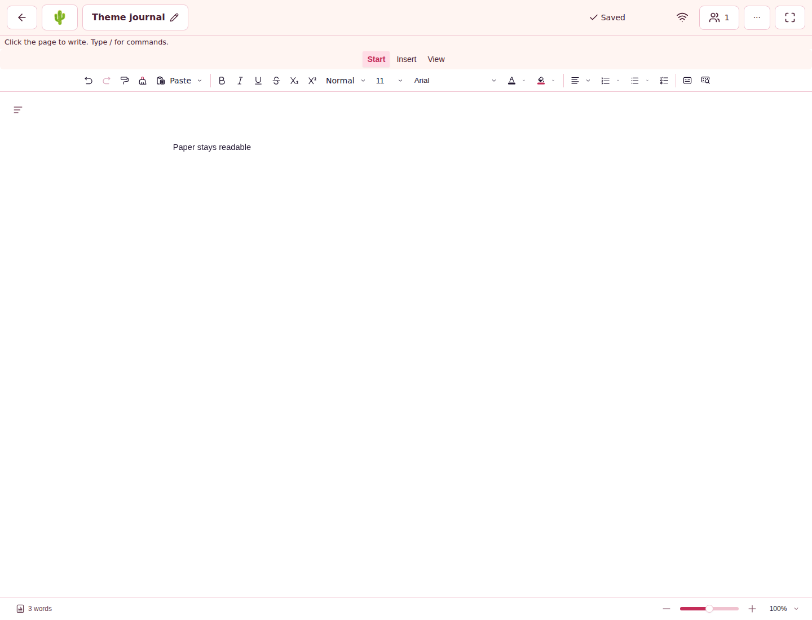
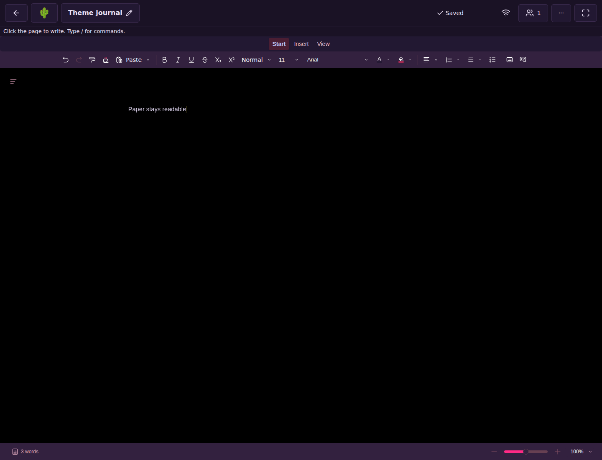
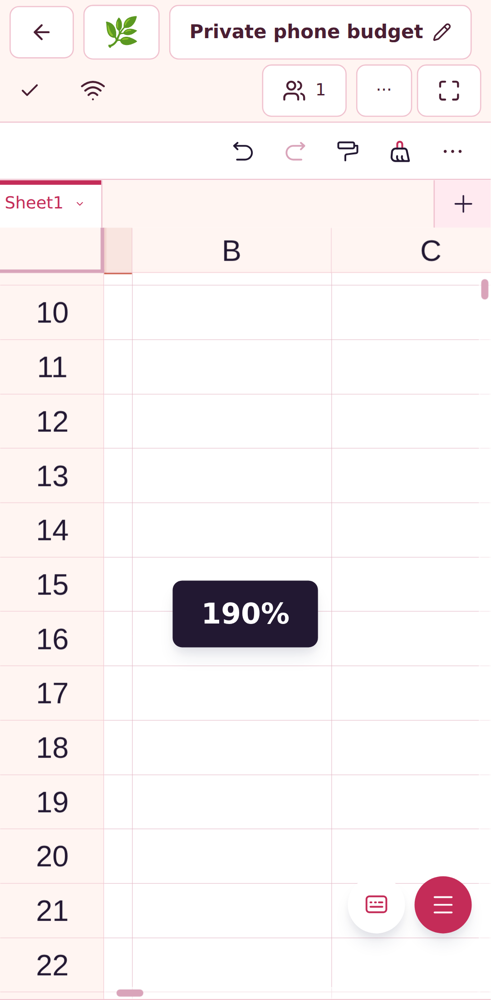
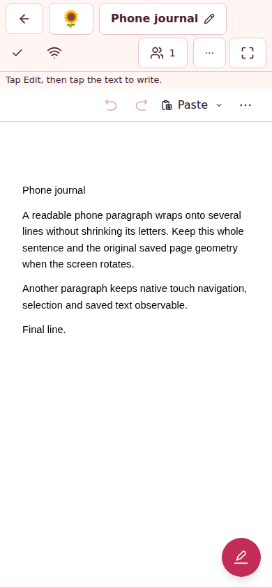
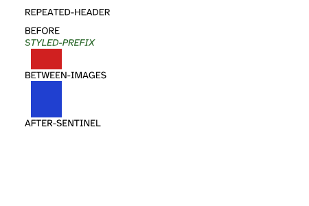
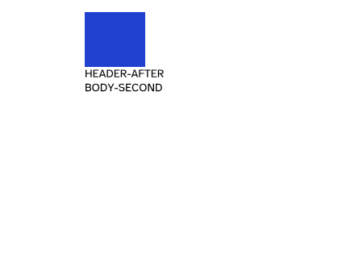

# 🔎 Final aggregate dependency evidence

This durable record accompanies [PR #240](https://github.com/mxbaylee/spinel/pull/240).
The candidate is `09622e074512d2fb069b7ed27e6e26f71549a4de`, over base
`3a0e2238fb5be3907d04120eabda2aafd6565d63`; the tested synthetic merge is
`eef70b35c2361e7fb9e151a967dd09070566cedf`. This evidence-only commit is a
child of that candidate; it does not change the reviewed application source.

The aggregate includes Univer 1.3.1 and all five guarded OSS patch families,
Canvas 1.1.0 / PDF.js 6.5.438 (#275), Caddy's exact image digest (#238), genuine
legacy/current offline SDK acceptance, and the owner-approved quieter Dependabot
configuration. The complete lock SHA-256 is
`986057c5c1ae36cc84c0cb6d1e49b9daf6fcda3d8909153a81acaf0738aaf65e`.
The [maintained source and failure record](../../../implementation/dependabot-2026-11-11.md)
and [precise Univer patch comparison](../../../implementation/SPN-099.md#-retain-reviewed-patches-while-updating-dependencies)
retain the original failed attempts, repair rationale and full XL scope.
SPN-099/119/122 and deferred SPN-147 remain open; dependency acceptance does not
claim the SDK can run unpatched or that missing upstream submissions are done.

## 👀 Independent review and actual visuals

Two independent nonimplementing reviewers, `/root/dependency_review_a` and
`/root/dependency_review_b`, each graded the exact candidate **98/100** before
publication: scope 35/35, correctness 25/25, evidence 18/20, operations 10/10,
maintainability 10/10. No source findings remain. The two evidence points reflect
resource-blocked broader reviewer-local execution, not a waiver of hosted CI.
The ink oracle's following-line false positive was repaired before publication,
with an explicit negative control. See the maintained record for earlier
resolved diagnostic/source-fixture findings. **Agent review only.**

Reviewer A inspected all six final application captures against the design
playbook/theme, and both PDF examples, approving the candidate with no remaining
visual findings on 2026-11-12. No new design is proposed. Owner and Collaborator
retain coherent editing controls and readable content; Operator has no new editor
surface and its operational/access evidence is separate; Link guest access
boundaries are exercised separately by CI rather than inferred from member
screenshots. Existing accessibility/theme
checks remain applicable.

The four desktop captures are actual Chromium development application states at
1440 × 1100, in light and dark themes. Phone captures are actual HTTPS application
states with mobile/touch emulation, **not physical-device tests**. The Sheet is
Pixel 7 emulation at 412 × 839 CSS pixels, DPR 2.625, after native pan/pinch to
190%; browser viewport scale remains 1. The Doc is reading mode at 390 × 844,
DPR 1 and native 100% zoom. Text reflows without changing saved geometry.
[Exact source paths, jobs, hashes and image dimensions](sources.json) distinguish
CSS viewports from bitmap dimensions.

The two Linux PDF samples visibly separate the image edge from following text.
The native library suite also checks strict ink clearance, image areas/origins,
independently authored reference pairs and immutable snapshots. Font em height
is not treated as glyph ascent; no renderer override or overlap tolerance was
introduced.

## 🧪 Local execution and failure disposition

The Mac's watchdog requires normal memory pressure, one runtime workload,
process-tree RSS at most 2 GiB and an eight-minute limit. On prior repair source
`e3471dc322cc4f45ab5b3f2e1d42590db3f82950`, the pure ink control passed (1 test,
567 ms, peak 204,912 KiB), and fresh normal npm installation plus all five patchers
passed (8,365 ms, peak 1,008,560 KiB). An earlier install preflight was blocked
by elevated pressure. The seven-file native/print attempt with FUZZ_SEED=1 was
resource-aborted at 3,078 ms, peak 927,232 KiB: no completed tests, not acceptance.
The only subsequent executable change, offlineClaim.test.ts, passed all 26 tests
under the watchdog (1,073 ms, peak 504,928 KiB). Formatting, whitespace and
targeted syntax checks passed. Hosted work owns the full selected matrix.

[Prior run identities and terminal conclusions](prior-runs.json) preserve both
failed source candidates and deliberately superseded runs. Original head
`7d545cb4dcf5382c86fc6bd94cff2f8904e981b8` failed obsolete SDK value pins,
callback source identities/module resolution, PDF font-em inference, random
collapsed-drawing coverage, native swatch selection and early Storybook canvas
sampling. Its source is merge `36c70001d292c61c28dd4d580a9b0a5b06150ac5`.
Second head `e3471dc322cc4f45ab5b3f2e1d42590db3f82950`, merge
`670ca5405150be91e0db598183ed7e1c7bb198cb`, passed the repaired library and Node
contracts but failed eight application tests sharing an old SDK-positive fixture.
The final candidate uses the actual current SDK and explicitly rejects old/future
SDKs without exposing catalog titles or cancelling the compatible old tab.
No production admission rule or timeout changed. Its predecessor's unfinished
jobs were deliberately cancelled; completed failures remain failures.

Metadata-only superseded runs 43204065145, 43204059380, 43204059605,
43209088242 and 43211036681 were deliberately cancelled and terminal states
verified. No cancelled job is treated as acceptance. The historical supervised
restore startup failure remains unexplained; bounded diagnostics are not a
claim of root cause. Fresh selected acceptance must actually pass. Offline
retention deliberately holds sync and does not claim pending old-runtime edits
drained into the new backend.

## 📏 Comparison sources and measurement limits

Responsiveness baseline `ae2885ede75a168711a712a837245bc7d61b0abc` descends from
`e4d361f0ce3c08d4a1e80b000e29f2c2f28f6670`; callback baseline
`2a49413a1d4d8841289412e311ddd237f522afa5` descends from
`f609961e4a2460bae0feedb62cedd722af270e86`. Both match the candidate's complete
lock and eight dependency maps while retaining original comparison behavior and
three historical patchers. They do not include current Doc optimization, Doc UI
repair or core channel pooling. Their active retention refs stay necessary.

The complete desktop responsiveness comparison is retained in
[responsiveness-desktop.json](responsiveness-desktop.json). All four candidate
samples preserve content and redo. Input p95 is 27.9–29.0 ms, first verified
browser-local empty is 344.9–359.4 ms, and no task exceeds the 50 ms observation
threshold. A reported longest-task value of zero does not mean zero work.
Conservative plain-sample whole-browser longest-task reduction is 99.4528%.
Containing-task duration is not time attributed wholly to the native reducer;
late harness reads and profiler/run variation remain descriptive.

[Desktop](callbacks-desktop.json) and [mobile](callbacks-mobile.json) callback
summaries preserve every counter and timing aggregate, source/trace hashes and
acceptance result while omitting individual spans and large raw traces.
Both candidate comparisons are bounded and accepted. Cursor pending high-water
is 4 (baseline 7,724 desktop / 8,346 mobile); zoom-update pending high-water is 1
(baseline 1,846 / 2,080). All candidate families report zero callbacks after
disposal; the baseline cursor reports 9 in each environment. Traced callback
timings are descriptive; separate unprofiled responsiveness gates remain required.

CI artifacts supplement this durable record and expire: PDF evidence after
7 days, browser/visual/performance evidence after 14 days. The retained JSON and
useful images remain in immutable Git storage linked from the PR.

## 🔗 Upstream status and retained work

On 2026-11-12, existing Univer PRs [#7938](https://github.com/dream-num/univer/pull/7938)
and [#7969](https://github.com/dream-num/univer/pull/7969) remain open, unmerged
and mergeable, at heads `1d3455159f34d0941ef2ca41370a86477277109a` and
`4db2a9103705fb94624e7a149aff99ac8342d0cf`, against upstream base
`5a06a7842c8e13fa0646d0733dc3662cf4b330b9`. Precise source comparison found
the repair semantics unchanged; no unnecessary upstream rebase is claimed.
The missing upstream submissions retained in SPN-147 follow these dependency
PRs, per the owner's sequencing.

## 🧹 Branch completion disposition — 2026-11-12

The dated historical statement in dependabot-2026-11-07.md that its original
comparison branches remain necessary is superseded by this reference audit.
All 13 currently open PR heads were inspected: neither original 2026-11-07
Dependabot comparison commit remains an active CI/comparator input or PR head.
Both are ancestors of retained descendants. Preserve their exact commits under
these archival tags before deleting the obsolete branch names after merge:

- `archive/dependabot-callback-dd6b3f39` retains
  `dd6b3f397ea89c9eb024fcbe9f52d77b865d45d4`, formerly
  `ci-baseline/doc-callback-dependabot-2026-11-07`.
- `archive/dependabot-responsiveness-b21979c3` retains
  `b21979c3fdb78e3736d7ded0f7b91f44d45e5968`, formerly
  `ci-baseline/doc-responsiveness-dependabot-2026-11-07`.

Recheck remote tag identities, branch heads and active PR ownership immediately
before deletion. Retain current `ci-baseline/univer-1.3.1-responsive` and
`ci-baseline/univer-1.3.1-callback`: committed CI uses their exact sources.
Keep the separate Canvas-excluded and Storybook baseline refs for active
consumers (including #224), and preserve unrelated ticket worktrees/branches.
After #240 actually merges, close #275 and #238 as superseded, delete their
unchanged bot branches and the obsolete #240 implementation ref, and remove
clean task-created implementation/evidence/local baseline worktrees and refs.
The evidence commit must remain reachable through its published immutable tag.
This section records the reviewed cleanup disposition, not a premature claim
that the still-open PRs have already merged or closed.

## ✅ Complete candidate acceptance

All selected first attempts for the exact final head passed.
[acceptance-runs.json](acceptance-runs.json) preserves every run and job identity,
conclusion and timestamp. The seven required gates are all successful in
[CI 43211061354](https://github.com/mxbaylee/spinel/actions/runs/43211061354):
Pull request 131158790995, Backlog 131159229600, Lint 131159229301, Typecheck
131159229683, Unit tests 131163420103, Lib tests 131164196423, and Playwright
smoke 131176400046. Every selected matrix/comparison/container/retained-state
job succeeded; none is replaced by a result from an earlier source.

- Node remaining phase: **811 passed, 0 failed, 2 skipped**, 57.145 s.
  Application Vitest: **2,049/2,049 passed**, 185 files, 241.30 s.
  Separate supervisor and recovery workers also passed.
- Library remaining: **967 passed, 3 skipped**, 87 files, 499.10 s.
  Separate cells and dense-cell workers passed. The full original mixed-fuzz
  workload passed: **100 seeds / 100,000 mutations**, 305.97 s, exactly two
  retained collapsed-image captures and zero newly collapsed random captures;
  content checks cover 2,783 Doc cases, 1,521 Sheet insertions and 495 removals.
- All development/production shards, both sync projects, both soaks, mobile
  HTTPS, true offline SDK upgrade, supervised restore, sized restore, retained
  sync and container smoke passed. Both paired callback and responsiveness
  comparisons passed.
- [Storybook 43211061238](https://github.com/mxbaylee/spinel/actions/runs/43211061238)
  passed its build, desktop light/dark, mobile light/dark, tablet and final
  states/interactions gate. Preview/deployment jobs are inapplicable for this PR.
- [Desktop offline 43211061237](https://github.com/mxbaylee/spinel/actions/runs/43211061237)
  passed real Chrome and Firefox on macOS 26, and Safari on macOS 15.
- [Spaces 43211061213](https://github.com/mxbaylee/spinel/actions/runs/43211061213)
  passed real provider backup/catalog/restore acceptance and cleanup.

The [mobile responsiveness comparison](responsiveness-mobile.json) passed all
four candidate samples with content and redo intact: input p95 **67.3–70.2 ms**,
longest task **122–161 ms**, first verified browser-local empty **382.7–531.3 ms**.
Conservative whole-browser longest-task reduction is **99.4815%**. This is
emulated mobile performance; it does not claim physical-device acceptance.

The final PR description references this accepted application source and durable
evidence. Repository policy also runs full CI for a description edit; any such
new current-head run must pass before merge. It is not waived or replaced by the
completed source-push run above. The application head and base must remain exact
at the guarded squash merge.
