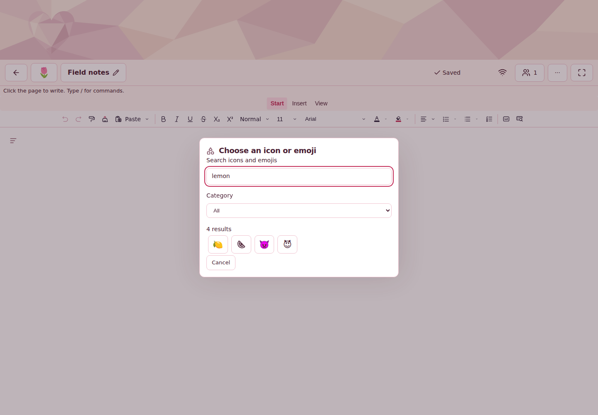
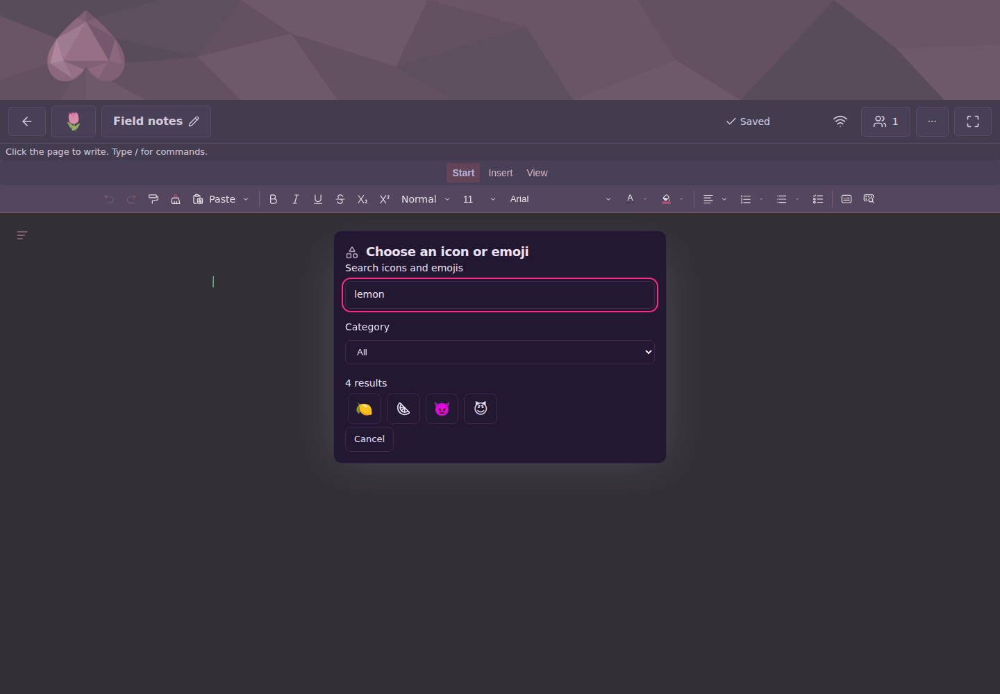
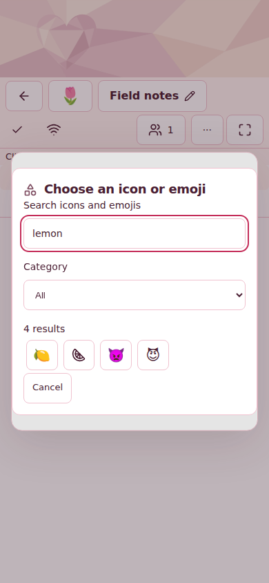
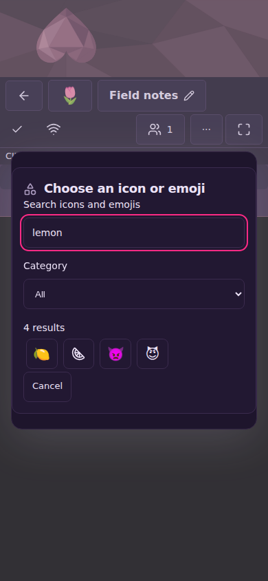
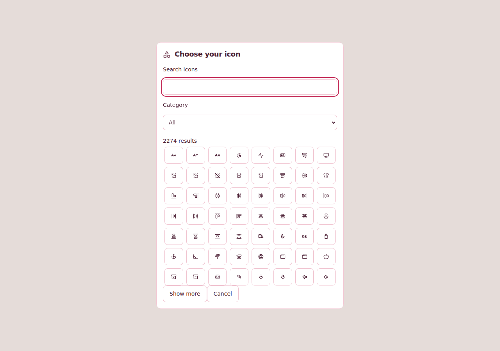
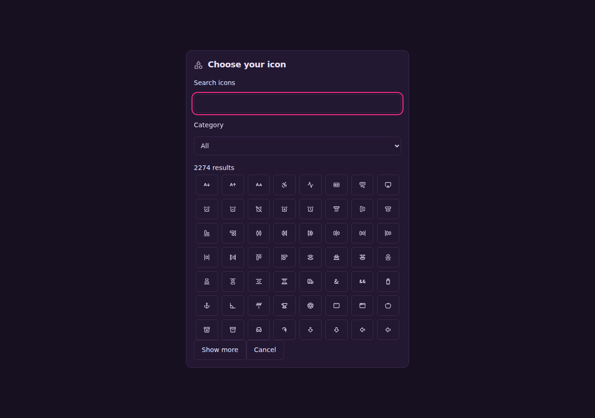
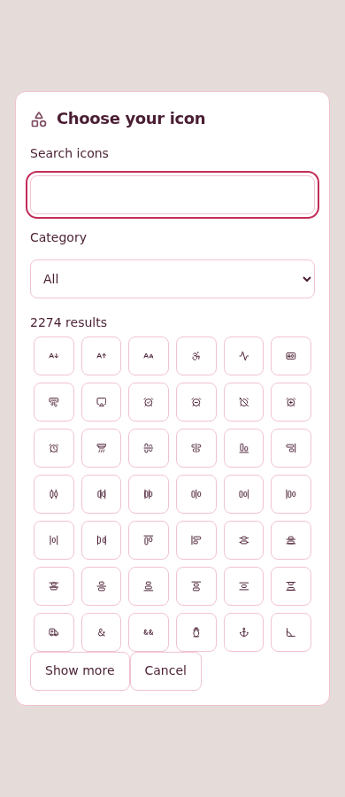
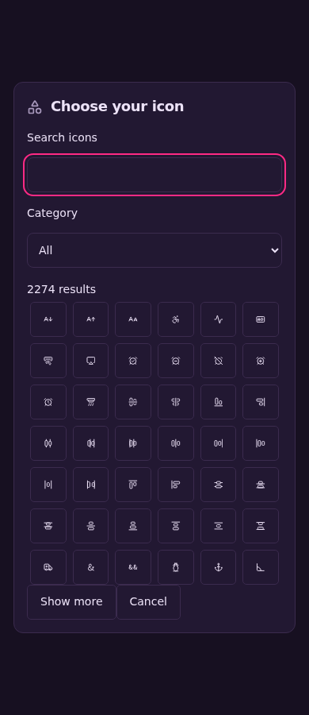

# ⬆️ Follow-up dependency acceptance evidence

## 🔗 Exact source and review

PR #277 aggregates #278. Application candidate `0d6e1ffae53fe5432fa2bb581bdf52ba7d9a2166`, base `f2e36db45a4cd10f3ff2e1358c5a3c457344856a`, tested merge `00c196fd661a5cf4d0a5f7d7d832c0811547358c`; application and merge share tree `836bf9867748dccee0812083ea0cbe648fa6f557`.
This evidence-only descendant does not change the reviewed application.

Both independent nonimplementing reviewers `/root/dependency_review_a` and `/root/dependency_review_b` graded the application **98/100**, rubric **35/25/18/10/10**, with no source findings. Both graded each historical helper **99/100**, rubric **35/25/19/10/10**:

- Responsiveness `96ae9e0a07d113c5de771f6e4e0f4ae83fae812d`, parent `ae2885ede75a168711a712a837245bc7d61b0abc`.
- Callback `b75e3797a11ac2f53e3833b5615f68b6c0091727`, parent `2a49413a1d4d8841289412e311ddd237f522afa5`.

Each reviewer independently checked the complete bot union, preserved spellings, 2,024 resolved canonical metadata rows and three-file-only helper diffs. All deductions reflect reviewer-local runtime attempts blocked at watchdog preflight; no process began. Steps to 100 are resource-safe reviewer profile/appearance/comparison executions and historical install/patcher checks. Hosted CI is separate acceptance, never a grade deduction. The root agent's guarded meaningful local tests passed as recorded below.

## 🧪 Verification and original attempts

[Maintained implementation and persona decision](../../../implementation/dependabot-2026-11-12.md) and [local receipts](../../../implementation/evidence/dependabot-2026-11-12/local-receipts.json) preserve the full scope and attempts. The dependency update leaves Univer 1.3.1 and all five guarded OSS patches unchanged; no Pro addition or patch is involved. All 66 changed lock records are exactly the union of bot sources `73983bb04b30af2da69b42705874c77fa4f55f1c` and `32330c01cb26dfd19e1ee4a0ec474930d223279e`; lock SHA-256 `cdb5afd5811c7229c9b0c9ffd945a51848dd1c58b32051d1fb20d2842568177c`.

Local Node 26.13.0, serialized workloads with normal-pressure preflight and continuous 2 GiB/eight-minute process-tree limits: installation/all five patchers passed in 5.440 s (peak 1,069,712 KiB); 94 profile tests in 2.703 s (510,192 KiB); 70 server tests in 24.047 s (1,017,696 KiB); 72 comparison/routing/fail-closed tests in 1.480 s (433,696 KiB); full lint/boundary/formatting in 11.744 s (810,704 KiB); exact-title PR validation passed. Local typecheck resource-aborted at 5.020 s (1,220,704 KiB), no compiler diagnostic; hosted Typecheck supplies its passing acceptance.

Original failures are retained rather than reclassified:

- #277 CI 43221977913 / 43221979993 / 43221980362 failed on the stale Lucide export catalog and/or historical manifest/lock mismatch. First catalog run passed 811 Node tests (2 skipped) and 2,048 Vitest tests before one export-set failure. The complete export-set assertion remains, with saved names and aliases preserved.
- #278 CI 43222001849 / 43222003491 / 43222003612 failed historical installation before observations. Reviewed dependency-matched helper descendants repair this boundary without changing comparison algorithms, applicability or budgets.
- #277 Storybook 43221977850 / 43221980073 and #278 Storybook 43222001834 / 43222003366 were cancelled. Their selected missing work is not a pass. Later original-head runs 43221980357 / 43222003731 succeeded but do not qualify the aggregate.
- #278 native desktop run 43222001951, Safari job 131195571227, failed to receive a native pointer click after document load. An earlier AppleScript bootstrap SIGTERM is retained without claiming causation. All three native browsers passed the fresh aggregate run; this does not establish a root-cause fix for the original failure.
- Initial local integration omitted the print workspace Vitest manifest; copying the complete bot change repaired locked installation without re-resolving dependencies. The first upstream metadata audit lacked its actual type-only module; extracting it completed the inspection. The first new marker assertion rejected legitimate currency `$` tags; the repaired assertion targets only `$extends:` and `$group:` markers.
- Metadata edits before publication triggered obsolete-original-head runs 43237356888 / 43237356288 (CI) and 43237356538 (Storybook). All were deliberately superseded and verified terminal-cancelled. They do not qualify the candidate.

## 📏 Hosted acceptance

All seven current-head gates and all selected workers passed in [CI 43237407934](https://github.com/mxbaylee/spinel/actions/runs/43237407934), **33 successful jobs**, attempt one. [Storybook 43237408378](https://github.com/mxbaylee/spinel/actions/runs/43237408378) passed its build, all five review variants and aggregate; only optional preview/main-only deployment were inapplicable. [Native desktop 43237407933](https://github.com/mxbaylee/spinel/actions/runs/43237407933) passed Chrome, Firefox and Safari. [Spaces 43237407947](https://github.com/mxbaylee/spinel/actions/runs/43237407947) passed. Exact current-head run/job identities and terminal results are preserved in [run-ledger.json](run-ledger.json). No rerun or selected-work waiver was used.

First-cohort execution: Node **811 passed / 2 optional measurements skipped**; application Vitest **2,117 passed in 185 files**; supervisor **131 passed**; recovery **607 passed in 47 files**. Library remaining **967 passed / 3 optional diagnostics skipped**, cells **106 passed**, dense cells **5 passed**. Mixed fuzz: **100 seeds / 100,042 original mutations**, 330.70 s, zero newly collapsed random captures.

Browser development shards: **74 passed / 3 skipped** and **75 passed / 1 skipped**; production: **81 passed / 3 skipped** and **84 passed**. Native sync: **21 development / 98 production passed**. Sheet/Doc soaks passed; mobile HTTPS **10 passed / 3 skipped**; SDK upgrade **2 passed**; supervised restore **2 passed**. Skips belong to explicit native-sync evidence or production-only maintenance owners, which execute in their owning environments; none excuses selected missing work. The [independent hosted audit](hosted-audit.md) records precise jobs, timings, attempt-one inspection and original snapshot status.

Full source-linked callback summaries retain counters, timing aggregates, trace hashes and unmapped-source counts. Only raw `callbackSpans` arrays are omitted, with paths/counts and original JSON hashes listed in each `archiveProvenance`. Traced timing is descriptive, not a substitute for unprofiled responsiveness gates. The complete responsiveness comparison reports are preserved.

- Desktop callbacks: cursor firings 8,361 baseline / 10 candidate; high-water 7,686 / 4. Mobile: 8,381 / 15, high-water 8,346 / 4. Candidate cursor and zoom families have zero callbacks after disposal and zero pending at trace end in both presets. Source-map unmapped positions remain explicitly recorded.
- Desktop candidate input p95 is 27.8–28.8 ms, longest task 0–64 ms, maximum paired flush 5.1–11.7 ms, and first verified browser-local drain 342.9–357.8 ms across four observations. Full reports distinguish profiled descriptive observations from unprofiled acceptance; baseline capacity refusal is expected historical evidence, not candidate success.

- Mobile candidate input p95 is 69.9–74.3 ms, longest task 132–165 ms, maximum paired flush 30.3–38.0 ms, and first verified browser-local drain 388.8–521.1 ms across four observations. Integrity, redo and unchanged acceptance gates passed. This is Chromium mobile emulation, not a physical phone.

## 👀 Actual visual evidence — agent review only

[Independent combined approval](visual-review.md) covers the exact application candidate and all eight images. No source or visual findings remain. No new design is proposed. [Source manifest](sources.json) records hashes, run/job/artifact identities, theme, viewport and pointer mode.

Actual production application identity picker, authenticated Owner fixture searching “lemon”; desktop-pointer Chromium, 1440×1000:

Actual application at phone width, 390×844, resized desktop-pointer Chromium:

Production IconPicker component in Storybook, 1280×900 desktop:

Production IconPicker component in Storybook, 390×900 Chromium mobile touch emulation:

No image claims physical-device testing. Owner and Collaborator retain saved appearance selection; Operator document restrictions and Link guest authority/revocation have separate behavioral tests and are not inferred from member screenshots. Application and performance artifacts expire after seven days; Storybook capture artifacts after fourteen. Durable images and measurements here remain commit-pinned.

## 🧹 Completion ownership

The final PR body links this immutable evidence. Its final metadata validation is separately required before guarded squash merge; the final run receipt will be preserved before merge under a PR-linked immutable annotated tag without another body edit. Close #278 only after the aggregate lands. Delete obsolete task worktrees/local branches and any remaining bot head refs only after exact-head and active-ownership checks; original #277 source is archived as `archive/dependabot-277-before-73983bb0`. Retain the two published comparison helper branches because current CI requires their exact commits; retain older sources still owned by open PRs. Do not alter unrelated active work. The monthly routine schedule and security-update handling remain unchanged.
