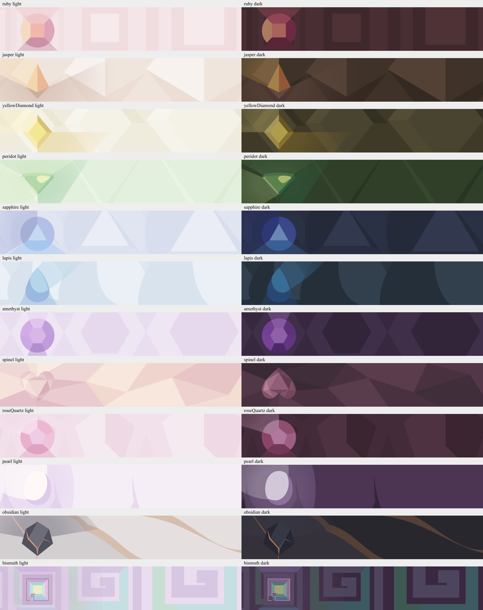

# SPN-086 paired banner artwork

Artwork refinement only; SPN-086 remains open for production personalization.
Final artwork approval belongs to the owner after local Storybook review.

Run `npm run storybook`, then open **Redesign → Appearance → Gems Light And Dark**
for side-by-side light/dark pairs with wide and phone crops. **Gems Collection**,
the individual **Space Ruby** through **Space Bismuth** stories, and **Gem Picker**
follow the toolbar's light/dark theme choice.

- Standalone SVGs: `src/ui/redesign/assets/gems/<gem>-light.svg` and `-dark.svg`.
- Source geometry and palettes: `src/ui/redesign/gemCovers.ts`.
- Preserved Spinel artwork: `src/ui/redesign/spinelCover.ts`.
- Regenerate all 24 assets: `node scripts/gem-covers.ts`.
- Regenerate the overview image too: `node scripts/gem-covers.ts --review`.
- [Review rubric](rubric.md), [independent art review](art-review.md),
  [independent integration review](integration-review.md).

The `references/` images are the owner's eleven attachments from 2026-10-26,
retained unmodified for review provenance. They depict Steven Universe gemstone
or character artwork; no ownership or open-source license is asserted. Background
SVGs are newly drawn geometric interpretations. The previous approved Spinel
is the twelfth reference. Obsidian uses the supplied character's charcoal/orange
lava identity; its focal stone is an interpretation awaiting owner review.

## Verified handoff

Independent art review: all twelve pairs passed at **95–100/100**, with no
blockers. Independent integration review: **10/10 for every pair**. Reports retain
all earlier below-threshold rounds and their actionable feedback, final category
scores and hashes of the exact reviewed sources. Final browser evidence includes
phone (390 px), desktop (1280 px), wide (2560 px) and all 48 light/dark picker
thumbnails at phone/desktop sizes. Approved light Spinel remains pixel-identical;
its dark counterpart is upside down as requested.

Local typecheck, lint/format, backlog validation and the relevant Storybook
interaction checks passed. This handoff does not claim full-suite or CI validation,
production SPN-086 completion, or owner approval. The broader ticket stays open.
