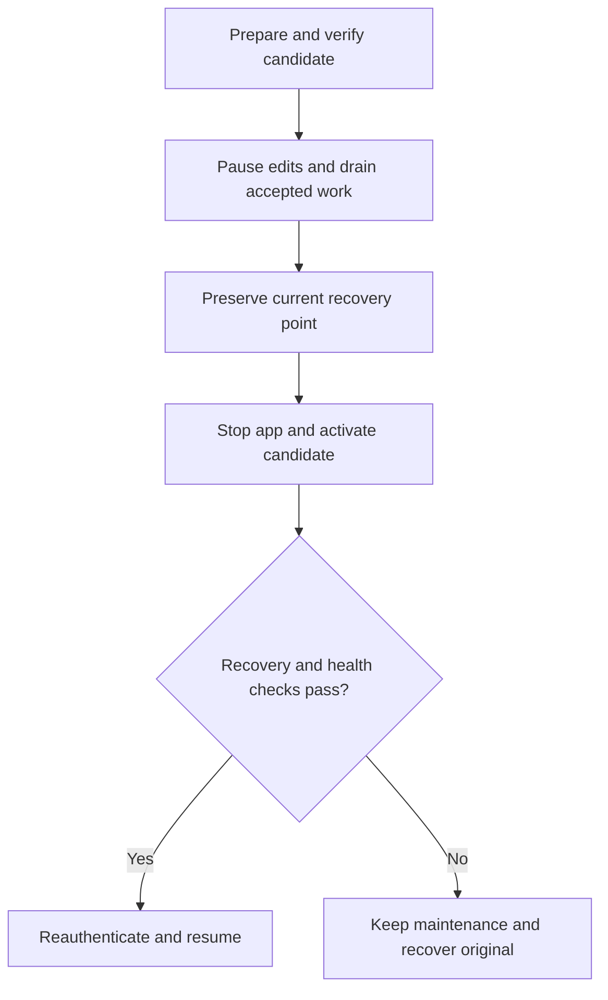

# SPN-063: backup options, deployment configuration and assisted restore

**Recorded:** 2026-10-27. **Status:** proposed design following the owner's
follow-up: manual admin downloads, automatic S3/DigitalOcean destinations,
per-database retention/backup settings, UI restore and scheduled maintenance
messaging. The [SQLite decision](SPN-063.md#accepted-decision-keep-sqlite-without-database-adapters)
and later [filesystem/pre-deployment direction](SPN-063.md#accepted-decision-implement-recovery-before-deployment)
are accepted. SPN-063 implements the filesystem destination, shared scheduler,
isolated verifier and read-only admin status. [SPN-109](SPN-109.md) subsequently
implements configuration and encrypted Admin downloads for filesystem/Spaces;
the owner deferred AWS S3 to post-production [SPN-114](../todo/SPN-114.md).
Diagnostics expiry, maintenance and assisted restore remain SPN-110–112. This discussion permits
a narrow **backup-destination** boundary; it does not reopen database-engine adapters.

**Recommendation:** one SQLite application dataset and one encrypted recovery
format; manual download alongside automatic filesystem or offsite backups;
separate disposable diagnostics retention; and a staged, supervised restore
operation. Deployment configuration owns storage credentials and policy. The UI
shows effective configuration and starts bounded actions. Implement assisted live
restore only after the isolated verifier and maintenance/restart lifecycle work.

The [runtime implementation record](SPN-063.md#runtime-implementation) and
[runbook](../backups.md#filesystem-destination-for-local-operation) identify the
delivered controls and actual JSON configuration. This appendix retains the
wider operating model without treating every proposed feature as completed by
the weekly verifier. Its baseline audit and test matrix preserve their original scope.

## Baseline before SPN-063 implementation

Audit baseline:
[`a9893ce3c72d0a707f97e4444f9b3f48a65dd226`](https://github.com/mxbaylee/spinel/commit/a9893ce3c72d0a707f97e4444f9b3f48a65dd226).

| Area | Current behavior | Proposed extension |
| --- | --- | --- |
| Workspace archive | [Archive code](../../src/server/backup/archive.ts) makes a consistent full SQLite copy, adds recovery metadata, compresses and authenticates/encrypts it. | Reuse one versioned bundle for manual and automatic recovery; add the main plan's complete inventory and semantic verification. |
| Automatic backup | [Service](../../src/server/backup/service.ts) schedules 02:00 UTC, retries failed attempts hourly, uses a database lease and records status. | Validated deployment schedule/policy; shared job coordination with manual export, verification and maintenance. |
| Backup destinations | [RemoteStore/SpacesStore](../../src/server/backup/spaces.ts) has a small put/list/remove test seam; production hardcodes a DigitalOcean endpoint/signing configuration. The concrete Spaces class also downloads. | A supported filesystem destination and one tested S3-compatible implementation with provider presets, sharing a common streaming download operation. No database abstraction. |
| Workspace admin UI | [App route](../../server/app.ts) and [BackupStatus](../../web/BackupStatus.tsx) expose status only. | Manual create/download, backup catalog and isolated verification first; assisted restore later. |
| Command line | [Backup CLI](../../scripts/deploy/backup.ts) can create keys, run/list/download backups and restore into a new directory. | Preserve independent cold-host recovery and reuse the same verified operation implementations. |
| Diagnostics | Separate bounded SQLite file; existing manual snapshot download and truncate in [routes](../../src/server/diagnostics/routes.ts). | Optional seven-day event expiry, retaining current byte/queue bounds. Automatic diagnostics backup stays off by default. |
| Live restore and maintenance | No admin whole-instance restore, edit-pause/unpause or scheduled-maintenance controller. | Explicit restart-safe lifecycle; no live-file replacement by an ordinary request handler. |

## Configure recoverable datasets, not arbitrary tables or paths

The deployment can expose fixed names that map to known internal stores:

| Dataset | Contents and default policy | Restore behavior |
| --- | --- | --- |
| **Workspace** | Accounts/passkeys/grants, Sheets/Docs, native Space structure, images, history, generations, accepted edits and retry/restore receipts, plus required recovery configuration. Manual encrypted download on; automatic backup enabled when configured, with its destination and offsite coverage explicit. | Restore the coherent application dataset. Do not restore document tables independently of their authority/history/receipt state. |
| **Diagnostics** | Metrics, logs and operational events in the existing separate file. Propose **seven-day live-event retention**, manual inspection/export available, automatic backup **off**. Existing byte limits still apply. | Not required for workspace recovery. Preserve useful incident evidence separately; normally start fresh after workspace recovery. |
| **Recovery control state** | Minimal operation journal, maintenance gate, active dataset generation and recovery authorization owned by the deployment, outside both stores above. | Must survive replacing the workspace and losing diagnostics. Not a general third application database or an operator-selectable backup plugin. |

“Documents” is a useful UI concept, but today it is not a separate recoverable
database. Splitting those tables would introduce consistency problems and more
operating work. The registry should be a fixed supported dataset mapping, not a
way for a web request to supply a filesystem path, database URL or SQL query.

### Three independent retention policies

1. **Live-data expiry:** seven days for diagnostic events, measured by trusted
   server receipt time. Run bounded cleanup and report failures. Keep byte limits
   too; a busy instance can drop observations before seven days. This is a maximum
   retention target, not guaranteed completeness. The current implementation has
   **no age-based deletion**, as [diagnostics](../diagnostics.md) documents.
2. **Recovery-point retention:** how long complete workspace backups survive.
   Preserve the current starting policy: newest point in each of seven UTC days,
   four Monday-based weeks and six calendar months, plus its existing safety
   holds. This is not a count of 17 distinct backups. Seven-day metrics expiry
   must not delete old workspace recovery points.
3. **Application history/trash policy:** checkpoint and deletion recovery inside
   the workspace. Backup retention does not prune that content. Its existing
   rules remain independent.

Deleting diagnostics rows does not erase old downloads, offsite copies or every
allocated disk page. If diagnostics backup is enabled later, give it an explicit
short archive policy and disclose that older exports persist independently.
Do not apply a new metrics TTL indiscriminately to future submitted feedback
(SPN-098); decide that data's retention separately.

## A deployment configuration shape

This **illustrative schema is not accepted by today's loader**. Names and
validation can be finalized during implementation. It separates policy from
destination credentials and supports manual plus automatic operation together:

```yaml
recovery:
  version: 1
  encryption:
    active_key_id: workspace-2026-01
    key_file: /run/secrets/spinel-backup.key
  datasets:
    workspace:
      manual_download: true
      automatic:
        enabled: true
        destination: primary
        schedule:
          at: "02:00"
          time_zone: Etc/UTC
      backup_retention:
        daily: 7
        weekly: 4
        monthly: 6
      verification:
        weekly: true
    diagnostics:
      data_retention_days: 7
      manual_download: true
      automatic:
        enabled: false
  destinations:
    primary:
      type: s3
      provider: digitalocean-spaces
      endpoint: https://nyc3.digitaloceanspaces.com
      signing_region: us-east-1
      bucket: example-private-spinel-backups
      prefix: example-instance/workspace
      credentials_file: /run/secrets/spinel-object-store.json
```

The example keeps today's UTC backup time and workspace retention. Those are
starting defaults, not newly demonstrated recovery guarantees. Proposed automatic
diagnostics opt-in would require a destination, schedule and explicit independent
backup retention; omitting them must fail validation rather than inherit long
workspace retention. Weekly verification applies to published recoverable
artifacts and reports blocked/missing configuration honestly.

For AWS, use an AWS preset with its actual signing region and SDK endpoint
resolution. For other S3-compatible services, require a reviewed trusted endpoint
and tested capability profile. Start with one automatic destination per dataset;
multiple simultaneous destinations add partial-success, retention and rotation
semantics that the initial product does not need.

Keep secret values out of checked-in examples, browser responses and logs.
Deployment supplies private mounted files or a supported credential provider.
Record a nonsecret key identifier and preserve old-key access for retained
archives. The decryption key must be recoverable independently of the host and
must not travel beside the bundle in the same download.

Use one source of truth: deployment policy is authoritative; the UI displays its
effective safe values and configuration errors. The first UI need not write back
deployment files. Separate recorded recovery metadata from live deployment
configuration: uploading an old bundle must not overwrite current endpoints,
credentials, maintenance controls or schedules automatically.

Manual-only operation can be useful for development/export, but it does not meet
the existing [offsite-before-daily-use requirement](../backups.md#current-sqlite-and-spaces-implementation)
unless an independent offsite recovery process is actually established. A green
manual download means browser handoff, not proof that someone retained the file.

## Filesystem destination and local acceptance

**Implemented foundation:** the supported filesystem destination now runs the same
backup, scheduling, retention, isolated verification and CLI restore services.
It is useful for development, recovery practice and operator-managed
copies. Keep a single concrete SQLite snapshot/restore path. Destination adapters
only publish, list, retrieve and remove encrypted artifacts; they do not own
schedules, encryption, semantic verification, retention policy or live cutover.

Separate shared recovery settings (key references, image/origin metadata, dataset,
schedule and retention) from destination-specific settings. The baseline loader
required Spaces fields even with an injected local transport. The implemented
[configuration loader](../../src/server/backup/config.ts) removes that dependency
for filesystem operation, validates shared settings and preserves old Spaces files.
The manual-only Admin workflow is implemented in [SPN-109](SPN-109.md), with
deployment-owned policy, bounded encrypted delivery and independent provider/host
launch acceptance.

For a development configuration, select `local` as the workspace automatic
destination in the future multi-dataset schema with this **illustrative,
unimplemented** entry. For the supported single-destination JSON, including exact
root device/inode identity, use the [current runbook](../backups.md#filesystem-destination-for-local-operation):

```yaml
destinations:
  local:
    type: filesystem
    root: /var/lib/spinel-local-backups
    prefix: example-instance/workspace
```

Deployment supplies the private destination root. A test harness creates its own
disposable private directory. Neither the browser nor an archive supplies this
path. A local destination needs no cloud credentials but still needs the archive
key, compatible immutable application image and recovery configuration.

### Filesystem publication and failure contract

- Write an exclusive temporary file inside the destination filesystem, stream
  bounded bytes, and verify the complete digest before publication. Only completed
  artifacts enter the catalog; partial files never appear as recovery points.
- Define and test the publication/durability procedure on supported filesystems:
  flush the payload, publish without replacing an existing artifact, and persist
  the directory update. A retry after an uncertain outcome must identify the same
  verified artifact or fail without overwriting it. Plain copy is not atomic,
  and a successful rename alone is not a power-loss guarantee. See Node's
  [copyFile contract](https://nodejs.org/api/fs.html#fspromisescopyfilesrc-dest-mode),
  Linux [rename semantics](https://man7.org/linux/man-pages/man2/rename.2.html) and
  [file/directory synchronization](https://man7.org/linux/man-pages/man2/fsync.2.html).
- Use a service-owned private root and generated instance/dataset/artifact
  identifiers. Reject traversal, absolute object keys and symlink escapes; bind
  operations to the validated root rather than trusting a string-prefix check.
  Private payload and staging permissions, bounded reads and safe error redaction
  apply to local copies just as to cloud objects.
- If configured on a mounted volume, verify the expected mount/volume identity
  before use and fail closed when it disappears or changes. A directory can still
  exist after its volume is unmounted. Never create a fallback root on the host
  disk or report success against the wrong storage. Recheck identity at publication
  and reconcile an interrupted job; existence alone is not the guard.
- Share job leases, retention holds and idempotent retry semantics. Cleanup removes
  only this instance's abandoned temporary artifacts after confirming they are
  inactive; retention cannot delete a point being verified, downloaded or restored.
  Preserve the newest good point and bounded failed-point inspection holds; do not
  prune after an incomplete or failed catalog listing.
  Do not recursively clean an operator-supplied path or follow links during deletion.
- Declare the supported filesystem/platform profile and byte/time limits. Start
  with local filesystems proved by the contract tests and the Linux deployment
  profile. Network mounts, sync folders and arbitrary removable filesystems are
  not automatically equivalent. Preserve existing archive/resource limits until
  measured changes are implemented; a new transport is not a larger capacity claim.

### Local success and offsite protection are different facts

Expose destination identity/type, latest successful publication, latest successful
isolated restore verification, and current failures. Track independent offsite
coverage separately. The baseline service labeled every transport success an
offsite recovery point; SPN-063 removes that assumption from the service and UI.
A same-host file or container bind mount may disappear with the live database.
Neither an adapter name nor a configuration boolean proves host-loss independence.

An operator-managed external copy may supply independent recovery only when its
actual location, retained key/image access and host-loss recovery process are
established. Keep unverified coverage visible; local success alone cannot turn the
offsite-before-daily-use requirement green. This distinction must be tested in
the status service and the admin presentation.

### Existing evidence and new acceptance work

Code audit at
[`e6bc58484894ac10ecc90cb3cade114d685abe4d`](https://github.com/mxbaylee/spinel/commit/e6bc58484894ac10ecc90cb3cade114d685abe4d):
the [native Space test](../../src/server/collaboration/space-native.test.ts)
already copies a real `BackupService` encrypted bundle into a local file, restores
it into a fresh directory, compares persisted rows and opens fresh native services
for content/access checks. That injected test transport is not a shipped filesystem
destination. The [scheduler test](../../src/server/backup/backup.test.ts) already
injects time, but mocks `run()`; it does not yet prove scheduled archive creation
through a real filesystem destination. The [production container smoke harness](../../scripts/ci/container-smoke.ts)
provides a starting point for constrained process lifecycle checks. These are
source observations, not newly executed tests or results of this planning change.

| Layer | Required pre-deployment acceptance | Limit of the evidence |
| --- | --- | --- |
| Destination/configuration | The same publish/list/download/remove contract for real filesystem storage and advertised S3 presets. Local configuration needs no cloud fields. Check private paths, collisions, digest failures, partial publication, missing/changed mounts and bounded cleanup. | SDK mocks and filesystem success cannot certify a real provider's IAM, endpoint or API behavior. |
| Scheduler and retention | Advance an injected clock through due/missed runs and retries while the real service creates encrypted files; verify one run under competing leases, restart catch-up, cancellation/shutdown and retention holds. Use isolated owned fixtures. | A mocked `run()` proves only scheduling decisions. Fast-clock tests cannot establish real copy duration or clock/host behavior. |
| Recurring verifier | Restore actual published files into disposable targets with no app traffic/outbound side effects; check authenticated inventory, native content/images/history, account/grant/guest invariants, old/new keys and corruption. Preserve last success with a current failure. | Passing archive integrity alone does not prove application recovery. An isolated check never activates its candidate. |
| Admin actions | When each action is implemented, exercise manual download, configured-backup selection and upload against real artifacts; test authentication/authorization, invalid/large input, retries/cancel, visible coverage and failure states. Include independent light/dark/phone review. | Existing status fixtures and document-version restore tests do not prove whole-workspace restore. |
| Maintenance and activation | In disposable real processes or production containers, pause every writer, drain/fence accepted work, preserve rollback, close all handles, activate a generation, restart under maintenance, verify access/content and resume. Keep authorization/journal outside the replaced database. | A no-op stop/start mock does not prove handle closure, WAL ownership, proxy maintenance or safe reentry. |
| Crash recovery | Kill the worker/app/controller at publication and each cutover transition, then start fresh and assert journal reconciliation, bounded cleanup, maintenance state and original/candidate/rollback integrity. Reconnect old clients and offline queues. | Thrown errors execute cleanup paths that a killed process may skip. Process termination tests do not simulate storage power loss. |
| Performance and resources | Run native two-editor fixtures with images/history and overlapping backup/verification under declared limits; record memory, disk/WAL/staging peaks, latency and recovery time against budgets chosen first. | Local/CI measurements are qualified by their environment; actual target-host acceptance is still required. |

Use test-controlled barriers at durable transitions instead of timing sleeps to
make crash tests reproducible. The external harness must clean up its own killed
processes/containers and temporary directories without relying on the app's
`finally` blocks. Preserve the repository's single-heavy-workload memory guard;
CI can run the constrained production-image checks. Test-only time/failure controls
must not become public production endpoints.

### Provider and host acceptance before public launch

A real S3/Spaces contract run can happen from a workstation or CI **before the
application is deployed**, using authorized credentials and a bounded isolated
prefix. Verify private access, endpoint/signing, upload/readback/download,
pagination, publication, retention/deletion and credential rotation. Record and
clean up only that run's artifacts; missing access is pending evidence, not a
reason to block independent local implementation. Do not infer resource spending
or credential access from this documentation decision.

[SPN-038](../todo/SPN-038.md) owns the remaining launch gate: run the selected
provider contract if still pending, check the actual target host's encrypted
mount and filesystem behavior, measure the agreed recovery/resource budgets,
and demonstrate cold recovery using independently retained archive/key/image
access. Include the maintenance/supervisor path if that feature will be enabled.
Retain CLI recovery when the web app is unavailable. Local completion does not
waive these checks, and provider/host access is not a prerequisite for completing
SPN-063's pre-launch implementation and local acceptance.

## One S3 destination implementation, with compatibility tests

The useful adapter boundary is transport: publish an immutable encrypted bundle,
list completed points, stream a selected point, and delete eligible points.
Artifact creation, encryption, inventory, retention policy and semantic checks
remain shared concrete SQLite recovery code. The current `RemoteStore` is a
starting point; extend it only for the operations the supported flow needs.

S3-compatible does not mean identical behavior. Current `SpacesStore` explicitly
sends `ACL: private`; new AWS S3 buckets default to bucket-owner-enforced ACLs
disabled, which rejects unsupported ACL values. AWS's
[Object Ownership reference](https://docs.aws.amazon.com/AmazonS3/latest/userguide/about-object-ownership.html)
supports omitting the ACL header for that configuration. DigitalOcean documents
[partial S3 compatibility](https://docs.digitalocean.com/products/spaces/reference/s3-compatibility/),
including differences in copy, lifecycle and encryption support. Simply changing
the endpoint is not sufficient validation.

Prove each advertised preset's signing/endpoint/addressing, private access,
streaming upload/download, interrupted-upload cleanup, checksum/readback,
pagination, publication and deletion behavior. Respect the current 5 GiB upload
cap until bounded multipart upload/abort is implemented and tested. An ETag is
not a generic SHA-256/content-proof contract. Continue application-controlled
authenticated encryption; provider encryption at rest serves a different purpose.

List only complete published points in the restore picker. Verify selected bytes
against their authenticated manifest and enforce instance/dataset identity. A
foreign-instance archive requires an explicit supported import/recovery workflow;
silently mixing it into the current timeline is unsafe. Hold a point during
download/verification/restore and retain failed points for bounded inspection.
Versioning, object lock and provider lifecycle rules need explicit policy because
deleting a current object may leave historical versions or be disallowed.

## Manual downloads and automatic jobs share one recovery format

**Download workspace backup** should create the same encrypted `.spinel` recovery
bundle used offsite. It must work without cloud credentials once local key/image/
recovery-configuration prerequisites are met. Decouple local artifact creation
from remote publication; today's `BackupService.run()` requires remote config.

Do not copy the live `.sqlite` file directly: committed state can remain in WAL,
as the [experiment](SPN-063-experiments.md#1-an-apparently-healthy-raw-copy-can-omit-committed-work)
demonstrates. SQLite supports consistent
[online backups and VACUUM INTO](https://www.sqlite.org/backup.html). Routine
backups therefore need not require a site-wide maintenance window, although the
current synchronous copy can cause foreground pauses that must be measured.
Do not keep edits paused through compression, upload or a slow browser download.

Run long jobs outside the HTTP request lifetime, with bounded staging and visible
progress/cancellation. Stream downloads and uploads; do not hold multi-GiB files
in browser `response.blob()` or server memory. The existing diagnostics download
is small and has different constraints; reusing that browser buffering approach
would be inappropriate for full workspace archives. Use authenticated,
short-lived download authorization, no-store responses and redacted job status.
Recheck access before delivery. Cleanup must handle disconnect, expiry and restart.

Manual and scheduled backups use the same exclusive job/resource coordination.
If one is already running, expose that job or queue a bounded request instead of
creating competing snapshots. Distinguish snapshot time, upload completion,
last verified recovery time and manual browser handoff. A failed new job keeps
the last good result visible.

The Operator's application role still cannot browse documents. A workspace
download must remain encrypted, and the UI must not offer archive decryption or
content preview. Infrastructure access or possession of both archive and key
already permits reading contents; the design must not imply cryptographic
exclusion from that actor. Require fresh Operator authentication for sensitive
export/restore actions and log only nonsecret operation evidence.

## Assisted restore is a supervised maintenance operation

Use two inputs to one preparation flow: **choose a configured backup** or
**upload a previously downloaded Spinel bundle**. Automatic backup is not a
prerequisite for upload-based restore. Arbitrary bare SQLite files lack the
authenticated recovery inventory/configuration; keep them out of the ordinary
UI flow. An advanced offline repair/import path would need its own documented
validation rather than silently pretending such a file is a complete bundle.

The preparation screen should show the dataset, source instance, snapshot time,
application/schema compatibility, verification coverage, estimated resources and
the acknowledged work that will be discarded after that point. Stage/download,
authenticate, inspect and verify in isolation **before pausing edits**. Missing
keys, incompatible versions or insufficient disk should block at this stage.



An actual cutover needs all of the following:

- **Explicit current authority and intent.** Reauthenticate the current Operator
  and confirm the exact artifact, target instance and rollback consequence. Use
  CSRF/origin protection, single-use authorization and idempotent job IDs. Do not
  derive authorization from credentials contained in the candidate backup.
- **Server-enforced pause and drain.** Stop new mutations at HTTP, sync and job
  boundaries, allow already accepted work to finish, then fence retries. Pause
  document/history/trash, invitations/access changes and other workspace writers.
  Drain to a bounded deadline; fail safely if that cannot be established.
- **A current rollback point.** Preserve the complete pre-restore dataset and
  required configuration before destructive activation; plan space for current,
  candidate, rollback and staging/WAL. If the current dataset is already broken,
  preserve available evidence and surface that rollback cannot be guaranteed.
- **External recovery control.** Authentication, ordinary leases and backup status
  live inside the database being replaced. Keep a narrow deployment-owned
  maintenance gate and durable operation journal outside it and outside
  diagnostics. A trusted supervisor carries the operation across app shutdown
  and restart. A scoped recovery authorization must survive only that operation;
  preserve a separate cold-host credential/CLI path if normal auth is unavailable.
- **Closed handles and crash-safe activation.** Stop every app/worker using the
  live dataset before replacement, including WAL owners. Activate a complete
  candidate generation with a filesystem procedure proved on the supported
  deployment; never rename just the main file while old handles/sidecars remain.
  Persist enough progress to recover a crash at each transition. Start the
  compatible pinned app under maintenance, with jobs still gated.
- **Safe reentry.** Apply the main plan's recovery epoch, revocation reconciliation
  and session/retry fencing. Old browsers and offline queues must not silently
  replay newer work over a restored timeline. Verify critical read/edit/deny
  behavior with isolated fixtures, require current recovery authority to resume,
  and retain the previous generation for a bounded rollback period.

Do not build this by giving the normal web app an unrestricted Docker socket or
shell-command API. The supervisor's allowed operations, paths and generation
identifiers must be narrow and validated. If the deployment cannot yet provide
that control path, the UI can prepare/verify a restore and offer the existing
offline activation instructions. It must not claim live replacement is available.

After an interruption, prefer visible maintenance to silently reopening an
unknown database generation. A failed candidate can return to the preserved
original only through the same verified activation procedure. Once users have
resumed and written new work, a later rollback is another explicit restore with
potential loss; it is no longer a harmless automatic undo.

## Pause, resume and scheduled notices

Expose application terms: **Pause edits**, **Resume**, and **Restore workspace**.
Avoid a generic “lock database” control backed by a long SQL transaction. An edit
pause and the encrypted volume's unlock are different operations; the UI should
not merge them.

A scheduled notice can say “Maintenance Friday at 8:00 PM Pacific” with a full
date, duration estimate and local-time equivalent. Store the selected absolute
instant and IANA zone, for example `America/Los_Angeles`, so daylight-saving
changes are handled deliberately. A recurring local schedule needs an explicit
policy for missing/repeated local times and missed jobs after downtime.

Keep **notice**, **pause schedule**, and **restore authorization** distinct:
publishing a banner must not authorize a destructive restore. Default to an
announced window with an Operator-initiated restore. Make cancellation and the
current job state visible; late or failed work must not disappear when the
advertised end time passes. No email/SMS notification system is required for
this first in-app capability.

Before the pause, connected people should see the planned time and whether their
edits are acknowledged. During it, reconnecting clients receive authoritative
maintenance status; offline edits remain clearly local and are reconciled with
the new epoch after restoration. Do not promise that all offline devices received
the banner. If the app stops, a minimal proxy/maintenance response must remain
available independently of its SQLite file, without exposing private job details.

## Recommended sequence and acceptance

1. **Filesystem destination and shared configuration:** implement the accepted
   filesystem contract, separate common recovery policy from provider settings,
   expose truthful local/offsite status, and exercise real scheduled archives.
   Preserve the current Spaces path and its regression coverage.
2. **Repeatable isolated verification:** complete SPN-063's original integrity,
   semantic, resource, rotation and last-success/failure acceptance against real
   local artifacts. Verification never activates the recovered dataset or its
   archived jobs. These first two steps are SPN-063's pre-launch delivery.
3. **Exports and configuration increments:** manual encrypted workspace download,
   validated S3 presets and dataset policy; seven-day diagnostics expiry remains
   a separately bounded change. Register concrete follow-up scopes before coding.
4. **Maintenance controls:** server-enforced pause/drain, external durable journal,
   restart recovery, safe client messaging and proxy status. Prove failure at
   every transition with actual local process lifecycles before live replacement.
5. **Assisted restore:** configured-backup picker and manual upload feed the same verified
   candidate flow, controlled activation, authority reconciliation and rollback.
   Scheduled notices can accompany this stage; unattended scheduled restore is
   unnecessary for the initial design.
6. **Launch acceptance:** verify the selected provider and actual target host in
   SPN-038 before public exposure, retaining the independent cold-host drill.

Each increment needs its own concrete implementation scope when work starts.
Steps 1–5 can be implemented and validated before deployment; real-provider
contract checks can also run early when authorized access is available.
SPN-063 implements steps 1–2, including read-only status presentation and the
independent CLI. SPN-109 implements step 3's Admin exports/configuration for
filesystem/Spaces, with diagnostics expiry in SPN-110; SPN-111 owns step 4 and
notices; SPN-112 owns step 5. Those remaining controls and actual
real-provider/target-host acceptance in SPN-038 retain their separate gates.

Acceptance must cover both manual-only and automatic configurations; wrong/old
keys; private AWS/Spaces access; interrupted transfer and bounded staging;
retention holds; double-click/retry/cancel; Operator access expiry; concurrent
edits and offline reconnect; auth-database replacement; restart or host loss at
each cutover step; unavailable image/key; failed checks and rollback; and current
light/dark/phone review for the implemented screens. Preserve the independent
command-line fresh-host drill: an in-app restore button is unavailable when the
host or application itself is gone.
