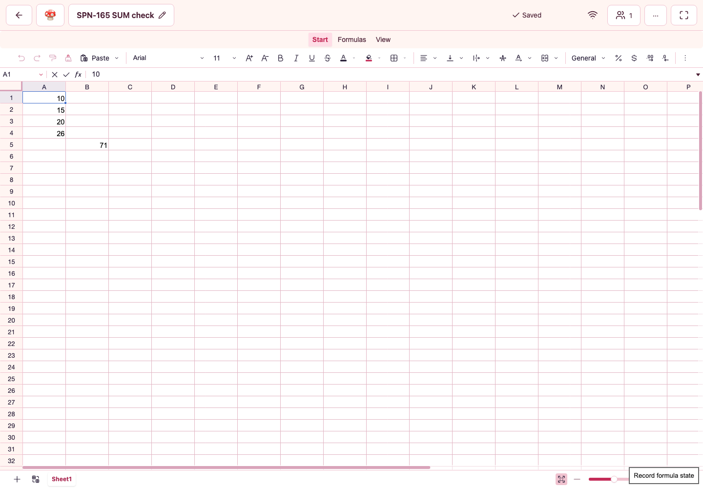

# 🧮 SPN-165 phone Sheet formula investigation

## 🔎 Scope and capability checkpoint

**2026-11-22, in progress; agent assessment: L.** The complete outcome includes
calculation, authored/saved state, IndexedDB durability, offline replay and writer
handoff, rendering, physical before/after observations, focused regression proof,
two exact-head independent reviews, seven CI gates, squash merge and guarded
cleanup. Native/platform investigation and verification make the original M
estimate too small. No requirement is split or waived; grooming is outside scope.

Fetched base: `cc9e9fd2222b12d87f0213e4d481409feb195ace` (SPN-164, #303).
The clean main checkout, local/remote branch and worktree inventories, exact-title
PR search, four unrelated open PRs and active-chat inventory found no existing
SPN-165 implementation or competing owner. This chat owns only
`codex/spn-165-phone-formula` in the primary checkout. Unrelated refs/worktrees,
processes and evidence remain untouched.

No `adb` was available on PATH or in the standard SDK/Homebrew locations; no
accessible Android debugging session was established. This does not establish
that the owner's phone is absent or incapable. Prepare and rehearse an exact-build
disposable fixture before requesting physical actions. SPN-154/SPN-164 waivers
and CI rerun exceptions do not apply.

## 🧭 Diagnose before repair

**Accepted, agent judgment following owner instructions, 2026-11-22.** The
reported Pixel 10 / Chrome 157.0.8103.78 installed-app observation used PR #289
build `ccc201ef`: A1:A4 = 10, 15, 20, 26; B5 = `=SUM(A:A)`; desktop displayed 71
and phone displayed no value. Seen once, unreproduced; offline editing also
occurred. Neither the historical cause nor a #289 regression is established.

Compare the same fixture's authored formula/inputs, native calculated state,
server and device snapshots/outbox, and actual visible result before changing
behavior. Forced recalculation, retries and longer waits cannot substitute for
this comparison. Preserve the first failure and distinguish fixture failures.

Initial source trace (a lead, not runtime proof):

- `web/SheetEditor.tsx` selects `NO_CALCULATION` for an enabled offline session;
  `web/sheetPreset.ts` retains engine options while replacing mobile UI plugins.
  `enabled` means a downloaded copy exists, including while online. The loader
  prefers `OfflineSession.initial()`: recovery snapshot, confirmed checkpoint,
  then downloaded bundle, validated before native creation. Thus an online
  prepared reopen can also use a cacheless authored snapshot with calculation
  disabled. This is distinct from connectivity or a missing server response.
- `lib/sync-transform/src/native-values.ts` excludes calculated scalar caches
  from authored-content equality/hash comparisons; this normalization is not
  evidence that every persisted snapshot strips caches. `transform.ts` excludes
  formula-result mutations from sync. `lib/sync-server/src/native.ts`
  intentionally does not calculate.
- `lib/sync-client/src/native.ts` applies live peer changes with `fromCollab`,
  without `onlyLocal`, so native dirty-range calculation can run. Confirmed
  replicas use authored state. `web/offline/replayHost.ts` uses that native
  replica and the existing durable checkpoint/authority/writer-reservation path.
- `web/spinelSync.ts` already has an explicit evidence-build read-only native
  snapshot event. Normal builds do not expose it.
- SPN-103's bounded admission/retry recovery belongs to live **Doc** Formula
  requests; native Sheet SUM is a separate boundary. Its authority, cancellation
  and no-blind-retry constraints remain relevant, but its queue is not evidence
  of this incident's cause. SPN-090 own-phone findings distinguish observations
  from code leads; SPN-156's exact-content replay guarantees remain acceptance.

**All four personas:** Owner needs intact inputs/formulas and trustworthy values;
Collaborator needs the same result without replay duplication or writer races;
Operator needs bounded, private fixture evidence and unchanged resource limits;
Link guest must retain scoped/revocable access with no new private-source access.
Selecting a repair before observation risks all four contracts. Supported
functions, authority, durability and recovery are unchanged during investigation.

## 🧪 Test plan and evidence

Planned: extend the lowest meaningful existing native/configuration owner once
the failing layer is observed; use selected production browser acceptance for
online load and prepared-device offline edit/reconnect, with exact server/device
content and native-value observations. `e2e/sheets.spec.ts`,
`e2e/native-sheet-value.ts`, `e2e/offline-fixture.ts` and
`e2e/sync-snapshot.ts` are existing fixtures to reuse. Canvas visibility is a
separate observation from native Copy/model values; 390px emulation is not a
physical phone. Keep relevant source/shared inputs in the CI selection plan.

### 🔬 Observed baseline boundary

Unchanged production source at the fetched base, pinned Node 26.13.0 and Univer
1.3.1. A disposable observation build adds read-only native inspection and an
explicit report button; it does not recalculate, edit cells or alter sync.
Runtime identity: `c2d1fcc9075a4fd4`. See the maintained evidence summary for
source/output/archive hashes and first-failure dispositions.

[Bounded baseline evidence](evidence/SPN-165/baseline-summary.json) retains the
native comparison and partial browser observations. The private archive verifies
all 149 extracted members against SHA-256; it preserves bulky build assets,
raw reports, original fixture mistakes and duplicate captures without adding them
to the PR. Its location/hash is in that summary.

- Actual Chromium desktop, online/unprepared: A1:A4 remained 10/15/20/26;
  native B5 and the visible grid both showed **71**, with `f = =SUM(A:A)`.
  The authenticated server snapshot retained the formula with no `v`.
- After **Available offline on this device**, the existing editor still had 71;
  the IndexedDB bundle retained the formula with no `v`. This is an authored
  snapshot needing local calculation, not proof of lost authored data.
- That browser run was resource-aborted during prepared reopen. Its partial
  results do not prove that reopen fails or passes. No mobile result was obtained.
- A separate small native comparison used the same seeded cells, real OSS
  plugins and Rendered lifecycle. At the same bounded 250 ms observation point,
  `NO_CALCULATION` produced **null**, intact formula and no calculation commands;
  `WHEN_EMPTY` produced **71**, intact formula and the normal calculation/result
  mutation sequence. No explicit recalculation command, edit or retry was used.
  This identifies a missing-initial-calculation mechanism, rather than a
  rendering-only mechanism, in the controlled comparison. It is not causal
  proof of the historical Pixel event or completed application acceptance.

The disabled setting originated before PR #289 (history points to SPN-053,
`e1b26cc4`); this alone does not date or prove the historical symptom. The existing
`IMAGE()` guard must continue to block external image loading offline. The
nearest existing browser negative is `e2e/offline-editing.spec.ts`'s “editing
IMAGE formulas offline makes no external image request while normal formulas
still calculate”; retain its meaning when testing an initial-calculation repair.

Independent nonimplementing diagnosis audit `/root/diagnosis_review` agrees with
this lead and its limits; no completion grade or runtime acceptance was issued.
The smallest plausible repair is confined to the live editor's initial
calculation setting. Preserve the distinct `snapshotViewer` suppression (that
preview lacks the live editor's IMAGE guard). Before accepting a repair, add
mixed SUM+IMAGE initial-load privacy proof and unrelated-cell offline replay:
editing a dependency can trigger recalculation and conceal a startup defect.

### 📱 Concrete physical prerequisite

The [phone checklist](SPN-165-phone-check.md) names the exact baseline and actions.
The HTTP/2 disposable tunnel preflight verified the emitted runtime, service
worker hash and fresh invitation. Initial DNS unavailability was preserved as a
fixture-readiness outcome, not a phone failure. The phone-only action request was
sent after that preflight; no phone observation has yet been received. Hosting is
bounded by the shared serial/RSS watchdog and must use a fresh verified window
after expiry. No existing account, installation or real document is part of this
fixture. Owner participation is an execution prerequisite, not product approval.

The first verified window expired normally after 445 seconds with **zero phone
reports**; the pre-expiry account check had zero test passkeys/sessions. Its
server and tunnel exited, their PIDs are absent and port 3165 has no listener.
The invitation in the original chat request is now expired. A fresh verified
window is the next action when the owner is ready; the full private window
archive also passed extracted-member hash verification. No physical result is
inferred from successful fixture readiness.

Checkpoint verification: `backlog:check` and `git diff --check` passed; new local
Markdown links and evidence JSON were checked. `backlog:index` regenerated the
L/22 entry; `backlog.json` and its current counters remain unchanged. No
production source file changed. Retain this unmerged ticket branch and private
archives as unique active work; no unrelated branch/worktree was removed.

Remaining: physical baseline; actual prepared reopen/offline-edit/reconnect
native/render observations; a justified repair and deterministic negative control;
current-browser and physical after evidence; any required light/dark/390px visual
approval; exact-head independent grades; seven CI gates; landing and cleanup.
No repair, waiver, PR, validation push or completion is claimed at this checkpoint.
Diagnostics inventory (`document-open`, local save, server acknowledgement,
checkpoint and replay) was inspected: production emitters remain unchanged.
Private fixture reports are separate from production diagnostics and bounded to
16 reports / 64 KiB per request; they contain only this synthetic test workbook.

### 📱 Resumed physical handoff, 2026-11-23

Resumed from `64accc23a42072a94663c99a89207e64fbeb8cf4`. Fetch confirmed
`origin/main` remains `cc9e9fd2222b12d87f0213e4d481409feb195ace`.
Branch/worktree, exact-title PR, remote-branch and active-chat inventories were
rechecked: this checkout remains the only SPN-165 branch; its previous chat is
idle; no implementation PR, remote SPN-165 branch or competing active owner was
found. Five unrelated open PRs, all unrelated worktrees and their unique work
were preserved. No old fixture process was running.

Both archived bundles and manifests matched their recorded hashes. The identity
manifest, 13 source hashes, 52 emitted assets and three hosting/watchdog scripts
also matched. The private integrity receipt is
`/private/tmp/spn165/resume-20261123-integrity.json`.

Fresh window `/private/tmp/spn165/phone-resume-20261123-1103` verified the runtime,
service worker and new invitation on its first readiness attempt at
`2026-11-23T11:03:12.888Z` (03:03 PST). Its `ready.json` and `readiness.json`
bind unchanged baseline source `cc9e9fd` to runtime `c2d1fcc9075a4fd4`.
The existing serial runner and process-tree watchdog own this bounded window;
it expires around 03:10 PST. The new invitation is private and supplied only in
chat. Do not reuse it after expiry; inspect reports and verify owned cleanup
before another window. Closure and physical observations are still pending at
this handoff, not inferred from readiness. Preserve and hash-archive this window
after closure using the same extracted-member verification as the first window.

No production behavior, acceptance requirement or completion counter changed;
no repair, validation push, review grade or merge is claimed. The next action is
the installed Pixel baseline in the existing phone checklist, preserving the
first visible result and native reports before selecting the repair.

### 📱 First received physical observations, 2026-11-23

The owner-ready window verified the same baseline/runtime at 07:38 PST and
expired normally after 445.160 s (peak 409,808 KiB, no resource abort). Owned
server/tunnel processes are absent. Its private archive and all 14 extracted
members were hash-verified; exact hashes and observations are in
[the evidence summary](evidence/SPN-165/baseline-summary.json).

One physical-phone report arrived: initial online, unprepared native B5 was 71,
with intact `=SUM(A:A)` and A1:A4 = 10/15/20/26. No prepared-reopen, offline or
post-sync report arrived. The owner reported syncing from the file list and
corrected the actual edit location to **C5**, not planned C1. A read-only query
of the stopped server's database found revision 2 with C5 `=SUM(A:B)`, unchanged
inputs and B5 formula, and one accepted revision after the seed. This proves
the authored edit reached durable server state; it does not alone establish
the offline/replay path, device durability or post-reopen calculated value.
The formula-only server snapshot has no calculated cache, as expected for this
server boundary. Do not substitute the initial native value for visible canvas
or later-stage evidence. Current Chrome version and explicit visible B5 results
remain unreported; clarification was requested.

The owner could see the formula when opening the keyboard, but reported the
value/edit banner missing or obscured and the editor bouncing while editing.
The private observer uses a fixed bottom-right button at z-index 99999; overlap
with native controls is plausible and contaminates visual acceptance. Relocate
that observer before another physical run, preserve this first observation, and
record the new observer/build identity separately. Do not attribute this overlay
to production UI or dismiss the separate keyboard-movement report as explained.

Owner steering requests a stable, always-visible bottom editing control and
consideration of the existing edit pen icon. Before implementing that expanded
UI outcome, trace the native mobile input/viewport ownership and reassess scope
alongside the formula repair; preserve the original calculation, replay, privacy
and physical acceptance requirements. Owner and Collaborator gain discoverable,
stable editing; Operator needs a bounded native integration; Link guest must
retain view-only/access behavior. New design patterns, production stories and
exact-head light/dark/390px independent visual review remain required. No UI or
formula repair, acceptance pass or completion is claimed by this checkpoint.
