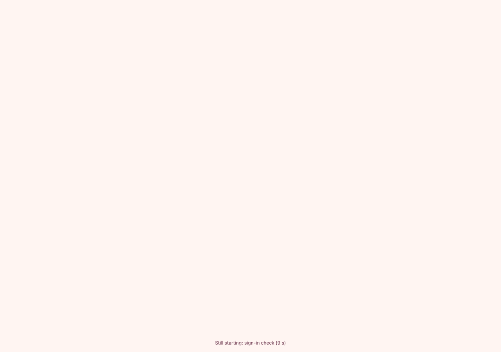
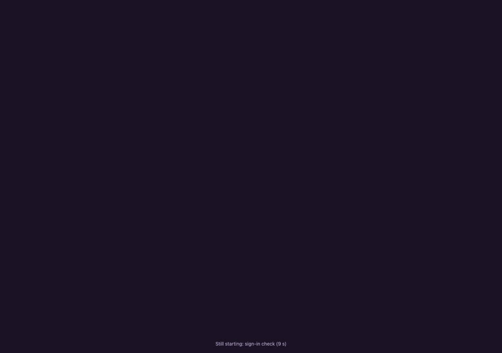
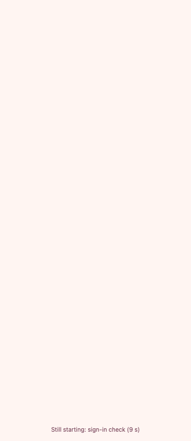
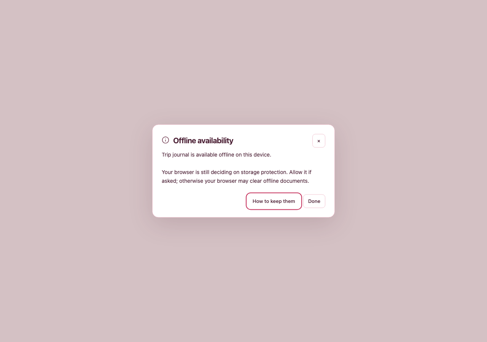
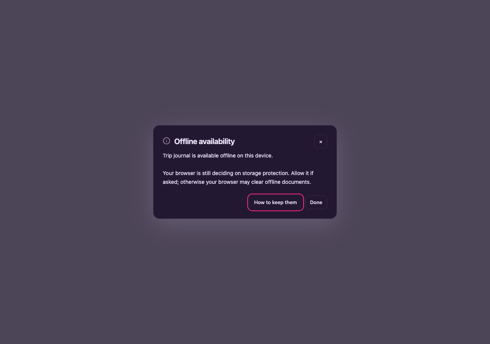
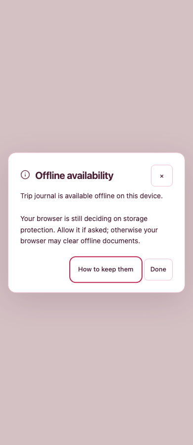

# 🔬 Current SPN-090 integration evidence

This is the integration of actual PR head `af7a6cf0562d132be76b251473d917c5cce97bf4`
with main `ebf0842f51b60d54649cf8a03065914bec0944bf`. It replaces the mistaken
older-source integration for review. [Receipts](receipts.json) identify exact changed
source content with SHA256 and retain each guarded execution, elapsed time and peak
process-tree RSS. The final candidate commit includes these evidence-only records;
no historical phone observation is assigned its SHA.

- **Passed:** private locked install; allocation of 154/155/156 using the backlog CLI;
  formatting and index generation; 202 Vitest tests across 10 relevant runtime files;
  23 Node tests covering bootstrap evidence, origin parser, image pixels, renderer grouping
  and CI routing; complete lint/dependency/format check.
- **Compiler pending:** guard terminated it after 2.296 seconds at 1,505,152 KiB under
  changing ambient pressure. No compiler diagnostic or pass. No repeated unchanged run.
- **First failures preserved:** formatter refused before launch under elevated pressure;
  successful later run started under normal pressure. Initial Storybook command used a
  nonexistent CLI path; no build ran. The corrected installed-package entry built successfully.
- **Visual build passed:** production Storybook with the unchanged production main/preview
  and only the StartupStage/OfflineAvailability stories selected. 4.802 seconds,
  1,020,976 KiB peak. This deliberately narrower local catalogue is not the full hosted
  Storybook/native acceptance run. The compressed config and capture script are retained.
- **Capture passed:** six current story views plus two actual icon sizes; 3.081 seconds,
  717,008 KiB peak. All story play functions completed successfully, no page errors or
  horizontal overflow. Guidance was closed after the pending-protection story's interaction
  so the changed pending message is visible. Every owned browser/server was closed.

Full compiler and hosted/native/real-browser owners remain pending. The warm Dashboard
browser scenario includes both disconnect-after-listing and a deep link whose list/item
requests fail before metadata reaches memory. Its prior wrong fixture database was corrected
to the established server `app.sqlite`; its actual hosted execution remains required.
Independent exact-head grading and visual approval are separate, pending gates.

## 🎨 Current visual gallery — agent review only

These are actual production DOM/component renders from the focused production Storybook
build. Desktop captures are 1280×900; phone captures are 390×900. They are not physical
launcher screenshots. [Manifest](visual/manifest.json) records file/source identities.

The startup story isolates the actual pre-React status element with a representative
“sign-in check” stage at nine seconds. It does not claim to render the entire App loading
screen or exercise real startup timing; the timer lifecycle has its unit owner.

Pending browser storage protection, after closing guidance:

Installed icon: actual production `iconSvg()` rendered with the same Sharp resizing
path used by Vite installation assets, at 192 and 512 pixels, for `any maskable` use.
The owner selected the 2.5-unit downward optical adjustment on their Pixel launcher;
these images show the generated asset, not a newly observed launcher result.
The prior 0/4.5-unit phone trials are documented observations without retained screenshots.

