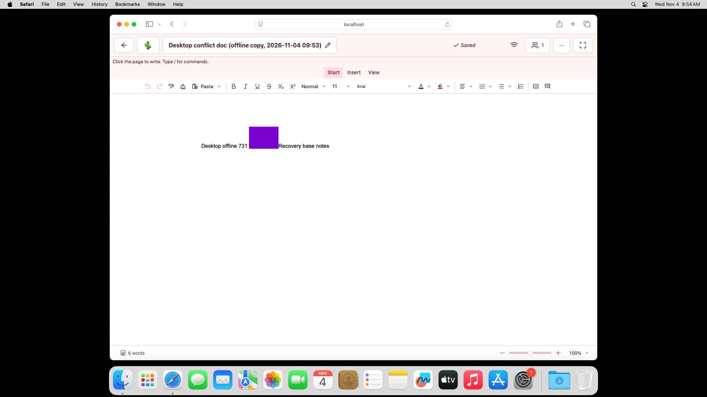

# 🔬 SPN-137 — second complete execution, missing native movement

This is a preserved **failed execution**, not current acceptance. The exact
source, base, tested merge, tree, provider identities and all artifact hashes
are in [manifest.json](manifest.json). Workflow
[41809367268](https://github.com/mxbaylee/spinel/actions/runs/41809367268), attempt
1, used source `7ce6870beb84a594cf8487c6422c14077c04996e` and tested merge
`30016f1305ce6bcd9574c51ee7e2857405b5db34`. Chrome and Firefox passed; Safari job
`126504446824` failed before posting its fifth native click.

## 📦 Durable original records

`records.json.gz` is standard gzip of a JSON envelope containing 27 original
UTF-8 source files. Each row has its original relative path, byte count,
SHA-256 and exact `content` string. It retains all three full acceptance reports,
versions, workflow job logs, job/artifact/member verification records, final
run/attempt/provider responses and source/tested Git objects. Safari's complete
profile probe, render-state JSONL and five pointer rows are also included.
No acceptance fields, image byte rows or pointer observations were omitted.

To inspect the envelope without executing any input:

```sh
gzip -dc records.json.gz > records.json
```

Verify the compressed and decoded hashes/lengths against `manifest.json`, then
verify each original file's UTF-8 content against its recorded hash/length.
The manifest also retains every original ZIP member's hash and byte count.
Original ZIPs, nonselected images and raw driver logs remain supplementary,
expiring artifacts; their individual dates are recorded in the manifest.

## 🖱️ First failed boundary

At `2026-11-04T09:54:12.730Z`, invocation 5 targeted Safari process `11555`, window
`83`, tab `1`. Its window was frontmost, visible and unminimized. The helper
constructed and validated movement event type `5` at screen point `(960, 510)`,
and returned from one Quartz post. That count records returned calls to a void
posting API; it is not a delivery acknowledgement.

The final page observation was `moved: null`, `clicked: null`, `events: []`,
`ready: true`. Events are recorded before trust/coordinate correlation, so
loosening coordinate matching would not address the observed empty event list.
The phase stayed `move-observation`; no `clickPost` exists. Observer removal
succeeded. Actual native cursor position was never sampled by this source, so
same-position suppression, coalescing and a specific OS/browser mechanism remain
unproved. All four preceding pointer invocations delivered matching movement
at the same calibration point and a matching trusted press.

Safari recorded 32 stages. Four restarted records, both normal revision-2
reconnects and the recovered Sheet conflict-copy check completed. The recovered
Doc reached its copied content and image, but its native-content check failed;
the completed Doc conflict-copy stage, storage deletion and post-loss offline
checks were not reached. All three owned browser/driver exits succeeded, with no
recorded teardown error. Neither the complete workflow nor Safari passed.

## 🖼️ Actual native failure view

Root and independent reviewer B inspected both original failure views. This
original full-screen PNG preserves the native Safari frame and surrounding OS
state. The recovered Doc visibly contains `Desktop offline 731`, the purple
inline image and `Recovery base notes`, with a `6 words` footer and no visible
blocking dialog. The image does not show the native cursor and does not replace
the failed native content assertion. The cropped application view conveys the
same useful failure state and remains a hash-identified supplement.



## ✅ Other owners and inspection limits

Independent reviewer A verified both other owners against the exact executed
source and inspected all twelve primary PNGs, four Doc before-input PNGs and
Firefox's permission image. Both reports have 37 stages, all four retained
records, native content/image checks, two revision-2 normal reconnects, two
conflict copies, explicit storage deletion/post-loss behavior and three owned
browser/driver exits. The underlying assertions compare complete content and
metadata; complete runtime databases are not exported in these artifacts.

All sixteen measured application captures report one capture. Sheet views show
`731` with blue/orange/green fixture paint; edited Docs show the expected text
and purple image. A reproduced each reported pixel count. The original PNG
hashes and measured counts are preserved in the original reports/member records.
Hashes identify images; they do not reconstruct them or prove inter-browser
pixel equality. Color counts establish the fixture's existing paint threshold,
separately from retained-image byte equality and visual inspection.

Both browsers' conflict Doc, recovered Doc and before-input Doc captures display
a `0 words` footer/spinner. The expected visible/native clipboard content and
complete-state assertions passed; normal Doc captures show `6 words`. One
capture does not establish persistence or later settling, and the paint fence
does not wait for word count. This was not a demonstrated data-loss or SPN-137
acceptance blocker. Firefox driver diagnostics include helper/GL/browser
warnings; the supported outcome is no acceptance/assertion or owned-teardown
error, not absence of all logged errors.

Intermediate live socket counts can be nonzero after blocked outage probes.
The executed fixture separately asserts that probes do not forward and that
prior connections close when switching offline. These snapshots are not final
teardown inventories. Their original values remain preserved.
