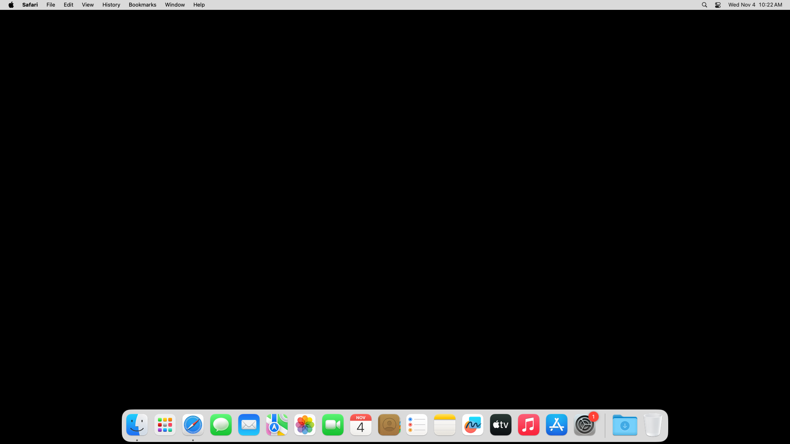

# 🧭 SPN-139 — initial identity recurrence on SPN-137's third execution

This package preserves a **failed native execution**, not acceptance of SPN-139
or SPN-137. Workflow
[41813499184](https://github.com/mxbaylee/spinel/actions/runs/41813499184), attempt
1, was the prospectively declared third complete SPN-137 execution. It used
source `5513ccb247401006982f628d0bac827691d51533`, main/base
`5062129284ef7c60c1bc292edba130bab278c8ba`, and tested merge
`0cb4e715881a5f4948c25584e7d9d5336f984984`. The source and tested tree are
`7b2388cb962187e487360e3b7c941796685efd3d`; the tested merge's parents are exactly
the stated base and source. Chrome and Firefox passed. Safari job
`126518336588` failed in **Prove same-profile ordinary Safari restart**, before
application acceptance or the new cursor observations executed.

The [manifest](manifest.json) retains exact identities, provider endpoints,
original workflow creation time, job results, all file and archive hashes, and
artifact retention dates. This is preservation of that one execution. It does
not add another native sample or authorize a rerun.

## 📦 Exact original records

`records.json.gz` is standard gzip of a JSON envelope with schema
`spinel-native-failure-source-files-v1` and 32 original UTF-8 files. Each entry
contains its source-relative `path`, original byte length, SHA-256,
`encoding: "utf8"`, and exact `content` string. All 13 non-PNG members from the
three artifacts are included: both full application acceptance reports, all
three browser-version records, the complete Safari capability probe, all six
driver logs, and Firefox's storage-permission accessibility record. There is no
Safari application acceptance report in this execution.

The envelope also retains all three complete workflow job logs, job/artifact
provider metadata and archive/member verification records; complete final
run/attempt/jobs/artifacts responses; endpoint and log-encoding provenance; and
the original source/tested Git objects. No report fields, embedded image bytes,
image hex, or diagnostics are trimmed. UTF-8 byte-order marks in the collected
job logs are preserved. Those job logs are the connector's decoded text saved
with a terminal newline, not a claim to original HTTP response bytes.

To inspect the envelope without executing any input:

```sh
gzip -dc records.json.gz > records.json
```

Verify the compressed and decoded byte lengths and hashes in the manifest,
then verify every entry's UTF-8 content against its recorded byte length and
hash. The package was decoded and compared byte-for-byte with every selected
original. Each original ZIP was checked against its provider size and digest;
CRC checks passed, extraction used safe regular paths, and every extracted
member was rechecked against its retained hash before packaging.

## ⏱️ First failed identity boundary

The first online identity attempt observed PID `4226` at
`2026-11-04T10:22:19.794Z`. It exhausted the unchanged **8,000 ms** command bound,
reporting **8,073 ms**, `signal: "SIGTERM"`, and `killed: true`. Its last recorded
phase was **`executable-read-end`**.

The AppKit import phase ran from `10:22:19.890Z` to `10:22:27.631Z`, a measured
**7,741 ms**. Process lookup, liveness, PID, bundle, and executable reads were
then recorded through `10:22:27.655Z`. **No launch-date phase or completed
identity validation was recorded.** The last phase does not establish that
reading the launch date caused the timeout. The import interval does not
separate executable loading, bridge-support processing, initialization,
scheduling, or other contributors inside that operation.

No positive owned identity was established. Teardown was explicitly refused
with `No owned Safari identity is available for teardown.` Successful owned
Safari exit evidence is therefore unavailable; runner/job completion is not a
substitute for that assertion.

Safari was 27.2 on macOS 15.7.9, build 24G830, x64, image
`20260824.0482.1`. Application dependencies/build and application acceptance were
not reached. There are **zero application stages, pointer invocations, and
before/after cursor samples** in this Safari result. Retained content and images,
normal/conflict reconnect, storage loss, and SPN-137 pointer acceptance remain
unexecuted on this owner. No result here establishes the cause of the prior
missing pointer movement or the effectiveness of the new cursor diagnostics.

## 🖼️ Original Safari capability failure view

Independent reviewer B inspected the original source-specific image. It shows
the Safari menu bar, Dock, and a black desktop with **no visible application
window**. This is a capability-stage native view, not application-content or
pointer-delivery evidence. The original PNG is retained byte-for-byte here.



## ✅ Chrome and Firefox results and current visual review

Chrome job `126518333772` and Firefox job `126518334079` passed on this exact
source/tested merge and attempt. Each report has 37 stages: four retained records,
native content/image checks, two revision-2 normal reconnects, two completed
conflict copies preserving originals, explicit storage deletion and post-loss
offline behavior, and three owned browser/driver exits. There is no report or
teardown error. Chrome was 157.0.8103.39 with ChromeDriver 157.0.8103.38; Firefox
was 159.0.1 with geckodriver 0.37.1. Both ran macOS 26.6.2, build 25G83, arm64,
image `20261026.0455.2`.

Independent reviewer B inspected **all 17 original current-source PNGs**:
12 primary application views, four before-input Doc views, and Firefox's storage
permission image. B independently matched ZIP sizes, SHA-256 digests, CRCs, and
all extracted member hashes. All Sheet views show `731`, the blue/orange fixture
rectangles, and green fill. Edited/recovered Docs show `Desktop offline 731`,
the purple image, and `Recovery base notes`; the four before-input views show
the base notes and purple image. Offline views show Saved locally/on-this-device;
recovered copies show Saved/online. The Firefox permission image shows the
`localhost:8176` persistent-storage prompt, whose subsequent report path completed.

The source-specific footer observations are retained without borrowing the
different images from source `7ce6870`: **both browsers' normal-offline and
recovered Docs show `0 words` with a spinner; both conflict-offline Docs show
`6 words`.** Chrome's before-input normal Doc shows `0 words`/spinner and its
conflict Doc shows `3 words`; both Firefox before-input Docs show
`0 words`/spinner. A single frame cannot establish persistence, later settling,
or data loss. Visible content and the executed native/full-state assertions
passed. These observations do not convert the failed overall workflow into a
pass.

All 16 measured application visual stages report `captures: 1`. Their original
paint counts and image data remain in the untrimmed reports. **B did not
recompute pixels for this run.** Hashes identify original images; they do not
reconstruct omitted standalone PNG files or prove pixel equality across browsers.

## 🗂️ Supplements and retention

The complete original ZIPs and all eight Chrome plus nine Firefox standalone
PNGs remain supplementary artifacts. This includes the 12 primary application
images, four before-input Doc images, and Firefox's permission image. Every
exact member path, size, and digest is in the manifest; its `supplementaryImages`
list identifies these 17 images explicitly. Their original report data is fully
preserved here, while the standalone PNG bytes remain in the following archives:

| Browser | Artifact ID | ZIP bytes | Created UTC | Expires UTC |
| --- | ---: | ---: | --- | --- |
| Chrome | 13313198177 | 227,512 | 2026-11-04 10:24:28Z | 2026-11-18 10:24:26Z |
| Firefox | 13312854969 | 453,845 | 2026-11-04 10:23:55Z | 2026-11-18 10:23:54Z |
| Safari | 13314155869 | 121,766 | 2026-11-04 10:22:47Z | 2026-11-18 10:22:46Z |

Artifact IDs are preserved as reported; their numeric order is not a timestamp.
Earlier transient provider polling snapshots remain in scratch. The complete
final responses and immutable source/tested objects needed for attribution are
included here. Runtime databases are not exported; the original executed
assertions establish content/metadata equality, with report hashes and measured
visual results retained at their actual scope.

## 🔎 Privacy and handling

Original text was checked before compression for credential tokens, private-key
material, JWTs, and signed download URLs. No such findings were present.
Credential-label matches in the three job logs were already provider-masked.
The preserved records contain synthetic localhost fixture content, runner paths,
provider/Git identities, and actual diagnostics. No signed artifact-download
reference is packaged. No fields were redacted or silently removed, and no
native scenario or test workload was executed to create this package.
