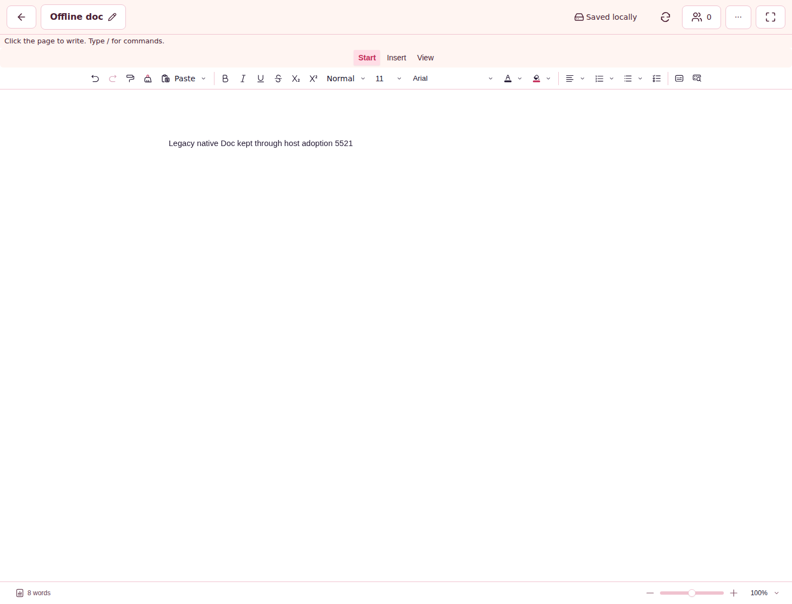

# 🧾 SPN-145 activation evidence

This directory preserves the original incident and the bounded local investigation.
The [implementation decision](../../SPN-145.md) defines the hypothesis, scope,
controlled comparison, supported disposition and acceptance that must still pass.
The final PR description records both reviews and actual hosted results on the
complete candidate. Nothing in this local record claims a browser acceptance pass.

## 📌 Original incident

`original/` contains byte-identical copies of the previously retained receipt,
image, context and normalized log excerpt from immutable source
`472a130c4b6fdaf7b342b0ea3d2c180cd408067e`, under
`docs/review-assets/spn-089-ee996e95/offline-upgrade-first-failure/`.
The receipt preserves all eight events and exact identities:

| Identity | Value |
| --- | --- |
| Source | `ee996e95e5a1ca117f4144e5e3950341eb97c6da` |
| Base | `7679351822caaa9535d73d656191f2a6597a3380` |
| Tested merge | `39a9b6227e0eb4339adbe1b9e99606318e90ef21` |
| Tested tree | `dca595ca8ef725b5f51af4732d7499af2346f4cc` |
| Run / attempt | `41927434953` / `1` |
| Offline-upgrade job | `126915583844` |
| Original artifact SHA-256 | `17999c68faf55bb4ada8b4aa6f242beeba093e80e053f3d0135c20b55038e67f` |

The first scenario failed attempt 0 in 129,085 ms; retry 1 passed in 13,252 ms.
The second serial scenario was **skipped on attempt 0** and passed only on retry 1
in 31,419 ms. `failOnFlakyTests` correctly kept the job failed. Later body-edit run
`41929259741` passed the same source/tested merge; it is not evidence of a repair.

The replacement was installed/waiting at 534 ms and still waiting at 120,000 ms
while the original remained active. Both workers already called `skipWaiting`.
**No first-attempt Playwright trace ZIP exists in the retained archive.** Its two
trace ZIPs belong to retry 1. The image and context establish pending content,
not the identity of an unfinished worker event. The complete raw archive was
verified locally; it is not republished because it also contains session fixtures.

## 🔬 Local investigation and identities

The starting main was `04baabd6a68abe7c0b225f8699681532e2205b60`. The binary
`diagnostic-commits.bundle` preserves the exact two local diagnostic commits and
their trees, with that main as its prerequisite:

| Commit | Purpose and first result |
| --- | --- |
| `bab37cc3683f944dbe141410c2a3dbeab67badd6` | Declared finite plan; extracted original proxy unchanged; both real HTTP lifetime controls failed at their one-second close-event bound. |
| `cf2d76c2da2d03e990cba38d2cc1ed97229409cb` | Added the initial emitted-worker control; browser launch was denied before any worker experiment ran. |

The bundle can be verified with `git bundle verify` and fetched into a disposable
checkout without relying on a surviving helper branch. These local commits are
not represented as the GitHub candidate commit. Final source/tree and review/test
identities are recorded separately in the PR.

`local-checks.json` indexes commands, resource receipts, SHA-256 hashes and first
failures. `local-checks.tar.gz` retains their original logs, the watchdog and the
initial browser probe script. Intermediate working-tree checks are labelled as
such; the final candidate's exact-commit checks are separately recorded in the PR.
All local workloads used Node **26.13.0**, the repository serial runner and the
unchanged eight-minute / 2 GiB process-tree limits. The typecheck repair used a
smaller 1,536 MiB V8 heap to remain below that process-tree limit.

### 🛠️ Findings and dispositions

- **Confirmed HTTP ownership defect:** the original shared proxy left downstream
  open on an upstream body abort and left upstream open when a completed GET's
  downstream reader abandoned it. Both original tests failed; both passed after
  pipeline/error/close ownership was repaired. Complete response bytes/status/
  headers and a pre-header failure's explicit 502 are also protected.
- **Browser mechanism remains a hosted gate:** the two-sample regression uses
  actual emitted legacy and A workers, their real `PREPARE_SHELL`/`cache.put`
  lifetime, the original negative proxy and the shared repaired proxy. It must
  demonstrate waiting, exact owner release and activation, independently of a
  green retained-client scenario.
- **Local capability unavailable:** TCP works, but abstract Unix socket creation
  fails with `EPERM`, blocking the required workspace lease. One pinned Chromium
  install invocation failed to decode its download. The installed system Chromium
  failed its singleton socket before launch. No lease/socket/browser isolation
  control was bypassed. Actual historical builds succeeded; that is not execution.
- **First implementation check failures retained:** TypeScript found a required
  Window-property cast and an inferred cleanup-array type; both were corrected.
  Lint's first run found one formatting difference after the cleanup edit; it was
  formatted. These failed runs are not overwritten by their repaired results.
- **Historical attribution unresolved:** the controlled shared-owner mechanism
  cannot identify the missing original trace's pending request. The permitted
  disposition depends on causal control **and** strict real current-head
  acceptance, with all selected workers and all seven gates successful.

## ✅ Selection and landing boundary

No CI workflow, selector, retry, timeout, worker source, fixture access rule or
historical ref is changed. The actual changed `scripts/ci/` and evidence paths
select the existing **full** plan, including offline-upgrade, both historical
comparison owners and sized restore. The existing planner/aggregate negative
controls require selected missing/failed work to fail. Additional workflows keep
their existing path filters; no unrelated native/physical-phone matrix is added.

The complete reviewed candidate includes removal of `docs/todo/SPN-145.md`, its
`grooming.completed_since` entry and the CLI-regenerated backlog index. No open
ticket lists SPN-145 as a dependency. Bookkeeping is a landing candidate, not a
claim that hosted acceptance already passed. Do not merge if either mechanism
comparison or the actual old/new-host acceptance is inconclusive or fails.

## 🔁 Initial review and repair loop

`initial-review.json` records the two independent grades on exact candidate
`ac42137cf8e16a906df4e20ab430fa446f4a4152`: A 96/100 and B 97/100. The companion
`initial-review.tar.gz` preserves their local receipts and A's actual collector
probe, including the malformed-object completeness defect. These are initial
grades, not grades for a later repaired candidate. Both local findings—trace
envelope validation and complete first-cause resource cleanup—are repaired before
validation publication and must be revalidated by both reviewers on the new head.
Final grades and acceptance results belong in the PR description.

## 🛑 First hosted candidate: preserved failures

[`hosted-81c070ad/receipt.json`](hosted-81c070ad/receipt.json) binds the failed
source, base, tested merge, plan, jobs, artifact hashes and retained files.
The raw control JSON for retries 0–2, first context/image, original Playwright
report and job log are retained. Gzip files are byte-preserving compressed copies;
the receipt hashes both their original and stored bytes. The available retry-1
trace remains identified by the original artifact hash, and is not mislabeled
as first-attempt evidence. The two real application scenarios did not run.

The receipt also preserves the separate Storybook Viewer failure JSON, screenshot
and worker/aggregate logs. Initial layout progress was not captured; source
inspection supports an unsafe initial readiness boundary, not a proven historical
layout sequence. The [repair checkpoint](../../SPN-145.md#-first-hosted-acceptance-and-bounded-repair-checkpoint)
records both findings, the finite next step and the unchanged acceptance rules.
This failed head cannot be merged, even though its pre-push reviews were 100/100.

[`hosted-repair-local.json`](hosted-repair-local.json) and its companion archive
retain the finite diagnostic and feasible repair checks. The exact AST-extracted
Playwright 1.64.1 poller ended async-false evaluation after one call with zero
queued polls, while synchronous false stayed pending and a single controlled
animation-frame callback later resolved true. This is local execution of the
pinned polling algorithm, not browser/worker execution. The bundle, extracted
function, diagnostic and actual repair-source hashes are preserved.

On the final repair bytes, all 46 focused tests, full typecheck and lint passed;
the index was regenerated and backlog/PR checks passed. The largest process-tree
RSS was 2,072,788 KiB, below the unchanged 2 GiB ceiling. Every workload used the
pinned Node and serial watchdog with no resource abort. Earlier intermediate
checks remain separate records. Fresh exact-commit grades and hosted acceptance
are still required before publication and merge respectively.

## 🔎 Proven mechanism; rejected trace-category preflight

[`hosted-5b645370/receipt.json`](hosted-5b645370/receipt.json) binds the next
failed head, tested merge, full plan and original artifact. The raw retry-0
mechanism receipt establishes the original proxy's obstruction and exact-owner
release, followed by automatic response cleanup and strict replacement activation
with the repaired proxy. Both samples retain the actual emitted workers and the
same real preparation event. The original historical incident remains unattributed.

The real retained-client attempt failed before trace startup because the collector
mistook one category enumeration for permanent capability. Its raw failure
receipt, screenshot, context and job log remain preserved. The result summary
retains the exact original errors, retries and durations; its normalization and
the original full-report hash are explicit. The complete retry-1 trace is reduced
to metadata/counts and its original hash to avoid republishing raw synthetic
fixture URLs. A passing retry and the second scenario's retry-only execution do
not qualify the failed job. The actual enumeration list was not captured.

The [diagnostic checkpoint](../../SPN-145.md#-diagnostic-startup-checkpoint-after-the-proven-mechanism)
records Chromium's current public contract, exact inspected upstream blobs and
the unavailable exact-browser-source limitation. The repair removes the invalid
enumeration prerequisite while preserving bounded startup and every actual
nonempty/lossless/completeness check. Protocol-adapter controls reproduce the
old rejection, require actual worker data for success and preserve startup errors;
they do not replace the mandatory real browser scenarios.

[`trace-category-local.json`](trace-category-local.json) and its 43-file companion
archive retain the prospective control, first local failures, corrected results,
and independent reviews of the preceding `5b645370` candidate. The verified
`trace-category-commit.bundle` preserves exact local repair commit
`52f6a9668fbbd693b81c5a2962047c46e59b6bca`, with `5b645370` as prerequisite.
The final integrated source hashes are recorded separately from those old grades.

Integration with main `977de3a3a7608a05e2103787f4dac01ec180013e` required only
backlog bookkeeping resolution and CLI regeneration. All 98 focused controls,
full typecheck, lint, backlog and exact-new-base PR-policy checks passed. The
integrated typecheck used a 1,408 MiB compiler heap and peaked at 1,987,016 KiB
process-tree RSS; the unchanged watchdog did not abort any final integration
check. The earlier 2 GiB termination and test-adapter typing/representation
failures remain recorded instead of being overwritten. Two fresh reviews must
grade the complete integrated commit before its next validation publication.
