# SPN-154 retained evidence

This directory preserves essential machine-readable results and useful sample-data
images for [PR #301](https://github.com/mxbaylee/spinel/pull/301). The
[implementation record](../../SPN-154.md) explains the experiment, repair,
reviews, first failures and acceptance limits. These summaries supplement the
original reports and traces; they are not full traces.

## Before the repair

- Published head: `1629858e44c4e759ed15d4c01776549a96ee2a77`.
- Base: `aeed0f4799950dced609bee497aa94aa43fc3465`.
- Tested merge: `54ce60f42985adf304e76e3eb3c0d97b538b8427`.
- [CI 44814643867](https://github.com/mxbaylee/spinel/actions/runs/44814643867),
  attempt 1. Production executed the PNG case first, at 20:51:26.678 UTC;
  development produced its artifact first because its existing first-failure
  policy stopped the worker.

`first-native-production.json` preserves exact native/saved text, formatting,
selection, image references, canvas identity and top-level navigation/time origin.
`first-native-wire-summary.json` preserves the transmitted insertion and matching
resync, explicitly distinguishing the observed fragment from the derived full
transient text. `first-publication-audit.json.gz` preserves all selected worker
outcomes, immutable plan identity and original artifact hashes.

The screenshot is the actual first failed native PNG case, 1440×1100/light.
The lifetime observer, not this still image, establishes native-editor replacement
without top-level navigation.

## First repaired native execution

- Published product head: `d7a2a9b96d735d90cc4ff01258f9c370a641e3a4`.
- Tested merge: `d76d651884e467de5784bde3b916d598253b9c19`.
- [CI 44821917229](https://github.com/mxbaylee/spinel/actions/runs/44821917229),
  attempt 1, labeled event. All six clipboard cases in each of development and
  production, plus both existing toolbar cases, passed on retry 0.

`repaired-native-first-event.json` records source and cross-project parity; the
implementation record and `repaired-native-executions.json` preserve the first
case start times, durations and artifact identities from the original Playwright
reports. The six `repaired-production-*.json` and six
`repaired-development-*.json` files preserve the positive PNG, HTML
failure/refusal/recovery, selection cancellation, content cancellation, viewer
refusal and ordinary-text outcomes. Original receipts are retained unchanged.

**Request-body limitation:** successful first-pass receipts contain zero/empty-hash
fields produced by an observer that would collapse a missing Playwright body
into an empty buffer. The old receipt cannot distinguish a missing body from an
exposed empty buffer, and those fields are not measurements of actual wire bytes. HTTP 201,
the canonical stored-image URL/hash, fetched image bytes, decoded pixels,
native acknowledgments and saved/reopened image assertions are separate verified
evidence. The later observer records body availability and nullable length/hash;
it does not substitute clipboard or stored bytes for request bytes.

The following originals are actual native-Doc application captures from the
production HTML case, 1440×1100, with sample content. They show two controlled
upload failures followed by a distinct successful native paste.

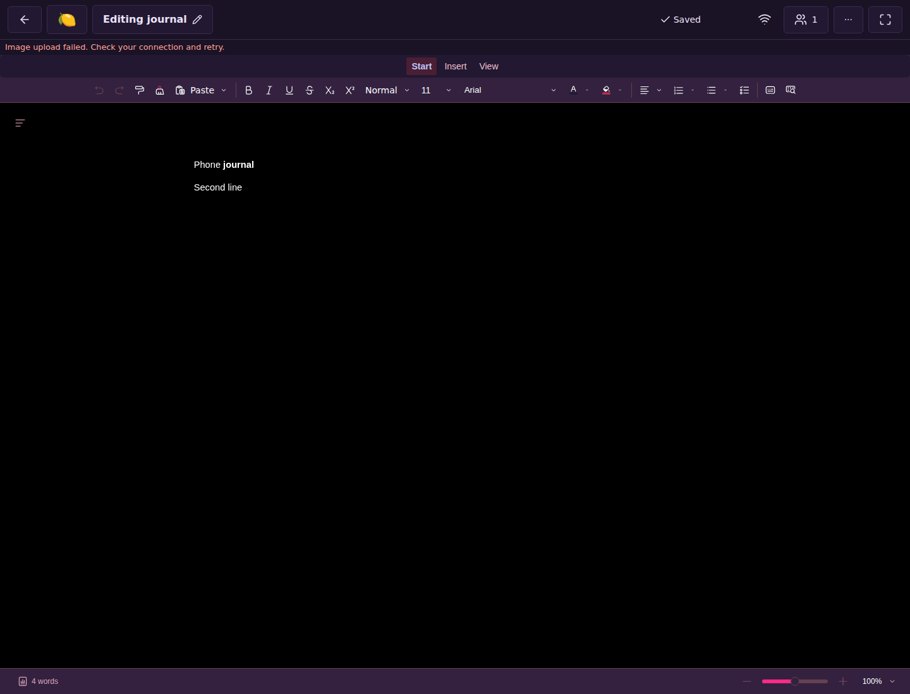

The native paste-options button temporarily overlaps the start of `Second line`
in the success image; exact native/saved assertions preserve the full text.

## 🎨 Feedback state captures

`visual-capture-source.json` retains the recovered Storybook build stamp, exact
source/build artifact hashes, all five variant results and the byte hashes of
the selected original PNGs. The build names head `d7a2a9b9` and tested merge
`d76d6518`. Each variant captured and checked 1,090 states; the 12 Doc feedback
states account for 60 captures across desktop light/dark, tablet and phone
light/dark. The catalog manifests contain no SHA themselves; producing-job
checkout and the downloaded build's `sha.json` provide that source chain.

These are actual production-component fixtures, using `DocEditorHelp` and
`editorFrame.css`. They show presentation at 390×900; they do not establish
native clipboard delivery on a physical phone. The full native application
captures above are separate evidence.

Phone feedback states, light and dark

| State | Light, 390×900 | Dark, 390×900 |
| --- | --- | --- |
| Upload failed |  | 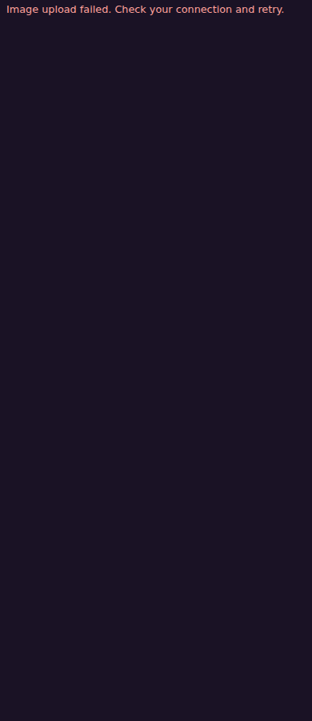 |
| Sign-in ended | 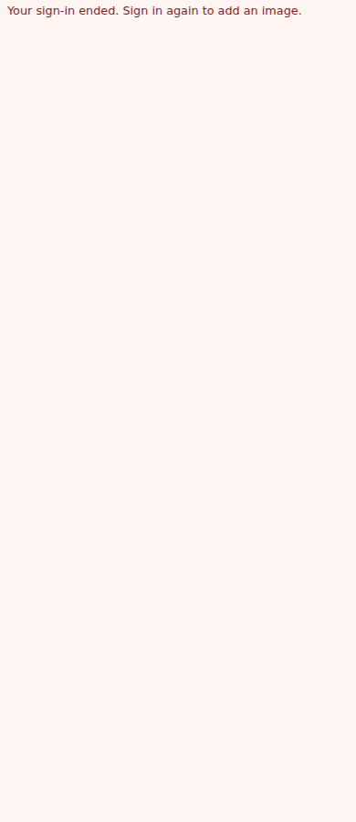 | 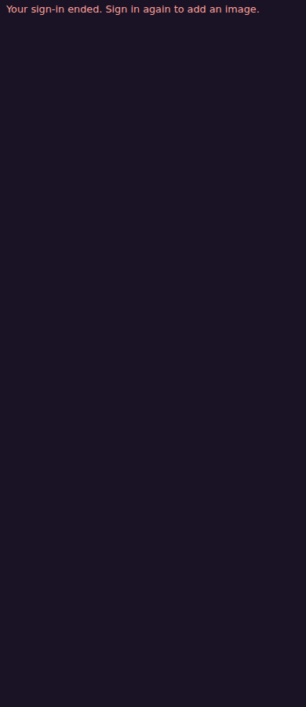 |
| Access denied | 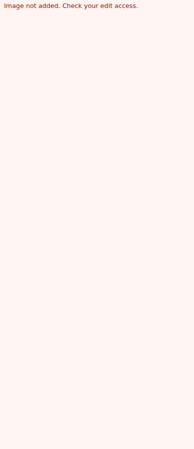 | 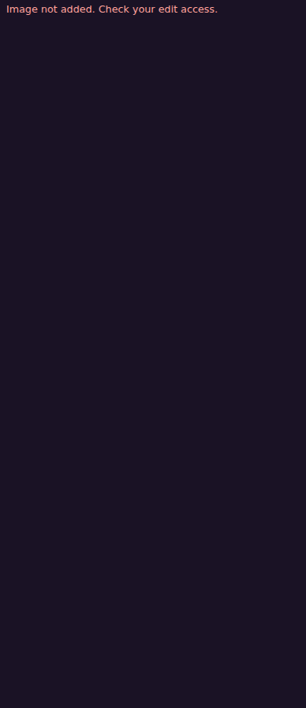 |
| Prepared offline | 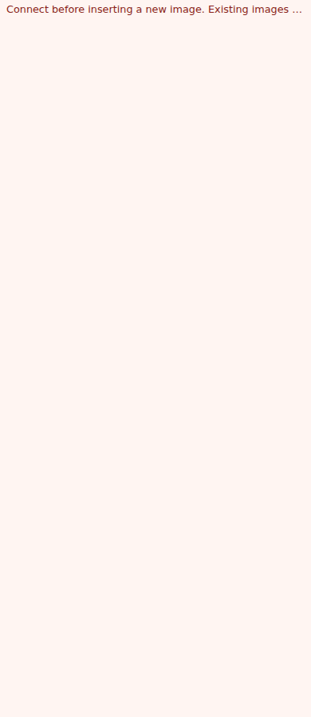 | 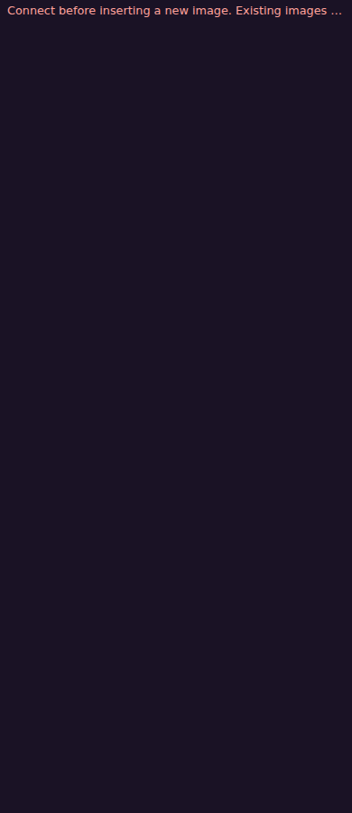 |
| Image limit | 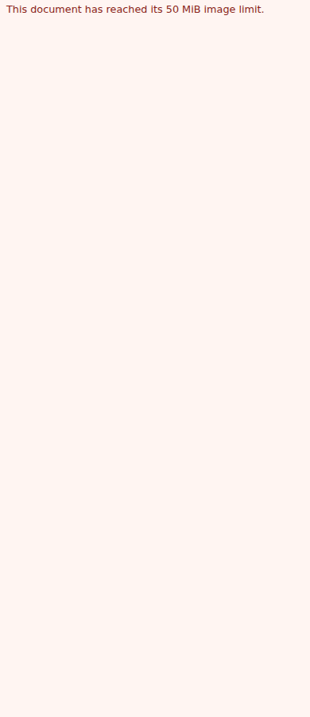 |  |
| Unsupported source | 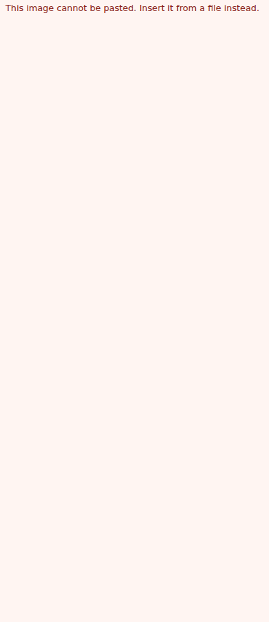 | 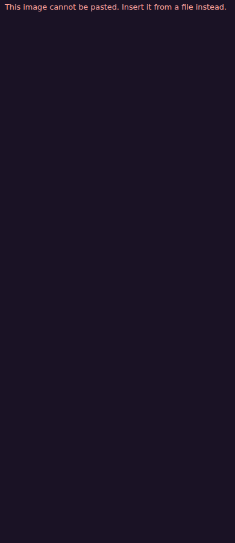 |

The unchanged fixed help slot truncates the offline message's supporting second
sentence at phone width, while retaining the complete actionable first sentence.
The complete message remains in the alert's accessible text. The matching full
message is visible in the retained desktop light/dark fixtures:

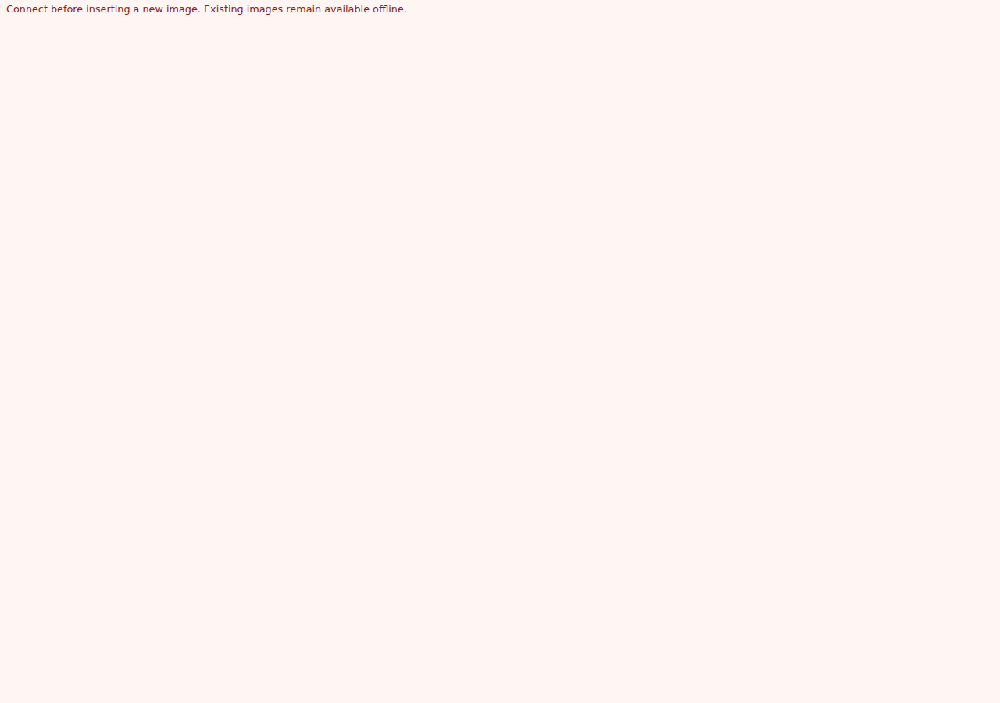

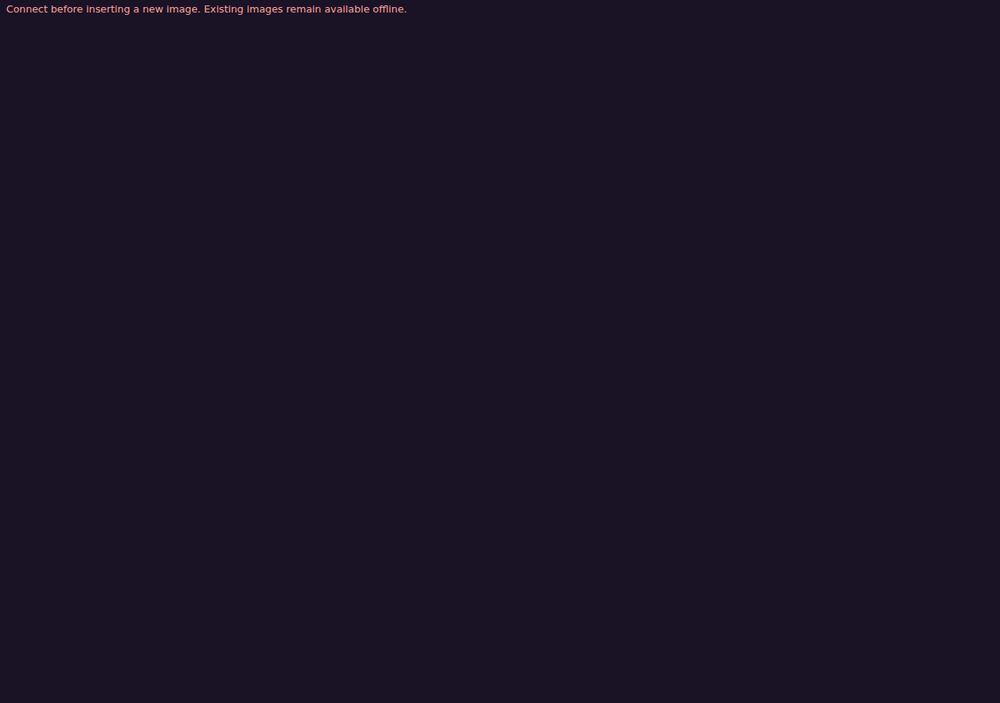

## 🧪 Local checks, review and image identity

`local-validation.json` and the bounded compressed logs preserve actual local
checks, including the first typecheck failure and its corrected successors.
`independent-reviews.json` records the two nonimplementing review identities,
exact candidate, individual rubric scores and resolved feedback finding.
`visual-review.json` records the independent inspection and approval of 33
actual images. `first-repaired-event-audit.json.gz` freezes the complete first
repaired CI event and terminal Storybook/Desktop evidence; its scope explicitly
excludes the later synchronize CI event, whose final outcome is recorded in
the maintained PR description. It is not a claim about future source checks.
Historical receipts keep their original source scope; they are not relabelled
as executions of a later commit.

`clipboard-source.png` is the exact deterministic source fixture: image/png,
80×60, RGB 23/201/151, 247 bytes, SHA-256
`3b5a98d5f358349c7e8e6cf77a4c4a3398c2530cfbc209b75da9668dca54e4c2`.
Chromium's clipboard bytes and the stored PNG can have different encodings and
checksums while preserving these exact decoded pixels; the receipts distinguish
all three identities.

Original hosted ZIPs, full reports and traces remain supplementary artifacts
with their workflow's retention period. Physical-phone SPN-154 confirmation is
still a separate acceptance item, and the original phone incident remains
unconfirmed. No SPN-170 waiver or mobile opt-in is inherited.

## 🔎 Additional native confirmation and separate admin failure

[validation-d91c9ad3-native-summary.json](validation-d91c9ad3-native-summary.json)
retains all 12 clipboard and two toolbar first-attempt passes on `d91c9ad3` /
merge `061b3fc6`, including the corrected request-body availability fields.
It explicitly does not claim whole-event acceptance.

The same synchronize event's development 1/2 worker failed because an existing
Sheet admin revocation case was flaky. Its [raw first-failure/retry summary](admin-revocation-first-failure.json)
retains both attempts, source, artifact hash and original error; the first
attempt has no trace. The successful retry-1 trace is not first-attempt evidence.
The [original error context](admin-revocation-first-error-context.md.gz) and these
unaltered retry-0 screenshots preserve the observation boundary:

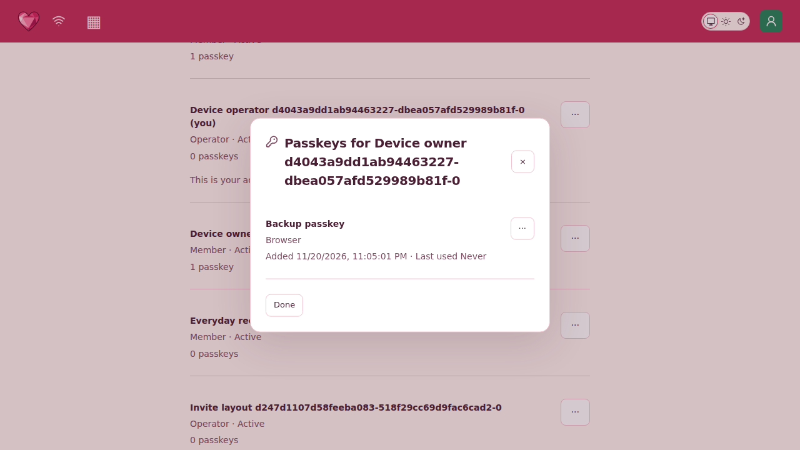

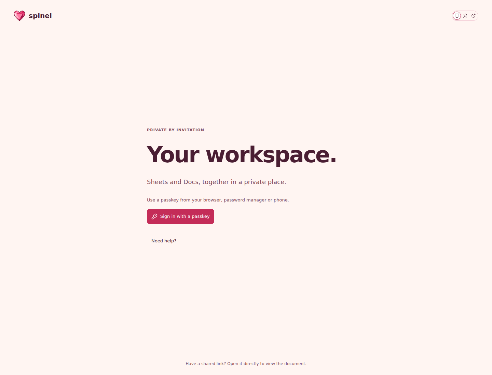

These images support the documented navigation-related observer gap, but do not
prove physical socket closure for that attempt. The [implementation record](../../SPN-154.md)
explains the bounded reuse of the existing relay witness, with unchanged
physical-closure, authority, content and time-limit assertions. Original fixture
typecheck failure and corrected checks remain separate receipts.

The [terminal d91 summary](validation-d91c9ad3-terminal-summary.json) and
[complete audit archive](validation-d91c9ad3-audit.json.gz) preserve both CI events,
Storybook and Desktop offline. The edited development-2 cancellation has
[partial Doc observations](validation-d91c9ad3-cancelled-partial-observations.json),
not a finalized report or certified pass. That source tested base `aeed0f47`;
main later advanced to `9717f55f`. New integrated-source validation must retain
its own identity and cannot inherit these outcomes.
