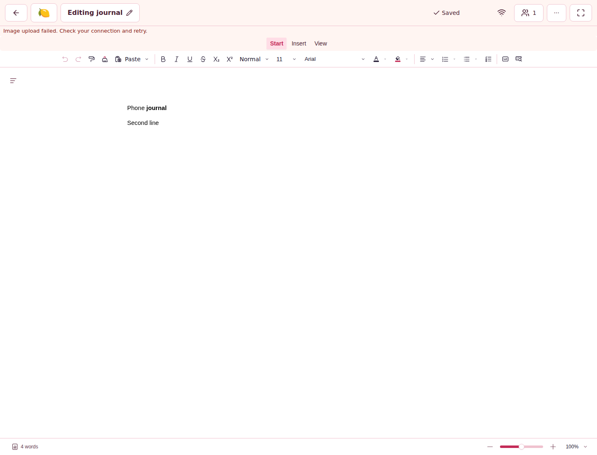
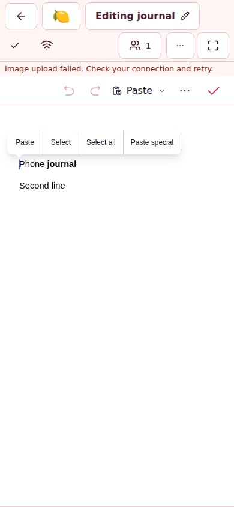
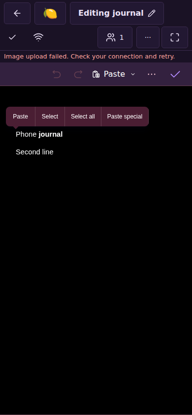
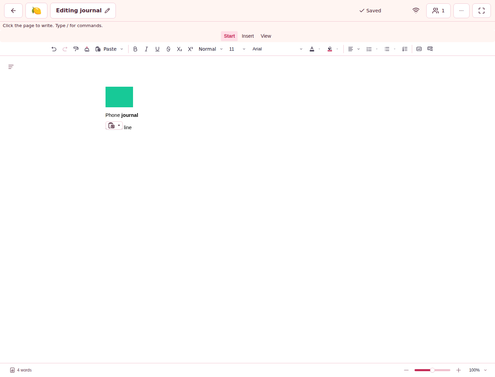
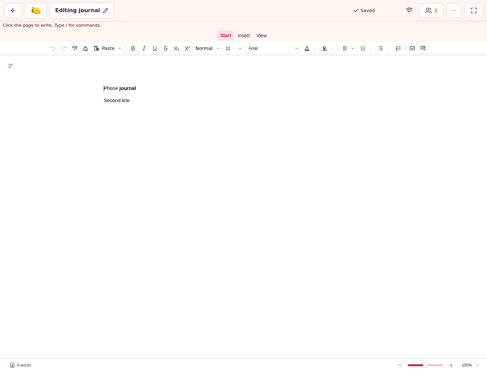
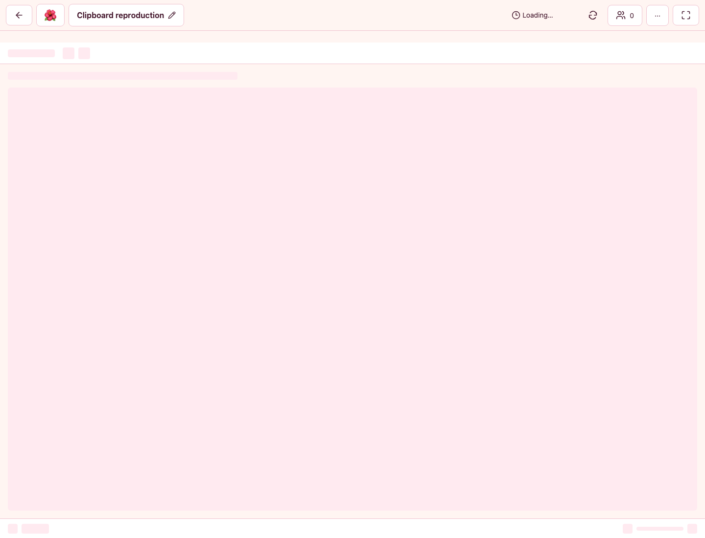

# 📋 SPN-154 evidence index

The [implementation record](../../SPN-154.md) maintains decisions, acceptance,
first-failure dispositions, diagnostic limits and exact source/check identities.
This directory keeps useful originals rather than every intermediate report.
The [manifest](manifest.json) binds the24 retained originals' exact bytes and PNG dimensions.
The subsequently authored [development budget record](development-shard-budget.json)
retains the proven20-minute deadline failures and complete three-shard collection model.

## 📦 Full preservation

Before consolidation, all480 files were compared byte-for-byte to the private archive:

- Source `45b3277f484c09cfd4fb69a05531a7e8b75e2172`; [original complete tree](https://github.com/mxbaylee/spinel/tree/45b3277f484c09cfd4fb69a05531a7e8b75e2172/docs/implementation/evidence/SPN-154).
- Archive directory: `/Users/mxbaylee/.codex/archives/spinel/SPN-154-20261122/` (private).
- `evidence-tree-45b3277f.tar.gz`, SHA256
  `70bef8fdac2c32c07df3d4195070fd5e723ba93a08254ee2781d1ed879f909f7`.
- Its480-source-file manifest `evidence-tree-45b3277f-manifest.json`, SHA256
  `21c54a8ae73ae2f6297796c84d610f816f00d2ef47367d3b9f82ac8bc36a0c75`.
  macOS archive metadata is not a source file.
- Verified full implementation history `implementation-45b3277f.bundle`, SHA256
  `5fc1547c22bafd1f270215bc6cd1748f443110c5028eea44de786be9c3c57e57`.
- Historical unique branches6efdd9dc/4d8c22cb are separately preserved in verified
  `research-history.bundle`, SHA256
  `b53f4db75020537457455213479600e51fcbe4fe856b30175e69f8ad5a2e1da1`.

Full logs, repeated reports/reviews, raw traces, earlier source tarballs and redundant
screenshots remain archived with actual source identity. Private trace/network records
and deleted synthetic database ancestry may contain fixture credentials and are not
published wholesale. The archive supplements essential findings here and in the PR;
an expiring CI artifact alone is not the record. Final-head records are archived before
obsolete branch/worktree cleanup.

## 🎨 Actual current application views

These five originals use source d93321a16ec3194ce5aeaf44da035eae523614b7,
tested merge536e8f80976e79645bf793e432574d3f1ccf1ad2, production run45048935325,
job137290091438/attempt1. Product code remains identical to419773ed. Desktop is
1440×1100; phone is390×844 **emulation**, not physical-phone acceptance.

The12 retained `current-419773ed/feedback/editor-dochelp--*-phone.png` captures
show each remaining distinct image-feedback message at390×900/light: sign-in ended,
access denied, prepared offline, image limit, unsupported image, clipboard failure,
insertion failure, file size, image format, invalid image, processed size and upload busy.
They are actual production-component fixtures from source419773edb69b57bc96ba7ddbdb6d99eccc44e59f.
The application captures above cover upload failure and shared light/dark palette/editor
placement. All original95 component captures and original inspection scope remain in
the archive; this smaller subset does not pretend to be the whole inspected set.
Independent final-candidate approval must be explicit: **agent review only**.

## 🔬 Original failure witnesses

- `first-native-production.json`, `first-native-wire-summary.json` and the screenshot
  below preserve hosted source1629858e / merge54ce60f4 / run44814643867/attempt1:
  inline-image submission/resync and replaced editor without top-level navigation.
- `local-reproduction-0e9cf7ff/summary.json` and its screenshot preserve the local
  recorder identity, native paste observation and missing build/cleanliness boundary.
- `validation-75a89e30/reopen-first-failure.json` retains the later viewer-reopen
  failure's exact timing, artifact/trace hashes and post-failure View only DOM node.
  Post-failure observations do not convert that attempt into a pass.

`clipboard-source.png` remains the optional phone fixture's original247-byte PNG,
80×60, RGB23/201/151. Clipboard/stored encodings can differ while decoded pixels match.
The [phone gate is explicitly owner-waived for SPN-154](../../SPN-154.md#-physical-phone-acceptance-waiver):
**not run, not passed**. These controlled desktop failures and repaired executions do
not establish the cause of the original phone incident.
