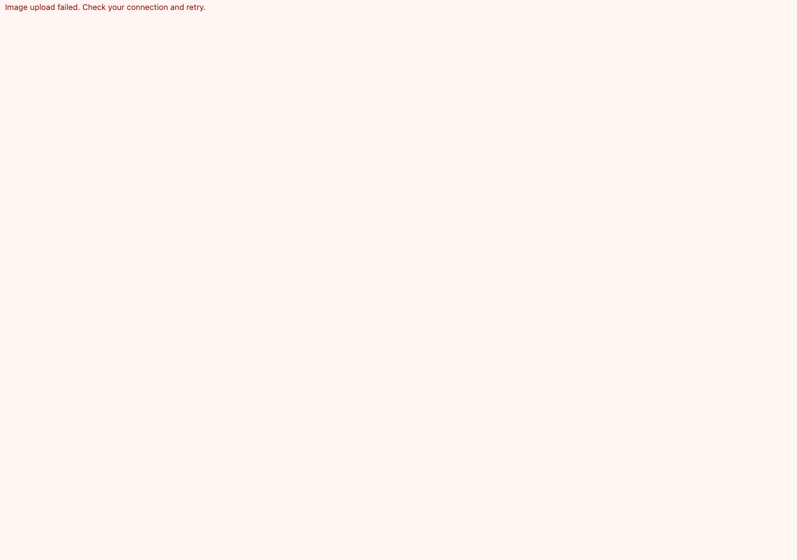
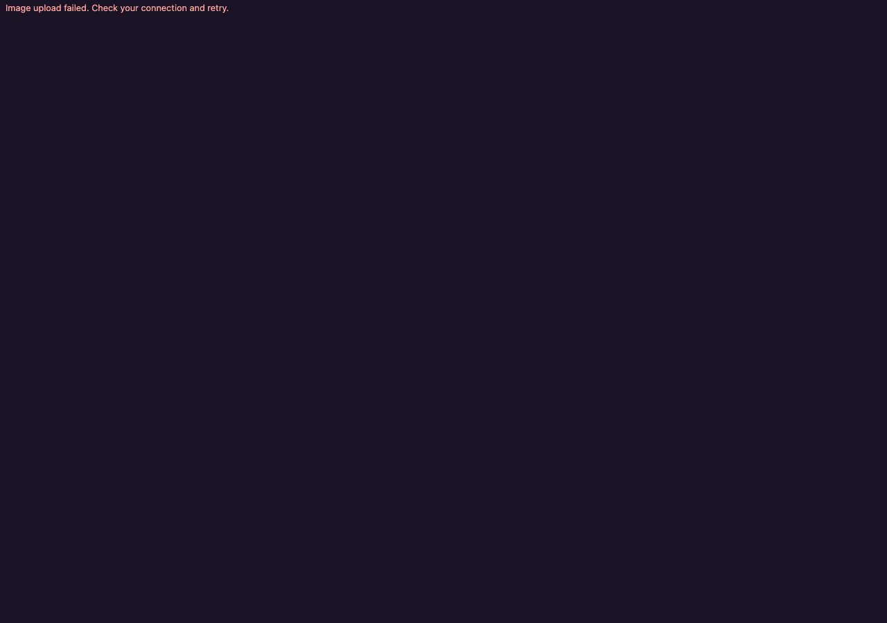
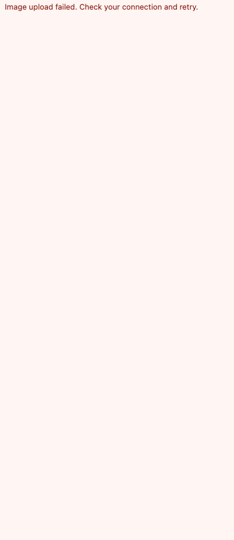
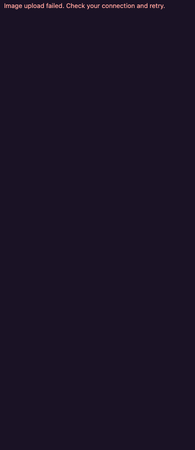

# 🧾 Current SPN-154 candidate evidence

Production/component source: `419773edb69b57bc96ba7ddbdb6d99eccc44e59f`.
Hosted merge: `c3b1b66980f93770539f3edfaffcd7a2fe76b2f1`, base `2dc7871db0a9b7f368cda5fe260af012c70fb6b7`.
CI: [45044614851](https://github.com/mxbaylee/spinel/actions/runs/45044614851).
Desktop: [45044614908](https://github.com/mxbaylee/spinel/actions/runs/45044614908).
Storybook: [45044615046](https://github.com/mxbaylee/spinel/actions/runs/45044615046).

## 🔎 Reviews and captures

Both independent nonimplementers graded the candidate 100/100 before push and
independently passed 61 local tests. Both complete records and test
receipts are retained. Review A's separate component visual approval lists the
36 inspected original files and their hashes. **Agent review only; component
approval is not application or physical-phone approval.**

`feedback/` contains the 95 exact component captures and the compressed original
manifest records all 19 states × desktop light/dark, 390px light/dark and tablet.
The production component and fixed CSS slot are used; no mock layout substitutes
for the real alert. The manifest records the actual viewports. Useful examples:

## 🧪 First failures remain failures

- `first-pr-gate-419.log.gz`: ticket intentionally remains open pending acceptance;
  the required completion counter is not yet appended.
- `first-dev2-419.log.gz`, `menu-first-failure-evidence.json.gz` and
  `menu-first-failure.png`: native destination replay recreates the inserted
  paragraph/drawing IDs; the original text, bold and paragraph IDs are unchanged.
  The observer repair checks that original body exactly and separately validates
  inserted drawing/link/resource consistency. `replay-observer-check.ts.gz` exercises
  the retained first-failure snapshots and six deliberate corruptions. Its log
  and formatting receipt belong to the later uncommitted observer repair, **not
  execution of the unchanged 419773ed test**; the final containing commit records
  that repair. They are not an actual native rerun.
- `safari-first-failure-summary.json` and `safari-first-failure.png`: selected native
  Safari offline recovery stopped at its explicit transfer-busy/Retry creating
  copy state, while the harness waited for Open copy. This is unresolved at this
  checkpoint; full private raw artifact/log are retained by the working task.
- `current-native-menu` is a resource-aborted local browser attempt, not a pass.
- `phone-window` preserves the 32-second hosting abort at system pressure 2.
  Runtime `cb32a5523a931b83` and verified PNG identity are in
  `phone-build-identity.json`. No phone action, session or passkey was recorded.
  No database, invitation credential or phone result is published here.

The desktop original failure/repair receipts elsewhere in SPN-154 remain
historical evidence and do not establish the original physical-phone incident's
cause. Current selected acceptance and final application visual review remain
pending. `manifest.json` hashes retained files; logs are compressed originals,
not pass-only excerpts. Source-specific limits above take precedence over the
directory's candidate label.

## 🎨 Actual application feedback

`application/` retains the 12 clipboard-case outcomes from production shard 2
(nine passed, three failed), their bounded synthetic receipts, and original
screenshots. `app-visual-review-a-419.md` independently approves the five captures
from passed HTML failure/recovery and phone-width failure cases, **agent review
only**. These are actual 1440×1100 desktop and 390×844 emulated application views;
the phone-width result is not physical-phone confirmation. The three failed cases
remain separate from the passing visual journeys.

`first-prod2-419.log.gz` preserves the complete first shard log: replay ID equality,
Escape dismissing the replay session, and the invalid CDP descriptor were the
three fixture failures. The later `clipboard-permission-check` receipt and archived
script prove corrected context-scoped denial in real Chromium only. Intermediate
repair lint passed. After the final replay/permission fixture edits, the full lint
rerun resource-aborted; final targeted oxlint and Prettier checks passed for every
changed executable file. Repair typecheck resource-aborted and remains pending
hosted acceptance. The receipt names distinguish these executions.
The transfer observer's three tests passed too quickly for the watchdog's first
RSS sample; a recorded zero peak is **not** a measured zero memory footprint.
