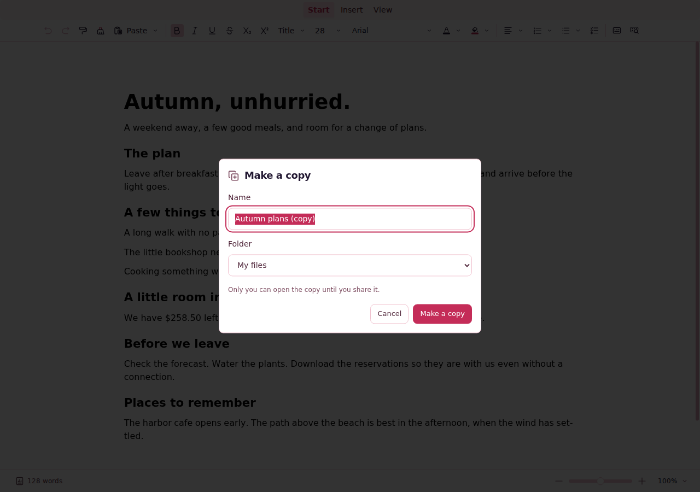
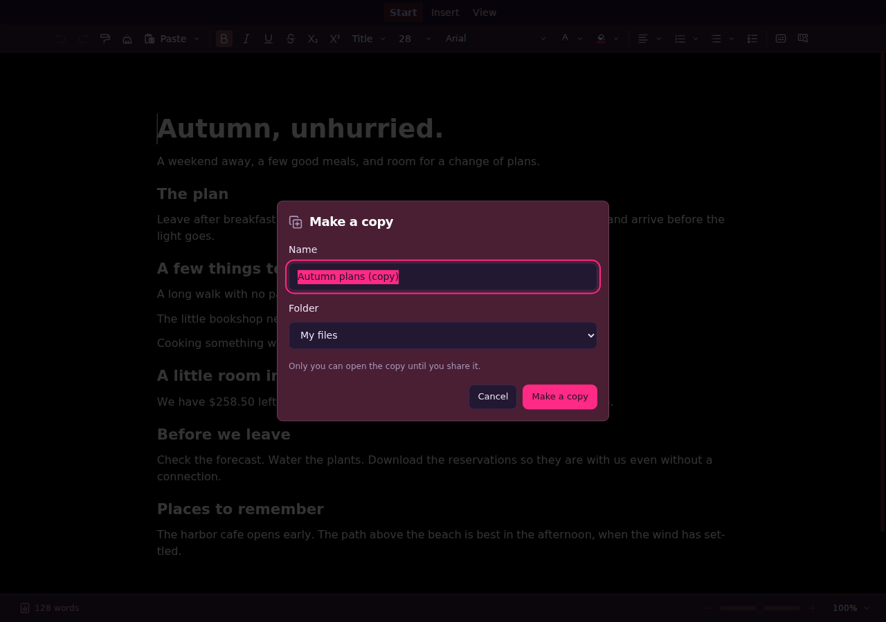
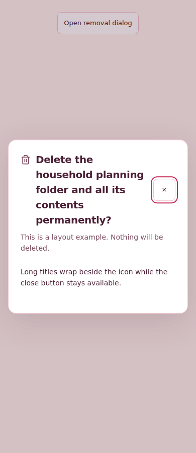
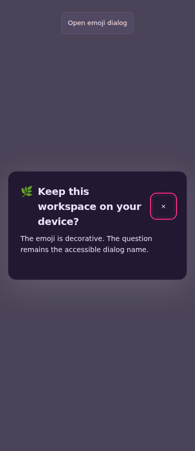

# 📦 SPN-089 candidate C — rejected validation evidence

## ⛔ Current disposition

**PR #260 is unmerged. Candidate C failed its required mobile responsiveness
maximum.** This archive preserves that first-attempt failure and the separate
successful checks. Neither the dialog improvement nor its visual/source reviews
waives the performance failure. SPN-146 owns the native investigation; the focused
registration keeps SPN-089 open with that prerequisite.

This is an evidence-only helper, parented by C, with no pull request and no
workflow dispatch. It does not advance PR #260, repair application code, rerun
acceptance or claim validation of the archival commit.

The focused prerequisite registration has since landed as **PR #266**, squash
`89d93c8b23db65d3fe6a83d1853acc716c024b80`. Its [final outcome](registration/README.md)
and [complete terminal record](registration/registration-terminal.json) accept
only that documentation change. Main has advanced beyond C's tested base;
integration with the accepted SPN-146 outcome remains pending. No bookkeeping-only
PR #260 push or unchanged native acceptance rerun was made.

| Identity | Exact value |
| --- | --- |
| Source C | `472a130c4b6fdaf7b342b0ea3d2c180cd408067e` |
| Base main used by C | `1045e729c391c47a9b6a895782a2fa69dc6fa044` |
| Tested merge | `97b0dd8e6d225173c1da30e99e7158e17ae07cf2` |
| Equal source/tested tree | `dcee968f677d6d70dc7064c948059bd17f32c940` |
| Ordinary CI | [41956095276, attempt 1](https://github.com/mxbaylee/spinel/actions/runs/41956095276) — failed |
| Native desktop | [41956095255, attempt 1](https://github.com/mxbaylee/spinel/actions/runs/41956095255) — passed |
| Storybook | [41956095281, attempt 1](https://github.com/mxbaylee/spinel/actions/runs/41956095281) — passed |

The ordinary run ended at **2026-11-05 03:17:45 UTC** with 31 successful jobs
and two failed jobs: the mobile worker `127011430611` and its required
Playwright aggregate `127025959343`. These are **one failing mobile case and
the aggregate**, not two independent failing cases. All 15 suites were selected;
the seven stable gate names were retained. No C workflow rerun, cancellation or discarded
performance sample was used.

## 🔬 Failed native observation

`mobile sustained native typing plain-3` failed the capacity maximum assertion
at `e2e/doc-responsiveness.spec.ts:718`:
**114.39999999990687 ms > 100 ms**. It was the first and only attempt.
The candidate worker retained six passes and one failure; four historical
baseline observations passed separately. The paired performance comparison
was skipped after the failure and is not accepted.

The 45th capacity pair (zero-based index 44), completed state 1,440, ran at browser
time 97,280.8–97,395.2 ms. History took 57.0 ms and collaboration 57.4 ms.
Both returned normally, clearing queues from 32/32 to 0/0. Neighboring outer
pairs measured 11.2, 12.7, 11.4 and 14.4 ms. An overlapping long task lasted
186 ms. These observations do not establish its internal cause.

Capacity p95 33.2 ms, idle maximum 2.7 ms, input p95 109.7 ms, longest task
191 ms and browser-local drain 526.3 ms satisfy their separate limits.
All 2,086 input/frame observations, exact saved/live/peer text and selections,
one-group Undo/Redo and Online checks passed before the maximum assertion.
`timingComplete=true` does not mean the sample reached completed acceptance.

The failed sample has no CPU profile, trace or lossless native operation-cache
capture. Separate successful C/B profile samples peak at 55.3/46.9 ms; separate
callback observations peak at 31.6/25.5 ms. None contains a comparable ≥80 ms pair.
They cannot explain the old unprofiled failures. The preceding B first-attempt
129.1 ms failure remains preserved in C's
[earlier failure archive](../spn-089-95d52be3/mobile-responsiveness-first-failure/).

- [Failure receipt and all baseline/candidate outcomes](mobile-responsiveness-safe-evidence/failure-receipt.json)
- [Exact failed metrics, losslessly compressed](mobile-responsiveness-safe-evidence/failed-plain-3-metrics.json.gz)
- [Readable failure log](mobile-responsiveness-safe-evidence/failure-log.txt) and [exact raw log](mobile-responsiveness-safe-evidence/failure-log.raw.txt.gz)
- [Existing diagnostic limits](mobile-existing-diagnostics.json)
- [Audited source boundaries](native-flush-source-audit.json)
- [Execution capability and proposed finite observation](native-diagnostic-capability-review.json)

The source audit places native history/collaboration composition, publication and
synchronous subscribers inside the pair; ordinary Spinel transport capture is
after the mutation handler returns. The 32-state bound limits cache count, not
action size or runtime pauses. Composition, subscribers, allocation, GC and
scheduling remain hypotheses. No numerical budget or workload was changed.

The actual local app attempt is blocked by its required Linux abstract Unix
workspace-lease `EPERM`. The available GitHub connector lacks diagnostic
workflow dispatch; the previously inspected browser was signed out.
The registration records the required compatible runner or legitimate dispatch
capability, a finite prospective diagnostic and an inconclusive stop. No new
diagnostic or speculative source optimization is represented as executed.

## ✅ Separate checks that passed

[The CI capsule](ci-pr-capsule.json) links the exact full
[terminal receipt](ci-terminal.json), [plan](ci-plan.json),
[plan provenance](ci-plan-provenance.json) and [coverage](ci-coverage.json).

All four repaired history cases passed retry 0: development Sheet/Doc
8,382/8,355 ms and production Sheet/Doc 7,856/7,081 ms. Native-copy cases
and both actual offline-upgrade cases also passed retry 0. Desktop responsiveness
passed its separate baseline/candidate and paired comparison. Both callback
lifetime comparisons passed, including cleanup of the owned fixture and
observed zero native state after disposal. Explicit maintenance/phone exclusions
remain identified in the terminal record; skipped work is not counted as executed.

[Native desktop evidence](native-terminal.json) records Chrome 157.0.8103.39,
Firefox 159.0.1 and Safari 27.2, the owned-stage results and observed browser/driver
exits. Target offline storage was absent after cleanup; the record does not claim
all other named databases were deleted.

[Storybook terminal evidence](storybook-terminal.json) and its
[capsule](storybook-terminal-capsule.json) record 1,056 stories × five variants
(5,280 captures/checks), 49 extra interactions and 42 icon states. Its nine
successful jobs and expected main-only deployment skip are independent of the
failed ordinary run.

The **historical prepublication** [96/97 source reviews](prepublication-reviews.json)
qualified C for its one necessary validation publication. They were not merge
approval. [Independent visual review](visual-review.json) approved the actual
15 focused C images; **agent review only**. The vertical title/icon alignment
finding is closed. The already identified compact native-copy Name-input styling
caveat remains a nonblocking P3 visual finding.

## 🖼️ Actual focused C captures

These are the existing images captured from C's hosted Storybook bundle, not new
renders made for this archive. All 15 are retained with exact bytes and hashes.
The capture manifest identifies variants, fixed fixture time and capture set;
the visual receipt records source, runtime and per-image findings.

| Dialog state | Desktop light | Desktop dark | Phone light | Phone dark | Tablet |
| --- | --- | --- | --- | --- | --- |
| Native SDK copy | [PNG](captures/redesign-native-editors--make-copy-dialog-light.png) | [PNG](captures/redesign-native-editors--make-copy-dialog-dark.png) | [PNG](captures/redesign-native-editors--make-copy-dialog-phone.png) | [PNG](captures/redesign-native-editors--make-copy-dialog-phone-dark.png) | [PNG](captures/redesign-native-editors--make-copy-dialog-tablet.png) |
| Wrapped SVG title | [PNG](captures/redesign-controls--long-modal-title-light.png) | [PNG](captures/redesign-controls--long-modal-title-dark.png) | [PNG](captures/redesign-controls--long-modal-title-phone.png) | [PNG](captures/redesign-controls--long-modal-title-phone-dark.png) | [PNG](captures/redesign-controls--long-modal-title-tablet.png) |
| Emoji title | [PNG](captures/redesign-controls--emoji-modal-title-light.png) | [PNG](captures/redesign-controls--emoji-modal-title-dark.png) | [PNG](captures/redesign-controls--emoji-modal-title-phone.png) | [PNG](captures/redesign-controls--emoji-modal-title-phone-dark.png) | [PNG](captures/redesign-controls--emoji-modal-title-tablet.png) |

The earlier [12-image dialog gallery](https://github.com/mxbaylee/spinel/pull/260#issuecomment-6648311382)
retains its original source-qualified captions and broad owner coverage.
Only four of these fresh C PNGs are byte-identical to earlier ee996e95 images.
Both fresh desktop native-copy PNGs differ from their earlier full images,
although the entire dialog region is identical. The
[independent retention receipt](capture-retention-independent.json) records
that distinction. These actual C files remove any need to infer their pixels
from the older references.

## 🔐 Preservation and scope

[The outer archival manifest](archival-manifest.json) inventories preserved source
payloads and separately authored archive navigation/review summaries. Two readable
files (error context and failure log) had only trailing horizontal whitespace
removed to satisfy the repository whitespace check. Their complete original bytes
are preserved losslessly as raw gzip files, with both identities in the manifest.
[The frozen CI handoff manifest](archive-manifest.json) remains byte-for-byte
unchanged. It records its original 16 payload identities, with the two original readable
identities recoverable through the outer manifest’s lossless gzip mapping. It does
not claim to cover the additional visual and source records.

Only curated receipts, synthetic fixture images and lossless selected failure
metrics/logs are published here. Full raw reports, session/driver logs, signed
download URLs and unrelated images remain excluded. Text and decompressed
payloads were scanned, and the failure/visual images were independently inspected.
Local workspace paths are provenance, not public download links.

The original mobile artifact `13385112595` is 2,698,069 bytes, SHA-256
`f7f53c8bd5140fe27fff8037fd74ed1285d5fbb23a1c0840b20a6c8cb0ec841f`;
its supplementary hosted copy expires on 2026-11-12.
The preserved failed metrics decompress to 648,838 bytes, SHA-256
`63525f50b66aade0c81592898acacec0441f2b8f0b98e6b4f9d296b2a75f41fa`.

The original Storybook artifact `13382719809` is 6,192,895 bytes, SHA-256
`9415a2c66657882449ff78eba53d065915011946ecc54355e8e6e2d0bc881a5a`.
A later truncated local ZIP was retained as an anomalous observation; the same
immutable artifact was recovered and its size/digest/CRC and all 363 extracted
files were verified. [Recovery](archive-recovery.json) and
[file equality](archive-recovery-files.json) preserve this history.
No CI, capture or test was rerun for the recovery; its cause is unknown.

Before eventual ticket-branch cleanup, preserve this entire archive in maintained
code or immutable PR-linked storage, recheck each ref's current head and active
ownership, and record any unavailable deletion capability. The active unmerged
implementation branch is not obsolete.
