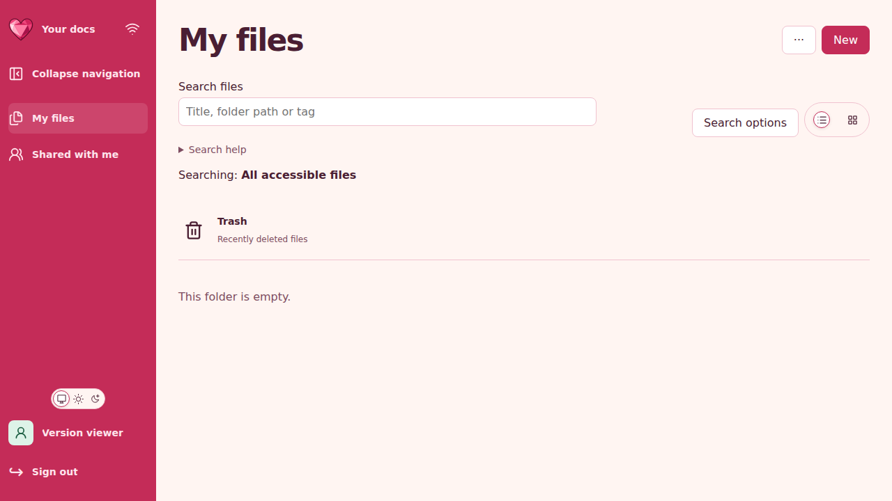

# 🧾 SPN-089 integrated-source history failure

These files retain the first failed history-viewer assertion from source
`866df9f34f8d1fa3d2782c5a9fe796e4744604c5`, tested as
`93d0d5fc5b3f850a93d178c36aa75fb18cc4b6a6` in source CI run **41938091631,
attempt 1**. The development 2/2 worker **126952141414** failed, and the required
Playwright aggregate rejected it. The built-in retry passed; it does not repair
the failed source run.

## 🔎 Preserved observation

The viewer authenticated and reached the empty My files dashboard. The expected
Sheet document and its Save status were absent. The original URL, redirecting
request and response were not recorded. Only the successful retry has a trace.
The fixture's live credential replacement and source-supported access-probe
redirect mechanism are documented with those limits in the [receipt](history-first-failure/receipt.json).

The [safe evidence manifest](history-first-failure/safe-evidence-manifest.json)
records the exact retained bytes and hashes. It covers the receipt, sanitized
test result, failure log, observed DOM, screenshot, source hashes and archive
extraction manifest. The original archive identity and missing-first-trace limit
remain recorded; raw reports, session-bearing diagnostic inputs and the retry
trace are not published here.

The readable log and receipt omit trailing whitespace and use one terminal
newline. Their exact original bytes are also retained in the two `.raw.gz`
objects named by the manifest; the original manifest retains the source hashes.
This formatting normalization changes no observation or failure disposition.

## 📚 Complete disposition

- [All 33 source CI jobs and selected-suite outcomes](../../implementation/evidence/SPN-089/integrated-866df9f-ci.json).
- [Independent reviews, verified build, 15-state capture, native matrix and Storybook](../../implementation/evidence/SPN-089/integrated-866df9f-validation.json).
- [Fixture ownership repair and its remaining acceptance](../../implementation/SPN-089.md#-history-viewer-fixture-ownership).

These are historical records of the rejected integration candidate. A later
metadata pass does not erase the failure. The repaired commit requires its own
independent reviews and strict hosted acceptance before merge.
