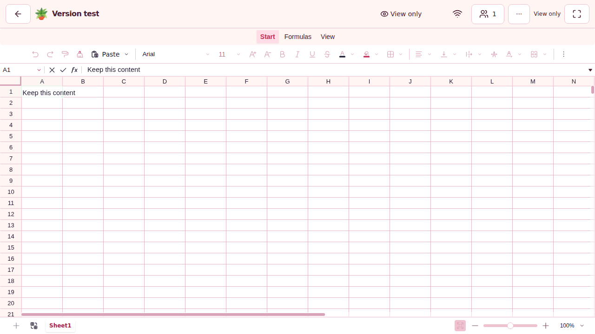

# 🧾 SPN-089 rejected B acceptance failures

## 🔎 Source and first observed development failure

This bundle preserves a deterministic acceptance-test defect in source
`95d52be36061315bff866dec615544104ca4767c` (B), tested as PR merge
`679ad75636799820e47bf0214ade771c3fe859e2`, tree
`43bac9fbd53c842b8d5796560f19076edacd38b7`, against main
`5c565b61e11ce29780581f33410749436ecef42f`.

[CI run 41948253612, attempt 1](https://github.com/mxbaylee/spinel/actions/runs/41948253612)
failed its [development 2/2 worker](https://github.com/mxbaylee/spinel/actions/runs/41948253612/job/126985936508).
The Sheet history case reached the actual online, read-only editor at the exact
item URL. Its newly added `Your profile` link assertion then found no accessible
element. All three built-in attempts failed at that same assertion: 17.418 s,
25.106 s and 17.233 s. The first started at 2026-11-05 01:41:59.557 UTC.

The development report records 11 passes, one unexpected failing case and 64
cases with no executed result, including Doc history. Those unexecuted cases
are not acceptance. The production worker also reports both Sheet and Doc
failing this same assertion; its exact attempts and other worker outcomes are
retained in the [CI disposition](../../implementation/evidence/SPN-089/integrated-95d52be-ci.json).
That checkpoint remains frozen with its then-pending work. The additional
[terminal record](../../implementation/evidence/SPN-089/integrated-95d52be-terminal.json)
retains the later mobile failure and final aggregate result.

The production failures occurred earlier but became observable after that shard
completed: Sheet retry 0 began at **01:40:02.414 UTC** and Doc retry 0 at
**01:40:43.121 UTC**. Each failed all three built-in attempts at the same locator;
the other 82 production cases passed. The separate
[production receipt](history-production-failures/receipt.json) preserves all six
attempts, archive/report identities and source attribution. Its
[first Sheet](history-production-failures/sheet-failure.png) and
[first Doc](history-production-failures/doc-failure.png) screenshots plus exact
page-snapshot blocks show both actual read-only editors. The
[production safe manifest](history-production-failures/safe-evidence-manifest.json)
records extraction/derivation checks; raw contexts and retry traces remain excluded.

Actual B first-attempt screenshot: the correct read-only Sheet, containing the
saved text, with View only status and disabled editing controls. The visible
editor header has no profile link. This differs from rejected A's empty My files
dashboard. The screenshot is not a capture of the corrected source.

## 🧭 Cause and correction boundary

`web/Rail.tsx` owns the global profile link. `web/editorFrame.css` deliberately
hides the workspace's outer header while an editor is present, and the editor's
own header does not expose that link. The inaccessible-role assertion was an
incorrect assumption in the fixture; pre-push source review missed it.

The correction reads `/api/auth/session` through the existing viewer browser
context, with a five-second bound. It requires HTTP 200 and the exact viewer ID,
name and non-admin status. This is the application's cookie-authoritative,
no-store identity endpoint. Original visible-editor, item URL, saved-content,
history naming, read-only, absent naming-action, page-error and cleanup checks
remain. No production authentication, layout, timeout, retry or selection policy
is relaxed. The corrected head still requires its own actual browser acceptance.

## 🧾 Retained evidence

The [receipt](history-first-failure/receipt.json),
[sanitized attempt results](history-first-failure/sanitized-history-results.json),
[first-failure log](history-first-failure/failure-log.txt),
[observed page](history-first-failure/observed-page.yaml),
[source hashes](history-first-failure/source-hashes.json), and
[extraction manifest](history-first-failure/extraction-manifest.json)
bind this subset to the original report and source. There is no first-attempt
trace; the available trace belongs to retry 1 and cannot reconstruct the first
attempt's network sequence.

Original artifact **13379978325** is **5,933,894 bytes**, SHA-256
`d572e3e5d0a9d04334bfbc7e2efd8d3d30e33ab9cdb5e4e95b6881e16b79b0e6`.
The original report is **1,470,188 bytes**, SHA-256
`c87d1cc6a25460ce690ea3a49565f0b6f5c8f91c4016ea19ca8fe5152d5ce3af`.
Raw reports, ZIP and trace contain broader diagnostic inputs and are not
published in this subset.

The [safe manifest](history-first-failure/safe-evidence-manifest.json) records all
retained byte counts and SHA-256 hashes. Only the readable log needed trailing
horizontal-whitespace normalization; its exact original bytes are retained in
`failure-log.txt.raw.gz`. The original safe manifest is preserved separately.
The screenshot and other files retain their original bytes.

B's independently successful native, Storybook and visual results remain in the
[source-bound validation record](../../implementation/evidence/SPN-089/integrated-95d52be-validation.json).
They do not waive B's failed ordinary CI or validate the repaired source.

## ⚡ Later mobile capacity-flush failure

The same run's [mobile responsiveness worker](https://github.com/mxbaylee/spinel/actions/runs/41948253612/job/126985936494)
later finished failed on `mobile sustained native typing plain-1`, retry 0.
It measured a genuine **129.1 ms** capacity pair against the **100 ms** maximum:
history 59.8 ms and collaboration 69.2 ms at completed state 672. Both returned,
clearing queues 32/32 to 0/0. The exact saved/live/peer content, selections and
66-group undo/redo assertions had passed; those passes do not waive the timing
failure. The worker had six passing cases and one failure, with no skipped or
flaky cases. There is no trace or CPU profile of the failed sample.

The [safe mobile receipt](mobile-responsiveness-first-failure/receipt.json)
retains source/runtime identity, all baseline/candidate outcomes, numerical
observations, archive/member hashes and privacy inspection. The original failed
sample's complete metrics remain in an exact compressed object; its synthetic
sender/peer screenshots and useful error context retain the failure surface.
No page snapshot was included in the original error context, and none is inferred.
The readable mobile log removes only one extra blank line at EOF for source
whitespace checks. Its exact original remains in `failure-log.txt.raw.gz`;
`original-safe-evidence-manifest.json` and the current `manifest.json` distinguish
original extraction identities from that readable representation.

[SPN-146](../../implementation/SPN-146.md#registration-and-scope) owns the separate
unknown-cause native/runtime investigation. The history-session correction does
not repair this measured path. The next substantively repaired source still
requires one complete fresh acceptance run with all original budgets and first
attempts; another failure requires diagnosis, not an unchanged rerun or waiver.
