# 📐 SPN-089 — title alignment review

## 🔎 Exact source

- Application source: `ee996e95e5a1ca117f4144e5e3950341eb97c6da`.
- Tested merge: `39a9b6227e0eb4339adbe1b9e99606318e90ef21`.
- Matching tree: `dca595ca8ef725b5f51af4732d7499af2346f4cc`.
- [Hosted Storybook run 41927434933](https://github.com/mxbaylee/spinel/actions/runs/41927434933), artifact **13370111549**, **6,193,053 bytes**.
- Archive SHA-256: `7a0610a58fa49ca6d8d3f5c60c0b8b065ccffbe330e37098ad23abcd1a0b60a7`.

The fresh unmodified hosted build contains **1,056 stories** and all **114** documented state links for **45 production dialog owners**. [artifact.json](artifact.json) records the inventory and identities. No CSS was injected into these acceptance images.

## ✅ Checks and independent review

The unchanged screenshot runner passed **40/40 states**: eight selected stories across desktop light/dark at 1280×900, phone light/dark at 390×900, and tablet at 768×900. It required successful actual Storybook plays, including the new first-line geometry assertions, before capture. [capture-manifest.json](capture-manifest.json) records every check and image; [capture-watchdog.json](capture-watchdog.json) records **61.516 seconds** and **1,252,664 KiB** peak combined RSS, exit 0, with no abort. The **14 useful screenshots** retained here cover every distinct title owner; the other 26 capture files are not duplicated in this evidence branch.

Both independent source reviewers graded the exact committed candidate **97/100** before its validation push; see [source-reviews.json](source-reviews.json). Local typecheck, lint/format/dependency policy, backlog, and exact-title PR checks passed; see [local-validation.json](local-validation.json).

**Agent review only.** Reviewer `/root/dialog_audit` independently inspected **17 current-source screenshots**: all 14 retained below, plus native copy on tablet, the shared long title on desktop dark, and the Space drawer on phone dark. It approved the exact source and closed the earlier P2 alignment finding. [visual-review.json](visual-review.json) records the scope and provenance checks. Full hosted catalogue and CI/native workflow results remain separately recorded in the PR and timestamped workflow receipt; this visual approval does not infer their outcome.

## 🧪 Diagnosis and retained history

[diagnostic-measurements.json](diagnostic-measurements.json) retains the bounded before/after experiment against the previous exact `ef899b8` build. The old shared SVG/emoji cues measured **2 px high**; Profile measured **1.5 px low**. The proposed rule brought all 34 measured cues in 30 states within **0.5 px**. The old-rule wrapped phone title rejected the 1 px alignment contract. These injected-CSS measurements are diagnosis only. [old-rule-long-title-phone.png](old-rule-long-title-phone.png) preserves the useful before image.

[prior-pr-body.md](prior-pr-body.md) preserves the preceding PR description, source-specific native initialization failures/repairs, earlier captures, and the original Firefox storage-preparation failure. Earlier assets remain pinned to their original commits. A fresh native pass does not establish that this CSS repair fixed the storage race, identify its writer, validate SPN-141's separate candidate, or erase that first failure. Any current-head CI failure still blocks readiness; the PR preserves its own first failure and retry disposition.

## 🖼️ Current-source screenshots

The compact native Storybook **Name** field retains its pre-existing square/default styling, while earlier production native-flow captures show rounded field styling. This is a nonblocking fixture-fidelity caveat for the preview; the repaired title region is approved in every shown native layout. These current images supersede older title-alignment approval.

### Shared titles

**Wrapped SVG title · phone light**

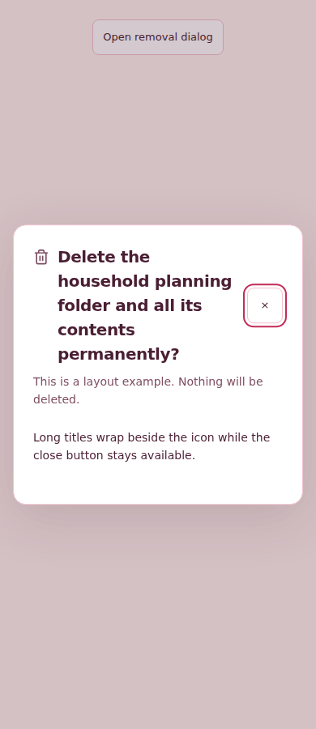

**Literal emoji · desktop light**

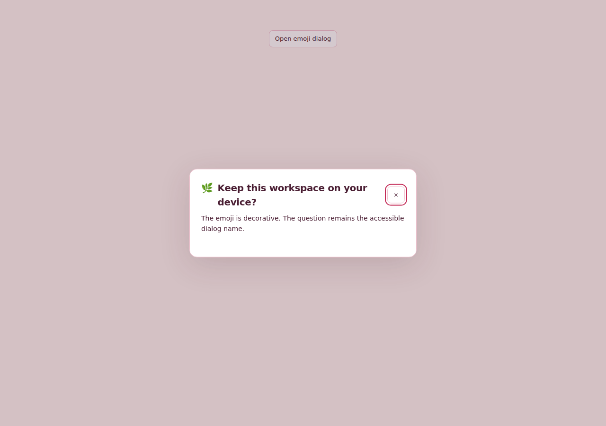

**Literal emoji · phone dark**

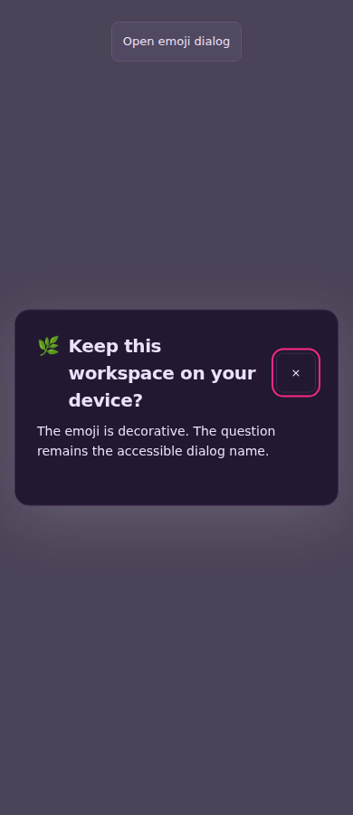

### Formula dialogs

**Insert formula · phone light**

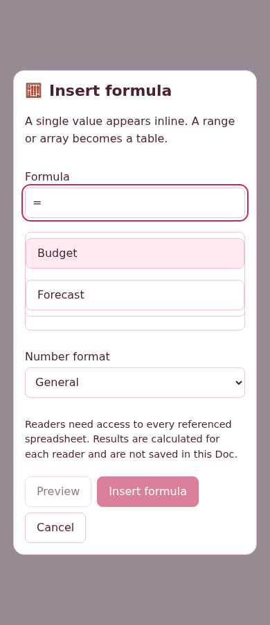

**Edit formula · desktop dark**

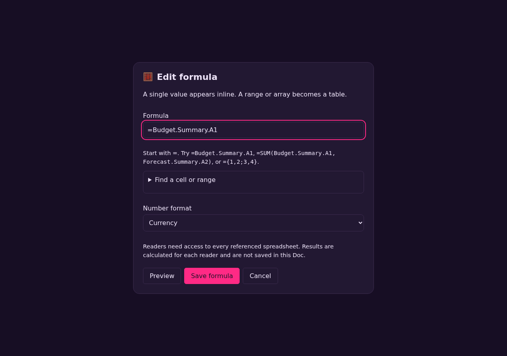

### Pickers and Space

**Profile icon picker · desktop light**

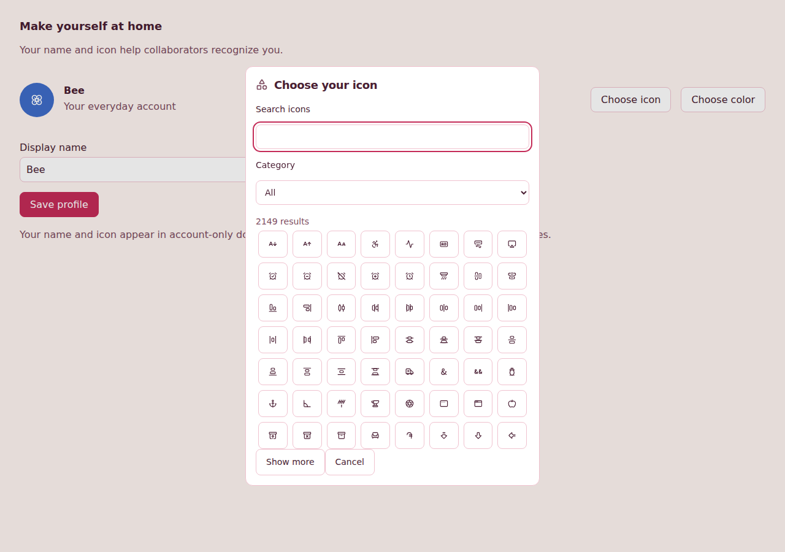

**Profile icon picker · phone dark**

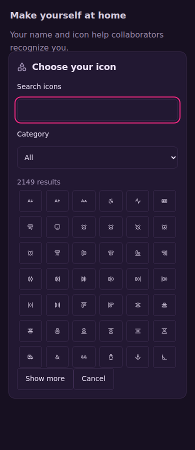

**Nested Appearance picker · desktop light**

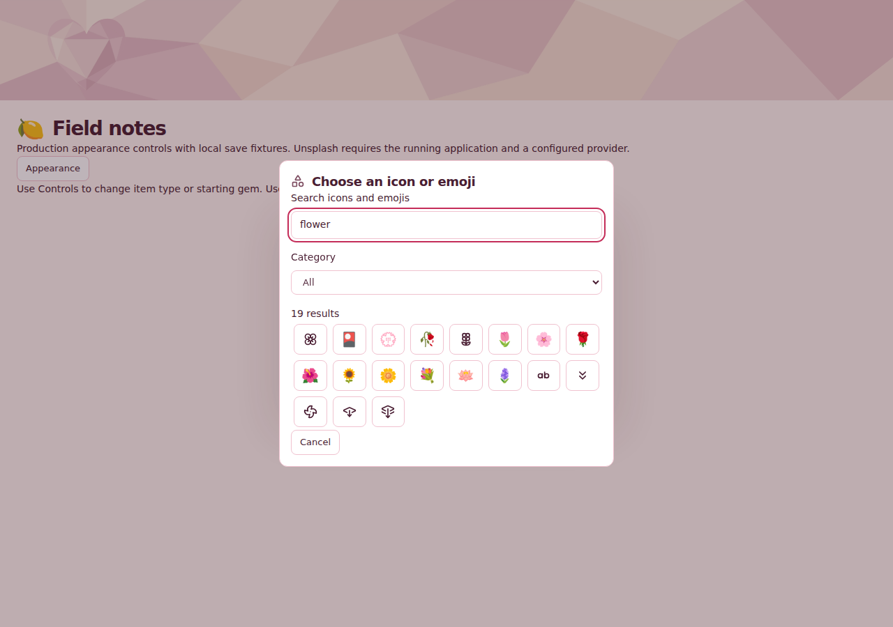

**Nested Appearance picker · phone dark**

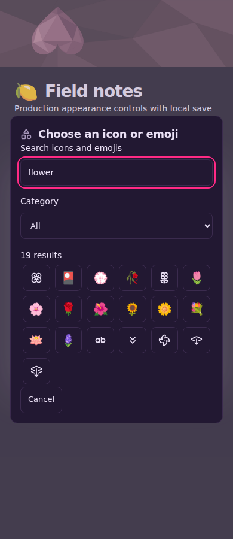

**Space contents · phone light**

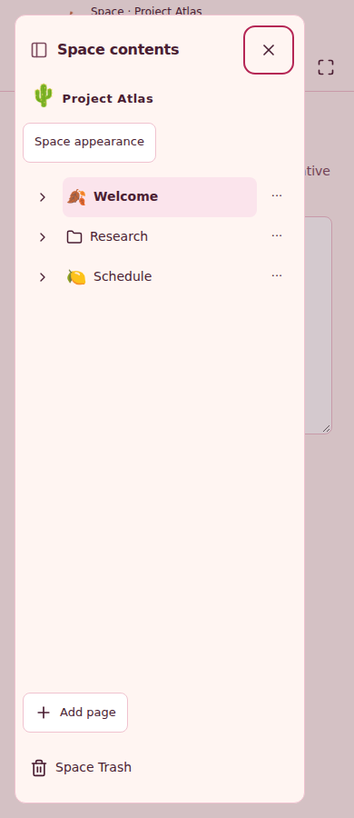

### Native SDK copy

**Native Make a copy · desktop light**

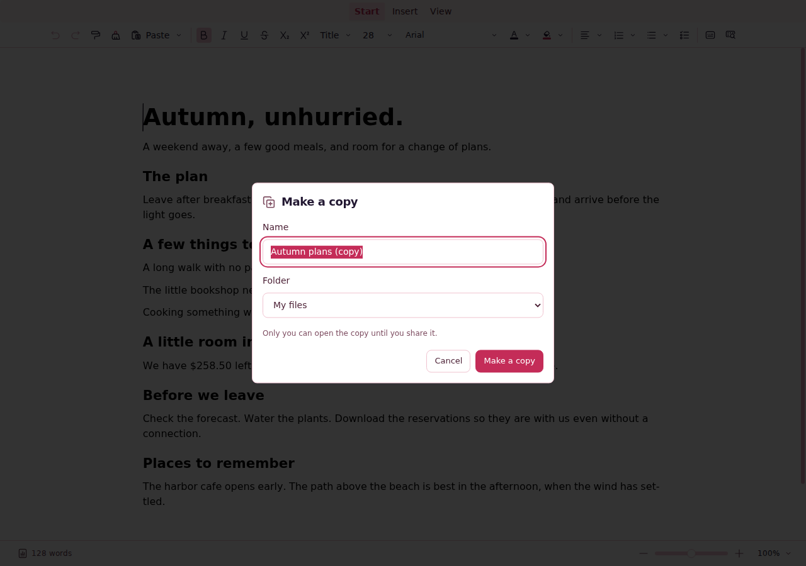

**Native Make a copy · desktop dark**

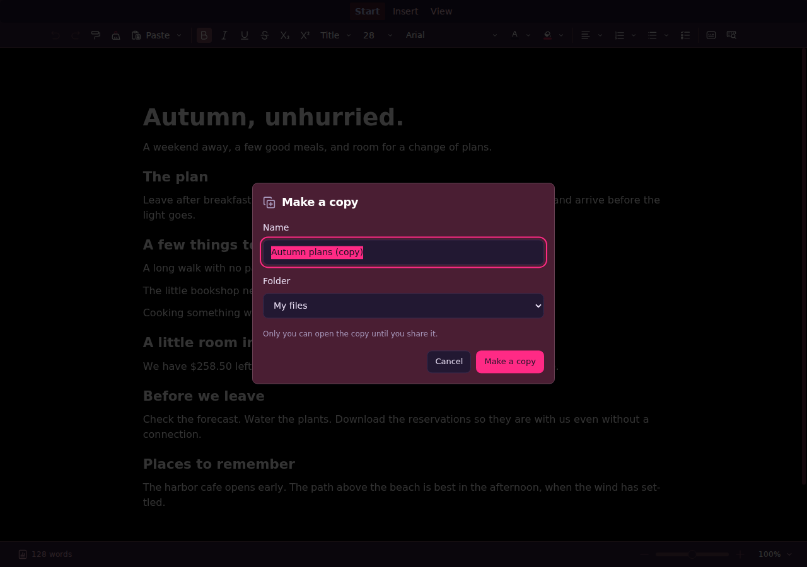

**Native Make a copy · phone light**

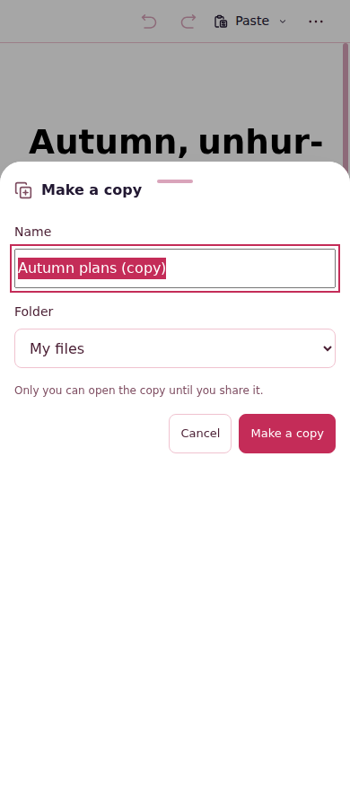

**Native Make a copy · phone dark**

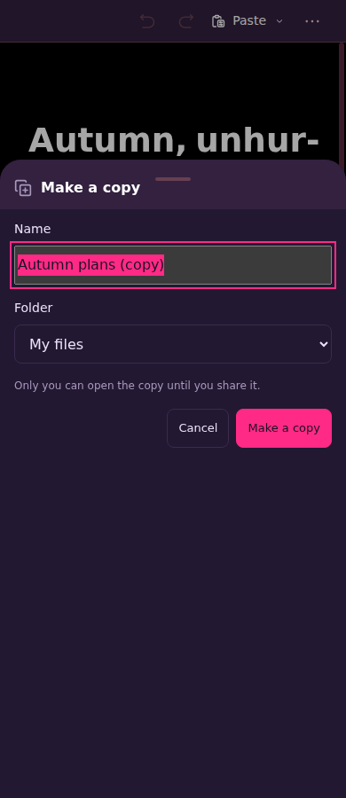

## ⛔ Current CI failure retained

[The offline-upgrade first-failure receipt](offline-upgrade-first-failure/receipt.json) records required job **126915583844** in source run **41927434953**, attempt 1. The new worker reached installed/waiting after **534 ms** and remained there at **120,000 ms**, while the old active worker stayed activated. The test expected activation. The error text says installation did not finish, but the retained observations specifically show installation completed and activation was not observed.

The built-in retry passed; `failOnFlakyTests` correctly kept the job failed. The second serial scenario was skipped in the first attempt and ran only on retry. No workflow rerun or assertion change was used to clear the result. The exact cause is unknown: unchanged worker/harness files do not prove zero asset or timing influence, and no relation to the earlier SPN-141 storage-deletion failure is established. This current failure blocks PR readiness.

The folder retains all eight worker observations, exact source/artifact identities and digests, retry disposition, source hashes, the first-failure screenshot, context and useful log excerpt. The image shows a synthetic legacy document still open with Saved locally; it does not prove successful upgrade. The original 18.7 MB provider archive is supplementary; its meaningful first-failure record is preserved here. There is no first-attempt Playwright trace in that archive—only retry traces.
