**Draft — the current-source Firefox offline storage-preparation check failed.** The dialog implementation has independent source and visual review, a deployed preview, and successful full-catalogue viewport checks. The separate blocker below prevents a fully verified or ready claim.

## 💬 Why

Several app-owned dialogs had plain or inconsistent title cues, and the shared modal silently supplied an `info` icon when a caller omitted its choice. SPN-089 makes that choice explicit and finishes the production-dialog audit.

## What changes

- Require exactly one semantic `icon` or literal `emoji` with every shared `Modal` title.
- Reuse `ModalTitleContent` in native Insert/Edit formula, the icon picker, Space contents, and the native editor's Make a copy dialog.
- Preserve textual accessible names and each existing owner's focus, dismissal, pending-operation and permission behavior.
- Add real production previews for the previously uncovered dialogs and strengthen existing title, accessibility, keyboard/focus and native-copy checks.
- Include the required ticket completion bookkeeping and regenerated backlog index, integrated with current main's SPN-142 grooming.

The verified inventory covers **45 production dialog owners: 41 shared Modal callers plus four other title owners**, with **114 unique state-preview links**. Browser-owned safeguards, nonmodal popovers and unsupported SDK internals retain their documented boundaries.

## 📚 Review every dialog

- [Complete 45-entry inventory and all state links](https://github.com/mxbaylee/spinel/blob/ef899b8004c650f8564d6f1fc3fa7d9bf9623076/docs/implementation/SPN-089.md#-dialog-preview-inventory)
- [Live Storybook — common emoji modal](https://mxbaylee.github.io/spinel/?path=/story/redesign-controls--emoji-modal-title)
- [Native formula dialog](https://mxbaylee.github.io/spinel/?path=/story/docs-formulas--insert)
- [Native icon and emoji picker](https://mxbaylee.github.io/spinel/?path=/story/account-profile--icon-picker)
- [Actual SDK Make a copy dialog](https://mxbaylee.github.io/spinel/?path=/story/redesign-native-editors--make-copy-dialog)
- [Preview build identity](https://mxbaylee.github.io/spinel/sha.json)

The live `/sha.json` was fetched without cache on **2026-11-04 at 21:51 UTC** and matched source `ef899b8004c650f8564d6f1fc3fa7d9bf9623076`, PR **260**, tested merge `b928c3848847eca3433171524a3ed8d331e295e4`, and Storybook run **41918564629**. The build contains **1,056 stories**, including **114/114** documented inventory links with zero missing or mismatched IDs.

The shared Pages URL can be replaced by a later deployment. Match `sha.json` to the reviewed source before using it as current evidence. The inventory marks dialogs that need an interaction or phone viewport.

## 🔎 Exact source and verification

| Identity | Value |
| --- | --- |
| Reviewed PR head | `ef899b8004c650f8564d6f1fc3fa7d9bf9623076` |
| Base | `7679351822caaa9535d73d656191f2a6597a3380` |
| Tested merge | `b928c3848847eca3433171524a3ed8d331e295e4` |
| Head and tested-merge tree | `19d726f7eeb41c581a7bd96ee221e49215a02f13` |

The tested merge tree matches the reviewed head exactly. Production components, styles and native-copy E2E are unchanged from the first hosted source `8e5c48f`. Subsequent changes repair only the real native-copy Storybook fixture and retain diagnosis/evidence; current-main backlog grooming is integrated.

### Hosted verification and readiness

| Workflow | Exact run / attempt | Evidence |
| --- | --- | --- |
| Full Storybook catalogue | [41918564629, attempt 1](https://github.com/mxbaylee/spinel/actions/runs/41918564629) | Five successful viewport/theme jobs checked **1,056 stories each**, for **5,280 state checks**. Four variants recorded nine additional interactions each; desktop light recorded thirteen, for **49 interaction passes**. The aggregate must also succeed. |
| Current-source CI | [41918564598, attempt 1](https://github.com/mxbaylee/spinel/actions/runs/41918564598) | Full conservative coverage plan. Backlog, Pull request, Lint and Typecheck have passed; the run link owns the remaining current result. All seven stable gates and every selected dependent suite are required for readiness. |
| Desktop offline | [41918564509, attempt 1](https://github.com/mxbaylee/spinel/actions/runs/41918564509) | **Failed.** Chrome and Safari passed; Firefox failed the storage-preparation predicate below. |

The exact-source CI plan is artifact **13366865855**, SHA-256 `31137ad69d268dc14fa32c4741e4fa7db08d77e63987df4fe93b89a192044ab4`. It retains full coverage, including actual native-copy owning shards and development/production sync coverage. This description edit also triggers fresh CI under repository policy; [current-head checks](https://github.com/mxbaylee/spinel/pull/260/checks) retain that additional run. No pending, failed or cancelled job is counted as a pass.

### Blocking Firefox storage-preparation result

Native **Firefox 159.0.1 on macOS 26 arm64**, [job 126884671951](https://github.com/mxbaylee/spinel/actions/runs/41918564509/job/126884671951), failed on this exact source/merge. `localStorage.clear` returned **0** at **21:46:37.499 UTC**; the final check at **21:46:37.518** observed **1** entry. Service workers and caches were empty and the targeted private database was absent. The other two database names were diagnostic context, not failed criteria. Later storage-loss assertions did not execute.

The [durable sanitized failure receipt and useful failure image](https://github.com/mxbaylee/spinel/tree/0355dba47304a59bb40899d95d5de886775229b4/docs/review-assets/spn-089-ef899b/firefox-first-attempt) retain all ten deletion operations, original archive/report/image digests and five relevant source hashes. Original artifact **13365513716**, **716,721 bytes**, SHA-256 `3fbdf7a964ead83bdb9e547f0582608aa93bbe04ec9ef5ebb432f225b2eaeee4`. Its temporary Actions copy expires November 18; the linked repository receipt does not depend on that copy.

This is additional evidence for [SPN-141 / PR #258](https://github.com/mxbaylee/spinel/pull/258)'s **quiescent storage-loss preparation outcome**. The harness/storage/fixture/workflow paths are unchanged by SPN-089. The exact key/writer and whether SPN-141's unintegrated candidate fixes this particular predicate are unproven. Accepted integration and fresh native acceptance are still needed after its [SPN-142 prerequisite / PR #262](https://github.com/mxbaylee/spinel/pull/262). No unchanged retry, wider deletion or relaxed assertion replaces this failed attempt.

| Relevant local check | Result |
| --- | --- |
| Full typecheck of the repaired source | Passed; 11.137 s, 1,862,036 KiB sampled peak process-tree RSS, pinned Node 26.12.1, `GOMEMLIMIT=1400MiB` |
| Full lint, formatting, dependency boundary | Passed at the preceding source checkpoint; 42.306 s, 803,044 KiB sampled peak RSS. The only later source change was the native story, which passed fresh lint (0.294 s) and formatting (0.456 s). |
| Backlog and exact-title PR checks against current base | Passed; 21 open tickets |
| Native-copy repaired preview across five variants | **Passed 5/5**, zero failures, from the fresh uninstrumented hosted build; 29.736 s, 1,080,508 KiB sampled peak RSS. |

[First-head source hashes and failure dispositions](https://github.com/mxbaylee/spinel/blob/ef899b8004c650f8564d6f1fc3fa7d9bf9623076/docs/implementation/evidence/SPN-089/first-head-results.json), [lifecycle diagnosis and final local check receipts](https://github.com/mxbaylee/spinel/blob/ef899b8004c650f8564d6f1fc3fa7d9bf9623076/docs/implementation/evidence/SPN-089/second-head-results.json), and the immutable final gallery linked below retain the successful checks and resource-aborted attempts. Full/focused local Storybook builds and the focused dev preview could not complete within the existing 2 GiB limit; they are not counted as passes. Hosted builds and actual rendered checks own acceptance. No CI routing, assertions, resource limits or production build settings were weakened.

## Independent reviews — agent review only

Both nonimplementing reviewers inspected this exact final head, carrying their complete implementation review forward and independently checking every lifecycle-repair and evidence delta.

| Reviewer | Scope /35 | Correctness /25 | Regression/evidence /20 | CI /10 | Maintenance/complexity /10 | Pre-push total |
| --- | ---: | ---: | ---: | ---: | ---: | ---: |
| dialog_audit | 35 | 25 | 17 | 10 | 10 | **97/100** |
| verification_plan | 35 | 25 | 17 | 10 | 10 | **97/100** |

No unresolved source finding remained before the validation push. The pre-push deductions explicitly reserved current-source runtime and hosted acceptance; those grades were not represented as CI or visual approval.

**Final independent visual approval: granted by `dialog_audit` for `ef899b8004c650f8564d6f1fc3fa7d9bf9623076` — agent review only.** The reviewer inspected all five fresh native-copy captures and verified all 363 extracted build files against the hosted archive. Prior inspected common, formula, Appearance, Profile, Space, Search, Passkeys, History and actual native production views carry forward only where their sources are unchanged.

**Accepted P3 fixture fidelity note:** compact native Storybook Name inputs retain square/default borders because the existing `.rd-native-editor` fixture selector excludes them from shared input styling. Titles, cues, content and actions are readable and approved; the retained actual production captures show the rounded production inputs. The fixture is not claimed to be pixel-identical to the production form.

<details>
<summary>Fresh native-preview verification receipt</summary>

```json
{
  "source": "ef899b8004c650f8564d6f1fc3fa7d9bf9623076",
  "testedMerge": "b928c3848847eca3433171524a3ed8d331e295e4",
  "tree": "19d726f7eeb41c581a7bd96ee221e49215a02f13",
  "workflowRun": 41918564629,
  "artifactId": 13366516366,
  "artifactBytes": 6192507,
  "artifactSha256": "a39ef7084e29999b2da37c6764dcd90ffa6c5ced5d5cb9b0fcb17c23332906d6",
  "builtAt": "2026-11-04T21:46:14.360Z",
  "reviewedAt": "2026-11-04T21:48:05.696Z",
  "runner": "unchanged scripts/screenshots.ts",
  "story": "redesign-native-editors--make-copy-dialog",
  "variants": [
    "light",
    "dark",
    "phone",
    "phone-dark",
    "tablet"
  ],
  "checked": 5,
  "failures": [],
  "elapsedMs": 29736,
  "peakKiB": 1080508,
  "exitCode": 0,
  "node": "v26.12.1",
  "catalogueStories": 1056,
  "inventoryRows": 45,
  "inventoryIds": 114,
  "missingOrMismatchedIds": [],
  "manifestSha256": "53cdb9edead0f33b5fc26c54c05d919566eb25299e4066033e1ebc3a9603eb2d",
  "processReceiptSha256": "004d3633a7b8ab65417a181a5d9dce95d9e1b1fe95331da992a41fcec1223cca",
  "captureSha256": {
    "light": "b47be47afdf7754101fcffcb8d4f4b01da3040dc4245265f3f36f6f03a5f0d38",
    "dark": "328484878ff3f2f8927831dcf19a0b0c9892ea6c6282c8c237d8fbca3c36f2e4",
    "phone": "3d6b0c83bf068564e0b2f6bf95a74ee74de5061a2874c8ce896ed178334a8968",
    "phone-dark": "cab2325280f021bca646f25a946443ced3b91f32088417653b5790cf857b74e5",
    "tablet": "0eb6b8583814e184a618a802548ce5cc27407a0d215b053ccb1e507109fc4522"
  }
}
```

</details>


[Immutable final capture gallery, inventory receipt and native-storage failure record](https://github.com/mxbaylee/spinel/tree/0355dba47304a59bb40899d95d5de886775229b4/docs/review-assets/spn-089-ef899b) preserve the source-bound evidence at commit `0355dba47304a59bb40899d95d5de886775229b4`.

<details>
<summary>Five fresh native-copy preview screenshots</summary>

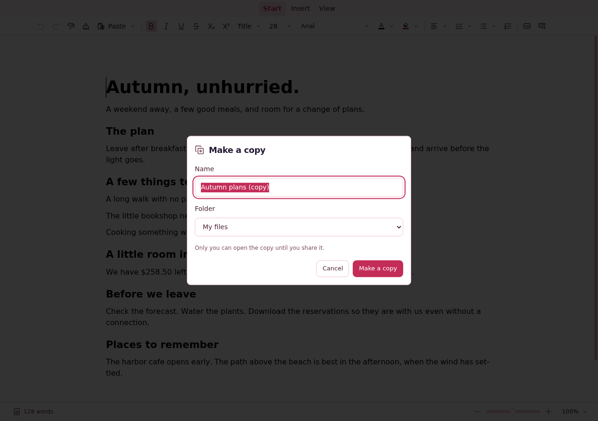

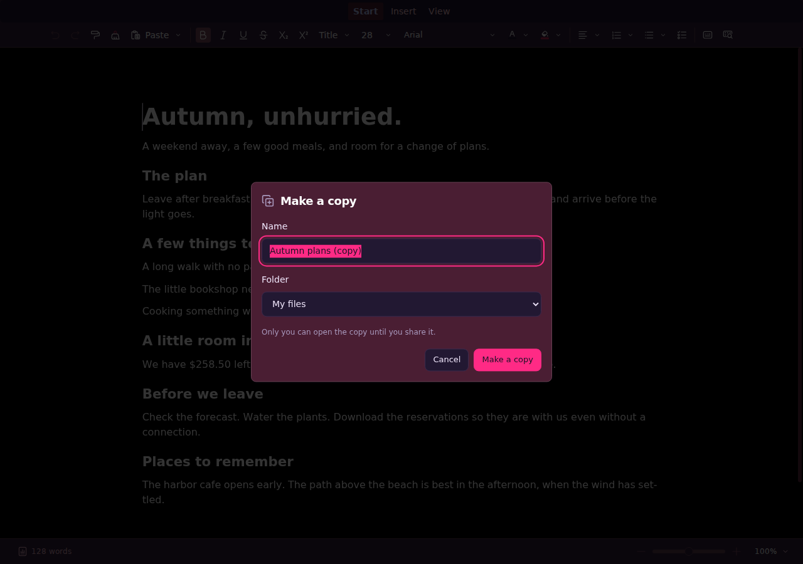


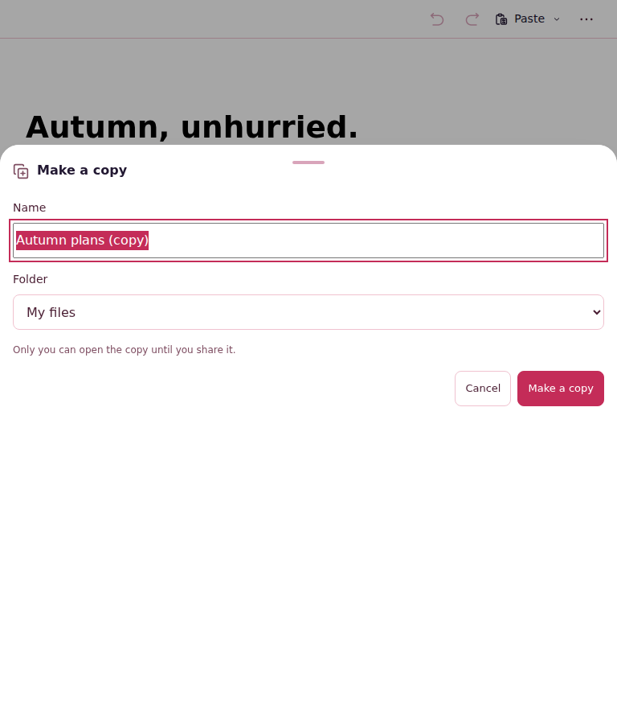

</details>

## 🖼️ Retained screenshots and failure history

Fourteen successful images are committed with [source identities and SHA-256 digests](https://github.com/mxbaylee/spinel/blob/ef899b8004c650f8564d6f1fc3fa7d9bf9623076/docs/implementation/evidence/SPN-089/first-head-results.json): ten Storybook states and four actual production native-copy views in desktop/phone and light/dark. They capture source `8e5c48f`, whose production components and styles are unchanged at this PR head. The repaired native Storybook preview additionally has current-source checks and independent visual review as recorded above.

<details>
<summary>Show all 14 retained successful screenshots</summary>

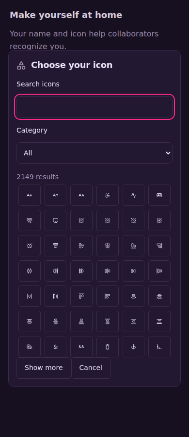

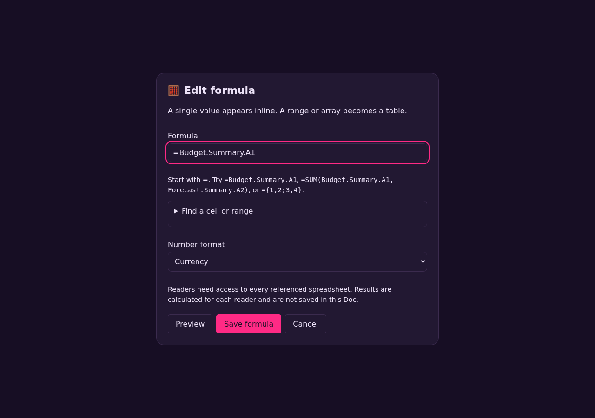

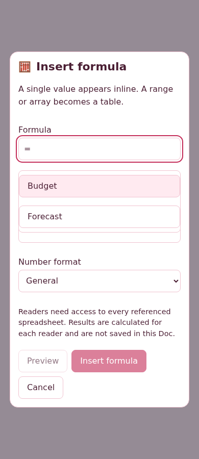

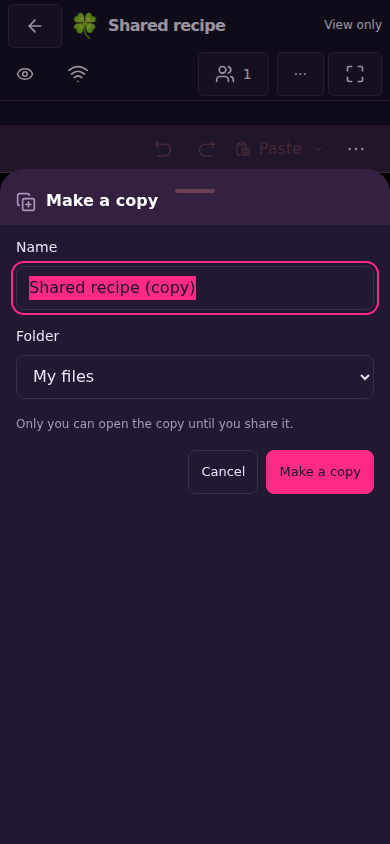

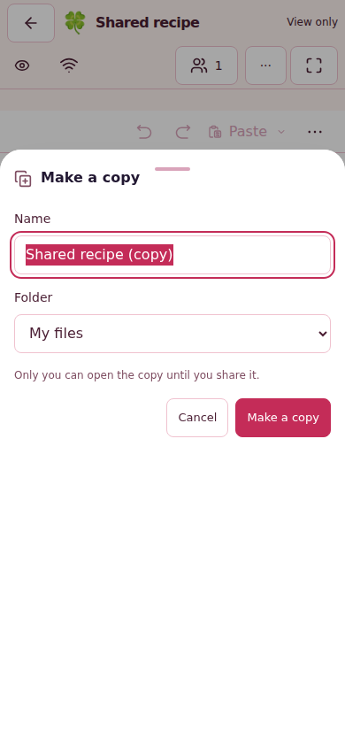

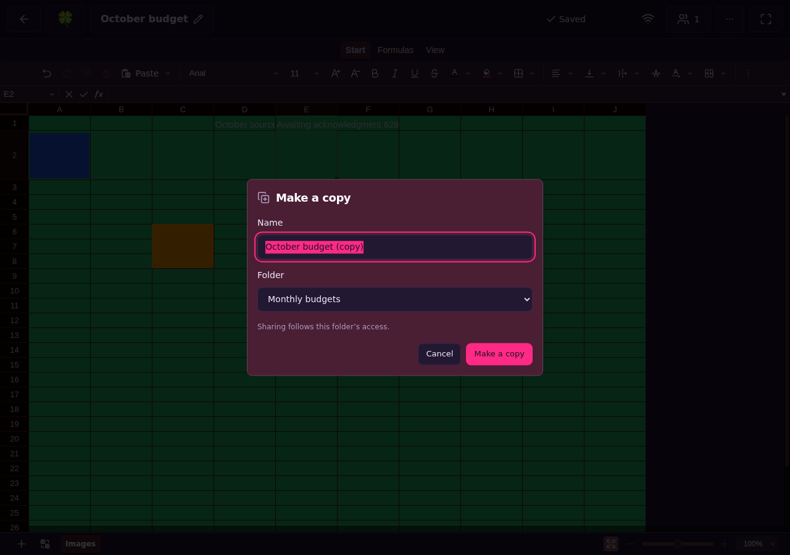

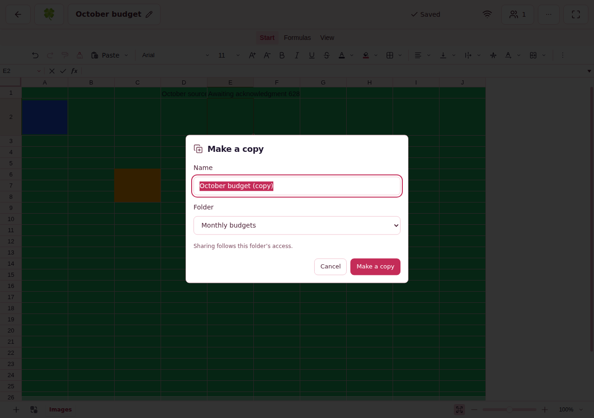

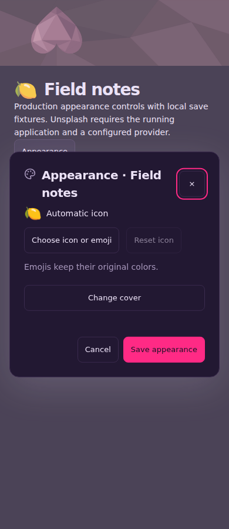

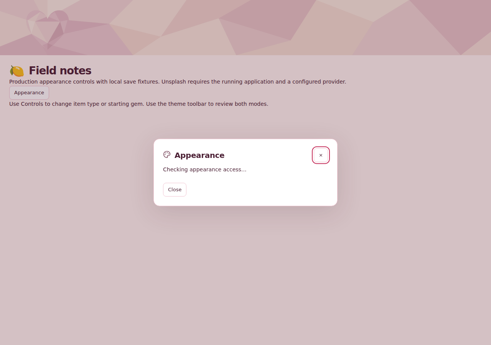

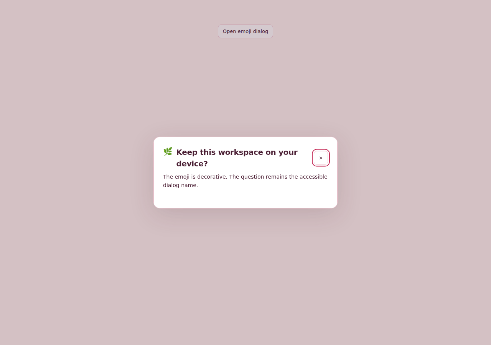


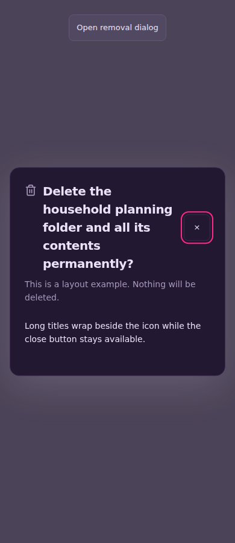


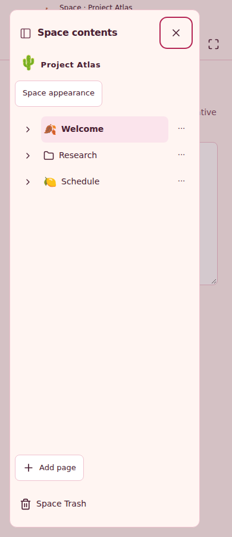

</details>

[Six baseline images and their verified main-build identity](https://github.com/mxbaylee/spinel/blob/ef899b8004c650f8564d6f1fc3fa7d9bf9623076/docs/implementation/evidence/SPN-089/before-checks.json) preserve the before state.

The first hosted source remains recorded honestly: the focused local capture passed **157/160**, with three compact native-copy preview failures; the full hosted catalogue later found the same story failure in all five variants. The [original manifest](https://github.com/mxbaylee/spinel/blob/ef899b8004c650f8564d6f1fc3fa7d9bf9623076/docs/implementation/evidence/SPN-089/first-head-manifest.json), failed captures and diagnostic outcomes are retained. Actual native-copy E2E passed on the first attempt at source `8e5c48f` in both development and production. The second actual hosted source `0106630` passed only **1/5** focused captures, also retained in [its complete evidence record](https://github.com/mxbaylee/spinel/blob/ef899b8004c650f8564d6f1fc3fa7d9bf9623076/docs/implementation/evidence/SPN-089/second-head-results.json). Finite diagnostics established that opening before global dialog UI subscribed lost the service's emission. The repair waits for the SDK's public `Steady` lifecycle, opens once, and waits for observable visibility. A bounded derived-bundle experiment passed **5/5**, explicitly as diagnosis rather than source acceptance. Fresh uninstrumented source acceptance is recorded above. Strict title/cue/form assertions remain, and existing E2E retains real toolbar clicks and phone taps.

The original source's development-sync job also failed after an unhandled socket `ECONNRESET` killed its server and later fixtures received `ECONNREFUSED`; its [sanitized failure record](https://github.com/mxbaylee/spinel/blob/ef899b8004c650f8564d6f1fc3fa7d9bf9623076/docs/implementation/evidence/SPN-089/first-head-sync-failure.json) remains failed. Source repairs superseded and cancelled the earlier incomplete CI runs; those cancellations are not passes. The current-source CI run above owns fresh sync validation. This UI/preview change does not claim to repair that transport error.

**Readiness rule:** keep this PR draft until the separate native-storage blocker is resolved through accepted integration, both independent exact-head review gates remain satisfied, all seven current-head CI gates and selected evidence (including CI from this description edit) succeed, and current-source Storybook and visual acceptance remain complete. **No merge is requested or performed.**
