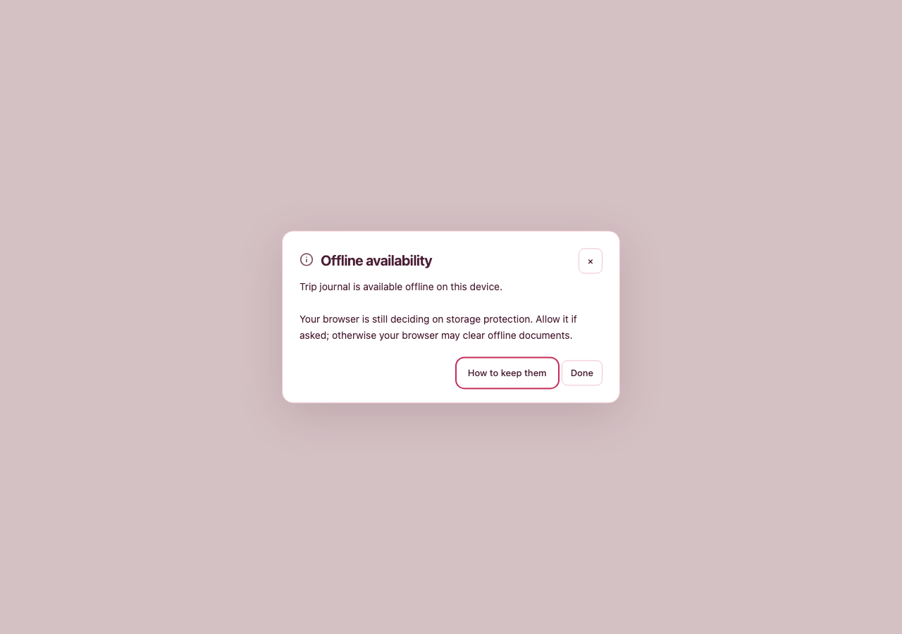
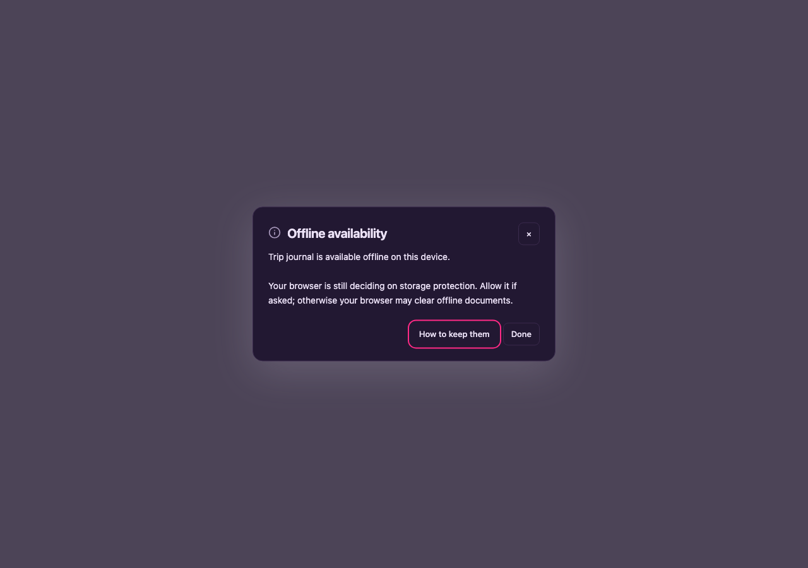
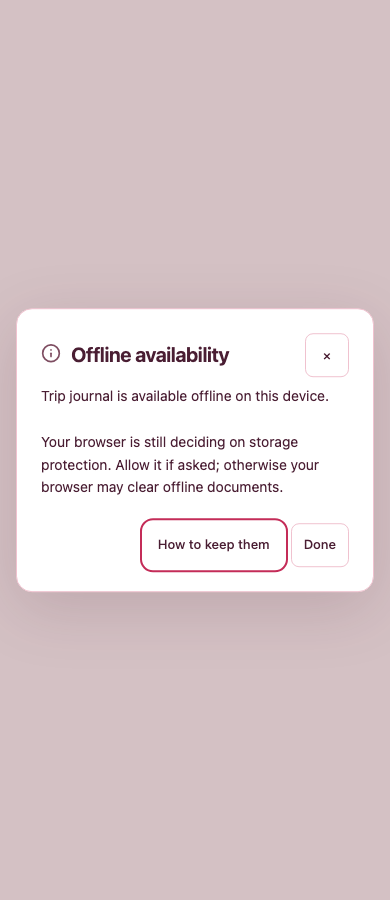
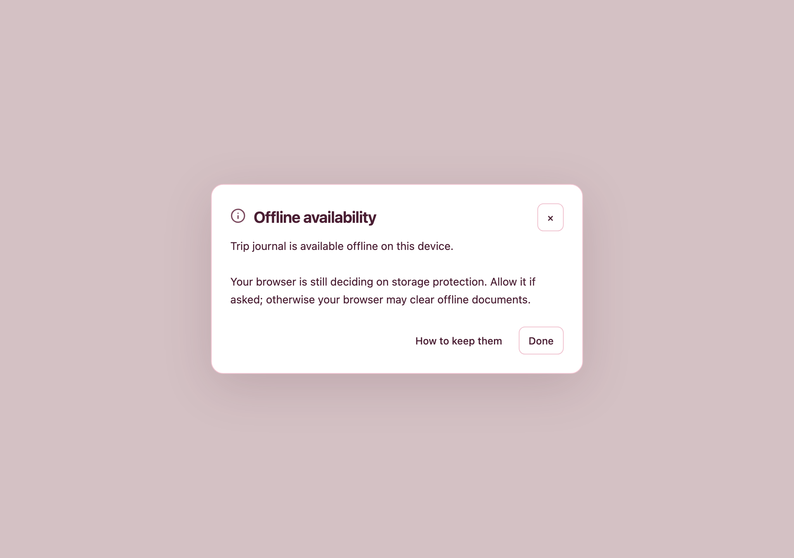
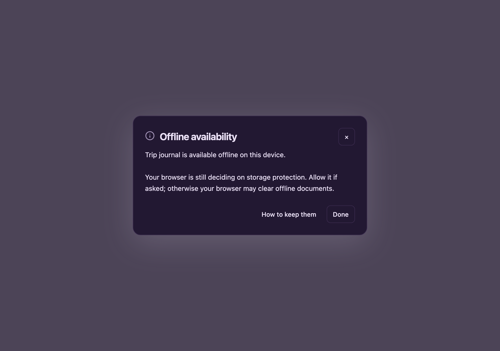
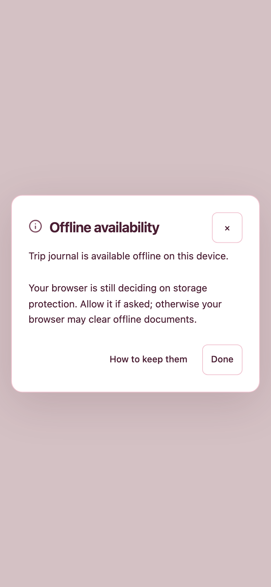

**Merged after exact-current validation; guarded branch cleanup complete.** Candidate **`43d3ee62bab1ed1d1b6d76209308f63f6e6aab07`** integrates actual landed main **`ec42f0741415e4e712395fb47c30b911bc4e64ea`**. Both independent nonimplementing reviews are **100/100** on this exact commit, with **exact-SHA visual and interaction approval — agent review only**. All seven required current-head gates passed; original CI has **33/33 successful jobs**, Storybook **eight success/two inapplicable**, and Desktop **three success**. The independently audited terminal archive is published. PR #224 was squash merged as **`c1d0d6e8ded33c10cf555ed2ed05ffd9ebc3a423`**, parent `ec42f074`, with the exact validated tree. Guarded branch cleanup is complete; immutable preservation tags retain unique history and all original dirty files remain intact.

Downloaded documents could fail to open after an Android restart or warm disconnect, and reconnecting could replace an offline editor containing unfinished input. This complete outcome bounds startup/network waits, opens verified saved copies through stable links, keeps the native offline editor mounted during reconnect, preserves complete installation resources, explains storage protection and uses the owner's chosen icon alignment. Guest UI completion ends public startup reporting; pending account admission continues reporting its actual stage. The latest changes repair the tests' real application-delivery and invitation-response/readback boundaries while retaining production behavior, assertions and budgets.

## 🧭 Exact source, full XL scope and integration

- **Source:** `43d3ee62bab1ed1d1b6d76209308f63f6e6aab07`. **Reviewed actual base:** `ec42f0741415e4e712395fb47c30b911bc4e64ea` (landed SPN-098 squash, parent `c525aa933505d6e78b8fdd7a89940d87506d5cb3`). The candidate's merge parents are repair checkpoint `e4de84c0ed0ee9e6b589714b5db067d4d6ee57b7` and actual main `ec42f074`. It is a descendant of previous published `724b577791273e0962ff08a38dea77a5aa632d84` and supports a normal fast-forward publication. No unmerged upstream source substitutes for actual main.
- **Complete outcome: XL; 19,437 counted lines**, acknowledged soft warning. The scope includes installed-context investigation, native persistence/access, shell/assets, owner-phone fixes, integration, verification and necessary evidence. The recent fixture repairs add no production architecture, package, deadline or permission. Both reviewers assessed the complete original outcome and maintainability, not just the newest patch.
- **Actual integration:** incoming feedback passes verified account context through Dashboard/EditorFrame/EditorTools, Rail and Space. Dashboard's only incoming change is `feedbackAccountId`; the mounted-device editor, native binding, true connection state, saved catalog and real-denial fences remain. Guest contexts receive no account feedback authority. Only backlog JSON/index conflicted; keep main's next ID **161**, grooming date **2026-11-14**, completion list **[SPN-098, SPN-090]**, and CLI-generated index. Only SPN-090's ticket is deleted relative to actual base. This is proposed landing bookkeeping, not a merge claim.
- **Publication boundary:** remote PR224 was last verified at **724**, actual main at **ec42**. The manager will publish this replacement metadata before the qualified source push and cancel/verify any superseded 724 metadata-triggered run before normal fast-forward publication. Those future actions and the eventual tested merge are not claimed as already completed here.
- Original dirty `7ffab` phone work, unique stale `9608` integration history and untracked capture helpers remain preserved. The old delivery handoff initially followed stale body `fe1fddd8`, then corrected to actual `af7a6cf` and the owner's later phone decisions. Those stale-source grades never authorize this candidate; guarded cleanup remains after actual merge.

[Canonical acceptance map and all persona decisions](https://github.com/mxbaylee/spinel/blob/43d3ee62bab1ed1d1b6d76209308f63f6e6aab07/docs/implementation/SPN-090.md) · [Actual-base ticket](https://github.com/mxbaylee/spinel/blob/ec42f0741415e4e712395fb47c30b911bc4e64ea/docs/todo/SPN-090.md) · [Combined integration and failure receipts](https://github.com/mxbaylee/spinel/tree/43d3ee62bab1ed1d1b6d76209308f63f6e6aab07/docs/implementation/evidence/SPN-090-current/landed-feedback) · [Exact review provenance archive](https://github.com/mxbaylee/spinel/blob/325ffdd2b6778bfc4f9c7a1a69b4248c3b2989ec/docs/review-assets/spn-090-review-43d3ee62/README.md).

### Owner decisions and retained product contracts

The owner's November 13 decision **removes BrowserStack entirely from this acceptance path**, including its workflow/harness, paid allocation, quota/ledger/forecast and monthly execution obligations. Their own phones replace that provider. Historical results and failures remain evidence. This does not erase product requirements or turn unexplained failures into passes.

- **Installed lifecycle:** [the actual own-phone findings](https://github.com/mxbaylee/spinel/blob/43d3ee62bab1ed1d1b6d76209308f63f6e6aab07/docs/implementation/SPN-090-own-phone-findings.md) record Android Chrome installation, storage protection, prepared Doc/Sheet content, initial cold/warm failures, and later observed warm Doc opening and cold offline launch after repairs. The owner later identified Pixel 10, “latest Chrome” and Home Screen launch. Exact OS/browser versions and build SHAs remain unknown. The final known-offline sign-in shortcut was not subsequently rerun on that phone. No historical phone result is assigned this candidate SHA.
- **Original complete-content/edit/reopen/replay/conflict/creation contract:** retained shared storage, native editing, recovery, creation and authority owners remain responsible for the product behavior. The manual notes do **not** prove every physical Sheet/image/authored-edit/reopen/creation/rejected-folder permutation. Standing four-persona judgment accepts targeted installed-lifecycle observations plus current deterministic/native owners, with explicitly lower integrated phone confidence than the original repeated three-platform matrix. This is an actual verification decision, not an invented pass.
- **Stable links and missing copies:** persisted-catalog deep-link fallback reads validated metadata and verified inventory for the prepared account, fences account/navigation changes, never fabricates a row and never overrides a real server denial. Ordinary and exact Space-child links, no accidental alternate-child open, viewer restrictions, guest/token exclusion and account isolation remain intact. A shortcut still is not a download or a whole-Space preparation.
- **Installation and durability:** immutable manifest/icon resources participate in complete-runtime admission. Offline before/after byte checks are in `installationResources` in `e2e/offline.spec.ts`; online PWA installability has its separate owner. Late storage-protection replies remain scoped and cannot replace a newer/dismissed result. The owner selected the icon's 2.5-unit downward optical adjustment after 0 looked high and 4.5 looked low.
- **Bounded platform confidence:** iPhone own-device verification is explicitly owner-deferred to SPN-152 after launch. Historical Firefox routes remain limitations/observations, not installed-path passes. Safari run `41385636726` retained installed bundles/images, not the full authored/replay/creation matrix. Chrome `41969903466` lost marker/cookie/IndexedDB/cache after relaunch; cause remains unproven, neither diagnosed provider fault nor established current app data-loss defect. Firefox `41970147127` stopped at unavailable offline control. Later authored/style failures remain failures in the chronological record.

Operator avoids unused paid orchestration and gains bounded maintenance. Owner and Collaborator retain durable edits/access and explicit pre-launch defects while accepting the stated hardware confidence limit. Guest gains no private offline store or authority. Additional manual devices or another provider could increase integrated confidence; they are not newly imposed prerequisites for this private two-person workspace. A reproducible current data-loss/access defect would still block.

### 📋 Owned remaining outcomes — no hidden completion

- **SPN-156, L, pre-launch:** sync saved Doc/Sheet edits while the file list is open. Retains the original **app-running reconnect** requirement: editor-independent replay and native/headless capability, account/item authority and revocation, exclusive writer ownership, durable outbox/snapshot/checkpoint acknowledgement, exactly-once delivery, interruption/retry/conflict/recovery, deterministic/native integration and cleanup, plus a bounded **actual installed-phone observation of the repaired build**. That physical observation remains pending in SPN-156; this PR does not claim it. Closing SPN-090 does not complete 156 or permit launch before it. No closed-app/OS background guarantee is added. [Full retained ticket](https://github.com/mxbaylee/spinel/blob/43d3ee62bab1ed1d1b6d76209308f63f6e6aab07/docs/todo/SPN-156.md).
- **SPN-154, M, pre-launch:** bounded known-build/device/image/online-state reproduction and repair of image paste refreshing/rejecting an edit, with unchanged content and plain failure explanation. Later Pixel/Chrome clarification does not establish exact versions, image source, online/build state or original paste cause. Its native clipboard/persistence and phone acceptance remain separate. [Full retained ticket](https://github.com/mxbaylee/spinel/blob/43d3ee62bab1ed1d1b6d76209308f63f6e6aab07/docs/todo/SPN-154.md).
- **SPN-152, S, post-launch:** actual own-device iPhone offline verification, explicitly deferred by the owner. **SPN-150, S, pre-launch:** branded loading screen. **SPN-155, S, post-launch:** transient false-offline feedback; this PR separately prevents permanent false-offline status in its repaired mounted-device path. **SPN-151, S, post-launch:** hosted provider leftovers/key revocation, keeping its per-deletion owner approval and unused-resource checks. **SPN-153, S, post-launch:** macOS script-path failures. These identities and complete canonical scopes are preserved; no new dependency on150 is invented.
- **SPN-158 is completed and integrated**, not a remaining blocker: the postcommit restore fixture waits for real running HTTP admission as well as the signed-out session before authenticating/writing. Session401 alone bypassed the paused gate and was not readiness. The unchanged deadline, held-paused HTTP negative, auth/content/crash/cleanup guarantees remain. Historical run 43548838838's actual503 cause is still unknown because its phase/body/controller state was not captured; its failure is not reclassified. [Landed contract and evidence](https://github.com/mxbaylee/spinel/blob/43d3ee62bab1ed1d1b6d76209308f63f6e6aab07/docs/implementation/SPN-158.md).
- **SPN-157 is completed under bounded non-recurrence**, with all 19 original obligations audited and actual Linux acceptance; historical cause remains **unknown** and no causal runtime repair is claimed. Original SPN-098 candidate 2204 failures in durable-running SIGKILL/readiness-first scenarios remain failed; unchanged supervisor files never proved independence from that candidate's startup/drain costs. The generic SIGKILL-test failure could have occurred in pre-crash setup or later status, so failed reconciliation itself was not established. SPN-160 adds phase/handoff diagnostics, not proof it cured those failures. [Complete SPN-157 decision](https://github.com/mxbaylee/spinel/blob/43d3ee62bab1ed1d1b6d76209308f63f6e6aab07/docs/implementation/SPN-157.md) · [19-obligation audit](https://github.com/mxbaylee/spinel/blob/43d3ee62bab1ed1d1b6d76209308f63f6e6aab07/docs/implementation/SPN-157-contract-audit.md) · [immutable original failure](https://github.com/mxbaylee/spinel/tree/5e1b7a9fac17c69ff9174caa9da9f8d13713737d/docs/review-assets/spn-098-failure-43544143900). All SPN-090 current-head gates still apply independently.

Original unmerged 8438ffac allocations collided with main's completed SPN-148 Safari and SPN-149 session-revocation identities. Those main identities remain;154/155 were allocated freshly by CLI with their original requirements/provenance, as were 156 and later registrations. Owner 150–153 identities remain exact. No ID is reused, no old grooming counter is reset, and no follow-up implementation is claimed as this PR's work. Unknown sign-out/removal observations remain unknown.

## ✅ Exact current independent reviews

Both same independent, nonimplementing reviewers revalidated the original XL outcome, actual base, complete diff, new repairs, source-bound failures, backlog and all thirteen actual images. Review inputs contained no desired grade or another reviewer's numerical assessment. The preserved blinded packet was scanned through **270 changed text/gzip files**; the sole numerical proximity match was the existing 100,000-line hard-limit policy. Original scored reports remain separate from those inputs.

- **A: 100/100**, rubric **35/25/20/10/10**, no actionable findings or remaining deductions. Exact-head visual/interaction applicability approved, **agent review only**. Independently ran **6 production controls**, **5.543 s / 1,221,312 KiB**, and **112 shared/authority tests in six files**, **1.281 s / 458,960 KiB**. [Original complete report](https://github.com/mxbaylee/spinel/blob/325ffdd2b6778bfc4f9c7a1a69b4248c3b2989ec/docs/review-assets/spn-090-review-43d3ee62/reviews/current/reviewer-a.md).
- **B: 100/100**, same rubric **35/25/20/10/10**, no actionable findings or remaining deductions. Exact-head visual/interaction applicability approved, **agent review only**. Independently ran **6 production controls**, **5.565 s / 1,090,160 KiB**, and **23 shared controls**, **687 ms / 289,056 KiB**. Its reporter independently records the **service-worker-owned** application delivery. [Original complete report](https://github.com/mxbaylee/spinel/blob/325ffdd2b6778bfc4f9c7a1a69b4248c3b2989ec/docs/review-assets/spn-090-review-43d3ee62/reviews/current/reviewer-b.md).
- Both used the maintained combined production build and explicitly did **not** claim a new independent build. They inspected source bindings, original detecting negatives and retained image sources. Their sequential guarded checks left no owned browser/server/serial descendants, listener or shared lock. Neither reran the unchanged resource-aborted compiler or the Linux-only process suite. Required CI status incurs no review deduction and still independently gates merge.

The immediately preceding guest-lifecycle review loop remains historical: exact **18c31705** received **95/100 from each** (35/22/18/10/10), for the guest reporter remaining live and missing mounted wiring protection; exactly 95 did not qualify. **724b5777** repaired GuestApp ownership and received **100/100 from each**, with exact visual/interaction approval and five independently executed development controls each. Original reports for both iterations are retained byte-exact in the archive's `reviews/prior-*` paths. Their later failed hosted attempt required the repairs below and their approvals do not certify this current head. Complete older review summaries and exceptions remain source-bound in the historical section and original preserved body.

## 🔬 Latest failures, repairs and local verification

**Original 724 production failure.** CI `43626186157`, attempt 1, production shard job `132542712402`, recorded **86 passed, one failed and one flaky**. The ready-guest case timed out on original attempt and both configured retries while the guest Space was already visible. Original trace shows the application request first owned by the service worker, then delivered to the frame; the page-only route never signaled. The repaired **context route** intercepts the actual worker/frame network owner, keeps service workers enabled and retains exact `Still starting: app code`, guest-absent, real mount, interval disposal and beyond-120-second silence assertions. The other guest states and pending account admission remain.

The first local probe incorrectly inferred that worker network ownership meant the displayed stage should say “service worker.” It failed while the app truthfully said “app code.” That probe/source/context/image remain preserved; the original exact app-code assertion was restored without changing runtime or budgets. Corrected production ready-guest passed **1.955 s / 1,173,152 KiB**. A production negative restoring only old GuestApp detected the startup line remaining after real guest mount (**8.340 s / 1,185,040 KiB**); exact positive source and 48 emitted files were restored. The five other production controls and six development controls retain their own earlier identities. [Full pre-integration fixture evidence](https://github.com/mxbaylee/spinel/tree/43d3ee62bab1ed1d1b6d76209308f63f6e6aab07/docs/implementation/evidence/SPN-090-current/hosted-fixture-repair).

**Maintenance navigation readiness.** Original 724 maintenance first remained on Invites and could not find Pause edits; its configured retry passed, which does not waive `failOnFlakyTests`. AdminInvites publishes its once-only address before awaited readback finishes; AdminPage deliberately fences navigation while busy. The maintenance fixture now waits for the real Backups & health link to become enabled, then clicks it. The existing held-readback control proves disabled anchor and direct health hash refusal, then successful navigation after the deliberately held 503 readback settles. Manual copy, focus, secret disposal and API exclusion remain.

**Combined development first failure and response readiness.** After actual ec42 integration, all five development startup cases passed, but the held-invite case still showed Creating after POST release and no address. Its later durable row timestamp was approximately **86 ms after reported case completion**, superseding an initial within-case interpretation. The original cause remains **unproved**; no SPN-098, cancellation or production-maintenance causal claim is made. One separately authorized diagnostic probe passed and recorded hold/release/fetch/fulfill/browser-response/readback stages, with no requestfailed event. It is **diagnosis, not replacement acceptance**.

The minimal correction registers an exact pathname/method POST response wait before Create; after release, it requires **201 and finished response delivery** before the existing five-second UI publication/focus assertions. Release permits delivery; it does not establish completion. The original **30-second overall budget**, five-second assertions, actual Escape, held POST, 503 readback, retries and all disposal guarantees remain. No sleep, blanket retry or product change was added. Final invitation positives passed in development (**5.243 s / 1,400,768 KiB**) and production (**2.470 s / 1,317,872 KiB**). A negative bypassing only health's busy hash guard failed exactly at the new expected `#invites`/actual `#health` assertion (**7.695 s / 1,419,888 KiB**), then exact positive/main AdminPage bytes were restored.

**Combined-source checks:** 23 shared startup/warm-open/catalog/feedback-context controls passed (**833 ms / 285,184 KiB**); production build passed (**1.609 s / 1,132,992 KiB**); all six production controls passed (**5.811 s / 1,078,048 KiB**). Five development startup passes and the failed invitation attempt are retained separately from the corrected invitation positives. Final format/lint/backlog passed. Exact committed-head PR policy passed (**417 ms / 178,464 KiB**, 19,437-line soft warning). [Combined source hashes, full reports, negatives and cleanup](https://github.com/mxbaylee/spinel/tree/43d3ee62bab1ed1d1b6d76209308f63f6e6aab07/docs/implementation/evidence/SPN-090-current/landed-feedback) · [Exact committed PR receipt](https://github.com/mxbaylee/spinel/blob/325ffdd2b6778bfc4f9c7a1a69b4248c3b2989ec/docs/review-assets/spn-090-review-43d3ee62/reviewer-execution/spn090-43d3-final-pr.json).

**Typing limitation, exact provenance:** the **8.726 s / 1,655,488 KiB resource abort** belongs to **parent 724 plus the pre-ec42 fixture edits**, whose exact executed inputs and pre-format test snapshot are in the pre-integration receipt folder. It was **not an attempt or pass on 43d3ee62**. No unchanged compiler retry was run after integration. The earlier 724 guest repair's genuine initial timer-wrapper type error and later **9.201 s / 1,685,440 KiB** successful typecheck remain historical 724 evidence; neither that nor upstream 098's successful typing is current combined-source acceptance. **Current full Typecheck passed in original CI 43634578422, attempt 1, job 132568672689 on source 43d3ee62 / tested 1a35df68.** This hosted result does not relabel the prior local resource abort.

All local workloads used pinned Node 26.13.0, shared serial, normal-pressure admission/runtime monitoring, the unchanged **2 GiB/eight-minute** watchdog, private Vitest cache and explicit owned-process cleanup. Every original first failure and resource refusal remains observable. No unchanged native matrix or physical-phone execution is inferred.

## 🧾 Original 724 terminal acceptance — still failed

[Published first failure](https://github.com/mxbaylee/spinel/tree/a9dd1e0f4b70963fb87e149228cc67a2a6b56990/docs/review-assets/spn-090-failure-43626186157) · [Published complete terminal archive](https://github.com/mxbaylee/spinel/tree/f749fcb29484c25920a6e10dc24871e3d783c016/docs/review-assets/spn-090-validation-724b5777).

Exact source `724b577791273e0962ff08a38dea77a5aa632d84`, base `c525aa933505d6e78b8fdd7a89940d87506d5cb3`, tested merge `6c28675d5fb1cc2d0a0a695413f95967b568ee40`, tree `3053e68ae482a614b328c91a75e8b6dafcb63078`. All original **attempt 1**, terminal checkpoint **2026-11-14 19:00:13Z**:

- **CI 43626186157:** all **33 jobs terminal, 31 success/two failure**. Production 2/2 failed and required Playwright aggregate `132552796173` failed closed. Six other required gates and all other selected workers, including mobile responsiveness, passed. Plan digest `7620327b1f26bb5d762ae0d4520894fa14e0ea13887d993cf3bf8f918de0bacd` selected all fifteen suites conservatively because the immutable range was unavailable. New startup cases: development five first-attempt passes; production four passes and ready-guest three configured timeouts. Exact offline installation/content/Doc warm/deep/403 and Sheet unfinished-input controls passed in the otherwise failed production job; their results do not waive that job's failure.
- **Storybook 43626186192:** all ten jobs terminal, **eight success/two inapplicable**. Five full-catalog variants each requested/checked/captured the same **1,043 stories**, no failures; original build/source/tested identity and ZIP digests are retained.
- **Desktop 43626186152:** all **three workers passed**, four ordinary-profile launches each with exact report/source/tested identities; eight JSON records and root audit retained. This is actual desktop native evidence, not new phone acceptance.

No workflow rerun or cancellation was used for those original runs. First archive `6c5e` omitted a nested manifest from its top manifest; corrected `a9dd` includes every payload, while original object/manifest and correction are preserved. Earlier preparation's already-gzip decoded-metadata defect was real and fixed with actual decompression hashes; a separate collector escaping concern was corrected as a display-level interpretation, not a demonstrated old parser failure. Collection fixes never changed product validation outcomes.

## 🔁 Earlier source-bound review and repair history

Rubric order throughout: scope **35**, correctness/data integrity/access **25**, regression protection/evidence **20**, workflow/operations **10**, maintainability/docs/process/complexity **10**. Reviewers are independent, nonimplementing agents; no CI-status deduction or desired score was supplied.

1. **Discarded stale-source path, `9608f78348ab014295cd7b604da4299e3a1ac230`:** A **97** (missing current visuals), B **100**. It did not include the actual published `af7a6cf` owner-phone decisions/fixes and is explicitly inapplicable. Its branch/work remains preserved for unique-work cleanup; its grades are not current authorization.
2. **Actual-head integration, `433092106839493d987668cac1791d548d4c15b1`:** A **88** (**35/17/17/10/9**), B **91** (**35/18/18/10/10**). Both approved that commit's current visuals, but source/test findings blocked publication. A's earlier provisional 96 became final 88 after independently verifying the reconnect defect; the final score is the authoritative one.
3. **Complete repaired candidate, `34e512fb2f9e323113a07a435a6af64252e0be5f`:** A **100** and B **100**, each **35/25/20/10/10**, no remaining actionable finding. **Both grant exact-head visual approval — agent review only.** Both revalidated the complete original outcome, superseding decisions, scope split, full candidate and repair evidence; these are not approvals limited to the repair diff.

4. **Published registration candidate, `27b87ff8767551fae03c163d2457744b31865ce3`:** A **100** and B **100**, each **35/25/20/10/10**, no remaining actionable findings. Both independently verified the complete candidate and its five-file documentation/backlog delta, SPN-157 evidence and uncertainty, persona effects, ID allocation, dependency, generated index and unchanged runtime/evidence. Both grant exact-head visual approval, **agent review only**. Prior runtime verification carries by verified byte identity; no unchanged browser run is claimed on this documentation-only head.

5. **Historical story-readiness repair, `67111d9c106c6518b813c6f1cf332068526c254c`:** A **100** and B **100**, each **35/25/20/10/10**, no actionable findings. Both independently reviewed the complete candidate, the actual first hosted failure, the play-only repair and evidence, and approve exact-head visual applicability, **agent review only**. These are new reviews, not reused prior-head grades.

Every actionable finding and disposition:

- **P1 unsafe editor teardown** (A −8, B −7): reconnect incremented Dashboard refresh, cleared the current view and unmounted OfflineViewer before metadata answered, bypassing dirty-aware navigation. Fixed by retaining the mounted device editor through reconnect/refresh and letting its existing native binding own authority/replay. The connection control receives actual binding state; device actions remain conservative. A real unfinished Sheet draft preserves the same native canvas and exact copyable text, with unchanged server content before Enter and exact acknowledged server content afterward. Restoring only the old handoff fails the same-canvas assertion.
- **P2 missing behavioral worker timeout test** (B −2): added actual production fetch-event/navigation execution with an abort-aware hanging request, before/at-deadline assertions, known-offline no-fetch and actual server-only-route negatives. Removing the production timeout fails the settlement assertion.
- **Shell-only Doc acceptance** (A −3): replaced frame visibility with an existing native fixture, actual canvas readiness and exact complete distinctive Doc text on both warm and first-list-failed deep-link branches. A real 403 refuses the same saved copy. This stronger test exposed and repaired the additional first-list loading gate and unrelated list-error overlay; metadata admission alone no longer claims the editor opened.
- **Offline installation evidence attribution** (A −1): the maintained mapping now points to actual offline manifest/icon-byte assertions and keeps online installability separately named.
- **Hosted startup-story play race:** all five full-catalog visual variants on `27b87ff8` failed the same synchronous role query before its passive effect appended the status; the later failure screenshot shows the expected line. The repair awaits `findByRole` within its existing default budget, then asserts the unchanged exact text. No product behavior, render, timeout or assertion is weakened. Original logs/manifest/diagnostic and screenshot remain committed.
- **Provenance clarification:** SPN-154 distinguishes the original incomplete paste note from the later device/browser context without inventing paste conditions.

Earlier provider-era review rounds, diagnostic branches and the `1fdcfc86` one-time “Fix, then push” exception remain in [the chronological decision record](https://github.com/mxbaylee/spinel/blob/67111d9c106c6518b813c6f1cf332068526c254c/docs/implementation/SPN-090.md) and [historical rubric notes](https://github.com/mxbaylee/spinel/blob/67111d9c106c6518b813c6f1cf332068526c254c/spinel-spn-090-rubric-notes.md). The recorded E/F progression was 86/87, 91/87 and final 91/93; the separately retained November 11 K/L round was 89/92. They are historical, superseded source/scope evidence and confer no exception for this head. Publication follows the two completed exact-new-head reviews above; no prior exception is reused.

### Reviewer verification and limits

- **Historical head `67111d9c`:** both reviewers independently executed the changed startup play on the existing source-matched production build using the unchanged production screenshot runner with `--no-screenshots`: all **five variants passed**, A **2.089 s / 631,168 KiB**, B **1.765 s / 631,728 KiB**. Both explicitly audited process cleanup and confirmed no port-6007 listener or owned task process remained. They verified refreshed source hashes and byte-identical original startup images; both approve all current visuals on this exact commit.

- **Registration head `27b87ff8`:** A independently confirmed exactly five changed documentation paths and 3,728 other tree entries identical to `34e512fb`, inspected immutable failure/comparator logs and passed guarded backlog validation (151 ms, 28 tickets). B independently verified the same scope and byte identity, then passed guarded `backlog:check` (290 ms / 188,784 KiB) and exact-base `backlog:pr` (537 ms / 264,240 KiB). Only documented soft warnings remain. Both independently confirmed the current visual approval applies to this exact commit.
- **A on repaired head `34e512fb`:** independently ran **178 tests**, all passed, **1.317 s / 355,536 KiB** peak. Verified all six repair source hashes, ten visual source hashes and the two equal 48-file runtime maps against current output; inspected final browser success and both negative controls. Exact-head visual approval applies to all eight images below.
- **B on repaired head `34e512fb`:** independently ran **141 tests**, all passed, **1.363 s / 355,600 KiB** peak. Independently verified all 48 emitted runtime hashes and retained successful/negative-control evidence. Its separate browser attempt was **resource-aborted at 6.897 s / 1,982,176 KiB**, yielding **no browser verdict**; it was not repeated or called a pass. B's approval relies on its source/unit review and verified retained worker browser evidence, with this limitation explicit. Exact-head visual approval also applies.

Reviewer B's earlier aborted browser attempt left **eight orphaned server/npm processes**. A subsequent audit tied them to its exact log PIDs, start times, worktree and parent/process groups; B stopped those exact owned PIDs with SIGTERM and confirmed no relevant processes remained. No rerun or unrelated kill occurred. Shared process-group termination had missed detached descendants, so future aborts require an explicit owned-process audit. This does **not** establish the cause of subsequent memory pressure. [Maintained cleanup receipt](https://github.com/mxbaylee/spinel/blob/67111d9c106c6518b813c6f1cf332068526c254c/docs/implementation/evidence/SPN-090-current/story-readiness/review-b-prior-abort-cleanup.json). The original attempt remains **no browser verdict**.

Both operated under the shared serialized workload and unchanged 2 GiB/process-tree, eight-minute, normal-memory-pressure guard. Neither grade is a hosted CI pass or merge authorization.

## 🔬 Historical 671 local evidence and failure dispositions

- **Historical exact-head PR check:** `67111d9c` against `ebf0842f`, passed under the shared serial/runtime watchdog: **517 ms / 266,016 KiB**, **16,629 counted changed lines**, only the documented soft-limit warning. No source changed after either independent review.
[Initial integration receipts and gallery](https://github.com/mxbaylee/spinel/blob/67111d9c106c6518b813c6f1cf332068526c254c/docs/implementation/evidence/SPN-090-current/README.md) · [Repair record and retained failures](https://github.com/mxbaylee/spinel/blob/67111d9c106c6518b813c6f1cf332068526c254c/docs/implementation/evidence/SPN-090-current/repair/README.md) · [Repair source hashes and guarded receipts](https://github.com/mxbaylee/spinel/blob/67111d9c106c6518b813c6f1cf332068526c254c/docs/implementation/evidence/SPN-090-current/repair/receipts.json).

- Initial actual-head integration: **202 runtime tests / 10 files**, **23 Node tests**, private locked install, formatting/index and full lint passed. The compiler was resource-aborted then; that remains an abort, superseded by the later actual passing compiler result.
- Repair worker/shell suite: **37 passed**. Corrected typed warm-catalog fixture: **6 passed**. Relevant warm/startup/bootstrap/native-binding owners also passed in the retained selected run; the independent repaired-head suites above provide fresh additional verification without claiming a full hosted matrix.
- **Final two production browser cases:** `e2e/offline.spec.ts`, production project, one worker, zero retries, **11.304 s / 1,665,056 KiB**. Both pass: exact restored Doc content with real 403 refusal, and mounted unfinished Sheet input through reconnect followed by explicit commit/server acknowledgement.
- **Final-source build:** **1.295 s / 1,255,120 KiB**, pass. All **48 emitted filenames/bytes** exactly match the browser-tested runtime after final formatting; [compressed equivalence maps](https://github.com/mxbaylee/spinel/blob/67111d9c106c6518b813c6f1cf332068526c254c/docs/implementation/evidence/SPN-090-current/repair/runtime-equivalence.json.gz) retain the comparison.
- **Full compiler:** **2.190 s / 1,812,240 KiB**, pass. Its first changed-source attempt exposed the earlier partial FileItem test cast; that fixture now supplies genuinely typed required metadata. The diagnostic is retained, not hidden by a cast or classified as resource-only.
- **Full lint/dependency/format:** **10.887 s / 797,840 KiB**, pass. Backlog shape and repaired-head `backlog:pr --base origin/main --title '🧪 SPN-090 Verify offline launches on real phones'` pass; only the explained size warning remains. Current-base diff whitespace check is clean.
- **Registration-only checks on `27b87ff8767551fae03c163d2457744b31865ce3`:** guarded allocation, changed-document formatting, generated index and backlog shape all pass (138/187/148/139 ms); registration-head backlog PR check passed **368 ms / 186,976 KiB**; after the stage-attribution clarification, changed-doc formatting passed **175 ms** and final exact-head PR check passed **356 ms / 178,672 KiB**, with the existing soft size warning. Tasks below 200 ms ended before the first watchdog RSS sample; zero recorded peak is not a claim of zero memory use. `git diff` proves no changes to runtime/test/story/workflow/dependency paths since `34e512fb`; no unchanged runtime workload was repeated. Receipts are retained as `spn090-register157{,-format,-index,-check,-pr,-attribution-format,-final-pr}.json` in the local watchdog archive; this narrative preserves outcomes in the PR.
- **Earlier focused production Storybook:** **4.802 s / 1,020,976 KiB**, pass, unchanged production configuration/preview with only StartupStage and OfflineAvailability selected locally. Capture: **3.081 s / 717,008 KiB**, eight outputs, successful story plays, no page errors/width overflow, all owned servers/browsers closed. Full hosted Storybook remains a distinct owner.
- **Historical story repair:** production focused build **3.532 s / 1,091,824 KiB** and the actual production capture runner **2.266 s / 637,136 KiB**, **five states/captures, no failures**. The current source/capture receipts and first hosted failure live in [the readiness repair record](https://github.com/mxbaylee/spinel/blob/67111d9c106c6518b813c6f1cf332068526c254c/docs/implementation/evidence/SPN-090-current/story-readiness/README.md). Changed-story oxlint passed; an initial mistaken ESLint path failed before lint ran and is retained. Formatting passed. Normal completion included an explicit clean owned-process audit.
- **Negative controls:** timeout removed → deadline assertion fails (**346 ms**); old Dashboard handoff restored → native canvas identity fails (**21.465 s / 1,480,304 KiB**). Both production mutations were removed before the final successful build/browser runs.

First failures are preserved: elevated-pressure formatter refusal; wrong Storybook CLI entry corrected from installed metadata; initial compiler resource abort; old test-fixture type error; modern Doc clipboard selecting the current paragraph (now one exact complete distinctive paragraph); genuine deep-link loading-gate failure; remaining unrelated list-error overlay; and worker tests initially misclassifying `/sign-in`. Existing route policy allows the public shell at `/sign-in` for App admission; actual server-only routes are `/invite`, `/setup`, `/share/`. No access routing was weakened. Temporary diagnostic logging was removed. Archives retain screenshots/context/synthetic fixture observations, excluding disposable databases. No timeout, assertion budget, retry count or memory limit was raised to obtain a pass.

## 🎨 Visible current applicability — agent review only

Both current reviewers inspected **all thirteen actual images** and approve retained image/interaction applicability on **43d3ee62**, **agent review only**. These are **retained original captures/assets, not new screenshots of 43d3**. Ten current startup/storage/icon images match candidate bytes; three historical storage proposals keep their original status. Startup/storage/icon renderers and relevant theme/story inputs are unchanged; landed main adds only an unused feedback icon entry for these shared Modal stories. The real current production controls supply lifecycle/navigation interaction proof. No whole-build pixel identity or fresh phone observation is invented; full current Storybook is still required.

[Current source/image audit](https://github.com/mxbaylee/spinel/blob/43d3ee62bab1ed1d1b6d76209308f63f6e6aab07/docs/implementation/evidence/SPN-090-current/landed-feedback/visual-applicability.json) · [Original source and reviewed-copy manifest](https://github.com/mxbaylee/spinel/blob/325ffdd2b6778bfc4f9c7a1a69b4248c3b2989ec/docs/review-assets/spn-090-review-43d3ee62/visuals/manifest.json). The first ten embeds below are retained current startup (five variants), storage (three variants) and actual generated 192/512 icon bytes; the final three are historical proposed storage references. Original captions, source commits and dimensions remain intact. Diagnostic negative screenshots stay in their evidence records rather than being presented as successful proposals.

## 🚦 Exact current terminal acceptance and guarded completion

[Immutable terminal evidence](https://github.com/mxbaylee/spinel/tree/6ead13ac1040dcf8fc0f9d3723f4b41465d594fd/docs/review-assets/spn-090-validation-43d3ee62) — **published and independently verified**. The original attempt-1 runs are [CI 43634578422](https://github.com/mxbaylee/spinel/actions/runs/43634578422), [Storybook 43634578351](https://github.com/mxbaylee/spinel/actions/runs/43634578351) and [Desktop 43634578353](https://github.com/mxbaylee/spinel/actions/runs/43634578353). Terminal API checkpoint: **2026-11-14T20:35:25Z**. Exact source is `43d3ee62bab1ed1d1b6d76209308f63f6e6aab07`, actual base `ec42f0741415e4e712395fb47c30b911bc4e64ea`, tested merge `1a35df689da6a19154e0589c4e82c9dcb6cd1a8a`, tested tree `d761b4562a11e876cb83a9cd0d951291192c71f6`. All fifteen suites selected conservatively under aggregate plan digest `310db6f552c1e4732c80fdc2eb7a9e7153a79a92e504b7de34c1e799dfd0586b`; source-bound plan and complete pagination are retained.

- **CI: 33/33 jobs succeeded.** All seven required gates — **Backlog, Pull request, Lint, Typecheck, Unit tests, Lib tests and Playwright smoke** — passed on exact source. Build is not substituted for Backlog. Full selected Linux recovery/supervisor, container, retained transition, restore, ordinary browser and performance owners passed. All **44 non-skipped completed job logs** across these three workflows are retained.
- **Changed browser contracts:** production 2/2 reports **89 passed, zero failed/flaky**; development 2/2 **79 passed/one inapplicable, zero failed/flaky**. All five startup cases in each environment passed on **retry 0**; ready guest took **604 ms production / 1,651 ms development**. Previously flaky supervised maintenance passed retry 0 in **31,940 ms**. The held invitation/navigation control passed retry 0 in development 1 (**2,257 ms**) and production 1 (**1,318 ms**). Full raw reporters retain offline installation byte assertions, warm/deep-link native content, unfinished-input reconnect, authority refusal, pending edits/replay and creation controls. Earlier failed attempts and unresolved original development-failure cause remain unchanged.
- **Mobile responsiveness:** seven cases passed, no retries/flakes. The four candidate samples bind to tested merge `1a35df68`; integrity and redo passed. Worst input p95 **64.1 ms**, longest task **146 ms**, first verified browser-local empty **443.5 ms** against the unchanged **1,000 ms** gate. The later read upper bound **3,761.8 ms** is descriptive and is not substituted for the browser-local witness. Full raw baseline/candidate measurements and attribution/variation qualifications remain retained. This is a mobile browser preset, **not a physical-device observation**.
- **Storybook:** all ten jobs terminal, **eight success/two explicitly inapplicable**. All **1,078 actual built stories** were requested, checked and captured in each of five full-catalog variants, zero failures. Exact build source/tested identity, catalog equality, raw manifests and original ZIP digests are retained. The thirteen independently reviewed visible images above keep their original source/theme/viewport captions; new full-catalog CI supplements them.
- **Native desktop:** all three workers succeeded on exact source/tested/run/attempt identity. Chrome, Firefox and Safari each record **four ordinary-profile launches**, their content/pending-work/reconnect/conflict/cleared-storage boundaries and explicit browser/driver exit flags. Eight original JSON reports and independent root audit are retained. Desktop results do not establish new phone coverage.

The archive retains raw measurements, reporters, manifests, original job logs, all ZIP member inventories/CRC/digests and independent audits. Original ZIPs remain private; bulk passing traces, browser profiles and databases are excluded from Git. An initial collector size filter omitted four callback measurement JSONs from its compact selection; their complete byte-exact gzip payloads and hashes were subsequently included in an explicit supplement. The first omission record remains visible. No workflow rerun, cancellation, timeout/budget increase or assertion weakening occurred during this validation collection. The metadata-before-push observation found no superseded edit-triggered run.

**Merge and guarded branch cleanup verified.** PR #224 was squash merged as `c1d0d6e8ded33c10cf555ed2ed05ffd9ebc3a423`, parent `ec42f0741415e4e712395fb47c30b911bc4e64ea`, exact validated tree `d761b4562a11e876cb83a9cd0d951291192c71f6`. The manager independently audited all 26 original ZIPs, member bindings and CRCs, four complete callback measurement supplements, all five full Storybook catalogs and 44 completed logs before publication and merge.

All three obsolete local implementation/integration refs and both remote implementation refs are absent. Original `7ffab533` and superseded `9608f783` unique histories are preserved under `archive/spn-090-original-local-7ffab533` and `archive/spn-090-superseded-integration-9608f783`. The [curated historical local-work archive](https://github.com/mxbaylee/spinel/tree/bc92bbc5948a1e57bb9955bf9887484466929547/docs/review-assets/spn-090-obsolete-local) is published under `archive/spn-090-preservation-67111d9c`. All fourteen original dirty/untracked file hashes and statuses remain unchanged. The three worktrees are detached at their original heads; ignored data remains in place. The first final inventory caught a stale tracking ref after the remote branch was already absent; the original receipt remains, and expected-SHA removal completed that omitted step. No unrelated refs, operational SPN-151 resources, worktrees or ignored data were deleted; no prune occurred.

The merged-body metadata edit triggered redundant closed-PR CI `43639356053`; the manager requested cancellation. Its actual outcomes and any final-body metadata run will be preserved in the [completion record](https://github.com/mxbaylee/spinel/tree/archive/spn-090-completion-43d3ee62-20261114/docs/review-assets/spn-090-completion-43d3ee62), reserved for publication after final metadata dispositions. The successful original attempt-1 validation above remains distinct; useful main CI/Story workflows are untouched. All owned pre-launch follow-ups remain as stated above; this merge is not launch completion.
