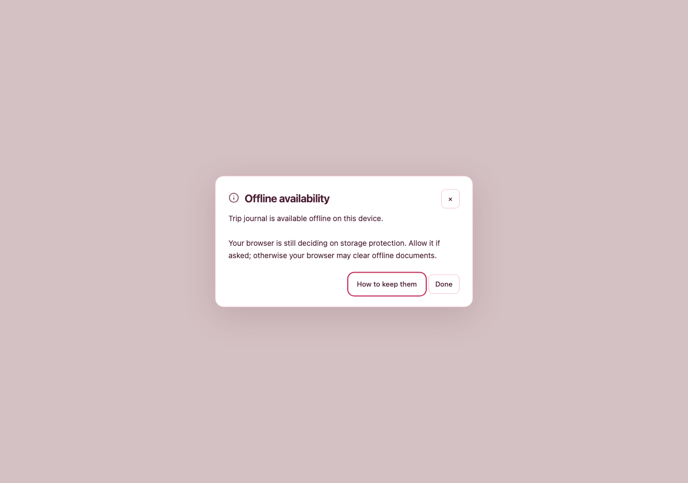
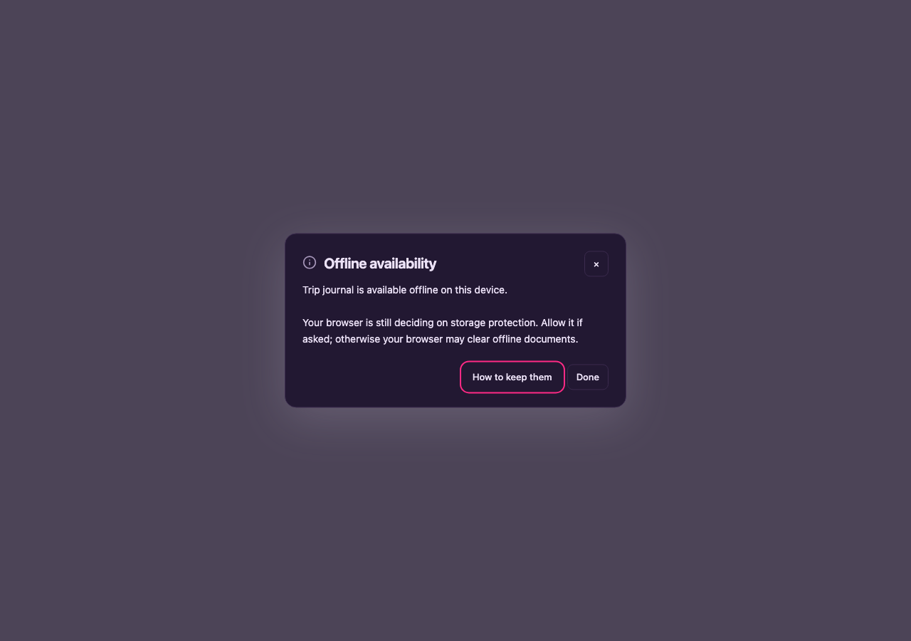
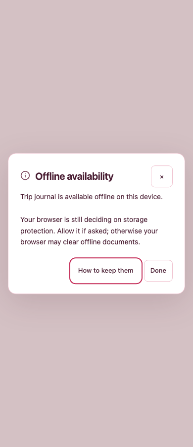
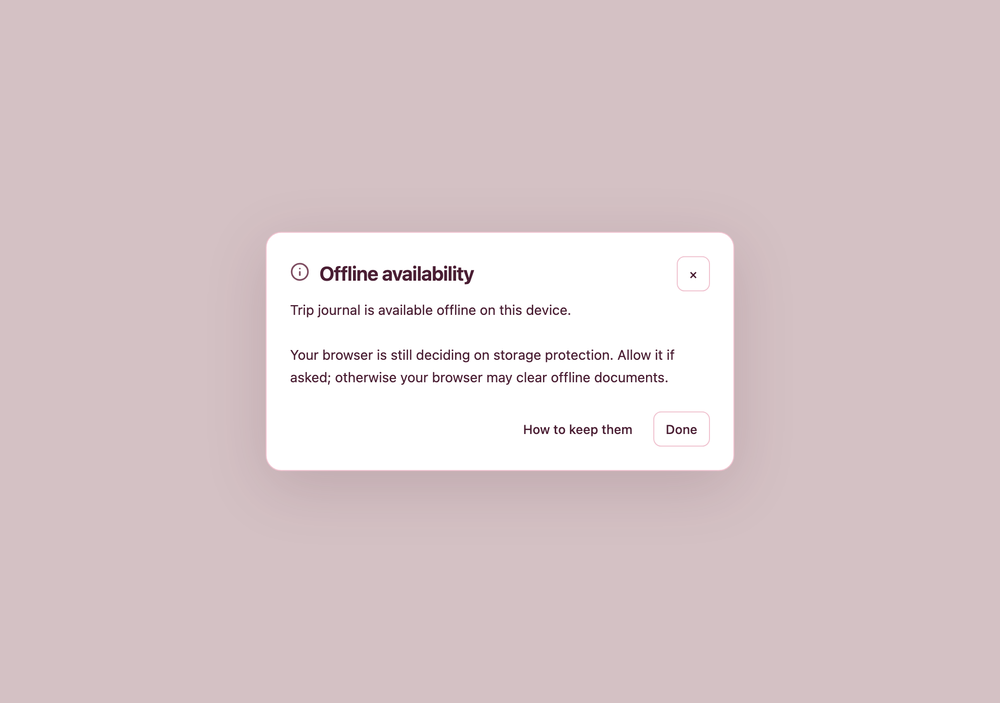
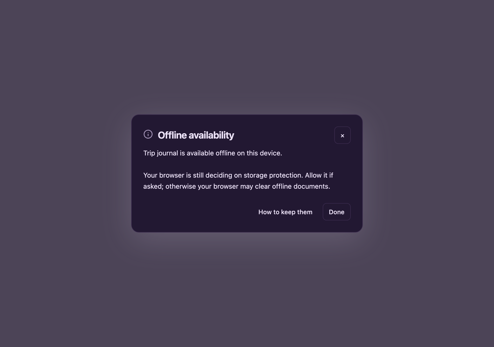
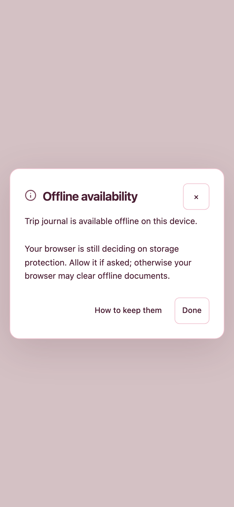

**Draft / local review candidate.** Exact source `43d3ee62bab1ed1d1b6d76209308f63f6e6aab07` integrates actual main `ec42f0741415e4e712395fb47c30b911bc4e64ea`. Fresh independent code and visual revalidation and all current-head hosted acceptance remain pending. No previous review or CI result is this candidate's approval.

Downloaded documents could fail to open after an Android restart or warm disconnect, and reconnecting could replace an offline editor with unfinished input. This complete XL outcome bounds startup/network waits, opens verified saved copies through stable links, keeps the native offline editor mounted during reconnect, preserves installation assets, explains storage protection, uses the owner's chosen icon alignment and ends public startup reporting when settled guest UI mounts. Pending account admission still reports its actual stage.

The [canonical scope and decisions](https://github.com/mxbaylee/spinel/blob/43d3ee62bab1ed1d1b6d76209308f63f6e6aab07/docs/implementation/SPN-090.md) map original acceptance, all four personas, provider retirement, current verification owners and every separately owned remainder. Pixel10/latestChrome/HomeScreen observations retain unknown exact OS/browser/build; final known-offline sign-in was not phone-retested. SPN154 and156 retain full pre-launch scope/estimates;156 has its own installed-phone execution prerequisite.152 remains post-launch. Completed157 retains bounded nonrecurrence evidence and unknown historical cause. No new dependency or physical-phone pass is invented.

The actual landed098 integration adds account-bound feedback context without replacing the offline editor/authority guards. Bookkeeping retains main grooming2026-11-14, next161 and `[098,090]`; only090's ticket is deleted against actualbase. Original dirty phone worktree, unique old integration history and untracked capture helpers remain preserved pending eventual merge cleanup.

**Original hosted failures and repairs.** Source724 CI43626186157 attempt1 finished33jobs:31success, production2 failure and fail-closed Playwright aggregate failure. Story43626186192 had8success/2inapplicable; Desktop43626186152 had3success. The [first failure](https://github.com/mxbaylee/spinel/tree/a9dd1e0f4b70963fb87e149228cc67a2a6b56990/docs/review-assets/spn-090-failure-43626186157) and [terminal archive](https://github.com/mxbaylee/spinel/tree/f749fcb29484c25920a6e10dc24871e3d783c016/docs/review-assets/spn-090-validation-724b5777) preserve full original logs/reporters/selected traces, source/base/tested/plan/attempt, native and Storybook identities and all first-failure dispositions. No workflow rerun/cancellation occurred. All10 original startup results are retained: dev5pass; production4pass and ready-guest3timeouts. The separate earlier671 recovery503 remains failed in its original published fdc2/9d89 records.

The production application request was service-worker-owned and bypassed the page-only test gate. The repaired context gate keeps the real worker and exact app-code assertion, proves the guest absent while held and actual settled UI/timer cleanup after release. The maintenance fixture now waits for enabled health navigation after invite refresh. Its existing held-readback control preserves negative mutation/navigation/secret-disposal behavior.

Combined development initially failed while Creating still showed after releasing POST. Exact durable-row timing was86ms after reported case completion; original cause remains unproved. A single redacted diagnostic probe exposed distinct release/fetch/fulfill/readback boundaries and is not acceptance. The final control now awaits exact POST201 and completed response before its unchanged5s UI assertion, within unchanged30s overall budget. Actual Escape, held POST and503 readback remain. No sleep, retry, timeout increase or product-cause claim was introduced.

**Local evidence.** [Combined-source receipts](https://github.com/mxbaylee/spinel/tree/43d3ee62bab1ed1d1b6d76209308f63f6e6aab07/docs/implementation/evidence/SPN-090-current/landed-feedback) retain23shared tests, productionbuild,6production browser passes,5development startup passes and final invitation positives in both builds. A health-only busy-guard negative failed at the new held-readback hash assertion; exact positive source was restored. Earlier repaired production old-GuestApp negative detected retained startup text after ready mount. Every first fixture assumption, failed case, diagnostic attempt and resource result is preserved. Full types resource-aborted on the preceding repair; unchanged compiler was not repeated. Current hosted typing and full Linux maintenance/native/browser/Story acceptance remain required. All local work used pinnedNode26.13, sharedserial, normalpressure,2GiB/eight-minute watchdog and explicit owned-process cleanup.

**Visual evidence / review pending.** The following13 useful images retain their exact original commit/theme/viewport captions; they are not newly captured phone observations. Ten retained current images match candidate bytes; three historical storage proposals remain historical. Startup/storage/icon rendering inputs are unchanged by the fixture repair and incomingmain adds only an unused feedback icon entry to sharedModal for these stories. Independent exact-head applicability/interaction approval remains required, agent review only.

