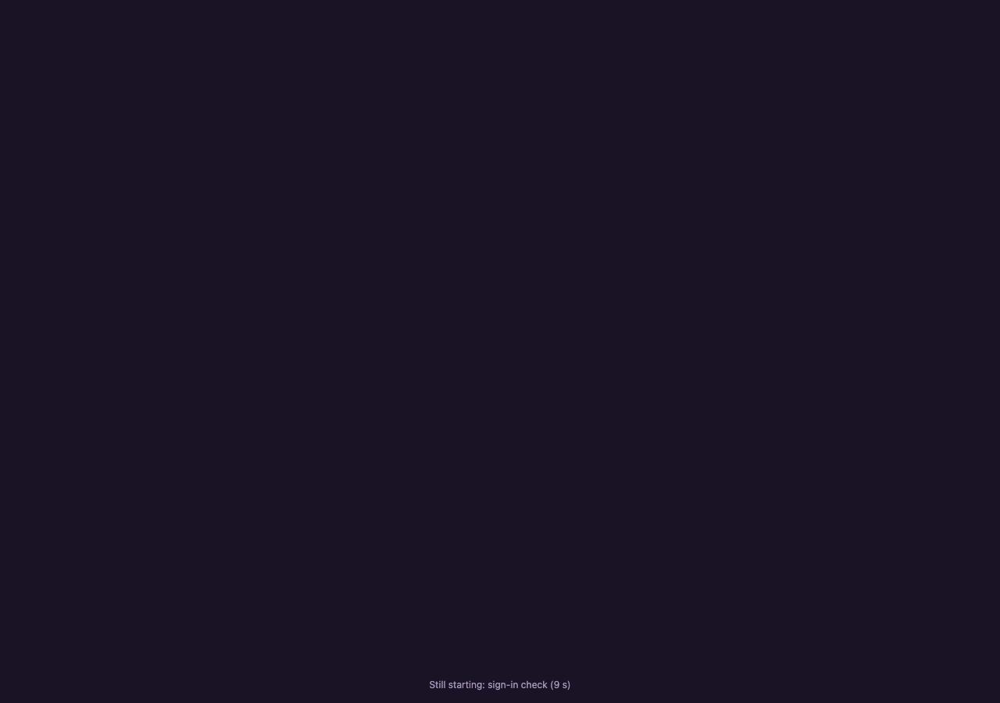
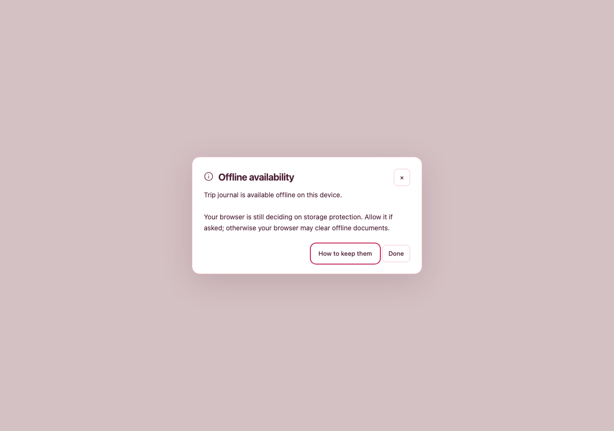
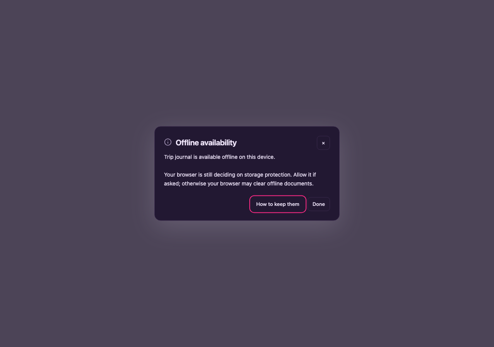
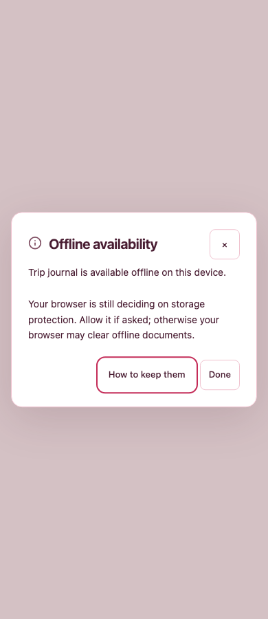
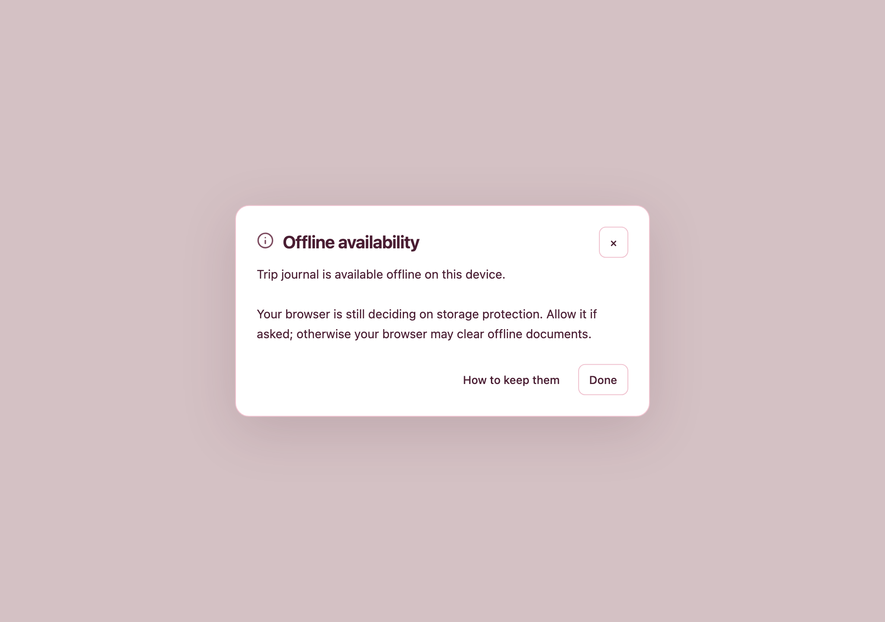
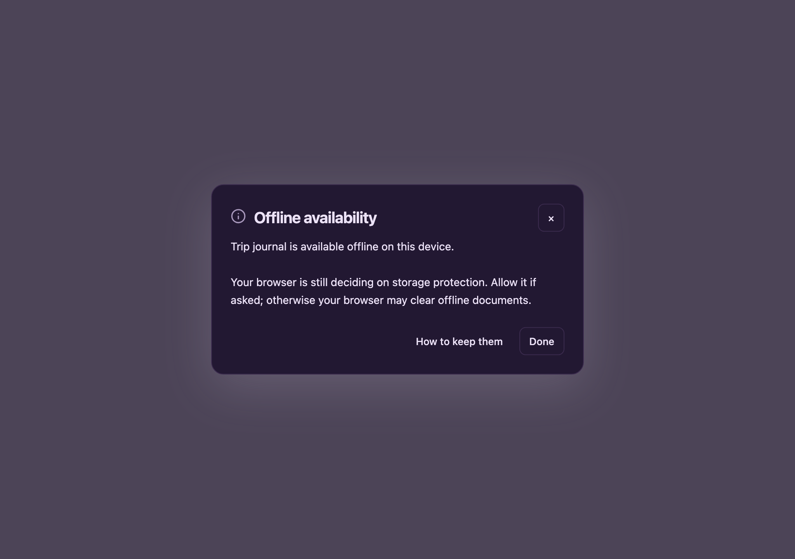
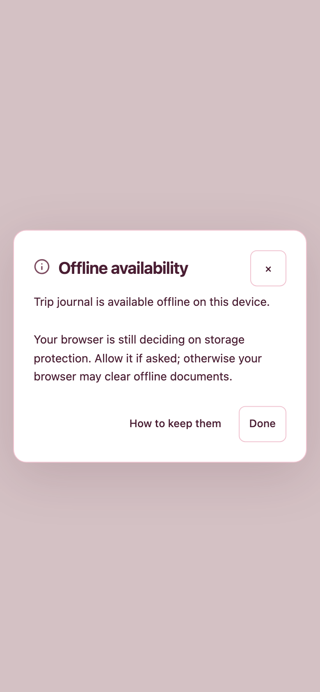

**Draft / blocked on SPN-158.** Current-source recovery validation failed; the required Unit and Playwright aggregates failed closed. Main has since advanced to `89e4426dfff1c3469b260305e21180ffd79fdb7f` through registration PR #284. This PR still needs the actual repair, current-main integration and new exact-head reviews/validation.

Downloaded documents could fail to open after an Android restart or a warm disconnect, and reconnecting could replace an offline editor with unfinished input. This change bounds startup/network waits, opens verified saved copies through their stable links, and keeps the native offline editor mounted while its existing binding reconnects. It also preserves complete installation assets, truthful storage-protection feedback and the owner's chosen icon alignment.

## 🧭 Exact candidate and scope

- **Published, previously reviewed source:** `67111d9c106c6518b813c6f1cf332068526c254c`. Both independent exact-head reviews are **100/100**, with no unresolved findings and visual approval, **agent review only**.
- **Reviewed/tested base:** `ebf0842f51b60d54649cf8a03065914bec0944bf`. **Previous published PR head:** `27b87ff8767551fae03c163d2457744b31865ce3`. Both were verified ancestors before the completed normal one-commit fast-forward publication. The hosted tested merge is `3a97ee4dcf0bc60c9918575f0d8cf4eced7bc1d4`; subsequent registration/base changes still need integration and fresh exact-head review.
- The repair changes only startup-story play readiness plus maintained evidence. Product runtime, rendered status, text assertion, time budgets and other stories are unchanged. Since the original resumed `af7a6cf0562d132be76b251473d917c5cce97bf4`, there are six first-parent commits and twelve reachable commits including merged main history.
- The earlier PR body cited stale `fe1fddd8`. The delivery run initially followed that stale identity, preserved its work separately, then resumed the actual `af7a6cf` branch. No stale-source review or test result authorizes this candidate.
- **Effort XL, complete outcome:** installed-context investigation, public runtime/assets, native editing/persistence/access, owner-phone defect repairs, main integration, verification and evidence. The diff against the reviewed/tested base is 219 files, +15,768/−914 lines; the prior registration-head backlog check reported 16,307 counted lines and a soft-limit warning, below the hard limit. The story repair adds six changed source lines and retained failure/review evidence; it does not expand the product outcome. Most additions are retained chronological evidence (about 4,885 canonical-record additions and 4,370 lines in two physical capability reports). The obsolete provider harness is removed. The coherent implementation split below preserves the remaining launch requirement.

Authoritative reconciliation: [current SPN-090 decisions and original-contract mapping](https://github.com/mxbaylee/spinel/blob/67111d9c106c6518b813c6f1cf332068526c254c/docs/implementation/SPN-090.md#-current-branch-integration-and-remaining-outcomes), [original ticket on the integrated base](https://github.com/mxbaylee/spinel/blob/ebf0842f51b60d54649cf8a03065914bec0944bf/docs/todo/SPN-090.md).

### Owner decisions and retained product contracts

The owner's November 13 decision **removes BrowserStack entirely from this acceptance path**, including its workflow/harness, paid allocation, quota/ledger/forecast and monthly execution obligations. Their own phones replace that provider. Historical results and failures remain evidence. This does not erase product requirements or turn unexplained failures into passes.

- **Installed lifecycle:** [the actual own-phone findings](https://github.com/mxbaylee/spinel/blob/67111d9c106c6518b813c6f1cf332068526c254c/docs/implementation/SPN-090-own-phone-findings.md) record Android Chrome installation, storage protection, prepared Doc/Sheet content, initial cold/warm failures, and later observed warm Doc opening and cold offline launch after repairs. The owner later identified Pixel 10, “latest Chrome” and Home Screen launch. Exact OS/browser versions and build SHAs remain unknown. The final known-offline sign-in shortcut was not subsequently rerun on that phone. No historical phone result is assigned this candidate SHA.
- **Original complete-content/edit/reopen/replay/conflict/creation contract:** retained shared storage, native editing, recovery, creation and authority owners remain responsible for the product behavior. The manual notes do **not** prove every physical Sheet/image/authored-edit/reopen/creation/rejected-folder permutation. Standing four-persona judgment accepts targeted installed-lifecycle observations plus current deterministic/native owners, with explicitly lower integrated phone confidence than the original repeated three-platform matrix. This is an actual verification decision, not an invented pass.
- **Stable links and missing copies:** persisted-catalog deep-link fallback reads validated metadata and verified inventory for the prepared account, fences account/navigation changes, never fabricates a row and never overrides a real server denial. Ordinary and exact Space-child links, no accidental alternate-child open, viewer restrictions, guest/token exclusion and account isolation remain intact. A shortcut still is not a download or a whole-Space preparation.
- **Installation and durability:** immutable manifest/icon resources participate in complete-runtime admission. Offline before/after byte checks are in `installationResources` in `e2e/offline.spec.ts`; online PWA installability has its separate owner. Late storage-protection replies remain scoped and cannot replace a newer/dismissed result. The owner selected the icon's 2.5-unit downward optical adjustment after 0 looked high and 4.5 looked low.
- **Bounded platform confidence:** iPhone own-device verification is explicitly owner-deferred to SPN-152 after launch. Historical Firefox routes remain limitations/observations, not installed-path passes. Safari run `41385636726` retained installed bundles/images, not the full authored/replay/creation matrix. Chrome `41969903466` lost marker/cookie/IndexedDB/cache after relaunch; cause remains unproven, neither diagnosed provider fault nor established current app data-loss defect. Firefox `41970147127` stopped at unavailable offline control. Later authored/style failures remain failures in the chronological record.

Operator avoids unused paid orchestration and gains bounded maintenance. Owner and Collaborator retain durable edits/access and explicit pre-launch defects while accepting the stated hardware confidence limit. Guest gains no private offline store or authority. Additional manual devices or another provider could increase integrated confidence; they are not newly imposed prerequisites for this private two-person workspace. A reproducible current data-loss/access defect would still block.

### 📋 Owned remaining outcomes — no hidden completion

- **SPN-156, L, pre-launch:** sync saved edits while the file list is open. The owner observed that reconnect did not upload until the Doc was opened. This retains the original **app-running reconnect** requirement. Its full remaining scope includes editor-independent Doc/Sheet replay, native/headless SDK capability investigation, account/item authority and revocation, exclusive writer ownership, durable outbox/snapshot/acknowledgement state, exactly-once retry, interruption/conflict/recovery, deterministic/native integration with fixture cleanup, and a bounded installed-phone reconnect observation. Its SPN-090 prerequisite is satisfied only after this PR actually lands. **Closing SPN-090 does not complete SPN-156 or permit launch before it.** Existing saved edits remain durable and opening the editor syncs them; no closed-app/OS background guarantee is added.
- **SPN-158, pre-launch, blocks SPN-090:** bounded repair of postcommit crash-fixture write-admission readiness. Current recovery job 132306723772 failed with auth-options HTTP 503 after durable `candidate-committed` and session 401, before the acknowledgement write and before `postcommit-cut`. Reading session 401 bypasses the paused gate and does not prove write admission; the actual cause of this individual 503 remains unproved because phase/body/controller diagnostics were absent. Preserve authentication, content, crash, cleanup, authority and existing deadlines; prove the proper running signal with a deterministic held-paused HTTP negative control and bounded actual Linux acceptance. Registration [PR284](https://github.com/mxbaylee/spinel/pull/284), exact `9733` candidate against `ebf0842f`, was squash-merged as `89e4426dfff1c3469b260305e21180ffd79fdb7f` after both independent 100/100 reviews and all seven required gates passed with explicit documentation-only applicability. SPN-158 repair and integration remain pending; no implementation or repair acceptance is claimed. [Immutable first failure and exact source audit](https://github.com/mxbaylee/spinel/tree/fdc2d7351527607ed67d3d540df7ae22e19a9db6/docs/review-assets/spn-090-recovery-failure-43548838838). This is distinct from SPN-157; successful unrelated owners do not waive either failure.
- **SPN-157, L, pre-launch:** failure in existing maintenance supervisor scenarios on SPN-098 candidate `2204b8c40ce6feb8ad03c65720c976510535ad00`, registered only. Unchanged supervisor files do not prove independence from that candidate’s startup/drain costs. Diagnose failures in the named durable-running SIGKILL and readiness-first authenticated restore scenarios and repair the demonstrated product or fixture cause, preserving original/candidate rows, fail-closed ownership, authenticated admission, orphan cleanup, existing deadlines, deterministic ordering/negative controls and bounded actual Linux acceptance. Reassess L at the IPC/kernel/process/persistence capability checkpoint. SPN-098 explicitly waits on this repair; SPN-090 has no dependency and retains every one of its own gates. [Canonical decision and exact failed/successful run provenance](https://github.com/mxbaylee/spinel/blob/67111d9c106c6518b813c6f1cf332068526c254c/docs/implementation/SPN-157.md). Failed run 43544143900 attempt 1 supervisor job 132291548937 had 129/131 passing; same-source earlier run 43540593013 passed. The SIGKILL case verifies/starts maintenance before arming its crash and swallows the transition RPC rejection: the generic failure may arise before the crash or during later status, so failed reconciliation is not established. [Immutable original failure evidence](https://github.com/mxbaylee/spinel/tree/5e1b7a9fac17c69ff9174caa9da9f8d13713737d/docs/review-assets/spn-098-failure-43544143900) is retained. The observed child-handoff timeout is not an established cause; a prior pass does not erase the later failure. No supervisor implementation is included here.
- **SPN-154, M, pre-launch:** reproduce and repair image paste refreshing/rejecting an edit. The later Pixel/Chrome clarification does not supply the specific paste conditions, exact versions, image source, online state or build identity.
- **SPN-150, S, pre-launch:** branded loading screen, preserving the owner's priority.
- **SPN-155, S, post-launch:** transient false-offline indicator, explicitly owner-deferred; this PR separately prevents a permanent false-offline state in its repaired mounted-device path.
- **SPN-151, S, post-launch:** hosted BrowserStack leftovers and key revocation, retaining its per-deletion owner approval rule and unused-resource rechecks.
- **SPN-152, S, post-launch:** actual iPhone offline verification, explicitly owner-deferred.
- **SPN-153, S, post-launch:** independently observed macOS script-test path failures.

The unmerged `8438ffac` allocations collided with main's completed Safari-click SPN-148 and existing session-revocation SPN-149. Those main identities are preserved. Fresh IDs 154/155 were allocated through `backlog:new` with the old outcomes/provenance intact; 156 and the independent supervisor registration 157 were likewise allocated, and the historical candidate’s `next_id` is 158. Separate registration [PR284](https://github.com/mxbaylee/spinel/pull/284), now merged at `89e4426d`, owns fresh SPN-158 and main’s next ID 159; no ID is reused, and its allocation/landing is not claimed as part of this unchanged source. Owner allocations 150–153 retain their exact identities. Main's November 12 grooming state is preserved; landing bookkeeping deletes SPN-090, appends its completion and regenerates the index. No follow-up implementation is claimed here. Unconfirmed sign-out/removal observations remain recorded as unknown causes, not claimed fixed.

## 🔁 Independent review iterations and repairs

Rubric order throughout: scope **35**, correctness/data integrity/access **25**, regression protection/evidence **20**, workflow/operations **10**, maintainability/docs/process/complexity **10**. Reviewers are independent, nonimplementing agents; no CI-status deduction or desired score was supplied.

1. **Discarded stale-source path, `9608f78348ab014295cd7b604da4299e3a1ac230`:** A **97** (missing current visuals), B **100**. It did not include the actual published `af7a6cf` owner-phone decisions/fixes and is explicitly inapplicable. Its branch/work remains preserved for unique-work cleanup; its grades are not current authorization.
2. **Actual-head integration, `433092106839493d987668cac1791d548d4c15b1`:** A **88** (**35/17/17/10/9**), B **91** (**35/18/18/10/10**). Both approved that commit's current visuals, but source/test findings blocked publication. A's earlier provisional 96 became final 88 after independently verifying the reconnect defect; the final score is the authoritative one.
3. **Complete repaired candidate, `34e512fb2f9e323113a07a435a6af64252e0be5f`:** A **100** and B **100**, each **35/25/20/10/10**, no remaining actionable finding. **Both grant exact-head visual approval — agent review only.** Both revalidated the complete original outcome, superseding decisions, scope split, full candidate and repair evidence; these are not approvals limited to the repair diff.

4. **Published registration candidate, `27b87ff8767551fae03c163d2457744b31865ce3`:** A **100** and B **100**, each **35/25/20/10/10**, no remaining actionable findings. Both independently verified the complete candidate and its five-file documentation/backlog delta, SPN-157 evidence and uncertainty, persona effects, ID allocation, dependency, generated index and unchanged runtime/evidence. Both grant exact-head visual approval, **agent review only**. Prior runtime verification carries by verified byte identity; no unchanged browser run is claimed on this documentation-only head.

5. **Current story-readiness repair, `67111d9c106c6518b813c6f1cf332068526c254c`:** A **100** and B **100**, each **35/25/20/10/10**, no actionable findings. Both independently reviewed the complete candidate, the actual first hosted failure, the play-only repair and evidence, and approve exact-head visual applicability, **agent review only**. These are new reviews, not reused prior-head grades.

Every actionable finding and disposition:

- **P1 unsafe editor teardown** (A −8, B −7): reconnect incremented Dashboard refresh, cleared the current view and unmounted OfflineViewer before metadata answered, bypassing dirty-aware navigation. Fixed by retaining the mounted device editor through reconnect/refresh and letting its existing native binding own authority/replay. The connection control receives actual binding state; device actions remain conservative. A real unfinished Sheet draft preserves the same native canvas and exact copyable text, with unchanged server content before Enter and exact acknowledged server content afterward. Restoring only the old handoff fails the same-canvas assertion.
- **P2 missing behavioral worker timeout test** (B −2): added actual production fetch-event/navigation execution with an abort-aware hanging request, before/at-deadline assertions, known-offline no-fetch and actual server-only-route negatives. Removing the production timeout fails the settlement assertion.
- **Shell-only Doc acceptance** (A −3): replaced frame visibility with an existing native fixture, actual canvas readiness and exact complete distinctive Doc text on both warm and first-list-failed deep-link branches. A real 403 refuses the same saved copy. This stronger test exposed and repaired the additional first-list loading gate and unrelated list-error overlay; metadata admission alone no longer claims the editor opened.
- **Offline installation evidence attribution** (A −1): the maintained mapping now points to actual offline manifest/icon-byte assertions and keeps online installability separately named.
- **Hosted startup-story play race:** all five full-catalog visual variants on `27b87ff8` failed the same synchronous role query before its passive effect appended the status; the later failure screenshot shows the expected line. The repair awaits `findByRole` within its existing default budget, then asserts the unchanged exact text. No product behavior, render, timeout or assertion is weakened. Original logs/manifest/diagnostic and screenshot remain committed.
- **Provenance clarification:** SPN-154 distinguishes the original incomplete paste note from the later device/browser context without inventing paste conditions.

Earlier provider-era review rounds, diagnostic branches and the `1fdcfc86` one-time “Fix, then push” exception remain in [the chronological decision record](https://github.com/mxbaylee/spinel/blob/67111d9c106c6518b813c6f1cf332068526c254c/docs/implementation/SPN-090.md) and [historical rubric notes](https://github.com/mxbaylee/spinel/blob/67111d9c106c6518b813c6f1cf332068526c254c/spinel-spn-090-rubric-notes.md). The recorded E/F progression was 86/87, 91/87 and final 91/93; the separately retained November 11 K/L round was 89/92. They are historical, superseded source/scope evidence and confer no exception for this head. Publication follows the two completed exact-new-head reviews above; no prior exception is reused.

### Reviewer verification and limits

- **Current head `67111d9c`:** both reviewers independently executed the changed startup play on the existing source-matched production build using the unchanged production screenshot runner with `--no-screenshots`: all **five variants passed**, A **2.089 s / 631,168 KiB**, B **1.765 s / 631,728 KiB**. Both explicitly audited process cleanup and confirmed no port-6007 listener or owned task process remained. They verified refreshed source hashes and byte-identical original startup images; both approve all current visuals on this exact commit.

- **Registration head `27b87ff8`:** A independently confirmed exactly five changed documentation paths and 3,728 other tree entries identical to `34e512fb`, inspected immutable failure/comparator logs and passed guarded backlog validation (151 ms, 28 tickets). B independently verified the same scope and byte identity, then passed guarded `backlog:check` (290 ms / 188,784 KiB) and exact-base `backlog:pr` (537 ms / 264,240 KiB). Only documented soft warnings remain. Both independently confirmed the current visual approval applies to this exact commit.
- **A on repaired head `34e512fb`:** independently ran **178 tests**, all passed, **1.317 s / 355,536 KiB** peak. Verified all six repair source hashes, ten visual source hashes and the two equal 48-file runtime maps against current output; inspected final browser success and both negative controls. Exact-head visual approval applies to all eight images below.
- **B on repaired head `34e512fb`:** independently ran **141 tests**, all passed, **1.363 s / 355,600 KiB** peak. Independently verified all 48 emitted runtime hashes and retained successful/negative-control evidence. Its separate browser attempt was **resource-aborted at 6.897 s / 1,982,176 KiB**, yielding **no browser verdict**; it was not repeated or called a pass. B's approval relies on its source/unit review and verified retained worker browser evidence, with this limitation explicit. Exact-head visual approval also applies.

Reviewer B's earlier aborted browser attempt left **eight orphaned server/npm processes**. A subsequent audit tied them to its exact log PIDs, start times, worktree and parent/process groups; B stopped those exact owned PIDs with SIGTERM and confirmed no relevant processes remained. No rerun or unrelated kill occurred. Shared process-group termination had missed detached descendants, so future aborts require an explicit owned-process audit. This does **not** establish the cause of subsequent memory pressure. [Maintained cleanup receipt](https://github.com/mxbaylee/spinel/blob/67111d9c106c6518b813c6f1cf332068526c254c/docs/implementation/evidence/SPN-090-current/story-readiness/review-b-prior-abort-cleanup.json). The original attempt remains **no browser verdict**.

Both operated under the shared serialized workload and unchanged 2 GiB/process-tree, eight-minute, normal-memory-pressure guard. Neither grade is a hosted CI pass or merge authorization.

## 🔬 Exact local evidence and failure dispositions

- **Exact current-head PR check:** `67111d9c` against `ebf0842f`, passed under the shared serial/runtime watchdog: **517 ms / 266,016 KiB**, **16,629 counted changed lines**, only the documented soft-limit warning. No source changed after either independent review.
[Initial integration receipts and gallery](https://github.com/mxbaylee/spinel/blob/67111d9c106c6518b813c6f1cf332068526c254c/docs/implementation/evidence/SPN-090-current/README.md) · [Repair record and retained failures](https://github.com/mxbaylee/spinel/blob/67111d9c106c6518b813c6f1cf332068526c254c/docs/implementation/evidence/SPN-090-current/repair/README.md) · [Repair source hashes and guarded receipts](https://github.com/mxbaylee/spinel/blob/67111d9c106c6518b813c6f1cf332068526c254c/docs/implementation/evidence/SPN-090-current/repair/receipts.json).

- Initial actual-head integration: **202 runtime tests / 10 files**, **23 Node tests**, private locked install, formatting/index and full lint passed. The compiler was resource-aborted then; that remains an abort, superseded by the later actual passing compiler result.
- Repair worker/shell suite: **37 passed**. Corrected typed warm-catalog fixture: **6 passed**. Relevant warm/startup/bootstrap/native-binding owners also passed in the retained selected run; the independent repaired-head suites above provide fresh additional verification without claiming a full hosted matrix.
- **Final two production browser cases:** `e2e/offline.spec.ts`, production project, one worker, zero retries, **11.304 s / 1,665,056 KiB**. Both pass: exact restored Doc content with real 403 refusal, and mounted unfinished Sheet input through reconnect followed by explicit commit/server acknowledgement.
- **Final-source build:** **1.295 s / 1,255,120 KiB**, pass. All **48 emitted filenames/bytes** exactly match the browser-tested runtime after final formatting; [compressed equivalence maps](https://github.com/mxbaylee/spinel/blob/67111d9c106c6518b813c6f1cf332068526c254c/docs/implementation/evidence/SPN-090-current/repair/runtime-equivalence.json.gz) retain the comparison.
- **Full compiler:** **2.190 s / 1,812,240 KiB**, pass. Its first changed-source attempt exposed the earlier partial FileItem test cast; that fixture now supplies genuinely typed required metadata. The diagnostic is retained, not hidden by a cast or classified as resource-only.
- **Full lint/dependency/format:** **10.887 s / 797,840 KiB**, pass. Backlog shape and repaired-head `backlog:pr --base origin/main --title '🧪 SPN-090 Verify offline launches on real phones'` pass; only the explained size warning remains. Current-base diff whitespace check is clean.
- **Registration-only checks on `27b87ff8767551fae03c163d2457744b31865ce3`:** guarded allocation, changed-document formatting, generated index and backlog shape all pass (138/187/148/139 ms); registration-head backlog PR check passed **368 ms / 186,976 KiB**; after the stage-attribution clarification, changed-doc formatting passed **175 ms** and final exact-head PR check passed **356 ms / 178,672 KiB**, with the existing soft size warning. Tasks below 200 ms ended before the first watchdog RSS sample; zero recorded peak is not a claim of zero memory use. `git diff` proves no changes to runtime/test/story/workflow/dependency paths since `34e512fb`; no unchanged runtime workload was repeated. Receipts are retained as `spn090-register157{,-format,-index,-check,-pr,-attribution-format,-final-pr}.json` in the local watchdog archive; this narrative preserves outcomes in the PR.
- **Earlier focused production Storybook:** **4.802 s / 1,020,976 KiB**, pass, unchanged production configuration/preview with only StartupStage and OfflineAvailability selected locally. Capture: **3.081 s / 717,008 KiB**, eight outputs, successful story plays, no page errors/width overflow, all owned servers/browsers closed. Full hosted Storybook remains a distinct owner.
- **Current story repair:** production focused build **3.532 s / 1,091,824 KiB** and the actual production capture runner **2.266 s / 637,136 KiB**, **five states/captures, no failures**. The current source/capture receipts and first hosted failure live in [the readiness repair record](https://github.com/mxbaylee/spinel/blob/67111d9c106c6518b813c6f1cf332068526c254c/docs/implementation/evidence/SPN-090-current/story-readiness/README.md). Changed-story oxlint passed; an initial mistaken ESLint path failed before lint ran and is retained. Formatting passed. Normal completion included an explicit clean owned-process audit.
- **Negative controls:** timeout removed → deadline assertion fails (**346 ms**); old Dashboard handoff restored → native canvas identity fails (**21.465 s / 1,480,304 KiB**). Both production mutations were removed before the final successful build/browser runs.

First failures are preserved: elevated-pressure formatter refusal; wrong Storybook CLI entry corrected from installed metadata; initial compiler resource abort; old test-fixture type error; modern Doc clipboard selecting the current paragraph (now one exact complete distinctive paragraph); genuine deep-link loading-gate failure; remaining unrelated list-error overlay; and worker tests initially misclassifying `/sign-in`. Existing route policy allows the public shell at `/sign-in` for App admission; actual server-only routes are `/invite`, `/setup`, `/share/`. No access routing was weakened. Temporary diagnostic logging was removed. Archives retain screenshots/context/synthetic fixture observations, excluding disposable databases. No timeout, assertion budget, retry count or memory limit was raised to obtain a pass.

## 🎨 Visible current result — agent review only

Both independent reviewers approve these images on exact `67111d9c106c6518b813c6f1cf332068526c254c`, **agent review only**. The startup story's play source changed; its render sources did not. Five fresh production captures bind that source, and original startup light/dark/phone images are byte-identical. The other storage/icon sources and images remain unchanged. [Current startup manifest](https://github.com/mxbaylee/spinel/blob/67111d9c106c6518b813c6f1cf332068526c254c/docs/implementation/evidence/SPN-090-current/story-readiness/local-visual/manifest.json) · [current source hashes](https://github.com/mxbaylee/spinel/blob/67111d9c106c6518b813c6f1cf332068526c254c/docs/implementation/evidence/SPN-090-current/story-readiness/receipts.json) · [unchanged storage/icon captions](https://github.com/mxbaylee/spinel/blob/67111d9c106c6518b813c6f1cf332068526c254c/docs/implementation/evidence/SPN-090-current/visual/manifest.json).

The startup captures isolate the **actual production pre-React status element** with a representative nine-second sign-in-check label. They are not a whole loading-screen or live timing demonstration. Light/dark desktop are **1280×900**; phone is **390×900**.

Additional refreshed production states, also independently reviewed: dark phone **390×900** and light tablet **768×900**.

Actual pending-protection result after its successful guidance interaction and dismissal. The completed download and still-pending browser protection answer remain distinct.

Actual production `iconSvg()` rendered through the installation asset's Sharp path, **192×192** and **512×512**, `any maskable`, owner-selected **2.5-unit** optical offset. These are generated assets, not new Pixel launcher screenshots.

### Historical proposed-state references

The earlier storage-decision light/dark/phone images are retained at immutable commit
`7d348d6a3d096cc322d6c0edcfb138764d4441de`. They show the earlier proposed/implemented state and **do not substitute for current-source captures**. This identifies their retained commit, not an invented capture build. The owner's 0- and 4.5-unit icon trials have documented observations but no retained launcher screenshots; none are manufactured here.

## 🧾 Retained published-head hosted attempt — not current repair acceptance

All runs below are **attempt 1** for source `27b87ff8767551fae03c163d2457744b31865ce3`, base `ebf0842f51b60d54649cf8a03065914bec0944bf`, tested merge `9a0537f7618f76bc64aa8b1addb41305daea202a`. Complete job/artifact pagination and logs are retained in the local hosted archive. No workflow was rerun to erase a failure.

- [CI 43546428545](https://github.com/mxbaylee/spinel/actions/runs/43546428545): **terminal cancelled, 33/33 jobs terminal: 31 success, one cancellation and one aggregate failure**. Six required gates passed: Backlog, Pull request, Lint, Typecheck, Unit tests and Lib tests. All eleven browser-matrix jobs passed; Doc responsiveness desktop passed; mobile job 132298958451 was superseded/cancelled, and Playwright aggregate 132306425404 failed closed. No old-head mobile pass is claimed. Development shards: **74 passed/3 skipped** and **75 passed/1 skipped**; production shards: **83 passed/3 skipped** and **85 passed**. Mobile HTTPS: **10 passed/3 skipped**; skipped cases remain reported explicitly; none of the new SPN-090 cases above was skipped. Mobile HTTPS’s three skips require the sync projects’ VITE_SYNC_EVIDENCE observer and are owned by those projects. Container smoke, retained sync transition, sized restore, both callback-lifetime owners, offline upgrade, supervised restore, both sync environments and both soaks passed.
- [Production 2/2 job 132298958655](https://github.com/mxbaylee/spinel/actions/runs/43546428545/job/132298958655): **85 passed / 11.6 min**, including exact native Doc content on warm and first-list-failed deep-link branches with real 403 refusal, unfinished Sheet input retained through reconnect and separately acknowledged server content, and `offline.spec.ts:292`'s offline installation manifest/icon-byte comparisons. The new tests were actually selected and passed; this is not shell-only inference.
- Unit owners: supervisor **131/131**, recovery **607 tests/47 files**, remaining **2169 tests/190 files**. The two SPN-157-named scenarios passed here (**965 ms** and **11.435 s**); this does not diagnose or close the separately retained feedback-source failure. Unit/lib aggregate artifacts bind exact plan digest `9c3d7a5aa62e8ffa583cb299b45d9ea16c02c200d0a19926bfdef3aaa243afec`. The conservative **full** plan selected all 15 suites because immutable range/event-label classification was unavailable. Artifact `ci-plan` 14093913783 ZIP SHA256 `564c95a2808d00ad5acca5e3b4a9de0a295a9235f05abc2a4d877ec5d977bb24`; its JSON file hash including newline is `2f8ab2f3ba6d3263cf00e00316ce1b88b878f939f6dae29a1e9ad6979e493db8`, distinct from the serialized gate digest.
- [Native desktop 43546428572](https://github.com/mxbaylee/spinel/actions/runs/43546428572): **terminal success, all three jobs**. Exact acceptance reports confirm four native ordinary-profile launches, downloaded and pending Doc/Sheet/image retention, exact-once normal reconnect, conflict-copy preservation and cleared-storage refusal. Chrome **157.0.8103.79** and Firefox **160.0** on macOS **26.7.2**; Safari **27.2** on macOS **15.7.9 Intel**. Chrome/Safari persistence stayed false; Firefox's observed permission changed it to true. These are desktop observations, not invented phone passes. Artifacts: Chrome14093689211, Firefox14094322618, Safari14095060486; downloaded ZIP hashes respectively `41e749f2a54601d84adfd8028713d7250bd27053272a01930e2fee273bb48432`, `0c602396aac373d2c6f9e1c5074e4e31642c79f754d594d5a42c17c693c073ad`, `8ec9d8d1389c7c85ebe5c11188d67f3650e6b446a190be4a5bc4534508401234`.
- [Storybook 43546428640](https://github.com/mxbaylee/spinel/actions/runs/43546428640): **terminal failure**. Full build passed (**1043 entries**), but all five visual variants failed the same startup-story readiness assertion; aggregate 132303373737 failed correctly, preview/deploy were skipped. First failure phone/light132299208406, then tablet132299208408, desktop dark132299208389, desktop light132299208456 and phone dark132299208760. The first log/manifest/diagnostic/screenshot are [maintained in this repair](https://github.com/mxbaylee/spinel/blob/67111d9c106c6518b813c6f1cf332068526c254c/docs/implementation/evidence/SPN-090-current/story-readiness/README.md). First artifact 14094840518 ZIP SHA256 `a33f5064ddd948903387ab38da48654506f961b0f55102077bb91509faf70514`. Full-build artifact 14094077946 ZIP SHA256 `a01dc46f6086ae3946c794a47b7e10bb91c91078aed849c19235fb9a2a75cab0` was independently checked; current startup/storage stories were present. These failures remain failures after the local repair succeeds.

The superseded metadata-edit CI run43548827532 is also terminal cancelled (16/16 terminal): Backlog/Lint succeeded; cancelled classification left Typecheck/Unit/Lib/Playwright gates failed closed without a plan. Complete old-head run pagination found only the original CI, metadata-edit CI, Desktop and Storybook runs; no follow-on old-head acceptance is claimed. Neither cancellation substitutes for current-head acceptance.

## 🧾 Current terminal hosted attempt — acceptance blocked

[Durable terminal evidence archive](https://github.com/mxbaylee/spinel/tree/9d89b15d4dda6cf8595e810aa4463bbeee97147a/docs/review-assets/spn-090-terminal-43548838838) · [original first-failure archive](https://github.com/mxbaylee/spinel/tree/fdc2d7351527607ed67d3d540df7ae22e19a9db6/docs/review-assets/spn-090-recovery-failure-43548838838). Terminal API collection is dated in the archive. This adds a final snapshot without rewriting the earlier partial first-failure observation.

All three current runs are **attempt 1**, source `67111d9c106c6518b813c6f1cf332068526c254c`, base `ebf0842f51b60d54649cf8a03065914bec0944bf`, tested merge `3a97ee4dcf0bc60c9918575f0d8cf4eced7bc1d4`. Complete run/jobs/artifact APIs, exact plan, compact original reports/manifests, selected full logs and ZIP hashes are retained. No unchanged rerun was requested.

- [CI 43548838838](https://github.com/mxbaylee/spinel/actions/runs/43548838838): **terminal failure, 33/33 jobs terminal, 30 success/3 failure**. Five required gates pass: Backlog, Pull request, Lint, Typecheck and Lib tests. Recovery job 132306723772 failed **606 passed/1 failed of 607**,46 passed/1 failed of 47 files,239.11 s; its postcommit case failed after 9.956 s with auth-options 503. Unit aggregate 132308782209 failed correctly. Playwright aggregate 132314895913 also correctly failed on that required Unit dependency: its artifact explicitly reports **playwright-run success**, with every actual browser worker and both responsiveness/callback workers successful. Missing/failed required work cannot pass the aggregate. Both failed artifacts bind plan digest `1e11f7aeb0fd2c7b6b8d810c697ad49ff928bbe29a85724b2b67e12281c26f70`; full conservative coverage selected all 15 suites. Plan artifact 14094932486 downloaded ZIP SHA256 `70c010f4f524b00e95c9f2a781027395b61161916a28c0979dde9e76e898b876`.
- [Current production 2/2 job 132306724084](https://github.com/mxbaylee/spinel/actions/runs/43548838838/job/132306724084): **85 passed/12.3 min**, actually selected both new warm/deep native Doc-content and unfinished native Sheet reconnect cases. Exact-content/real 403, same-editor/unfinished-input and later server acknowledgement remain distinct assertions. `offline.spec.ts:292` also passed its downloaded Sheet/Doc/images and offline installation manifest/icon-byte comparisons. Exact source and job log are retained; no frame-only inference. Development shards **74 passed/3 skipped**, **75 passed/1 skipped**; production 1/2 **83 passed/3 skipped**; mobile HTTPS **10 passed/3 skipped**. The existing skips remain explicit and none of the new SPN-090 cases was skipped. Container, retained sync transition, sized restore, both sync environments/soaks, offline upgrade and supervised restore all pass.
- Remaining Unit **2169 tests/190 files** and supervisor **131 tests/1 file** passed. These successes neither diagnose nor close the SPN-157 failures on the separate SPN-098 candidate. Desktop/mobile responsiveness each passed 4 baseline and 7 candidate cases, with integrity/timing validity and **physicalDevice=false**. Candidate first-verified-browser-local-empty samples: desktop **344.6–350.4ms**, mobile **369.4–377.5ms**, within the unchanged1000 ms gate. Later server-read bounds remain descriptive; comparison reports preserve baseline/profiling attribution limits.
- [Native desktop 43548838849](https://github.com/mxbaylee/spinel/actions/runs/43548838849): **terminal success, all 3 jobs**. Exact source/tested reports confirm four ordinary-profile native launches each, retained Doc/Sheet/images and pending edits, replay/conflicts and cleared-storage refusal. Chrome 157.0.8103.79/Firefox 160.0 on macOS 26.7.2; Safari 27.2 on macOS 15.7.9 Intel. These are desktop observations, not phone passes. Reports and downloaded ZIP hashes for artifacts 14094972586/14095133689/14094748508 are in the terminal manifest.
- [Storybook 43548838841](https://github.com/mxbaylee/spinel/actions/runs/43548838841): **terminal success, all 10 jobs terminal: 8 success, 2 preview/deployment skips**. Full build has 1043 entries; all five desktop-light/dark, phone-light/dark and tablet manifests checked **1043 entries each, zero failures**, and aggregate 132311043994 passed. All five ZIPs were downloaded and independently hash-verified against GitHub artifact digests; manifest/source binding uses the exact workflow identity, without inventing an embedded SHA. Current Linux captures need not match the independently approved Mac image bytes. The prior27 startup-story failures remain retained and are not relabeled passes.

The compact immutable archive retains every native report, all five complete Storybook manifests, both gate failures and Lib success, paired responsiveness comparisons, source-bound selected cases, full terminal API metadata and downloaded ZIP digests. It excludes the large screenshot ZIP payloads, databases and browser profiles. All current independently reviewed images above remain visible with accurate source captions.

## 🚦 Hosted acceptance and completion

**Blocked on SPN-158 and fresh acceptance after its repair/base integration.** Current Unit tests and Playwright aggregate are failed; five other required gates, actual browser workers, native desktop and full Storybook are successful. Both retained exact-671 reviews against `ebf0842f` were 100/100 with visual approval, **agent review only**; those grades are neither a CI pass nor a review of the still-pending integration with current main. Registration/repair is separately owned and no implementation is claimed by this checkpoint. The maintained source/shared dependency plan remains intact; no paid-device trigger, skip, relaxed deadline, blanket retry or waiver is introduced.

Before merge: actual current-head hosted success, no unresolved blocker, two exact-current-head qualifying reviews and visual approval, and an up-to-date base are required. Any repair or base integration changes the reviewed head and requires both reviewers to revalidate before the next validation push. Do not reuse the older one-time push exception.

After a qualifying squash merge, recheck every ticket-created implementation/review/integration/evidence branch's head and active ownership, preserve unique work, then delete only obsolete refs. The stale integration and older dirty worktree remain preserved until that audit. SPN-151's explicitly owner-controlled hosted resource/key cleanup retains its separate approval rule. No branch cleanup or production launch is claimed complete by this description.
