# 📱 SPN-098 post-SPN-160 feedback screenshot evidence

These captures render the production feedback components and their shell integrations
at source commit [`23e7553ff4f35f5f03dfe51a644840994e52929e`](https://github.com/mxbaylee/spinel/tree/23e7553ff4f35f5f03dfe51a644840994e52929e).
The clean-source production build was captured on **2026-11-14**; its manifest records
`2026-11-14T07:25:42.467Z` and a runner duration of **131,677 ms**.

## Provenance and scope

The actual `FeedbackDialog`, `AdminUsers` / feedback downloads, `EditorFrame`,
and `AdminPage` components are exercised through their maintained production
stories. API responses, account names, feedback messages, diagnostic ranges, and
download bodies are synthetic fixtures. These images document component rendering
and story interactions; server persistence and real SQLite membership have separate
browser validation. Phone views use browser emulation.

The local build used a focused story catalog and `typescript: { reactDocgen: false }`
to omit automatic prop documentation. It retained the same production components,
story args, decorators, themes, and play assertions, and re-exported the canonical
preview configuration. The repository's full, unmodified Storybook configuration
and CI remain separate validation gates. This evidence does not assert a final CI
result, reviewer grade, or merge approval.

- [Build source identity](storybook-source.json) preserves the generated source SHA,
  branch, and build time. The local build has no CI workflow identity.
- [Complete capture manifest](storybook-manifest.json.gz) is retained as gzip; decompression reproduces the original bytes. It
  retains **44 requested stories, 220 checked states, 220 captures, and zero recorded
  failures**: every requested story in all five variants below.
- **Only the 16 selected PNGs in this gallery are retained here.** The manifest's
  other capture filenames document the full local run; they are not additional
  files in this directory.
- [Retained-image mapping](retained-images.json) records each PNG's original story
  ID, variant, original filename, dimensions, size, and SHA-256 hash. Each retained
  PNG is an unedited, byte-identical copy of its original capture from
  `test-results/spn098-post160-visual/`.

## Capture conditions

The screenshot runner initialized the browser clock to **2026-10-20 16:00:00 UTC**.
Time can advance for component timers and SDK debounce. Screenshots use full-page
capture, disabled screenshot animations, and reduced-motion preference; PNG heights
are recorded separately in the image mapping.

| Variant | Theme | Viewport (CSS pixels) | Browser input emulation |
| --- | --- | --- | --- |
| `light` | Light | 1280 × 900 | Desktop, no touch |
| `dark` | Dark | 1280 × 900 | Desktop, no touch |
| `phone` | Light | 390 × 900 | Mobile, touch |
| `phone-dark` | Dark | 390 × 900 | Mobile, touch |
| `tablet` | Light | 768 × 900 | Touch; included in full manifest |

## Selected gallery

Open a thumbnail for the original PNG. Story IDs and original filenames are in the
[JSON mapping](retained-images.json); the state names below match the maintained
stories.

| Production story state | Retained captures |
| --- | --- |
| Account / Feedback / Draft | <a href="account-draft-light.png">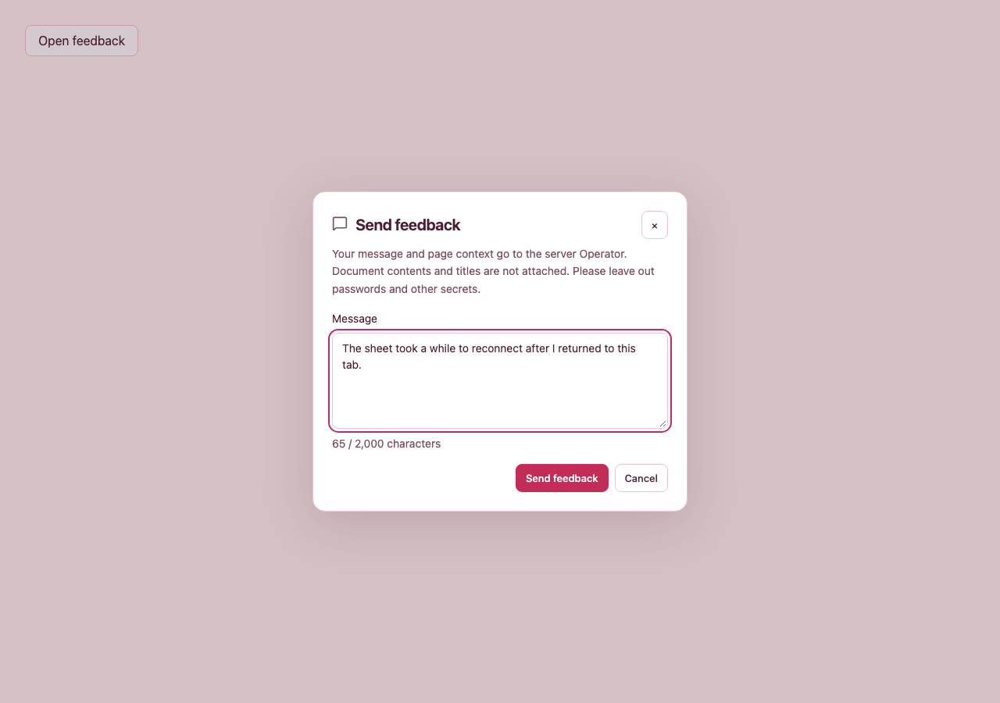</a> `light` <a href="account-draft-dark.png">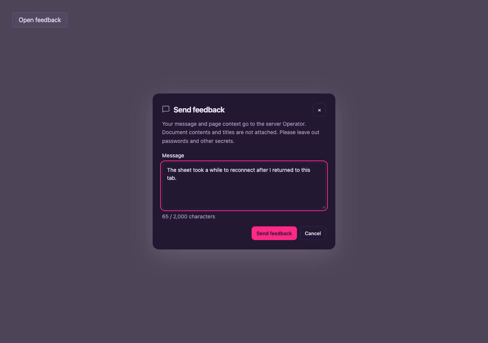</a> `dark` <a href="account-draft-phone.png">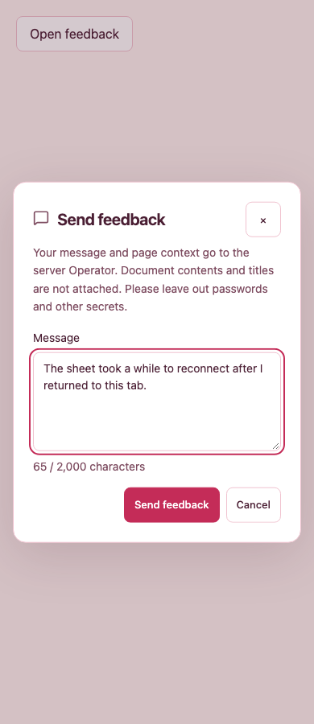</a> `phone` |
| Account / Feedback / Failed Draft | <a href="account-failed-draft-phone-dark.png">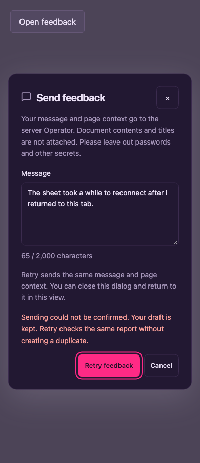</a> `phone-dark` |
| Account / Feedback / Long Message | <a href="account-long-message-phone.png">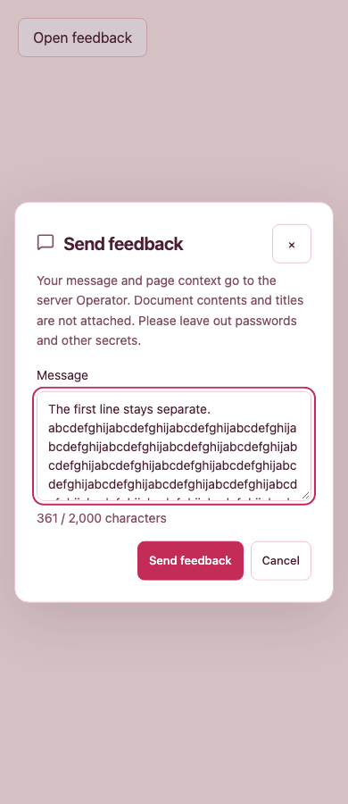</a> `phone` |
| Account / Feedback / Access Changed | <a href="account-access-changed-phone.png">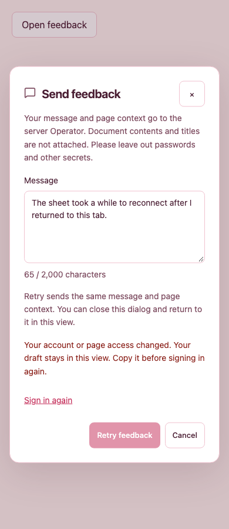</a> `phone` |
| Admin / Feedback / Flag | <a href="admin-feedback-flag-light.png">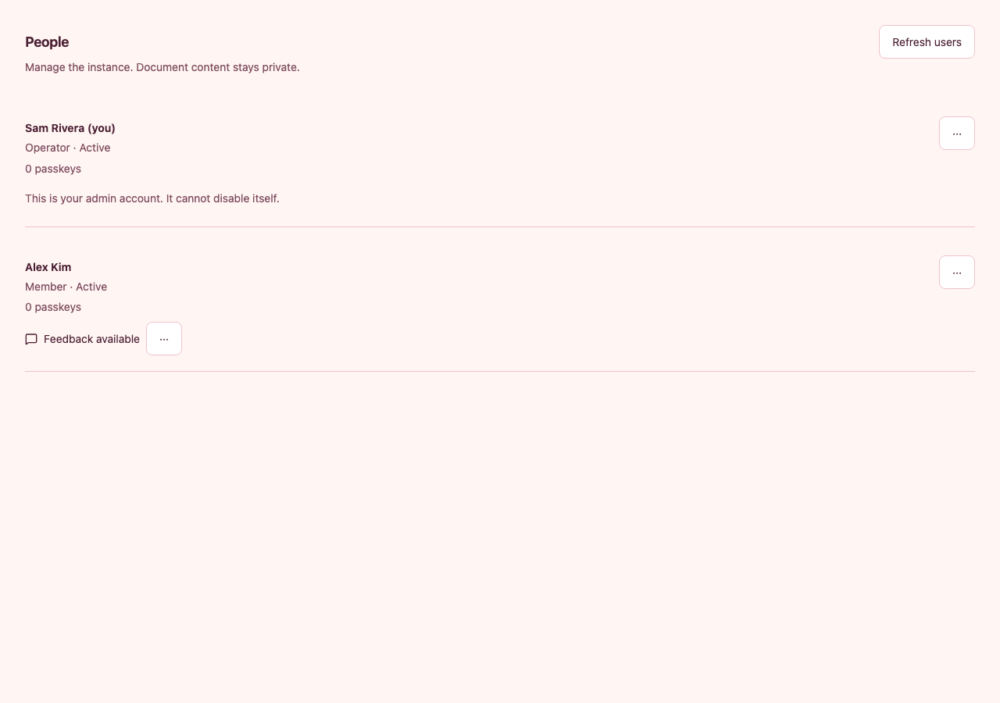</a> `light` |
| Admin / Feedback / Paired Downloads | <a href="admin-paired-downloads-light.png">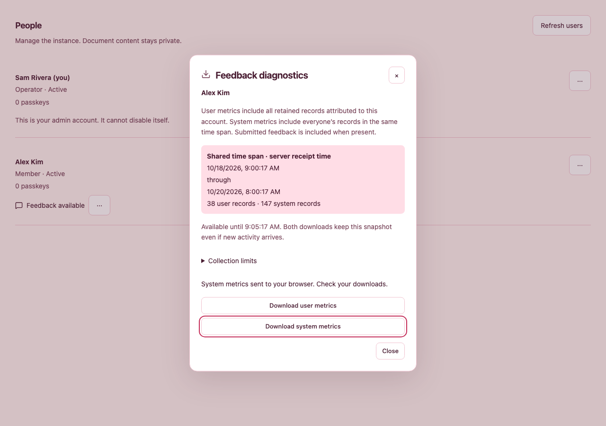</a> `light` <a href="admin-paired-downloads-dark.png">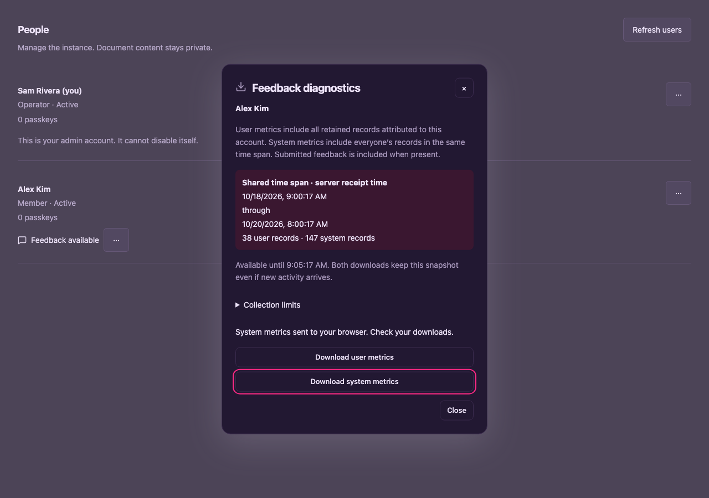</a> `dark` <a href="admin-paired-downloads-phone-dark.png">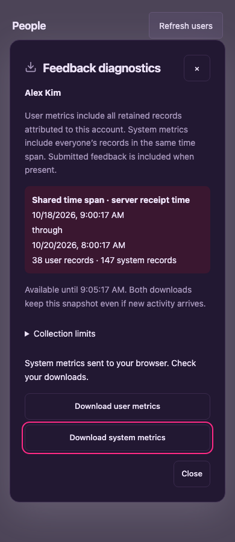</a> `phone-dark` |
| Admin / Feedback / Download Failed | <a href="admin-download-failed-phone.png">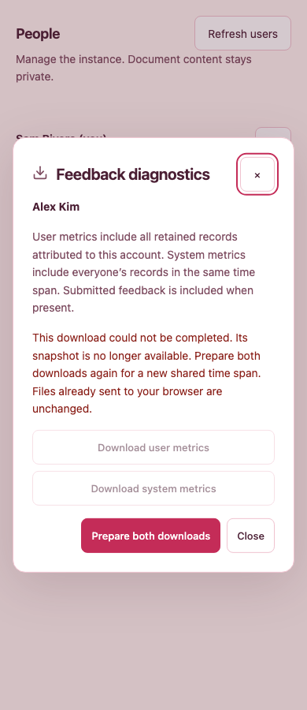</a> `phone` |
| Admin / Feedback / Expanded Limits | <a href="admin-expanded-limits-phone.png">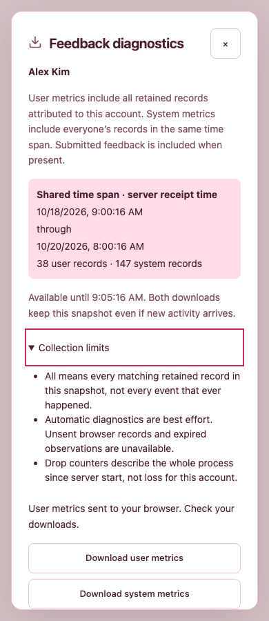</a> `phone` |
| Admin / Feedback / Access Changed | <a href="admin-access-changed-phone-dark.png">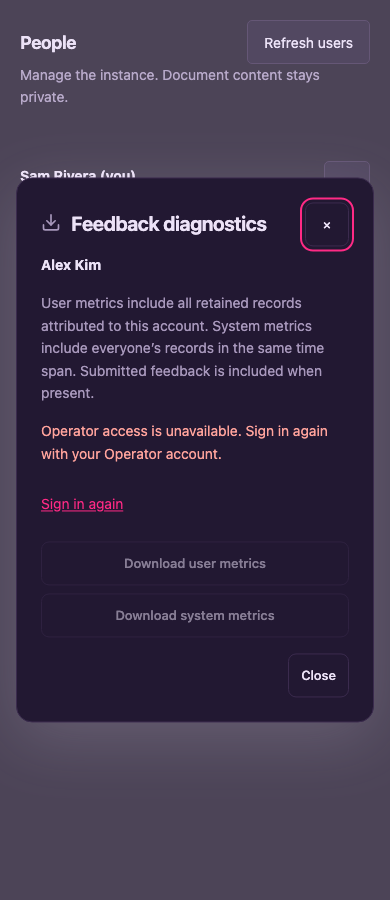</a> `phone-dark` |
| Admin / Feedback / Old Feedback Only | <a href="admin-old-feedback-only-phone.png">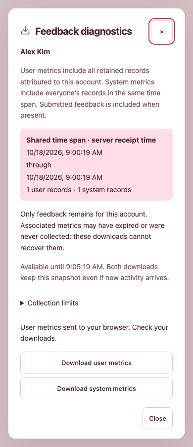</a> `phone` |
| Editor Frame / Guest | <a href="editor-guest-phone.png">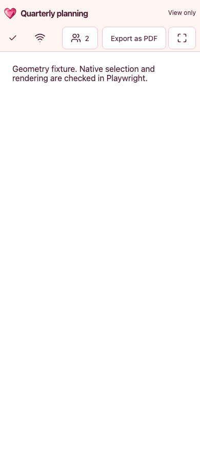</a> `phone` |
| Admin Page / Diagnostics Clear Blocks Navigation | <a href="admin-diagnostics-clear-phone.png">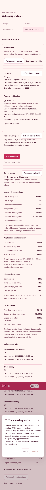</a> `phone` |

## 🔎 Current-source boundary

These captures use the preserved private locked installation after actual main754e6531 integration, including
Univer 1.3.1, Storybook 10.6.5 and lucide 1.69.0. They replace historical images
for current visual assessment, without erasing the earlier gallery or its provenance.
All 220 requested states passed. Proposed placement and interaction decisions
remain in [the admin design guidance](../../design/admin.md#user-feedback-handoff-spn-098).
Independent visual approval and hosted full-catalog acceptance are separate gates.

The build and current images bind runtime source23e7553f. Evidence-only documentation was assembled after the build; executable hashes remain unchanged. Task-private cache locations and focused config are retained with the local evidence. The prior32 actual/proposed reference images remain untouched. Independent visual review is pending; no self-approval is claimed. SPN-157 remains the explicit merge prerequisite.
