## 📨 Complete feedback candidate; supporting SPN-157 investigation

**Draft; SPN-157 remains an explicit merge blocker. No merge is authorized by this supporting validation.** Complete candidate **`5e72d33ac9cb3a86b3496345209493d6c86e469c`** integrates actual main **`754e65317744e5ce97ede501935c6586e4875f2a`**, including landed SPN-160 first-failure diagnostics. Runtime/build/capture source is `23e7553ff4f35f5f03dfe51a644840994e52929e`;51 executable/config hashes match the final evidence-only commit. Remote publication and selected hosted acceptance of this new candidate remain pending.

Full **L** outcome remains durable intentional feedback with server-derived identity/access, idempotent receipt and generation/truncate fences, complete paired user/system SQLite downloads from one immutable snapshot/inclusive receipt window, bounded preparation/transfers, expiry/cancellation/cleanup and honest accessible member/Operator states. Operator receives complete correlated exports; Owner and Collaborator retain truthful receipt/retry; Link guests gain no feedback or diagnostic authority. No inbox, automatic content capture, permission expansion or AI feature. [Complete contract and decisions](https://github.com/mxbaylee/spinel/tree/5e72d33ac9cb3a86b3496345209493d6c86e469c/docs/implementation/SPN-098.md) preserve the original specification and explicit157 dependency despite conditional own-ticket deletion/landing bookkeeping. Main completions148/145/149/158/160,next161 are preserved. **9,653 counted changed text lines**, below unchanged10,000 soft limit.

The full instrumented feedback source is needed because the original readiness-first case loads the full app, while durable-running does not import feedback. SPN-160 main-only supervisor/recovery passes are comparators; neither proves the original cause nor replaces feedback-source acceptance. The original successful run, subsequent failed supervisor run, deliberate cancellation and earlier131.2ms native failure remain separately retained below. No deadline, authority, persistence or performance budget is relaxed. SPN-110 retains its separate actual expiry/export integration.

## 🔎 New independent review and visual gate

**Two independent nonimplementing reviews: A (`/root/review_a`) 100/100 and B (`/root/review_b`) 100/100 on exact `5e72d33ac9cb3a86b3496345209493d6c86e469c` against `754e65317744e5ce97ede501935c6586e4875f2a`.** Each rubric is scope35/35, correctness25/25, regression20/20, operations10/10 and maintainability10/10, with no actionable findings or withheld points. Each independently ran81 tests across13 files: A4522ms/548096KiB; B4355ms/541840KiB, first attempt, cleanup verified. Both inspected all16 proposal/reference and all16 fresh actual images and separately approved the visual result on this exact head: **agent review only**. Both verified image/source/evidence bindings and accurate viewport/full-page captions. Full review reports will be retained in the reserved validation record below. Root separately verified the exact-head PR check465ms/189120KiB. Historical grades below retain only their original source/base meaning. Hosted acceptance and the complete SPN-157 prerequisite remain pending; these grades do not authorize merge.

## 🧪 Current feasible local evidence

[Original receipts, source hashes, private configurations and cleanup](https://github.com/mxbaylee/spinel/tree/5e72d33ac9cb3a86b3496345209493d6c86e469c/docs/implementation/evidence/SPN-098-post160-2026-11-14) retain exact outcomes. Pinned Node26.13.0, shared serial/normal-pressure/2GiB/eight-minute watchdog, Go640MiB/GOGC50/GOMAXPROCS2 and task-private caches; existing private dependency packages preserved without reinstall.

- **81 tests in13 files passed:** existing71 diagnostics/context contracts plus10 landed ownership/control diagnostic contracts;4.642s,541,024KiB.
- Full TypeScript passed8.998s,1,695,024KiB; dependency/oxlint/format passed10.932s,814,720KiB. Generated backlog and exact-main PR policy passed. Subsequent changes are evidence/documentation only.
- Fresh production Storybook build passed9.555s,1,489,584KiB; **44stories ×5variants =220states/captures, zero failures**,132.049s,1,362,192KiB. Canonical production components, preview/decorators/story args/play assertions retained; focused catalog and omitted automatic prop documentation are disclosed. Hosted full catalog remains separate.
- All workloads passed first attempt. A packaging script queried the wrong manifest key before correction; original build/capture bytes were unchanged and no workload repeated. Owned capture processes exited and shared lock was absent at release.
- Exact retained SPN-157 actual-connection comparison reports both old baseebf andcandidate2204 at synchronous2/FULL,wal,busy_timeout0 on the pinned Mac with identical Node/libsql/native inputs. This excludes an effective-setting difference on that Mac only, not Linux configuration/timing or historical cause.198ms run ended before the200ms RSS sample: no measured peak claim. Connections/temp databases cleaned up.

Prior ordinary application build/four diagnostics browser flows remain historical evidence. Current application/feedback behavior is unchanged; the selected hosted browser and Linux supervisor/recovery owners provide new combined-source acceptance. Linux-on-Mac platform refusal was not repeated. **New hosted acceptance is pending and SPN-157's complete causal/repair outcome remains open regardless of a supporting pass.**

## 🧾 Reserved current-source evidence

The [current-source validation record](https://github.com/mxbaylee/spinel/tree/archive/spn-098-validation-5e72d33a-20261114/docs/review-assets/spn-098-validation-5e72d33a) is pending at publication. Once independently verified and published, it records the actual first result, source/base/tested merge, selected checks, diagnostic interpretation, reviews and failures, superseding this pre-push pending checkpoint. An absent record is not a pass. SPN-157 remains an explicit merge prerequisite regardless of a passing supporting run.

The [completion record](https://github.com/mxbaylee/spinel/tree/archive/spn-098-completion-5e72d33a-20261114/docs/review-assets/spn-098-completion-5e72d33a) is reserved for an actual guarded merge and branch cleanup. Neither is claimed while that record is absent. No merge is authorized by this supporting validation alone.

## 🖼️ Fresh actual production visuals — agent review only

[Gallery and exact source/manifest/PNG mapping](https://github.com/mxbaylee/spinel/tree/5e72d33ac9cb3a86b3496345209493d6c86e469c/docs/review-assets/spn-098-post160) bind render source23e7553f, preserved lock (Univer1.3.1/Storybook10.6.5/lucide1.69.0), synthetic APIs/accounts/messages/downloads, fixed fixture clock2026-10-20T16:00Z. Desktop1280×900, phone390×900 with recorded full-page heights; browser emulation, no physical-device claim. Server persistence and SQLite completeness have separate contract coverage. The historical16 actual and16 proposal/reference images remain below with their original provenance; they are not relabeled current.

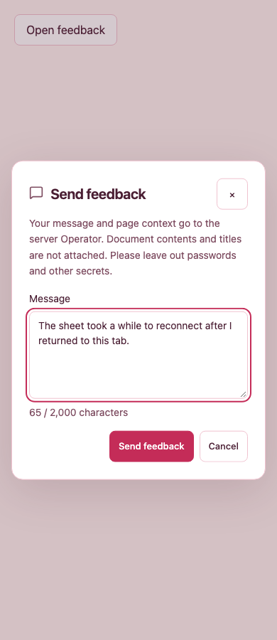

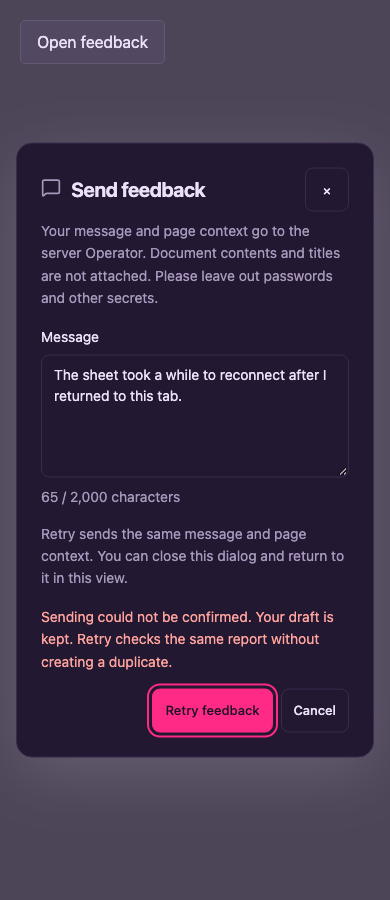

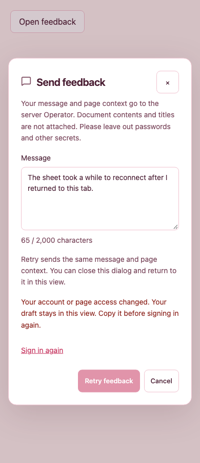

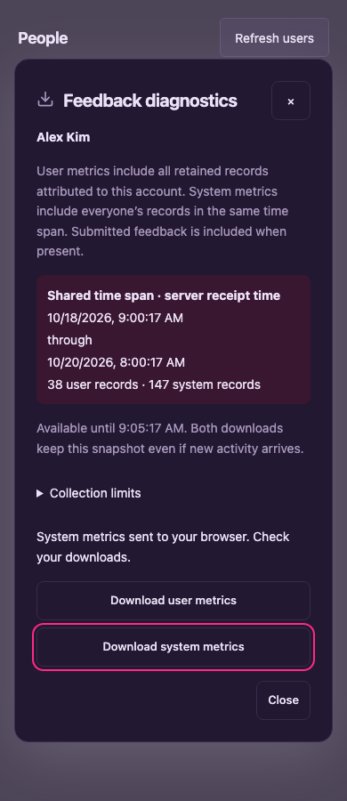

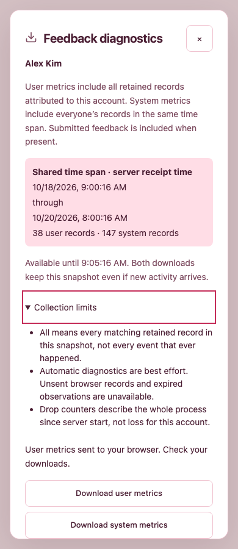

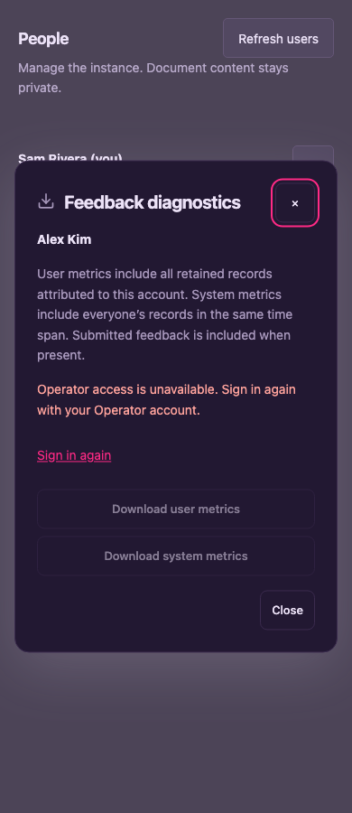

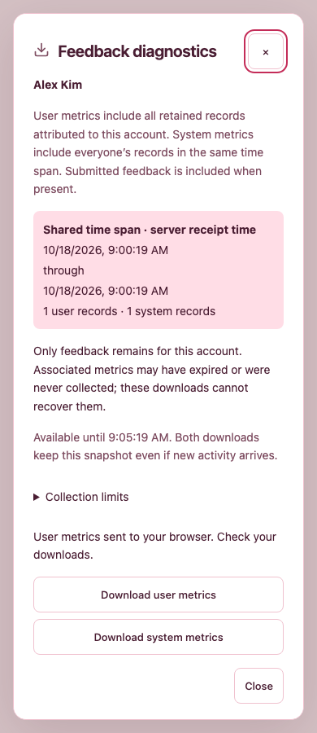

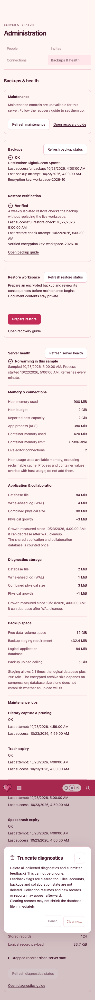

🧾 Historical source2204 delivery, prior independent reviews, failures and32 retained actual/proposed references

The following is the preserved prior PR checkpoint. Its source-specific present-tense statements describe that historical candidate, not the new integration above. Original immutable evidence and first-failure dispositions remain authoritative for those attempts.

## 📨 Outcome and status

Members can deliberately send feedback from Account or Document actions. A success receipt follows durable storage; ambiguous retries retain the same report identity. Operators receive two complete SQLite downloads from one frozen snapshot and the same server-receipt-time window: every retained row attributed to the selected user, and every system row within that window. Draft, cancellation, expiry and failed/unknown states remain explicit.

**Draft; merge blocked by newer metadata-validation Unit tests failure.** Reviewed candidate `2204b8c40ce6feb8ad03c65720c976510535ad00` integrates reviewed/tested base `ebf0842f51b60d54649cf8a03065914bec0944bf`. Actual local application/browser/visual source is `8e986617a40977eb96d016be7dc361366003384f`; subsequent commits change only evidence/documentation, with unchanged executable hashes. Previous remote candidate was `94c6968e29b57351c548dd5065cb0a61adfad896`.

**Current main has advanced:** registration [PR #284](https://github.com/mxbaylee/spinel/pull/284) squash-merged as `89e4426dfff1c3469b260305e21180ffd79fdb7f`, registering SPN-157 and this ticket’s dependency. This unchanged candidate still needs the demonstrated repair, current-main integration, new exact-head reviews and fresh acceptance. Retained reviews below apply to source `2204b8c4` against its tested base `ebf0842f`; they do not approve the pending integration.

## 🛑 Latest required-check failure

The final-description edit triggered [CI 43544143900, attempt 1](https://github.com/mxbaylee/spinel/actions/runs/43544143900) on the same reviewed source `2204b8c4`, base `ebf0842f`, tested merge `62bc0229`. **Unit tests (supervisor) job 132291548937 failed 2/131 cases (129 passed); required Unit tests aggregate 132293846852 correctly failed.** The earlier three successful workflows below remain valid historical acceptance; they cannot override this newer required failure. PR is draft and cannot merge.

[Immutable first-failure checkpoint](https://github.com/mxbaylee/spinel/tree/5e1b7a9fac17c69ff9174caa9da9f8d13713737d/docs/review-assets/spn-098-failure-43544143900) retains the original supervisor log, prior successful supervisor log, exact plan/run/job/source identities and one guarded Mac reproduction attempt. Failures: durable-running SIGKILL reconciliation rejected maintenance control generically (8.814s), and authenticated real-app restore readiness-first never observed private readiness (23.720s). The log also records `ownership.ts:221: Workspace ownership handoff timed out` at 02:06:51Z. Reporter output omits phase/jobPhase/controllerFailure; the exact causal mapping remains unproved. No evidence supports a feedback-specific cause, deadline relaxation or identical hosted rerun.

The one focused unchanged local attempt was platform-blocked: the real supervisor child explicitly requires Linux; macOS received a fixture-message timeout, and the real-app case was correctly skipped. Normal-pressure serial/watchdog receipt: 10.782 s, 494,608 KiB, no guard bypass. This is neither a Linux reproduction nor a pass. Next owner: **SPN-157**, assigned by the manager as a separate pre-launch **L** supervisor handoff/recovery outcome, with reassessment at the Linux/IPC/persistence capability checkpoint. Focused registration PR #284 has now landed SPN-157 and the SPN-098 prerequisite link on main; its complete L diagnosis/repair remains unfinished. SPN-098 implementation is not expanded and remains blocked. The failing run is now terminal: all 33 jobs completed, with 30 successes and three failures (supervisor, Unit aggregate and the fail-closed Playwright aggregate). All actual browser workers passed; their success does not waive the supervisor failure. The draft-checkpoint metadata run 43545634784 was deliberately cancelled and all 16 jobs were verified terminal; cancellation is not acceptance. The [immutable terminal and cancellation record](https://github.com/mxbaylee/spinel/tree/e8128c36b4d017fbcda51820ff634265b4f34d8c/docs/review-assets/spn-098-terminal-43544143900) preserves exact terminal identities, plan digests and final mobile results. No implementation source changed. Both retained exact-source reviews were 100/100 with independent visual approval against `ebf0842f` (agent review only); new main/repair integration is still unreviewed.

## 🔎 Independent reviews — agent review only

Two independent nonimplementing reviewers revalidated the complete outcome on `2204b8c40ce6feb8ad03c65720c976510535ad00` against base `ebf0842f51b60d54649cf8a03065914bec0944bf`. Neither received the other's grade. Review grades and hosted acceptance are separate gates.

- Reviewer A (`/root/review_a`): **100/100**, scope 35/35, correctness 25/25, regression 20/20, operations 10/10, maintainability 10/10. Independently ran 71 tests in 11 files on unchanged executable source `8e986617` (4.136 s guarded, 421,600 KiB); revalidated all 42 source hashes and final evidence on `2204b8c4`.
- Reviewer B (`/root/review_b`): **100/100**, scope 35/35, correctness 25/25, regression 20/20, operations 10/10, maintainability 10/10. Independently ran the 71 tests (3.806 s guarded, 415,152 KiB), inspected complete scope/access/persistence/exports and verified final source and evidence identities.
- **Visual approval: both independent reviewers, exact final `2204b8c4`, agent review only.** Both personally inspected current images against the playbook, themes, proposed references and all four personas. Both verified all 16 retained image identities and the 44-story/220-state manifest. No unresolved findings or remaining actionable steps to 100. Current rendering source is unchanged from captured `8e986617`.
- Review iterations: `8e986617` A 100/B 100; evidence candidate `323e3ad4` B 99 with one local evidence-provenance deduction; repaired final `2204b8c4` A 100/B 100. Reviewer B found an old manifest hash/path copied into the new image mapping. Commit `2204b8c4` repairs it with the actual `.gz` path, stored SHA-256 and explicit decoded SHA-256; decoded manifest matches the summary and all 16 image hashes/dimensions verify. Both reviewers independently verified the repair. No capture or executable source changed.

## 🧪 Current local evidence

[Exact command/resource receipts, source hashes and original logs](https://github.com/mxbaylee/spinel/tree/2204b8c40ce6feb8ad03c65720c976510535ad00/docs/implementation/evidence/SPN-098-resume-2026-11-13) retain each outcome. All actual workloads used fresh private locked dependencies, Node 26.13.0, the shared serial runner and unchanged normal-pressure/2-GiB/eight-minute watchdog. The main checkout's stale dependency symlink was removed without touching its target.

- Locked installation passed: 5.446 s, 1,171,920 KiB peak.
- Eleven diagnostics/context suites passed **71 tests**: 5.151 s wrapper, 545,248 KiB. They include real HTTP/SQLite authorization, durable idempotence, exact mixed-actor paired membership/window, generation/truncate races, staging/transfer limits, cancellation and failed-cleanup controls.
- Full TypeScript passed: 3.000 s, 1,898,288 KiB. Full dependency boundary/oxlint/format passed: 12.005 s, 823,424 KiB. Backlog, exact-title PR policy and complete candidate whitespace checks passed.
- Focused production Storybook build passed: 6.315 s, 1,506,848 KiB. **220 states across 44 stories passed**, covering desktop light/dark, phone light/dark and tablet; 126.421 s wrapper, 1,279,344 KiB. Canonical preview, production components, story arguments and play assertions are retained; only the local catalog and automatic prop documentation are narrowed. Full hosted catalog remains selected.
- Ordinary production build passed: 1.589 s, 1,050,512 KiB.
- All **four existing production diagnostics browser cases passed on their first actual attempt**: 21.9 s test / 22.260 s wrapper, 1,802,384 KiB. These use real isolated private apps and actual downloaded SQLite files. They prove lost-ack receipt recovery, paired immutable downloads, truncation of flags and stale retry prevention, plus honest failure/cancellation/access states. [Browser report and paired artifact receipt](https://github.com/mxbaylee/spinel/tree/2204b8c40ce6feb8ad03c65720c976510535ad00/docs/implementation/evidence/SPN-098-resume-2026-11-13) retain exact outcomes; the local config omits only unrelated shared servers because each case starts its own app.

Two setup failures are preserved: an initial Storybook command used a removed CLI path, and an initial Playwright invocation let variadic `--project` consume the test filename. Both failed before their workload executed. Correcting the command paths/argument syntax produced the actual runs above; no source, assertion, retry or budget changed. The earlier macOS startup block did not recur with current main's Linux-only lease guard. Local results do not claim Linux/deployment or full-matrix acceptance.

## 🛡️ Retained native failure and current hosted gate

Previous source `94c6968e` failed CI **42023278283**, attempt 1, tested merge `bc2e8c812c5c67252ddf6889b34d8b0838af1073`, tree `ffdc72abd7d46c361ecd75286569f63a828cff84`, based on `2f442317`. Mobile job **127231484521**, plain-3 retry 0, exceeded the unchanged capacity maximum: **131.2 ms >100 ms**, completed state 416/index 12. Native history was 32.1 ms and collaboration 99.0 ms; queues 32/32→0/0 and overlapping long task 188 ms. Other measurements passing their separate budgets do not erase this failure. Playwright smoke correctly failed.

[Immutable prior outcome archive](https://github.com/mxbaylee/spinel/tree/e213439aee55d6772858a71cdd7b350134c4465f/docs/review-assets/spn-098-current-outcome-94c6968e) retains original failed-mobile/native/build/desktop/result ZIPs, terminal identities/digests, browser reports, paired rows, unit/mobile logs and prior visual/evidence reviews. Failed-mobile artifact **13415581418**, 3,083,848 bytes, SHA-256 `34a6c65ce950be7fafaddc12c707cd4392246a68ff4cfc018acf51e6f1ca3812`, remains failed evidence. [Earlier full handoff](https://github.com/mxbaylee/spinel/blob/e43d7f84f69d5ad4d1ac370367108d9c8aca4484/docs/review-assets/spn-098-publication-94c6968e/pr-before-takeover.json) preserves earlier review/run/repair identities and environment blocks.

Main now supplies SPN-146's native pending-buffer, pooled-channel and presence repairs, offline fixture repairs, and updated SDK/dependencies. [SPN-146's accepted disposition](https://github.com/mxbaylee/spinel/blob/ebf0842f51b60d54649cf8a03065914bec0944bf/docs/implementation/SPN-146-linear-tail.md#-current-state-2026-11-10) explicitly retained its unmet no-breach criterion and SPN-089's remaining gate. This PR makes no claim that every tail was eliminated and does not infer a feedback-specific cause. Fresh selected native validation applies to this materially changed combined source; no unchanged failure rerun or relaxed budget is proposed.

## ✅ Earlier successful current-head acceptance

[Immutable current acceptance archive](https://github.com/mxbaylee/spinel/tree/32a4694e773e3bcabd6472fd27747b044ee7b0dc/docs/review-assets/spn-098-acceptance-2204b8c4) preserves the original full plan, complete job/API records, exact artifact IDs/digests, original numerical/reporter JSON, full small native/responsiveness archives and member-level stored/decoded hashes. Source **`2204b8c40ce6feb8ad03c65720c976510535ad00`**, base **`ebf0842f51b60d54649cf8a03065914bec0944bf`**, tested merge **`62bc0229c5675ff519b733cfc8f3c9a7e6e918d8`**, identical source/tested tree **`d6bb81924f90aab2d2f2172927f847e412366816`**. Main and remote source were rechecked unchanged after terminal acceptance. Every run below is its first current-head attempt, **attempt 1**, with no unchanged rerun, relaxed budget or hidden retry.

- [CI 43540593013](https://github.com/mxbaylee/spinel/actions/runs/43540593013) **succeeded: all 33 jobs**. All seven required gates passed: Backlog job 132280423634, Pull request 132279984142, Lint 132280423612, Typecheck 132280423715, Unit tests 132282457481, Lib tests 132282498472 and Playwright smoke 132289382973. Complete pagination includes every worker. The immutable classifier selected full coverage, all 15 suites, with reason “Immutable range or event labels unavailable; full coverage.” Plan SHA-256 `7f3f130bf8684f274220b739e4b20536890acf2a4c91a6fe5dbdb250d6078b7e`; plan artifact 14091377455. Unit/lib/browser aggregate artifacts 14092087618/14091951985/**14093415652** all report passed and match plan/base/head/tested identities. Source/shared-dependency routing remains intact; the workflow delta only retains `spn098-feedback-pair.json` in existing artifacts.
- **All four diagnostics cases passed retry 0 in production and development**, using real isolated apps and actual downloaded SQLite files. All four ordinary browser shards have zero unexpected/flaky results; explicit unrelated skips remain recorded as skips. Production pair receipt proves one preparation, frozen membership, user 2 / system 3 feedback rows, common snapshot/generation/inclusive receipt window and exclusion of the later row. Mixed observation/unattributed rows are separately proven by the real-SQLite unit contract.
- **Mobile responsiveness job 132280423732 passed**: baseline 4 / candidate 7 expected, zero unexpected/flaky/skipped. Candidate plain-1/2/3 input p95 **60.4/55.1/55.3 ms**, capacity paired-flush max **23.2/24.3/24.2 ms** against the unchanged **100 ms** limit; first verified browser-local drain **313.6/394.4/371.9 ms**. Profile maximum 25.6 ms. Comparison, integrity, post-burst and boundaries passed. Original artifact **14093480182**, **2,104,094 bytes**, SHA-256 **`feba315f5be821d8290d663a6015e7f255e56bbd6df88bb39663bc93f15f86a4`** is retained whole. Desktop counterpart passed with plain-1/2/3 input p95 29.0/29.2/29.2 ms, paired max 4.9/4.6/5.0 ms and browser-local drain 347.5/349.9/344.1 ms. These are hosted emulated presets, not physical phones. Their baseline source is `96ae9e0a07d113c5de771f6e4e0f4ae83fae812d`.
- **Both callback lifetime workers passed**, candidate tested merge above versus baseline `b75e3797a11ac2f53e3833b5615f68b6c0091727`. Cursor/zoom-init/zoom-update pending high-water 4/1/1, pending at end 0, callbacks/installations after disposal 0. Both comparison results accepted with zero failures, progress terminal passed and no first failure, persistence failure or dropped events. Artifacts 14091812599 desktop /14091358686 mobile retain original trace identity; full numerical/frame-summary/progress/comparison JSON is archived.
- [Desktop 43540593025](https://github.com/mxbaylee/spinel/actions/runs/43540593025) **succeeded**: ordinary Chrome157.0.8103.79 / Firefox160.0 on macOS26.7.2 arm64 and Safari27.2 on macOS15.7.9 x64 all passed actual persisted-profile, restart, offline-edit, reconnect, storage-loss and cleanup acceptance. Complete native artifacts 14091966472/14092091881/14091812936 are archived with exact source/tested/runtime identities.
- [Storybook 43540593085](https://github.com/mxbaylee/spinel/actions/runs/43540593085) **succeeded**: all five full-catalog viewport/theme workers and interaction aggregate passed, **1,076 states per variant  / 5,380 total, zero failures**. Artifacts 14092327440 desktop-light,14092078133 desktop-dark,14092377401 phone-light,14091482855 phone-dark,14092317714 tablet; all original full manifests are archived. Inapplicable preview/deployment jobs were skipped. The reviewed useful current light/dark/phone images below remain pinned to maintained source.

The archive clearly distinguishes retained original evidence from supplementary expiring successful raw callback/Playwright traces and all full-catalog captures. It does not claim those large traces are fully archived. The original **131.2 ms failure above remains failed evidence**; this new combined-source acceptance does not establish a feedback-specific cause or eliminate every native tail. Both qualifying exact-source reviews and independent visual approvals remain complete. Any later metadata-triggered validation is checked independently before merge against the same reviewed source.

## 📐 Scope and personas

Complete **L** outcome, with no acceptance deferred: durable feedback, actor/file authority, retry/truncate fencing, complete paired snapshot/window exports, private bounded staging, expiry/cancellation/cleanup and current member/Operator UI evidence. Operator gains complete exports without an inbox; Owner and Collaborator keep truthful receipt/retry state without automatic content capture; Link guests gain no feedback or diagnostic authority. No AI feature or new document permission is introduced.

[Canonical implementation/decisions](https://github.com/mxbaylee/spinel/blob/2204b8c40ce6feb8ad03c65720c976510535ad00/docs/implementation/SPN-098.md) retain the original ticket contract and first-failure history. SPN-110 remains separate observation-expiry work; whichever ticket lands second must retain actual expiry/export integration. Landing bookkeeping removes only SPN-098 and preserves the 2026-11-12 grooming reset, current SPN-148/SPN-145 completions and generated index. **8,984 counted changed text lines**, below the unchanged 10,000-line soft limit; binary assets and generated-index exclusions retain the base policy.

## 🖼️ Current visual evidence

Actual current production components at source **8e986617**, fresh locked Univer 1.3.1 / Storybook 10.6.5 / lucide 1.69.0. Synthetic APIs/accounts/messages/downloads, fixed clock 2026-10-20T16:00Z, desktop 1280×900 and phone 390×900; phone uses browser emulation. No physical-device or screen-reader claim. [Gallery, source, compressed complete manifest, stored/decoded digest and PNG hashes](https://github.com/mxbaylee/spinel/tree/2204b8c40ce6feb8ad03c65720c976510535ad00/docs/review-assets/spn-098-current). Server/browser checks separately prove persistence. **Agent review only.**

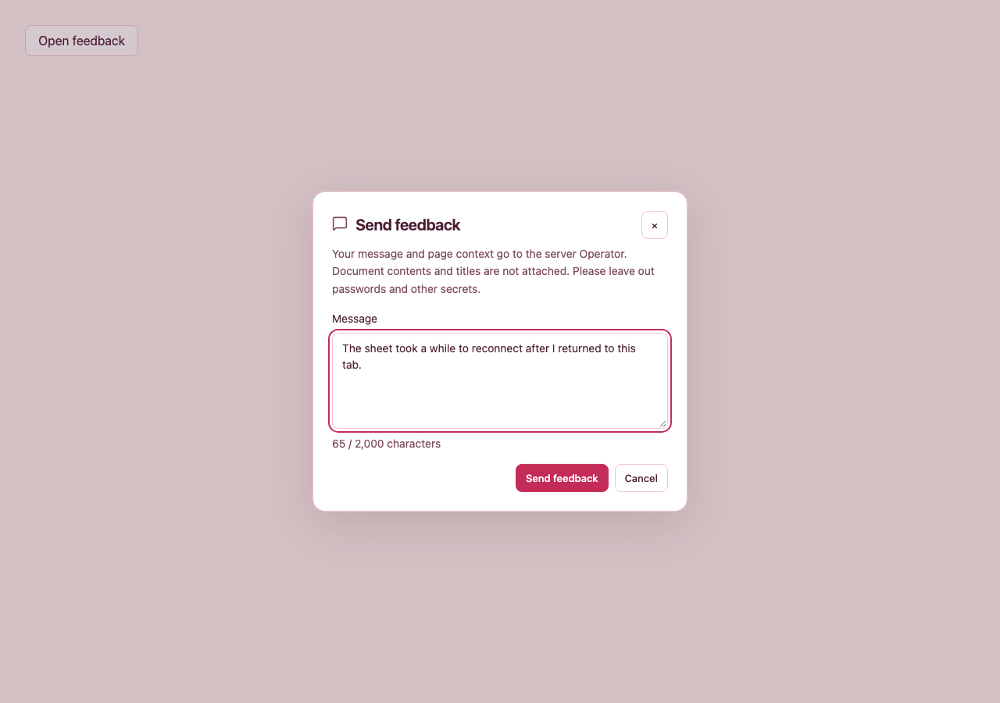

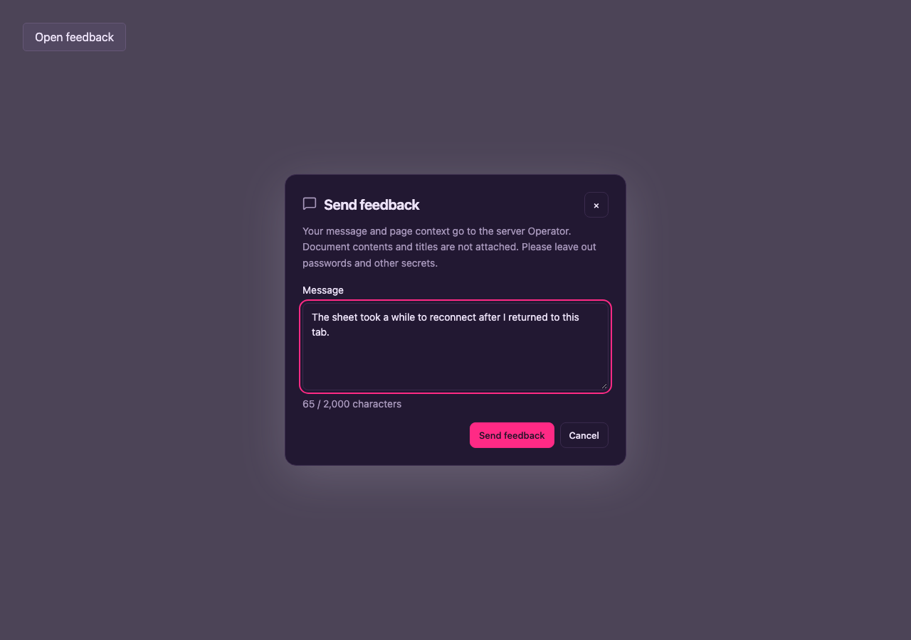

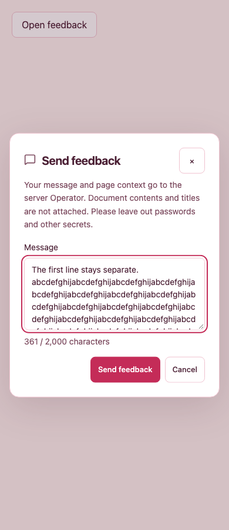

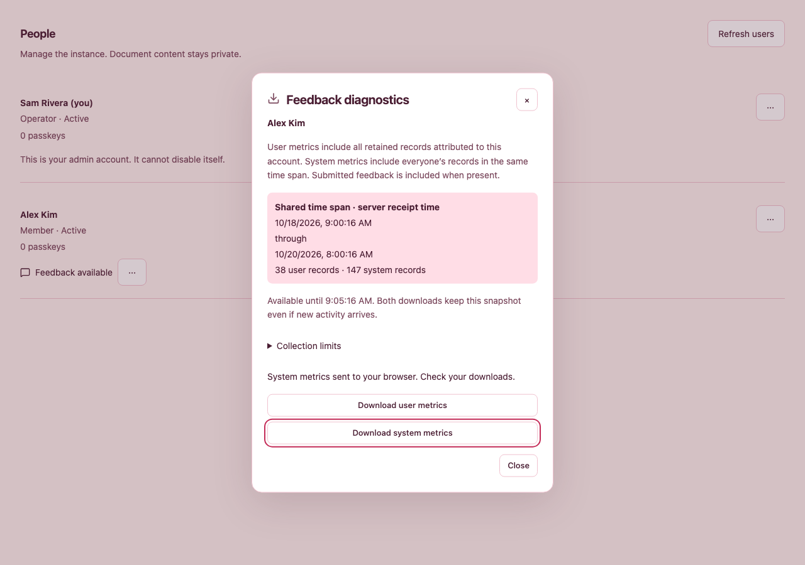

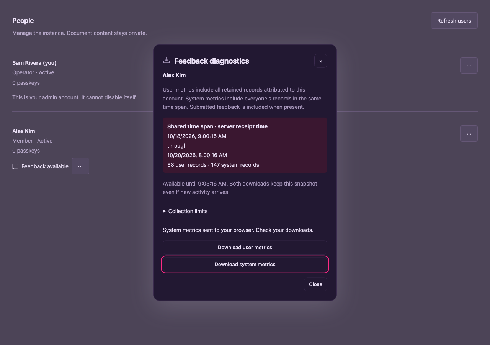

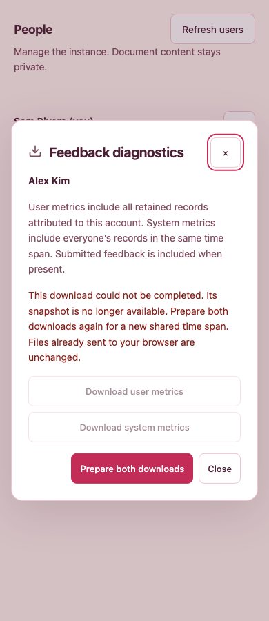

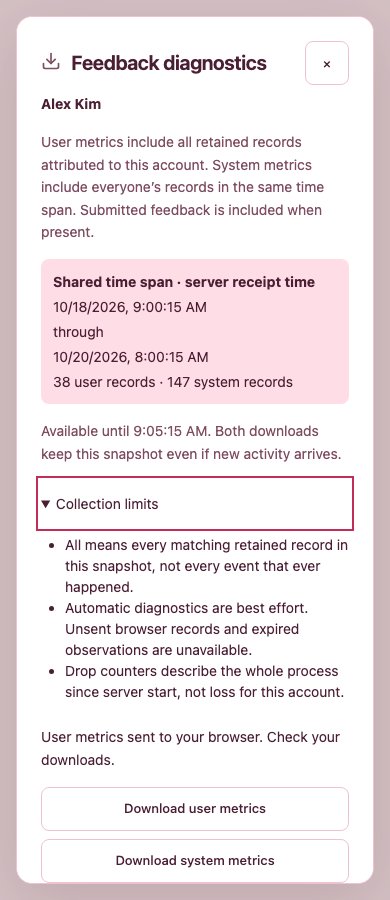

🎨 Original design/reference states, historical source ea6aa741

The existing approved [admin design guidance](https://github.com/mxbaylee/spinel/blob/2204b8c40ce6feb8ad03c65720c976510535ad00/docs/design/admin.md#user-feedback-handoff-spn-098) governs placement and shared controls. No new playbook pattern is proposed. The earlier production prototypes below preserve the proposed states and their original provenance; they are historical references, not current approval.

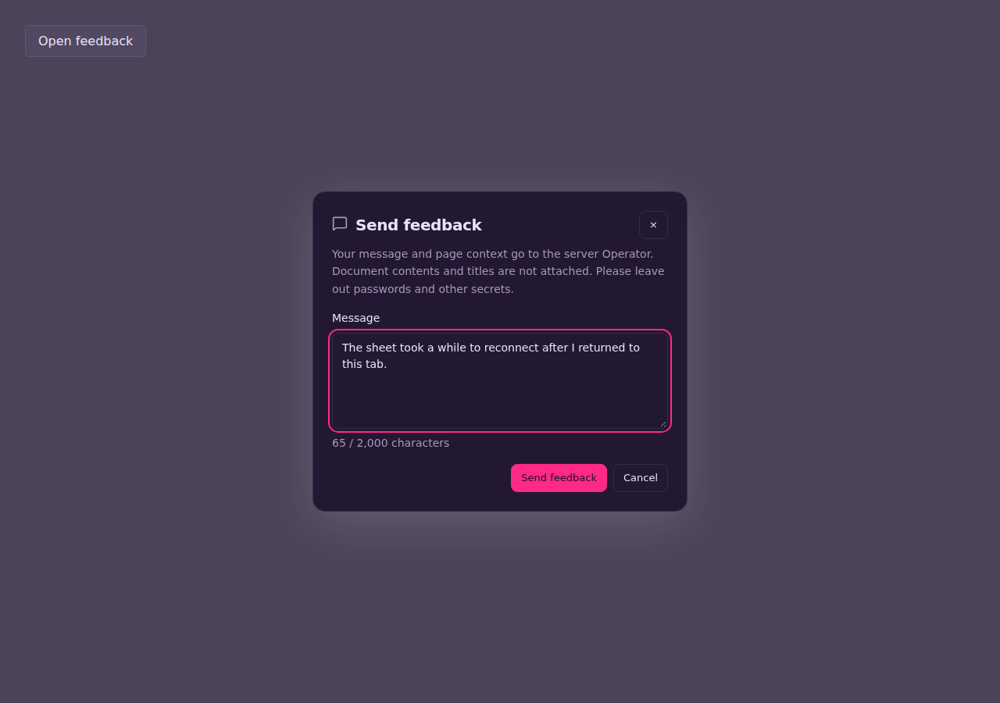

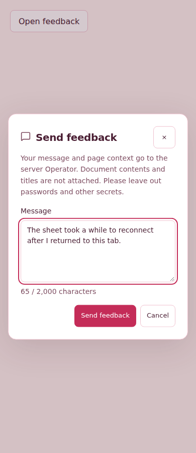

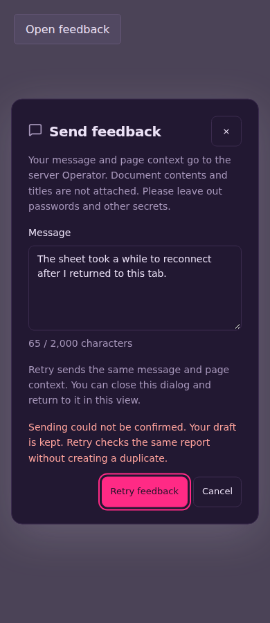

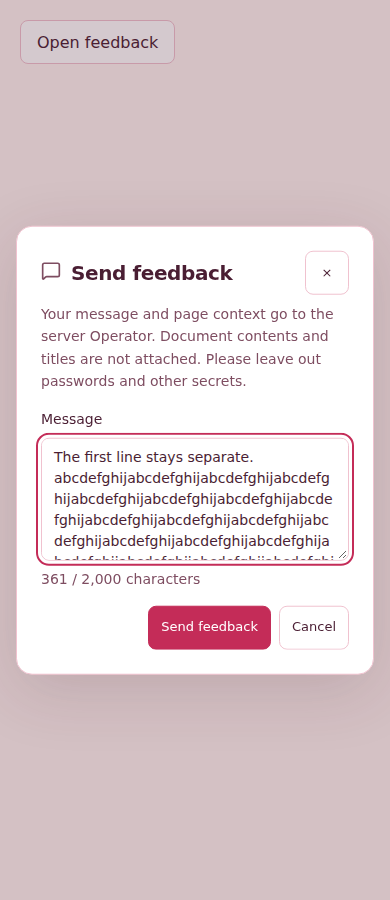

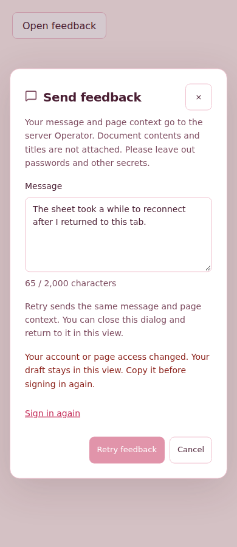

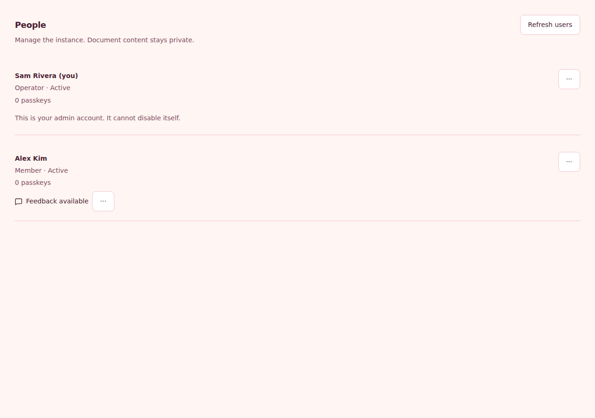

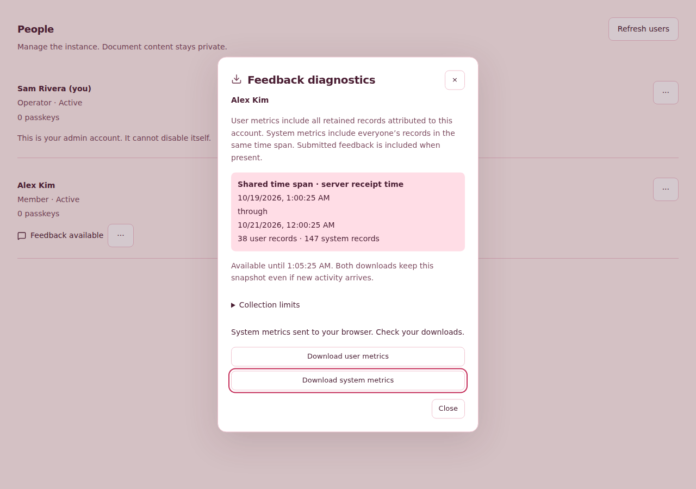

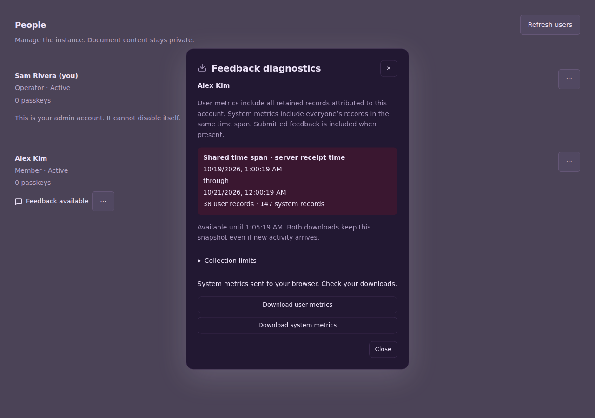

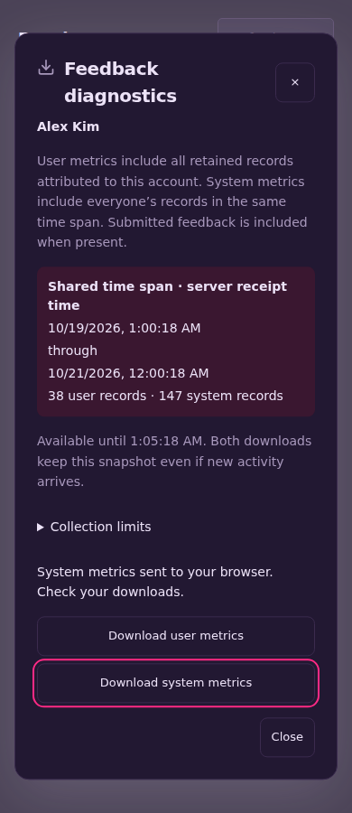

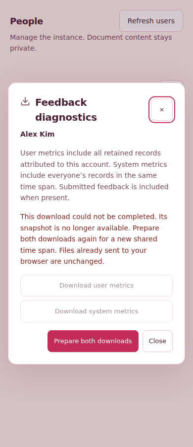

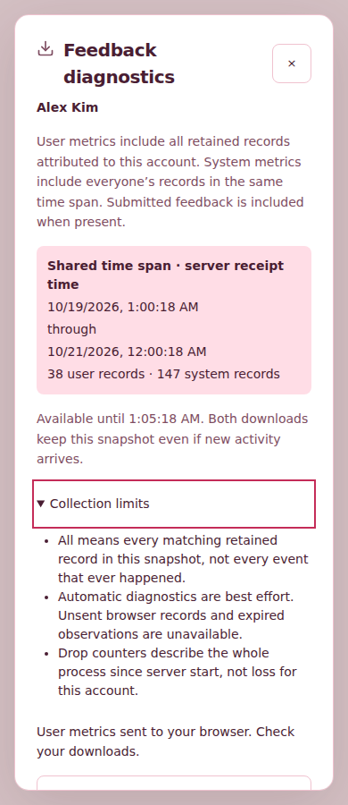

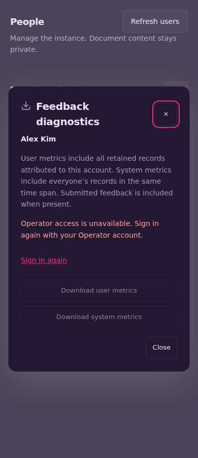

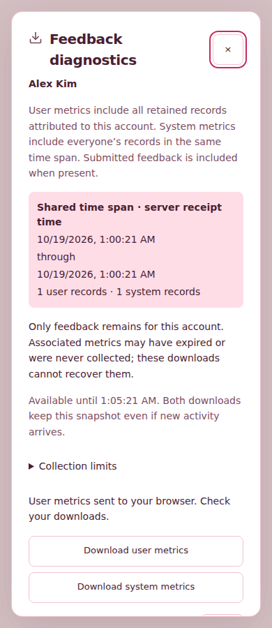

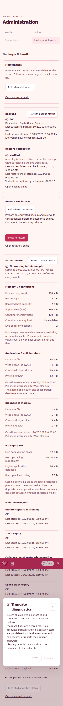

## 🧭 Run checkpoint

PR 227 is draft on unchanged reviewed source `2204b8c40ce6feb8ad03c65720c976510535ad00`. Both retained 100/100 reviews and visual approvals apply to that source against `ebf0842f`, but latest required Unit tests failed in metadata run 43544143900. Original successful acceptance and the new first failure are preserved separately. No merge, source push, deadline change or unchanged rerun is authorized by an earlier pass. Manager assigned SPN-157 (registered by merged PR #284) and coordinates its reviewed repair before fresh SPN-098 acceptance; existing historical branches, SPN-110 actual integration and post-merge cleanup remain preserved.

