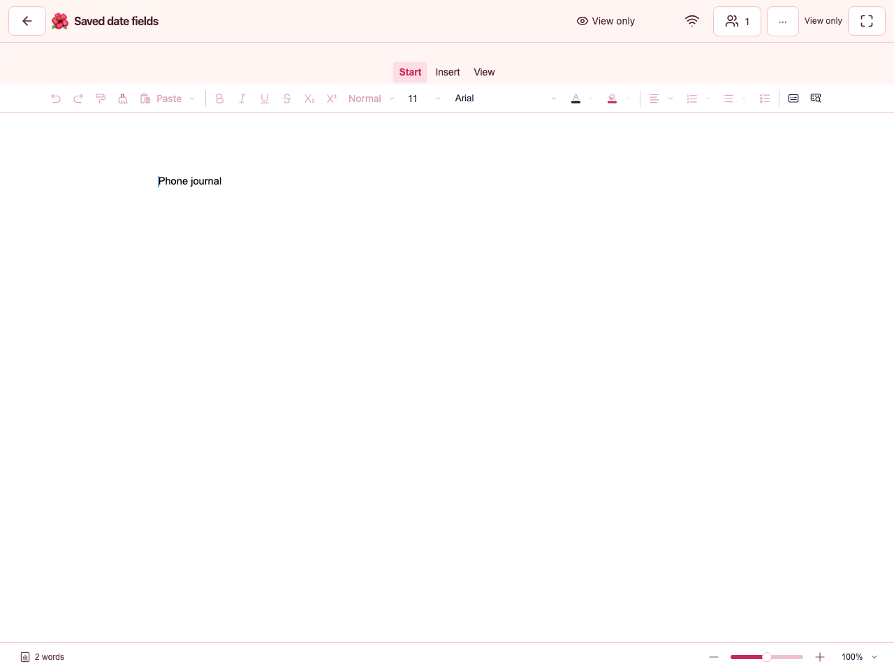
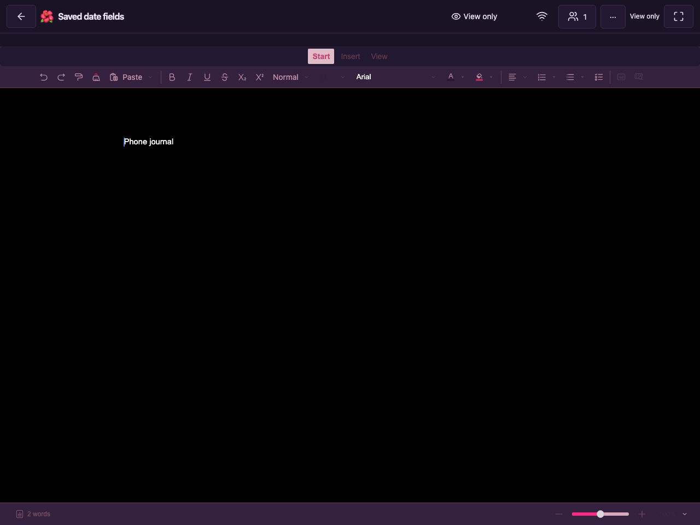
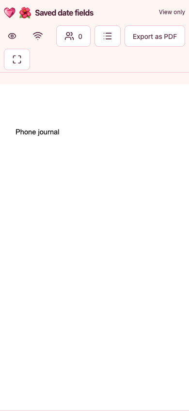
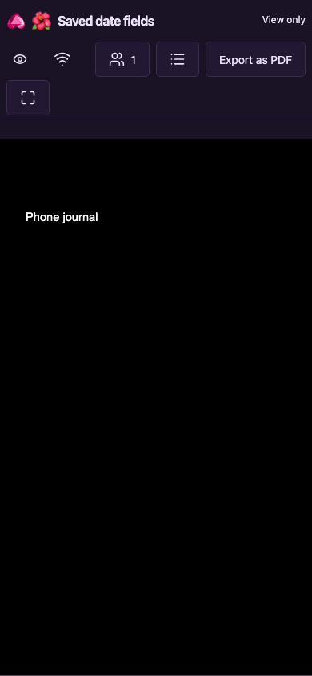
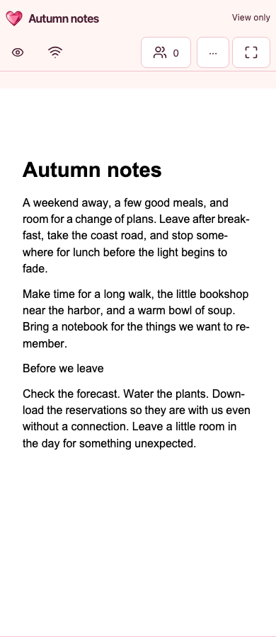
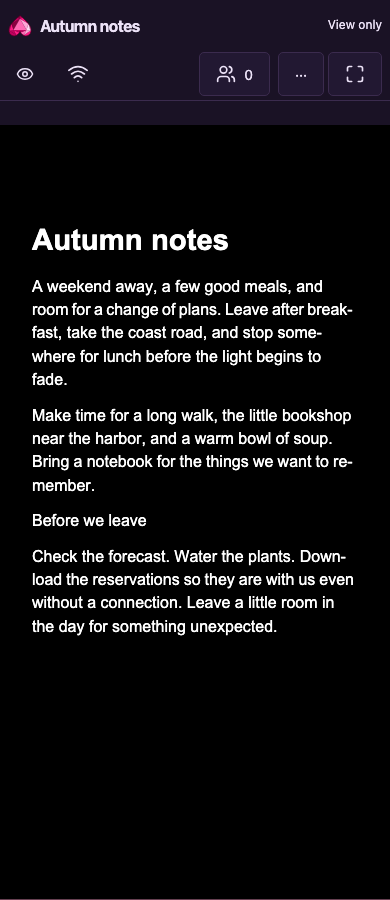
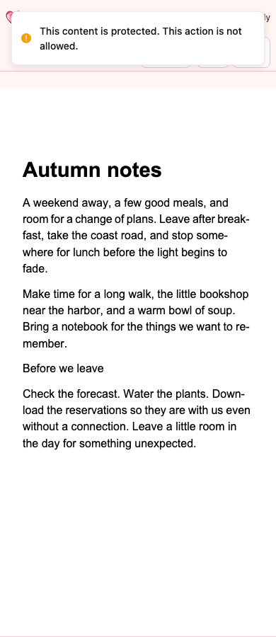
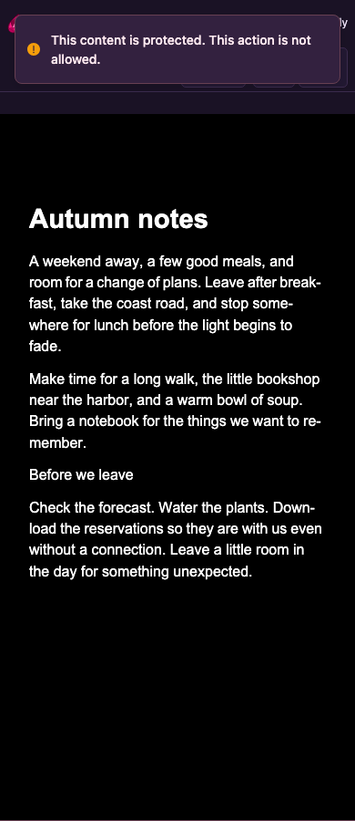

# 🎨 Current SPN-106 visual evidence

Actual source `499edf373a256bebe851bf0e3449f6f56cfdecd5`, based on
`aeed459c7828a46d66e0054399eff0f00f1c506e`. Subsequent landing/evidence changes
leave executable inputs unchanged. No alternate design is proposed: restore quiet
reading while retaining truthful native denial. Independent visual approval is
recorded on the final reviewed commit in PR #246; capture success alone is not approval.

Application: production test build with read-only selection evidence, Chromium,
synthetic account desktop1280×960 and anonymous guest phone390×844 touch/mobile
emulation. Both plain and stale-field branches passed load/reload warning history
and complete saved snapshot/head/receipt/legacy/grant equality. Account branches
prove HTTP403; guest branches prove dashboard401. Plain branches additionally
prove concurrent authorized editing and guest revocation. Images show the stale-field
fixture; saved date values are verified by data assertions rather than displayed dates.

Mounted native Storybook with production theme/chrome,390×900, inherited real
main/preview and only DocMobile selected. All four states passed their actual
play checks. Denial calls the public mounted Doc API, returns false, preserves
body/layout and emits one genuine native protection warning. No warning was
frozen/fabricated. These fixtures are not application routes or physical devices.

[Exact hashes, raw checks and build binding](../../implementation/evidence/SPN-106-current-20261121/receipt.json).
