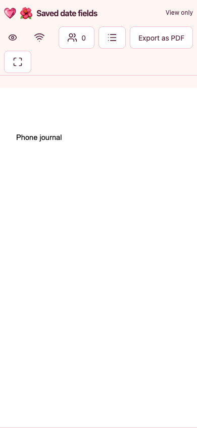
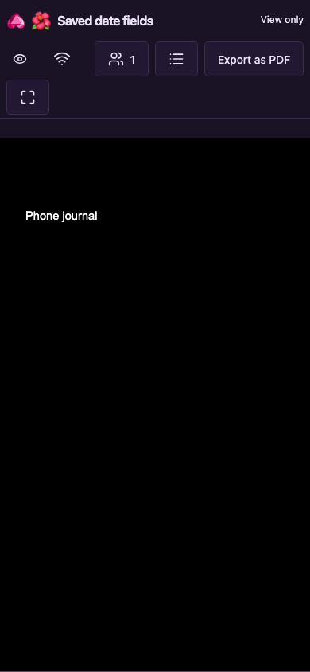
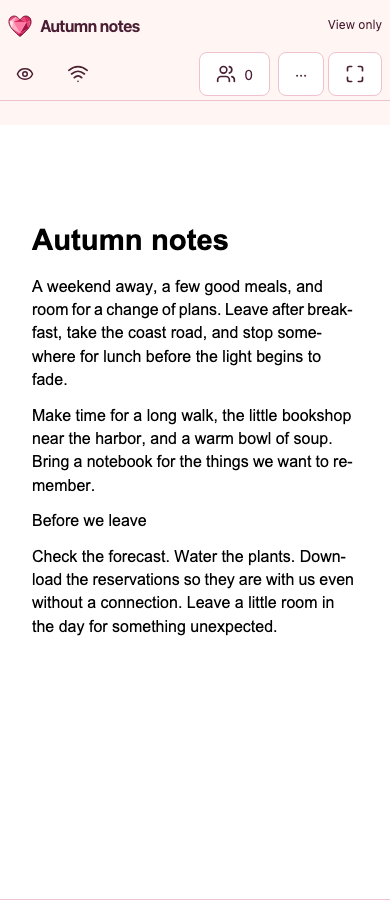
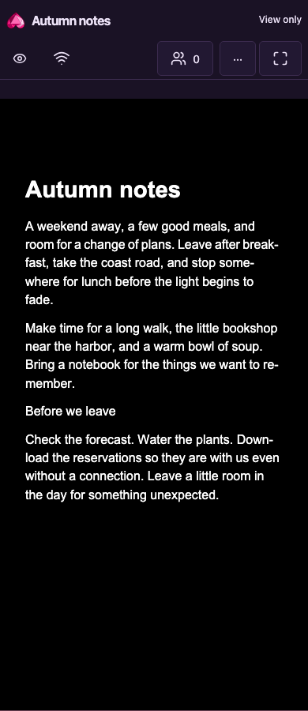
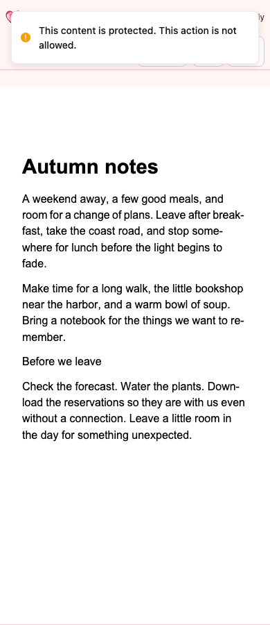
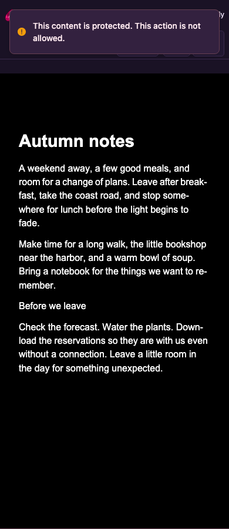

# 🔕 Actual phone reading and denied-edit states — SPN-106

Runner and focused Storybook source `5afac055559e43cc06c0e399a0f61babd2864962`,
main `c1d0d6e8ded33c10cf555ed2ed05ffd9ebc3a423`. These six original PNGs are
unedited synthetic fixtures, inspected by the implementer; independent visual
approval remains pending. The [receipt](../../implementation/evidence/SPN-106-guest-storybook-20261114/receipt.json)
records exact hashes, raw results and build/source equivalence.

## 📱 Production phone guest — light and dark

Chromium touch/mobile emulation at390×844, production test build from
`141fa3aca4b4fb3a127e4983a21e975fe9e333ec`, with every retained input/output
verified unchanged. These images show the stale-field branch after initial
load/reload integrity assertions. Both plain and stale-field branches checked
anonymous dashboard GET denial (401). The plain branch also executed concurrent
owner editing and live guest-link revocation. HTTP PUT denial belongs to the
account cases, not this guest case.
The canvas displays body text; saved date fields are proven by exact snapshot
assertions. No physical-device claim.

## 📖 Mounted native viewer — light and dark

Focused Storybook build imports the real configuration and preview, selecting
DocMobile only. Existing native fixture, completed-layout/reflow play assertions,
production chrome and theme are preserved. Capture viewport390×900.

## 🔒 Mounted genuine denied edit — light and dark

The story calls the public native Doc API; insertion returns false, content,
style and settings remain unchanged, and one genuine permission event produces
the visible warning. All document text remains visible. The real warning was
neither frozen nor recreated, hidden or dismissed.

The implementer initially misread the batch image display as blank body. The
manager and implementer reopened the same original files separately and saw the
complete paragraphs; hashes match. That interpretation and speculative
selection/viewport explanation are withdrawn. No repair or runtime repeat was
made. The four-state runner passed; focused evidence does not replace the full
Storybook catalogue, other selected owners or independent visual approval.
