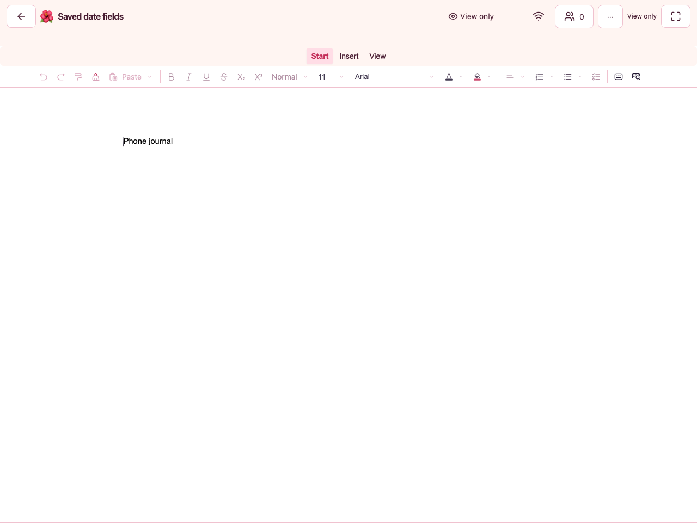
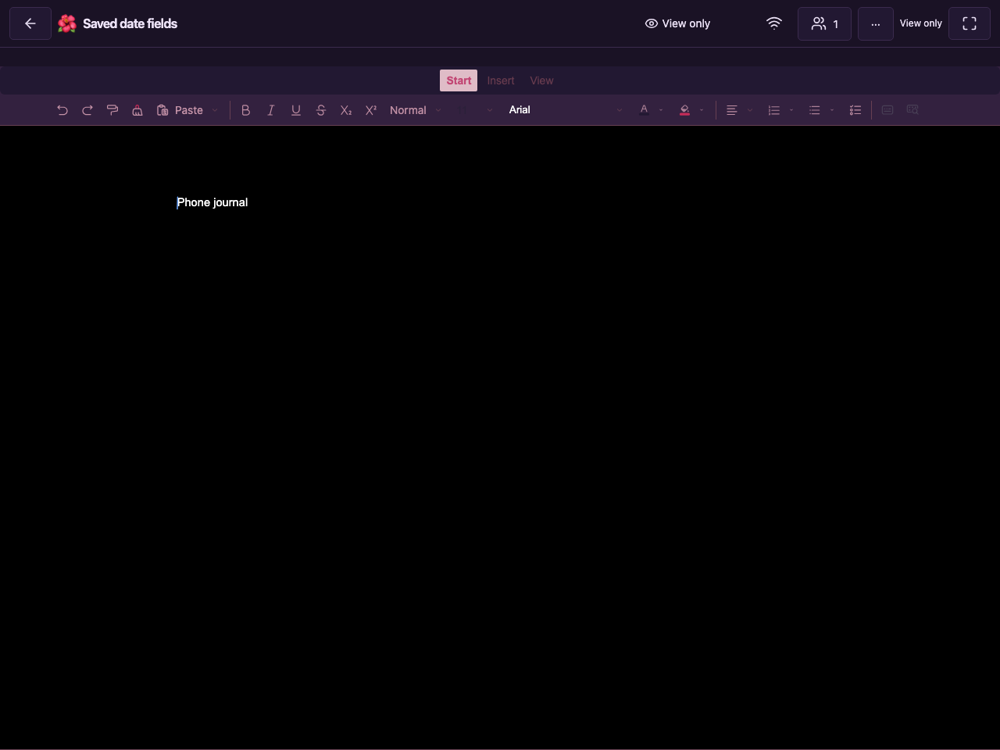

# 🔕 Actual desktop viewer — SPN-106

Source `141fa3aca4b4fb3a127e4983a21e975fe9e333ec`, actual main
`c1d0d6e8ded33c10cf555ed2ed05ffd9ebc3a423`. These are unedited images from the
first passing production desktop-account viewer case, using Chromium at
1280×960, synthetic saved data and the real application. The production test
build enables the read-only selection observer; it has no writable test API.

The fixture contains stale header/footer date fields whose exact saved values
were checked. This modern canvas view displays the body. Captures follow both
initial load and reload assertions; pre-navigation warning history catches a
notice even if it disappeared earlier. No notice was dismissed or hidden.

## ☀️ Light — account viewer

## 🌙 Dark — account viewer

The [receipt](../../implementation/evidence/SPN-106-production-20261114/receipt.json)
contains original PNG hashes, exact source/build identities and full compressed
raw test/build evidence. These images are **not independent visual approval**.
Phone, guest and mounted native denied-edit state evidence remain pending.
