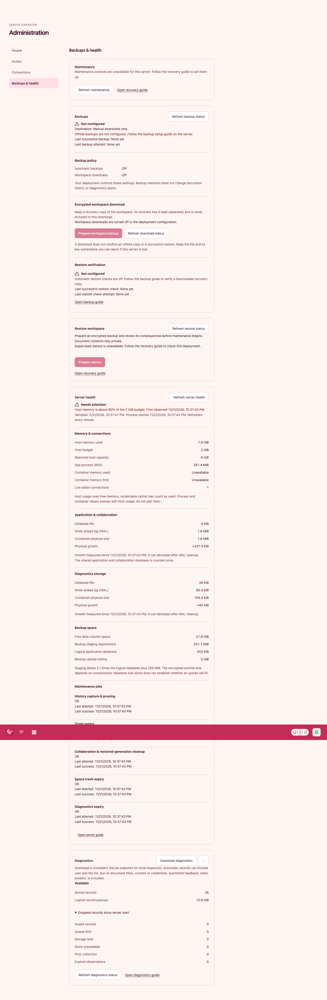
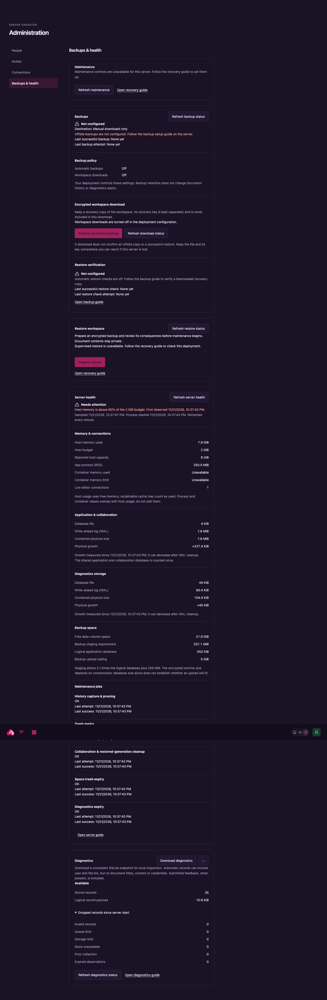
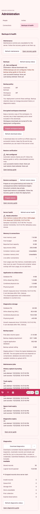
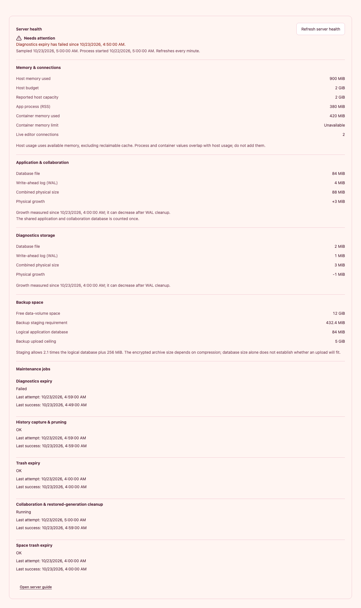
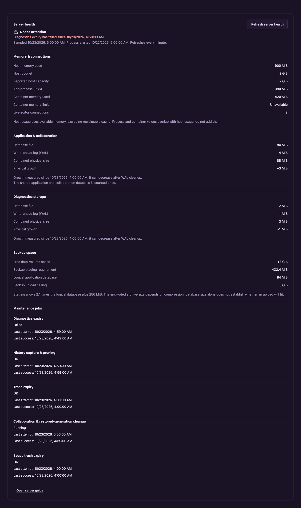
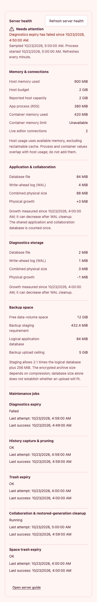
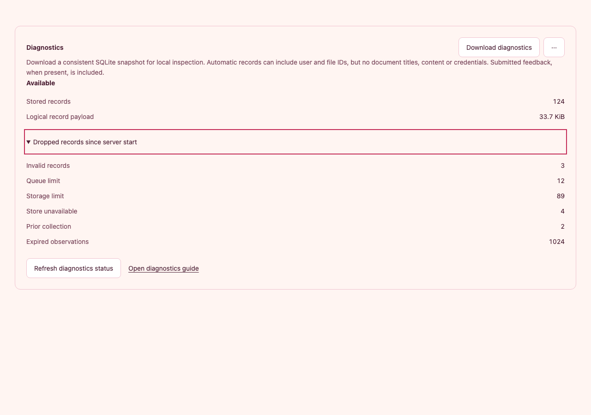
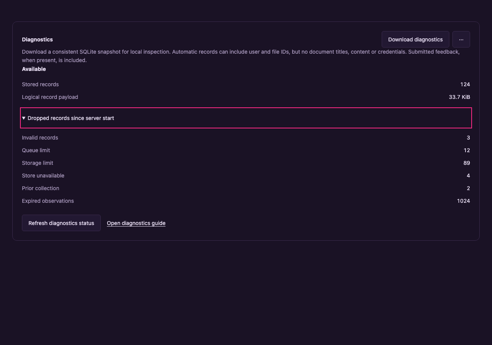
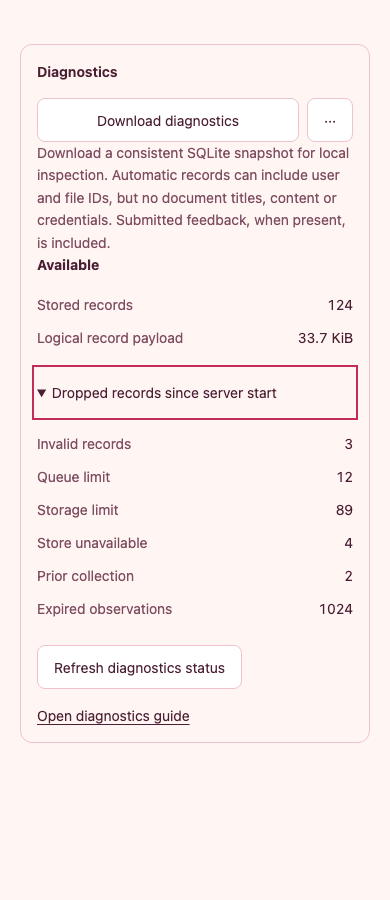

Diagnostic observations now expire by trusted server receipt time, defaulting to seven days. Deployment may select 1–7 whole days; invalid configuration fails startup. The existing gated health timer scans at most 1,024 candidates plus one lookahead through the existing receipt index. Feedback counts against the scan budget and survives. Deletion and exact byte subtraction commit together; capacity/deletion failures remain visible and retryable.

Submitted feedback, flags, idempotent acknowledgments and already prepared immutable paired-export bytes/membership are preserved. New exports disclose the age target, process-lifetime losses and unknown historical completeness; old feedback cannot authorize unrelated current context. Explicit truncate still invalidates the generation and both downloads. Workspace history, trash, backups and the recovery journal are unaffected. No new scheduler, dependency, schema or index is required.

## 🔎 Source and scope

- Complete candidate: `5ba5e8998f4e78032c0a6bc26353b7a4532a5034`; base: `9072a66a719cbf9bc8d4d4e814562950165026dc` (completed SPN-106 and landed SPN-098 contract preserved).
- Recovered original `09093eb64c08cd262acc8390c64581a7f82c5fc2` and combined `f8c4b7461f7df5b9bc35459c0e6b5538c8161115`. Their historical tests/native captures are **not current acceptance**. Preserved archive tags remain.
- Full outcome remains effort M. One ticket only; no split, dependency update or grooming. Generated landing index preserves next ID 171 and all 13 existing completions, appending SPN-110.
- [Decisions, all four personas and failure dispositions](https://github.com/mxbaylee/spinel/blob/5ba5e8998f4e78032c0a6bc26353b7a4532a5034/docs/implementation/SPN-110.md).

## 🧪 Current local acceptance

- Independent A: **119/119 tests, 11 files**, source `58cbb3e327f81c0767dce0d3bf017ab76308a039`, 8,144 ms/1,166,416KiB peak.
- Independent B: **174/174 tests, 19 files**, same source, 11,648 ms/1,075,904KiB peak. Includes the complete 23-test application suite, actual startup/minute/retry/close timer, content-free attempt outcomes, receipt cutoffs/forgery/queues/clocks/restart, 1024-row scan bounds, real SQLite rollback/full-store recovery, accounting/continued ingest, feedback/routes/authorization and real immutable paired exporters.
- Real production diagnostics collection/download/clear journey: **1/1 first attempt**, source `664e84a44b1f5ca223aa71ea11cc633eb030d7fb`, 11,874 ms/1,881,424KiB. Current light/dark/390px images below. Runtime/component source is unchanged in the final candidate.
- Focused actual production Storybook components: **15 states passed**; corrected failure fixture at `0bc71b97bef16d54b56b2a1ce8d3edcb206f76f6` recaptured **5/5** affected states. Full lint and full repository typecheck passed; 27 routing/selection/fail-closed controls passed. Final backlog PR check passed at the complete candidate.
- [Exact commands, test identities, original failures and watchdog measurements](https://github.com/mxbaylee/spinel/blob/5ba5e8998f4e78032c0a6bc26353b7a4532a5034/docs/implementation/evidence/SPN-110-current.json). Serial normal-pressure/2GiB watchdog throughout; no retry or budget relaxation. Repair dispositions cover duplicate recovered imports, missing maintenance receipt time, supervisor loss-registry compatibility, fixture UUID typing and deterministic timer selection. Typecheck/full Storybook pressure aborts are retained as aborts; lower compiler memory and focused story selection supplied safe local evidence. Hosted broad Storybook subsequently passed on the final head (below).
- Existing diagnostics/health/library/browser owners and source/shared dependency routing remain intact. Selected missing/failed workers cannot pass. No expensive duplicate browser cutoff matrix was added.

## 📡 Diagnostic upkeep

Adds the fixed `diagnostics-expiry` job result only after each bounded attempt completes/fails. `HealthJobs` preserves first failure through retries and isolates observers. The supervisor's fixed loss registry now accepts bounded expiry counts while reading old records lacking that field. [Emitter inventory and regression owners](https://github.com/mxbaylee/spinel/blob/5ba5e8998f4e78032c0a6bc26353b7a4532a5034/docs/diagnostics.md#emitter-maintenance-inventory) are updated. Queue, logical, physical and free-space bounds remain; observations carry no exception text or document content.

## 🖼️ Designs and actual screenshots

Uses existing approved Admin maintenance rows and numeric disclosure; no new design pattern. **Agent review only.** [Source/theme/viewport captions and original PNG hashes](https://github.com/mxbaylee/spinel/blob/5ba5e8998f4e78032c0a6bc26353b7a4532a5034/docs/review-assets/spn-110/captures.json). Application images are real production-route captures at 1440×1000/light+dark and 390×1000/light; failure/count states use actual production components with controlled Storybook API fixtures at 1280×900 and 390×900. Phone is Chromium emulation, not a physical-device claim. The app's real host-memory warning is unrelated to expiry success.

## 🧑‍🔬 Independent review

`/root/review_a` and `/root/review_b` independently approve **100/100 each on `5ba5e8998f4e78032c0a6bc26353b7a4532a5034`**, before validation publication. Each rubric is 35/35 scope, 25/25 correctness/access, 20/20 regression evidence, 10/10 operational usability, 10/10 maintainability/complexity. Neither deducts CI results. Both independently ran the local suites above and revalidated the unchanged tested source in this complete commit. All findings are repaired: deterministic timer selection/order, reused seed fixture, stale integration comment, unrelated documentation rewrap, and truthful story timestamps. No unresolved blocker or remaining step to 100. Reviewer A inspected all 9 committed images and granted exact-head visual approval, **agent review only**.

## 🚦 Hosted acceptance and landing

All seven required gates passed on the exact reviewed head `5ba5e8998f4e78032c0a6bc26353b7a4532a5034`, attempt 1. Base `9072a66a719cbf9bc8d4d4e814562950165026dc`; tested merge `c660d3c380433e5455346119620e6a2f431658d6`; source and merge trees both `7f1a3ab96d1d2e5466fee6019b373ee0c292bc55`.

- [CI run 44995244454](https://github.com/mxbaylee/spinel/actions/runs/44995244454): Pull request `137124759645`, Backlog `137124969783`, Lint `137124969753`, Typecheck `137124969791`, Unit tests `137126955637`, Lib tests `137126768250`, Playwright smoke `137134169792` all successful. Full immutable coverage plan SHA-256 `caaf244de55575054d9edd898508b0921c2d0828c9efedfaa9ba02c639f4e5e5`; all three aggregate result records passed with matching head, merge and plan identities.
- All selected application/library partitions, development/production browser shards, mobile HTTPS, sync and soaks, offline upgrade, supervised restore, container, sized restore, retained sync transition, desktop/mobile responsiveness comparisons and callback lifetime checks passed. The production diagnostics shard ran all five diagnostic journeys on their first attempt: 6,210 / 3,437 / 41,693 / 9,408 / 8,706 ms. Whole shard: 93 passed, 3 explicitly inapplicable cases skipped, 0 unexpected, 0 flaky. The only skipped CI job is the unrequested default-off Doc editing mobile suite; this is distinct from the selected mobile checks that passed.
- [Storybook run 44995244492](https://github.com/mxbaylee/spinel/actions/runs/44995244492): all five desktop/tablet/mobile theme partitions plus state/interaction aggregate passed. Only conditional publication jobs skipped.
- [Native desktop run 44995244608](https://github.com/mxbaylee/spinel/actions/runs/44995244608): Chrome `158.0.8127.37`, macOS 26 arm64, job `137124760399`; Firefox `160.0.1`, macOS 26 arm64, job `137124760489`; Safari `27.2`, macOS 15 Intel, job `137124760215`. All report `passed` and `complete`, source/head identities match, and browser/driver shutdown checks passed. These are actual ordinary-profile restart, retained content/images, offline editing, reconnect/conflict and storage-deletion checks, not emulation or historical evidence.
- [Spaces run 44995244471](https://github.com/mxbaylee/spinel/actions/runs/44995244471), job `137124759323`: actual provider passed in 9,022 ms; encrypted publish/readback, anonymous denial, catalog, restore and cleanup completed. Archive sizes 664 bytes and 12,333 bytes (supervised). No capability-unavailable skip.
- [Durable acceptance archive at `cc428945248b035979b022f918c5bae26bb2ccd1`](https://github.com/mxbaylee/spinel/tree/cc428945248b035979b022f918c5bae26bb2ccd1/docs/review-assets/spn-110-acceptance): original native/provider ZIPs, plan and aggregate ZIPs, job identities, production report, compact browser measurements, relevant compressed logs, review record and SHA-256 manifest. Full browser traces remain supplementary artifacts, not claimed as permanently retained. This evidence-only archival commit does not change the reviewed implementation head.

No hosted failures or retries occurred in these acceptance runs. Historical acceptance and the old timer memory abort do not satisfy or substitute for this acceptance. Local first failures and repaired findings remain preserved in the linked current evidence.

## 🧹 Landing and cleanup audit

Squash landing is guarded against movement of the reviewed head. Any validation triggered by this final metadata edit must finish before merge. The [durable completion audit](https://github.com/mxbaylee/spinel/tree/archive/spn-110-completion-5ba5e899/docs/review-assets/spn-110-completion) records the final metadata validation identities, squash commit, rechecked branch heads and active PR ownership, and actual cleanup results.

Cleanup covers every obsolete SPN-110 implementation/integration/completion branch and the two missing historical worktree registrations. Preserved archival tags: `archive/spn-110-feedback-integration-f8c4b746`, `archive/spn-110-desktop-09093eb6`, `archive/spn-110-acceptance-5ba5e899`, and the completion audit. Unrelated work remains untouched. Grooming is outside this request.
