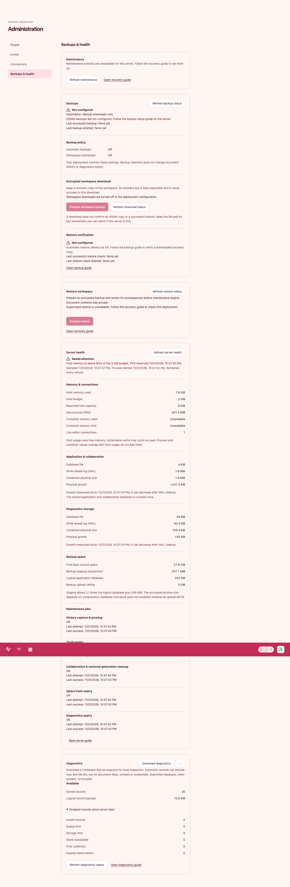
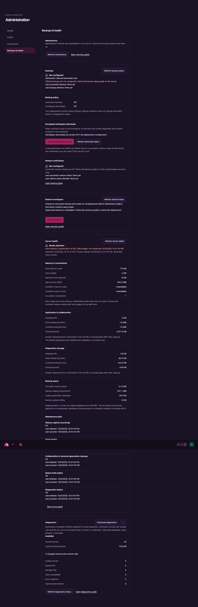
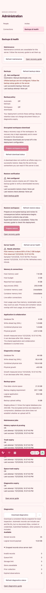
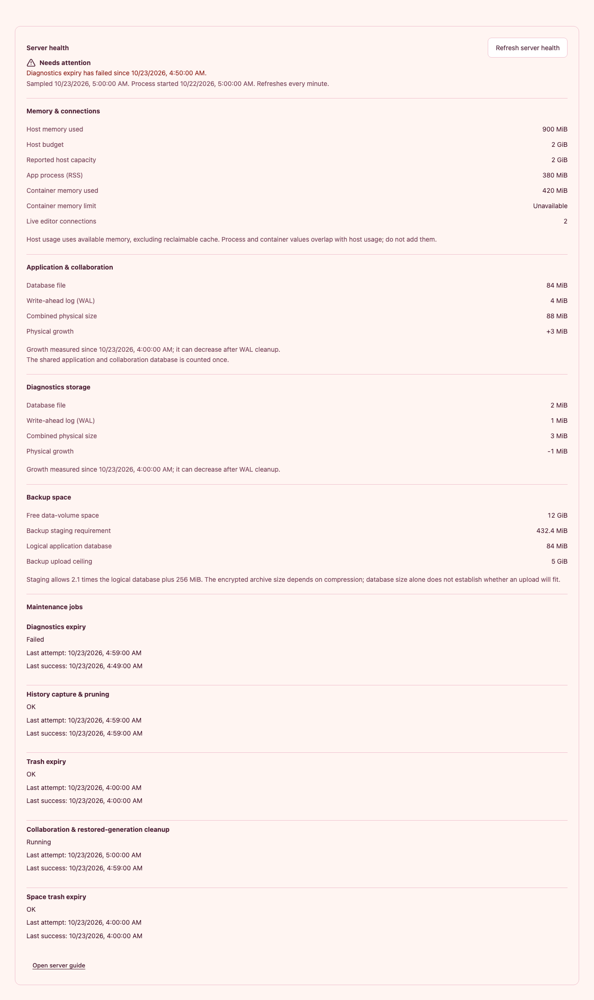
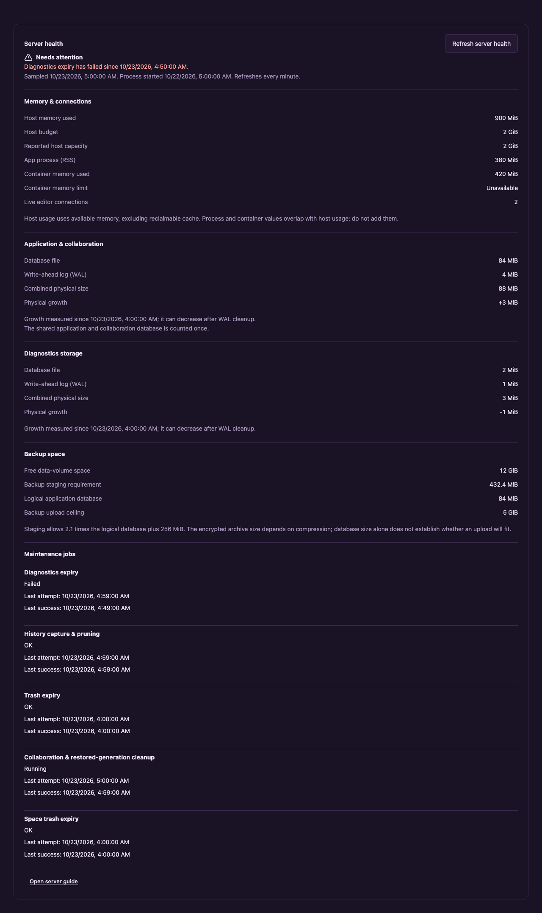
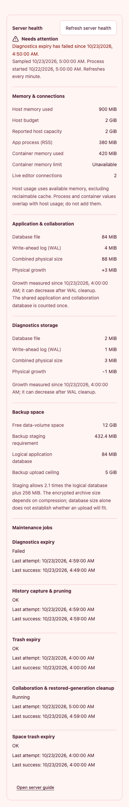
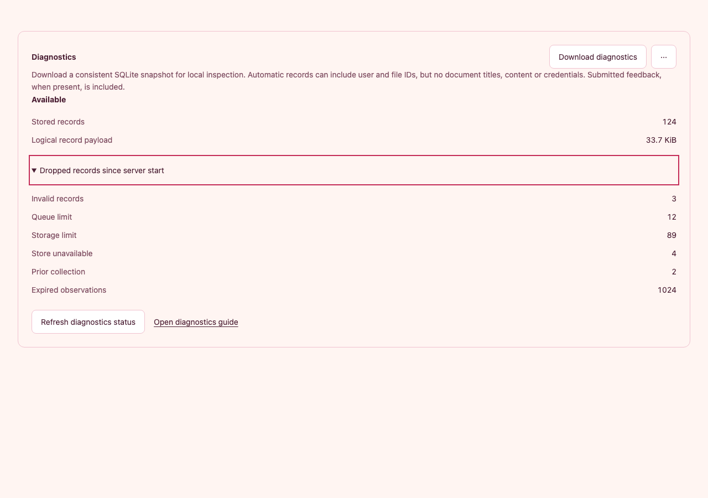
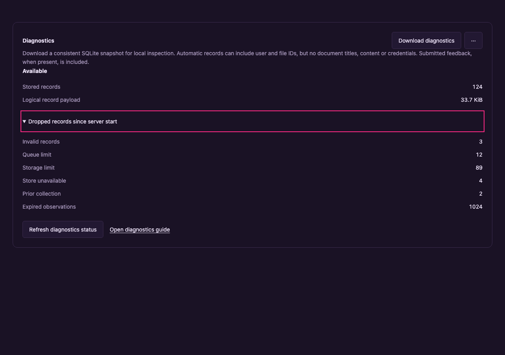
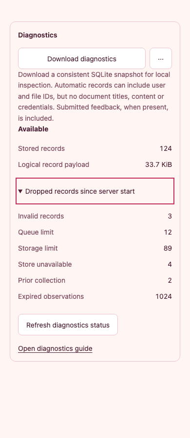

# ⏳ SPN-110 visual evidence

Captured from production source `664e84a44b1f5ca223aa71ea11cc633eb030d7fb`.
Subsequent `58cbb3e3` repairs affect test determinism/documentation only.
Failure-story captures were refreshed at `0bc71b97bef16d54b56b2a1ce8d3edcb206f76f6`
after correcting the fixture success timestamp to precede its failure. Runtime
components are unchanged. [Captions and hashes](captures.json) identify
original, unedited full-page PNGs. Phone means Chromium emulation, not a physical
phone. Independent visual review is **agent review only**, recorded in PR #247.

## 🖥️ Real application

The existing production diagnostics journey exercised authenticated collection,
real correlated download, generation-fenced clear and navigation. The app's
measured host-memory warning is a real measurement; it is not an expiry failure.
The new Diagnostics expiry row shows OK, and the disclosed process-lifetime
Expired observations counter is present. Captures are 1440×1000 light/dark and
390×1000 light. No new pattern was proposed: existing maintenance rows and
numeric disclosure follow [the Admin playbook](../../design/admin.md).

## 🧩 Production failure and nonzero-count states

The existing Storybook runner completed 15 states across light/dark desktop,
light/dark390px and768px. These representative light/dark/390px images show
the actual ServerHealth and AdminDiagnostics components with controlled API
responses. They are fixture states, not a deliberately failed live deployment.
The focused build imports the unchanged real main and preview configuration;
only story selection changes. No CSS, state, text or screenshots were fabricated.

