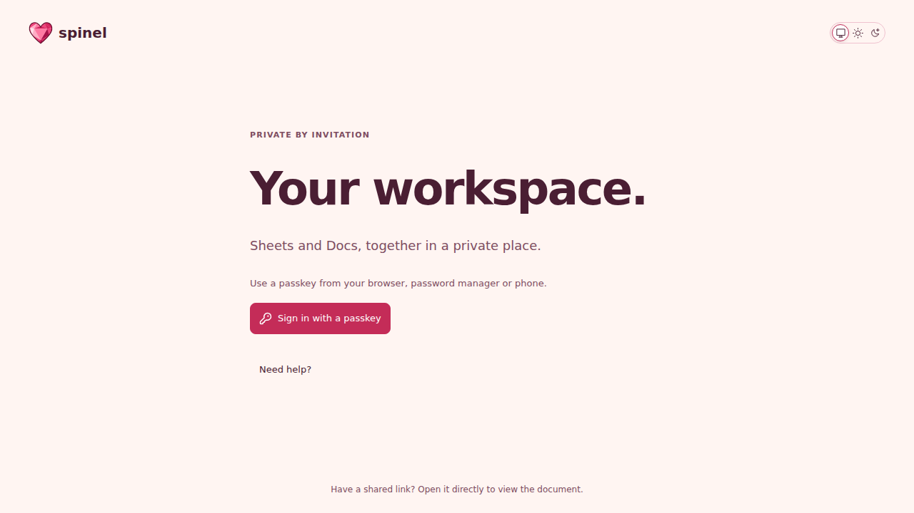
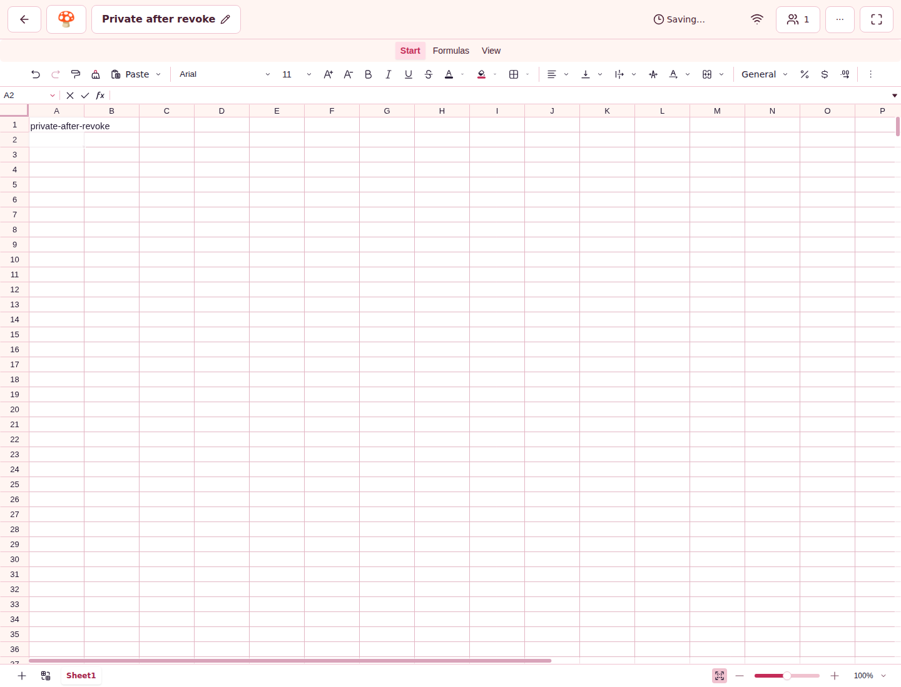

# SPN-158 hosted validation — first attempt retained

## 🧾 Exact candidate and boundary

Source `bfeb0b23953a67aae8afcba8af6eadd8b24f1040`, actual base
`89e4426dfff1c3469b260305e21180ffd79fdb7f`, tested merge
`1211f269850c22b213e707cdd6aeeb8e7e3f9b3d`, [PR #285](https://github.com/mxbaylee/spinel/pull/285).
The merge object's parents identify that exact base and source. All four workflows
are attempt 1. This evidence-only archive is a child of the candidate; it does not
change implementation or claim a squash merge or branch cleanup.

**Terminal checkpoint: 2026-11-14T04:15:29.441709+00:00. Validation failed; PR #285 is not merge-ready.**

CI **43553620429** completed failure: **33/33 jobs terminal**, with only production
1/2 and its fail-closed Playwright aggregate failed. The seven standard gates are:
Pull request, Backlog, Lint, Typecheck, Unit tests and Lib tests **success**;
Playwright smoke **failure** (job **132327633121**). Every other selected CI worker
completed success, including all three Unit workers, four Lib workers, ten other
Playwright workers, container, retained transition, sized restore, both paired
callback workers and both paired responsiveness workers. The browser aggregate
retains `Incomplete coverage playwright-run: selected=true, result=failure`.

Desktop offline **43553620350** completed success (3/3 actual native Mac lanes);
Storybook **43553620410** completed success (five review workers and aggregate,
two expected draft publication/deployment skips); Spaces **43553620364** completed
success. All **47 jobs** across these four runs are terminal. All actual execution
and every required gate remains attributable to the exact candidate; no failed gate
is converted to a pass by successful component acceptance.

## 🧪 Actual Linux postcommit acceptance

CI run **43553620429**, recovery job **132321620682**, checked out the tested merge.
All **47 files / 609 tests passed**, total **234.52 s**. The exact case
`real SIGKILL at postcommit preserves the durable restore decision and all retained evidence`
passed in **11,218 ms**, and the full HTTP file passed **11/11** in **1,831 ms**.
The passing case includes authentication, acknowledged marker write, postcommit cut,
SIGKILL, reconciliation, exact durable content, retained evidence and cleanup.
The original raw recovery log is retained with its hash in the manifest.

This is current Linux crash acceptance, distinct from the two deterministic local
HTTP controls and their detecting session-only mutation. It does not establish the
missing phase/body or cause of the original SPN-090 authentication-options 503.
[That first failure remains immutable](https://github.com/mxbaylee/spinel/tree/fdc2d7351527607ed67d3d540df7ae22e19a9db6/docs/review-assets/spn-090-recovery-failure-43548838838).
The original two SPN-157 failures remain a separate complete L investigation.

## 🚫 New first failure: login revocation observation

Production 1/2 job **132321620858** failed in the original workflow attempt.
At `e2e/collaboration.spec.ts:446`, after revoking one session, the fixture waited
5,000 ms for its Playwright websocket close counter to increase: expected >0,
received 0. The first attempt failed in **7,559 ms**. Its configured retry 1 passed
in **5,996 ms**; the shard reports **80 passed, 3 skipped, 1 flaky**, and correctly
exits 1 with `failOnFlakyTests`. That automatic test retry is not a separate workflow
attempt or an agent-triggered rerun. The failing check remains a merge blocker. The delivery manager assigned the existing
[SPN-149 / PR #282](https://github.com/mxbaylee/spinel/pull/282) observer-repair outcome
to investigate and integrate this evidence; no new ticket or SPN-158 scope expansion
is implied. That assignment is not a repair or acceptance claim.

The first-attempt snapshot already shows the revoked page at sign-in, while the
other login's sheet still displays the deliberately held edit as Saving. This
bounds the observation but does not diagnose its cause or prove the later queued
edit and broadcast assertions, which the failed first attempt did not reach.
The first attempt has two screenshots and an error context; the trace belongs only
to the successful retry, and cannot supply first-attempt causal evidence.

The original artifact **14097746136**, `theme-screenshots-production-1`, ZIP SHA256
`d30a17c29b5eb10716abed4873159e7df71c2949cfd378ce7f54efeed5e22410`, was verified before
extraction. The complete Playwright JSON, exact first-failure attachments and
source/helper/config bytes are retained under `failures/production-1/`.
The raw error context is gzip compressed byte-for-byte, including its generated
source-excerpt whitespace.
The original ZIP and success-only trace remain local; browser protocol payloads
are not published. No unchanged workflow rerun, timeout increase, gate change,
fixture skip or speculative product fix was used.

## 🔎 Coverage, provider scope and reviews

The immutable plan selects full coverage. Canonical plan SHA256 is
`40a049f429a87dd8c090c9c599189e1aee832f0497649a10e28349f1d5464783`;
the retained newline-terminated plan file SHA256 is
`00f0a230dde84273672a2ca2deab4860600114e0b9cd44f7e74d5c0d9d8bec3c`.
These differ intentionally. Aggregate results verify the canonical digest and
tested identity. Worker jobs and every step are retained independently of the
seven standard gates, so selected missing or failed work is not called a pass.
Paired Doc callback and responsiveness workers include their selected immutable
baseline and candidate phases; their result is distinct from crash acceptance.

DigitalOcean Spaces run **43553620364**, job **132321405338**, performed actual
provider acceptance on exact source bfeb: 12 checks passed, including a real app
child supervised restore, duration **10,084 ms**, cleanup complete. Its ZIP artifact
**14097685682** has SHA256
`2c6af7547252a8e024684df5d35e9465b49feb31f07bd5d5efd83fa40fd4f70b`.
This synthetic provider fixture is not actual production-host launch qualification.
Sized restore uses the tested merge and a 256 MiB-class synthetic archive under
1 GiB / 0.75 CPU; its passed integrity/authority/cleanup evidence is retained.
Neither is a physical phone observation.

The plan's legacy phone selection is not a newly required paid-device run.
BrowserStack's separate workflow is label/dispatch-only and was not triggered;
the owner's provider retirement and replacement verification decision are already
in main's SPN-090 Rules. No BrowserStack or new phone pass is claimed here.
Storybook PR preview is intentionally skipped for the draft PR; required selected
review workers and aggregate are accounted for separately.

Both independent nonimplementing reviewers graded exact bfeb against base89
**100/100**, each rubric 35/25/20/10/10. Their actual reports, independent focused
HTTP checks, and available process-cleanup audit are retained under `reviews/`.
They did not deduct for pending CI, and their grades do not override this new failed
gate. Their original pending-Linux statements are historical pre-push checkpoints;
the exact Linux result above supplies subsequent acceptance. No UI implementation
or visual approval is claimed; the two images above are failure diagnostics.

## 🔐 Retention and privacy

The manifest inventories payload hashes, decompressed hashes, artifact digests,
run/job/source identities, and the complete terminal checkpoint.
Raw job logs are GitHub-masked output; retained logs/reports were checked for common
credential/private-key patterns, and both failure screenshots were inspected as
synthetic fixture content. No database, cookie jar, browser profile or protocol
trace is included. Expiring GitHub artifacts supplement this durable record.
